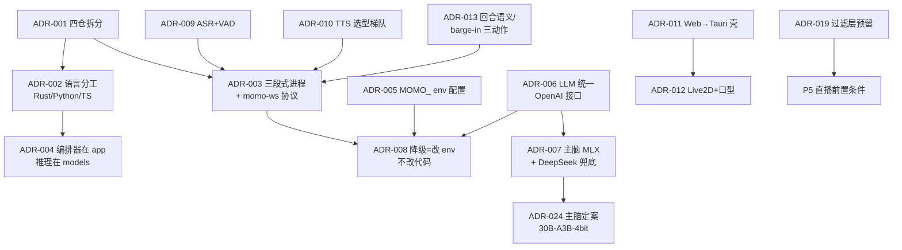

# 决策汇总（ADR）

> 所有已确认设计决策的单点定论。每条：标题 + 决策 + 理由 + 被否选项。其他文档引用结论，不重述理由。
> 状态均为「已锁定」，除非特别注明。推翻任何一条都需要先改本文档。

## 仓库与工程

### ADR-001 拆四个独立仓库（docs / app / models / infra）

- **决策**：`momo-docs`、`momo-app`、`momo-models`、`momo-infra` 四个独立 public 仓库挂在 `Momoyeyu` 账户；上一级 `momo/` 仅本地统合目录。
- **理由**：边界清晰、各仓 CI/发布节奏独立、文档与代码可分开演进。
- **被否**：monorepo（Rust/Python/TS 跨语言构建耦合，且文档仓无法单独公开节奏）；双仓（infra 与 app 生命周期和发布物不同——infra 是 CLI 工具集，app 是应用主体）。

### ADR-002 语言分工：Rust=运行时与工具，Python=模型，TS=薄前端

- **决策**：Python 只做模型相关业务；Rust 做应用运行时与 infra 小工具；TS 仅限薄前端。Rust 生态不足处允许单独引入 C++ 组件，**须文档注明理由**。
- **理由**：模型生态（torch/onnx/MLX/训练脚本）全在 Python；回合状态机要稳定并发、低延迟、可分发单二进制；前端只需渲染与音频 IO。
- **被否**：全 Python（GIL 下并发管线与分发都吃力）；全 Rust（模型绑定生态不足，推理侧会反复造轮）。

### ADR-005 一切环境差异走 `MOMO_` 环境变量

- **决策**：环境差异与密钥全部走 `MOMO_` 前缀环境变量；仓库只提交 `.env.example`（占位无值），本地 `.env` 不入库；兼容后续配置发布平台。规范见 [../01-architecture/config.md](../01-architecture/config.md)。
- **理由**：密钥不进 git；env 是部署平台最通用的注入面；降级切换=改 env。
- **被否**：配置文件入库（密钥泄露风险、多机差异难管）；CLI-only（对配置发布平台不友好，且长参数难维护）。

### ADR-020 文档先于代码 + 单一 GitHub Project

- **决策**：4 仓 + 1 个 GitHub Project（Projects V2）排需求；协议/状态机/配置先写文档再实现。
- **理由**：单人项目最大的风险是决策漂移，文档是唯一的对齐物。
- **被否**：先代码后补文档（单人也会忘）；每仓各自 issue 分散排期（全局优先级不可见）。

### ADR-023 infra CLI 唯一命名 `momoctl`

- **决策**：momo-infra 的命令行工具唯一名字是 `momoctl`；子命令集：`doctor` / `pull [--check]` / `serve up|down|status|logs|restart` / `switch --to` / `bench` / `gc`。
- **理由**：与产品名 `momo` 及进程名 `momod` 区分开，避免把产品名直接当命令用的歧义；`kubectl`/`systemctl` 同类惯例。
- **被否**：以 `momo` 作 CLI 名（与应用主体/产品同名易混）；`momoctl models verify|gc` 独立子命令树（作废，verify=`pull --check`、gc=`gc`）。

### ADR-025 infra 扩展为「CLI + Web 控制台」，训练 job 由 infra 编排、models 执行

- **决策**：`momoctl web` 子命令起 axum 控制台（REST + SSE + 内嵌静态 SPA），覆盖组件起停/模型管理/训练 pipeline/env 配置四块运维面；训练 job 状态机（queued→preparing→running→succeeded/failed/canceled→promoted）由 infra `jobs/` 编排，执行器分本地子进程与 SSH 远程（4090D/mac-studio），训练实体脚本仍在 momo-models `training/`。CLI 与 Web 共用同一核心与 `--json` schema（详见 [`../02-repos/momo-infra.md`](../02-repos/momo-infra.md) Web 专节）。
- **理由**：用户明确需求（2026-10-11）——web 页面操作 infra、管理推理与训练、模型选择与微调 pipeline、常见配置；单 binary 内嵌 SPA 保住单文件分发与 bootstrap 独立性；训练实体与编排分离守住「infra 无推理」硬约束。
- **被否**：独立 momo-web 仓/进程（多一套分发与版本对齐，收益不足）；Gradio 式 Python UI（引入 Python 依赖，违背 infra bootstrap 独立约束）；训练编排放 momo-models（模型仓不该管进程/ssh/状态目录等机器运维）。

## 架构与协议

### ADR-003 三段式进程分离 + 进程间 WebSocket

- **决策**：交互端（渲染+音频 IO）/ 编排器（回合、打断、路由、状态机）/ 模型服务（LLM/ASR/TTS）三者进程分离；进程间走 `momo-ws v1`（JSON 文本控制帧 + 音频二进制帧，单连接复用）。规范见 [../01-architecture/protocol.md](../01-architecture/protocol.md)。
- **理由**：三段可部署到不同机器（正常档/降级档拓扑不同）；WS 同时承载双向控制与流式音频，打断语义天然契合。
- **被否**：gRPC/REST（服务端流式 + 双向打断语义不顺手，且浏览器端音频二进制支持繁琐）；进程内单体式（无法跨机部署，mac-studio 收回时无降级路径）。

### ADR-004 编排器放 momo-app（Rust），模型推理放 momo-models（Python）

- **决策**：编排器（tokio+axum）与前端同属 `momo-app`；ASR/TTS/LLM 接入与训练在 `momo-models`；边界细则见 [../01-architecture/boundaries.md](../01-architecture/boundaries.md)。
- **理由**：推理代码迭代快、依赖重（torch/onnx 数 GB），独立成 Python 服务按需起停；编排器轻依赖、要随前端/桌面壳一起分发。
- **被否**：推理内嵌 Rust（ort/candle 对目标模型生态覆盖不足）；编排放 Python（回到 ADR-002 被否理由）。

### ADR-006 LLM 统一 OpenAI-compatible chat 接口抽象

- **决策**：大脑无论后端是 MLX（`mlx_lm.server`）、借用的 vLLM 还是 DeepSeek API，编排器一律走 OpenAI-compatible `/chat/completions` 流式接口；换脑=改 endpoint env。
- **理由**：三家后端原生同接口，热切换零代码；不重复造 LLM 私有协议。
- **被否**：把 LLM 也纳入 momo-ws 自定义消息（要为每个后端写适配层，违背"调用现有库"原则）。

### ADR-008 降级 = 改 env，不改代码

- **决策**：正常档（交互端 Mac Air/laptop + 编排器 laptop + 大脑 mac-studio MLX）与降级档（laptop 单机全栈 + 小模型/DeepSeek）用**同一套协议与代码**，只切 endpoint 配置。
- **理由**：mac-studio 是借来的随时可能收回；bigstrong vLLM 实测 502 不通（2026-10-10）证明依赖外部必须有降级路径。
- **被否**：单独维护降级分支/构建（代码分叉即腐烂）；人工改代码切模型。

### ADR-013 回合状态机与 barge-in 三动作语义

- **决策**：回合状态机 Idle→Listening→Thinking→Speaking→Idle，Speaking/Thinking 可被 Interrupted；idle 超时触发自发行为。barge-in 固定三动作：**停播、取消上游生成、已播出文本记账入历史**。细则见 [../01-architecture/runtime.md](../01-architecture/runtime.md)。
- **理由**：「能插话」是拟人对话的体验核心；已播出文本记账保证 LLM 历史与实际说出的话一致。
- **被否**：打断即整回合丢弃（用户听到的和模型记得的不一致）；排队制不打断（破坏"像人"第一指标）。

### ADR-019 输入输出双向过滤接口预留，P5 前必须实装

- **决策**：过滤层以接口形式在编排器管线中预留（输入侧+输出侧钩子），本地单人阶段可空实现；**P5 直播前必须实装**。
- **理由**：Neuro 2023 被封的教训——过滤是直播前置条件，不是可选项；预留接口避免 P5 时改管线结构。
- **被否**：直播时再补（届时管线已固化，改造成本高）。

### ADR-021 无 LLM 网关，编排器直连大脑 OpenAI 端点

- **决策**：不设独立 LLM 网关服务；编排器直连大脑 OpenAI-compatible endpoint（SSE），上游可为 mlx_lm.server / 借用 vLLM / DeepSeek / llama.cpp——只是 `MOMO_LLM_ENDPOINT` 指向不同（`MOMO_BRAIN_BACKEND`/`MOMO_BRAIN_PORT` 负责启停侧）。
- **理由**：上游本身已是 OpenAI-compatible，网关只做纯转发、无增量价值，反而多一个进程与故障点；换脑本来就是改 env。
- **被否**：自建 LLM 网关进程（纯转发层）；把 LLM 纳入 momo-ws 自定义消息（同 ADR-006 被否理由）。

### ADR-022 编排器↔模型服务复用 `momo-ws v1`，不另设 `/v1/*` 协议

- **决策**：编排器与 ASR/TTS/embed 之间一律说 `momo-ws v1`（`01-architecture/protocol.md` 是唯一协议规范），模型服务端 `hello.client=orchestrator`。模型服务可另挂 `POST /v1/tts/synthesize` 类非流式调试口供 `momoctl bench`/手测，但运行时主路径不经过它。
- **理由**：打断、取消、流式音频、VAD 事件（`input.vad`）语义已在 momo-ws 定义；再立一套 REST 主协议要维护两份语义且打断语义难表达。
- **被否**：为模型服务另定义 REST `/v1/*` 作为运行时主协议。

## 模型选型

### ADR-007 主脑 = mac-studio MLX，Qwen3-8B-4bit 起步

- **决策**：主脑用 mac-studio 上 MLX 跑 Qwen3-8B-4bit（**实测** 2026-10-10：121 tok/s、峰值内存 4.7GB，已达标）；30B-A3B-4bit 实测达标后已升为主脑（见 ADR-024），8B-4bit 保留为备档。降级=laptop 本地小模型或 `deepseek-v4-flash`。机会型副脑=bigstrong 常驻 vLLM qwen3.8-27B-FP8（理论每人 30–45 tok/s，**实测 2026-10-10 服务 502 不通**，待主人修）。
- **理由**：512GB 统一内存跑 MoE 无压力；本地优先保护隐私。
- **被否**：laptop 常驻 8B（8GB 显存要与 TTS 抢）；云 API 做主脑（依赖网络+隐私，只当兜底）。

### ADR-009 ASR = SenseVoice-Small（sherpa-onnx）+ VAD = silero-vad

- **决策**：ASR 用 SenseVoice-Small 走 sherpa-onnx 纯 CPU（**实测** 2026-10-10：laptop CPU×4 RTF 0.040，8.4s→337ms；zh/en/ja/ko/yue + 自动语言检测 + 情感/事件标记）；VAD 用 silero-vad；**不训练**。
- **理由**：CPU 就够不占显卡，语言覆盖满足中/英/日要求。
- **被否**：Whisper turbo（~6GB VRAM 或 CPU 慢档；语言广度不够时再评估）；云端 ASR（违背本地优先）。MeloTTS 的否决见 ADR-010。

### ADR-010 TTS 梯队：CosyVoice3 首选 / GPT-SoVITS 备选 / Kokoro+F5 兜底 / edge-tts 仅 P0

- **决策**：目标是声线克隆型 TTS。首选 **Fun-CosyVoice3-0.5B**（9 语言含中日英、双向流式官方标称 150ms、instruct 情感控制、有训练脚本；实际部署需求**待实测**）；备选 **GPT-SoVITS**（MIT，zh/en/ja/ko/yue，官方标 4060Ti RTF 0.028，零样本 5s/少样本 1min，生态最成熟）；已实测兜底 **Kokoro-82M**（实测 2026-10-10：首包 209ms、RTF 0.023、VRAM 0.76GB）与 **F5-TTS v1**（实测：零样本 RTF 0.535、VRAM 0.8GB）；edge-tts（实测：首包 1937ms）仅 P0 过渡。
- **理由**：克隆声线是产品目标；梯队保证每一档都有已验证退路。
- **被否**：**MeloTTS**（laptop 无 sudo，fugashi 依赖系统 MeCab 装不了——已否决）；edge-tts 长期用（1937ms 首包远超 1.5s 指标，且依赖外网）。

### ADR-011 交互端 Web 薄前端起步，长期 Tauri 2 壳

- **决策**：短期浏览器 Web（Live2D + 音频 IO），长期 Tauri 2 桌面壳；**前后端协议不变**，跨 macOS/Windows/Linux。
- **理由**：浏览器是零成本开发环境；Tauri 壳解决桌面分发与音频设备权限，协议不变意味着迁移零协议改造。
- **被否**：原生客户端分别开发（单人维护不起）；Electron（体积与内存对薄前端过度）；移动端（见 product.md 非目标）。

### ADR-012 Live2D = pixi-live2d-display + Cubism 免费 sample；口型起步 RMS

- **决策**：渲染用 pixi-live2d-display + Cubism 官方免费 sample 模型；口型 v1 用音量 RMS→`ParamMouthOpenY`；长期同一前端进 Tauri 壳。
- **理由**：免费模型先立起来，license 问题留到 P5 前确认（见 product.md 非目标）。
- **被否**：viseme 级口型（v1 复杂度不值，RMS 已够用）；3D/VRM 方向（与人设方向不符）。

### ADR-014 记忆 = sqlite-vec + BGE-M3（P3）

- **决策**：P3 引入 sqlite-vec + 多语 BGE-M3 做记忆检索；此前纯 context。
- **理由**：本地单文件、无额外服务；BGE-M3 覆盖中/英/日。
- **被否**：外部向量库服务（本地优先+单用户，杀鸡用牛刀）；永不加记忆（"像人"三支柱缺一角）。

### ADR-015 action 总线仿 neuro-game-sdk（P4）

- **决策**：游戏/工具通过 WS 向编排器注册 `{name, description, json_schema}` 的 action；LLM 只输出结构化调用；执行下沉到注册方校验。协议见 [../01-architecture/protocol.md](../01-architecture/protocol.md) `action.*`。
- **理由**：LLM 不直接执行、执行下沉到注册方——安全边界天然成立。
- **被否**：LLM 直接生成并执行代码（无安全边界）；让编排器内置游戏逻辑（每接一个游戏改核心）。

### ADR-016 视觉 = `deepseek-v4-flash-vision-exp` API，不自建 VLM（P4）

- **决策**：截图输入直接调 DeepSeek 视觉接口。
- **理由**：不自建模型、不占本地显存；白嫖级成本。
- **被否**：本地 VLM（8GB 显卡已排满 TTS+ASR，且 P4 才需要）。

### ADR-024 主脑定案 Qwen3-30B-A3B-4bit

- **决策**：主脑由 Qwen3-8B-4bit 升级为 **Qwen3-30B-A3B-4bit**，跑在 mac-studio MLX（`mlx_lm.server :7820`）。**实测 2026-10-10（M3 Ultra）：121 tok/s、峰值 17.2GB**。8B-4bit 同为 121 t/s，保留为备档/二级兜底。
- **理由**：MoE 激活 3B 使生成速度与 8B dense 持平而回答质量更高；512GB 统一内存无压力。
- **被否**：继续常驻 8B-4bit（同速但更弱，降为备档）；32B dense（同显存档下 MoE 更快）。

## 环境约束（硬事实，写文档/代码时视为前提）

### ADR-017 laptop 必须走 hf-mirror，只能 user-space 安装

- **决策**：laptop 访问 huggingface.co 不通，必须 `HF_ENDPOINT=https://hf-mirror.com`（mac-studio 直连慢，镜像同样更快）；PyPI 同理走镜像。laptop **无 sudo**，一切安装必须 user-space（uv/venv/cargo）。
- **理由**：网络实测结论（2026-10-10），不是偏好。
- **被否**：依赖系统包管理器的方案（无 sudo 不可行，MeloTTS 即因此否决）。

### ADR-018 torch 与 torchaudio 版本严格对齐

- **决策**：momo-models 中 torch/torchaudio 版本成对锁定（已踩坑）。
- **理由**：版本错位导致过实际故障。
- **被否**：交给解析器自由解析。

## 检查表

- [ ] 每条 ADR 含：决策、理由、被否选项
- [ ] 实测数据均标注「实测 + 日期」，未达标量标「预估/待实测」
- [ ] GPU 写法统一为 **RTX 3070 Laptop（8GB）**，无 Ti 后缀
- [ ] CosyVoice3 部署需求写「待实测」，不引用旧稿 ~5GB 未验证估计
- [ ] 其他文档只引用本文档结论，不重述理由
