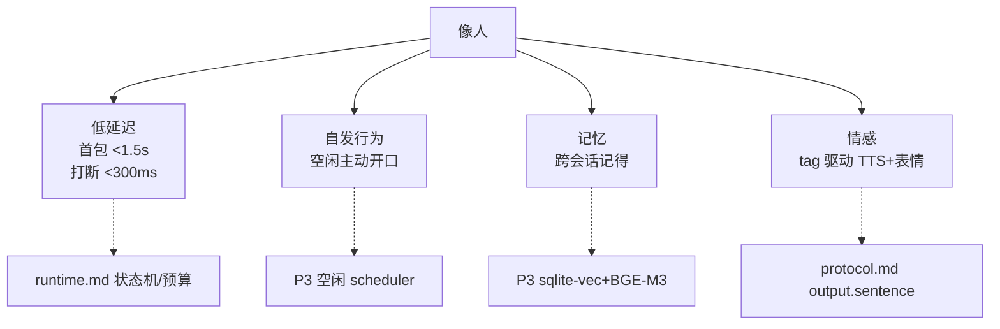

# 产品定义：momo

> 一句话：momo 是一个本地优先的 AI 虚拟伙伴 —— Live2D 形象、语音对话、能被打断、有自己的人格与记忆；先本地跑起来，直播暂缓。

## momo 是什么

momo 的核心不是"某个模型"，而是一条**流水线**：定制 LLM + TTS + ASR + Live2D 皮 + 回合/打断运行时 + action 总线 + 过滤层（课题背景调研见 [research.md](./research.md)）。在此之上坚持两个约束：

- **本地优先**：LLM/ASR/TTS 全部可本地自托管，云端 API 只做兜底、对照和视觉等补充能力。隐私、零订阅成本、可离线演示。
- **模块化**：交互端 / 编排器 / 模型服务三段式进程分离（见 [../01-architecture/system.md](../01-architecture/system.md)），单组件可替换、可降级。

## 目标用户

**唯一的用户是开发者本人。** 这决定了：

- 不做账号体系、多租户、权限模型；
- 交互端默认跑在本机浏览器/Tauri 壳，网络环境按 LAN 设计；
- "产品验收"= 开发者本人觉得"像个人、聊得下去"。

## 核心体验指标

"像人"是产品目标，但必须落成可测的工程指标：

| 指标 | 目标值 | 说明 |
|---|---|---|
| 首包延迟（文字回合） | **< 1.5 s** | 从提交文字到扬声器出声。预算分解见 [../01-architecture/runtime.md](../01-architecture/runtime.md) |
| 首包延迟（语音回合） | **< 1.5 s** | 从用户说完话（VAD 判停）到出声；ASR/VAD 预算同上表 |
| 打断响应 | **< 300 ms** | barge-in 触发到停播完成；打断后再出声仍按首包指标 |
| 自发行为 | 挂机 10 min 主动开口 2–3 次 | P3 验收项；空闲 scheduler 注入情境让 LLM 自发说话 |
| 记忆 | 重启后记得上次聊过什么 | P3 验收项；sqlite-vec + BGE-M3 |
| 情感表达 | 每句输出携带 emotion tag | tag 同时驱动 TTS 情感控制与 Live2D 表情 |

"像人"三支柱与指标的对应关系：

## 语言要求

- **默认中文**：人设、prompt、默认交互语言均为中文。
- **能力覆盖中/英/日**：ASR（SenseVoice-Small，实测支持 zh/en/ja/ko/yue）、TTS（CosyVoice3 9 语言含中日英 / GPT-SoVITS 中日英韩粤）、LLM（Qwen 多语）都覆盖。
- **开放问题**：一句话内混说中日英（code-switching）时 TTS 表现待实测，可能按句做语言路由（见 research.md 开放问题）。

## 非目标

| 非目标 | 理由 |
|---|---|
| **直播（P5 暂缓）** | 直播前必须先实装输入/输出双向过滤、弹幕队列、素材 license（Live2D 免费模型 + 克隆音色的直播授权）确认。另起调研，不在当前里程碑承诺 |
| **移动端** | 唯一用户场景是桌面；Live2D 前端走浏览器 + Tauri 2 桌面壳已覆盖 macOS/Windows/Linux；移动端会引入音频会话/权限/后台保活等复杂度，对唯一用户零收益 |
| 多用户 / 账号体系 | 单用户本地应用，无此需求 |
| 自研推理引擎 / 自建 VLM | 推理全部调用现有库；视觉（P4）直接调用 `deepseek-v4-flash-vision-exp` |
| 歌声合成 | 独立子系统（so-vits/RVC 方向），远期另行调研 |

## 检查表

- [ ] 首包延迟有可分解的预算表（见 runtime.md）
- [ ] 每个"像人"支柱都对应到可验收的量化指标
- [ ] 非目标每条都有理由，且与 roadmap.md 阶段划分一致
- [ ] 语言要求与模型选型（ASR/TTS/LLM 语种覆盖）一致
