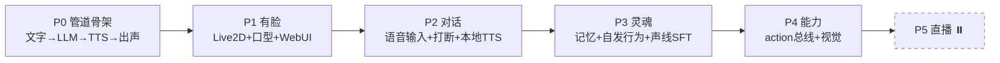

# momo 开发路线

> 每个阶段都有可演示的闭环和明确的验收标准；
> 训练/微调能安排就安排（TTS 声线 > LLM 人格 > ASR 不做）。
> 配套调研见 [research.md](./research.md)。

## 里程碑总览

## P0：管道骨架（目标：打字能回话出声）

手写部分：编排器 momod（Rust）+ 模型服务（Python），拓扑见 [../01-architecture/system.md](../01-architecture/system.md)：
- momod 骨架：`MOMO_` env 配置、日志、`momo-ws v1` 服务端（`/ws/ui`）
- LLM client：OpenAI-compatible stream（先接 `deepseek-v4-flash` 或借用 vLLM）
- TTS provider：edge-tts 流式播放（P0 过渡，P2 换本地）
- 编排器最小版：text in → LLM stream → 按句切分 → TTS 队列 → 下行音频播放
- 命令行 REPL：输入文字、听到回复

验收：终端打字，momo 开口回答；记录一次往返的各环节耗时并打出来。

## P1：有脸（目标：浏览器里看得见）

手写部分：
- 极简 WebUI（原生 HTML/JS + WebSocket，不上框架）
- pixi-live2d-display 加载一个免费 Live2D 模型（Cubism 官方 sample）
- 音频播放 → AnalyserNode 音量 → `mouthOpen` 参数（音量口型）
- WS 协议：文本 / 音频 chunk / 表情 tag 三类消息

验收：浏览器里角色随说话开合嘴，能眨眼（idle 动画），文本气泡同步。

## P2：对话（目标：动嘴说话 + 会听 + 会打断）

手写部分：
- 麦克风采集 → silero-vad → SenseVoice（sherpa-onnx，已实测 CPU RTF 0.04）
- barge-in：说话中检测到用户语音 → 停播、取消 LLM stream、已播文本入历史
- 本地 TTS 替换 edge-tts：先 Kokoro（已实测 209ms/0.76GB 兜底可用），再上 CosyVoice3
- LLM 输出加 `[happy]` 类情感 tag → 驱动表情/TTS 参数

验收：全程动嘴不动手聊 5 轮，中途插话能被打断；端到端延迟目标 <1.5s。

## P3：灵魂（目标：有记忆、会自己找话、声音是她）

手写部分：
- 记忆：sqlite-vec + BGE-M3，会话摘要定期入库，检索注入 prompt
- 空闲 scheduler：N 秒无输入 → 注入情境（时长/最近话题）让 LLM 自发开口
- 人设 prompt 迭代：写 character card，攒评测用例（固定 20 个问题回归）
- 声线克隆（见下方并行轨道）
- LLM LoRA 微调实验（可选，4090D/夜间 bigstrong）

验收：重启后记得上次聊过什么；挂机 10 分钟会主动挑起 2-3 次话题。

## P4：能力（目标：不止会聊天）

- action 总线：照 neuro-game-sdk 做 WS action 注册/调用/校验
- 视觉输入：截图 → `deepseek-v4-flash-vision-exp`（白嫖，不用自己跑 VLM）
- 工具调用：搜索/时间/表情组控制

## P5：直播（暂缓）

OBS + 弹幕平台接入 + 审核过滤 + 观众队列。另起调研。

## 并行轨道 A：声线（重要，尽早开始）

1. **攒素材**（本周可做）：收集目标声线 30s-2min 干净音频（单人声、无 BGM）
2. **零样本试听**：CosyVoice3 / IndexTTS-2 / GPT-SoVITS 各跑一遍对比，选基座
3. **不够用就 SFT**：补到 10-60min 素材 → 4090D 单卡微调（GPT-SoVITS 最轻，CosyVoice3 次之）→ 产物拷回 laptop 推理
4. 评估标准：盲听 A/B——像不像 + 稳不稳 + 情感范围

## 并行轨道 B：LLM 人格微调（P3 之后再认真做）

- 数据：攒日常对话 + 人工修写成符合人设的回复（几百条起步）
- 算力：4090D 24h 单次能跑 8B-14B QLoRA；30B 以上等夜间 bigstrong 窗口或拆多天
- 基座跟着主脑走：主脑定下来是谁，就微调谁

## 风险备忘

- CosyVoice3 在 py3.12/WSL 的依赖（pynini）可能要折腾，预留降级：Kokoro 已验证兜底
- 借用 vLLM 当前不通，副脑状态待主人确认
- DS key 还没部署到机器上，P0 前先配上
