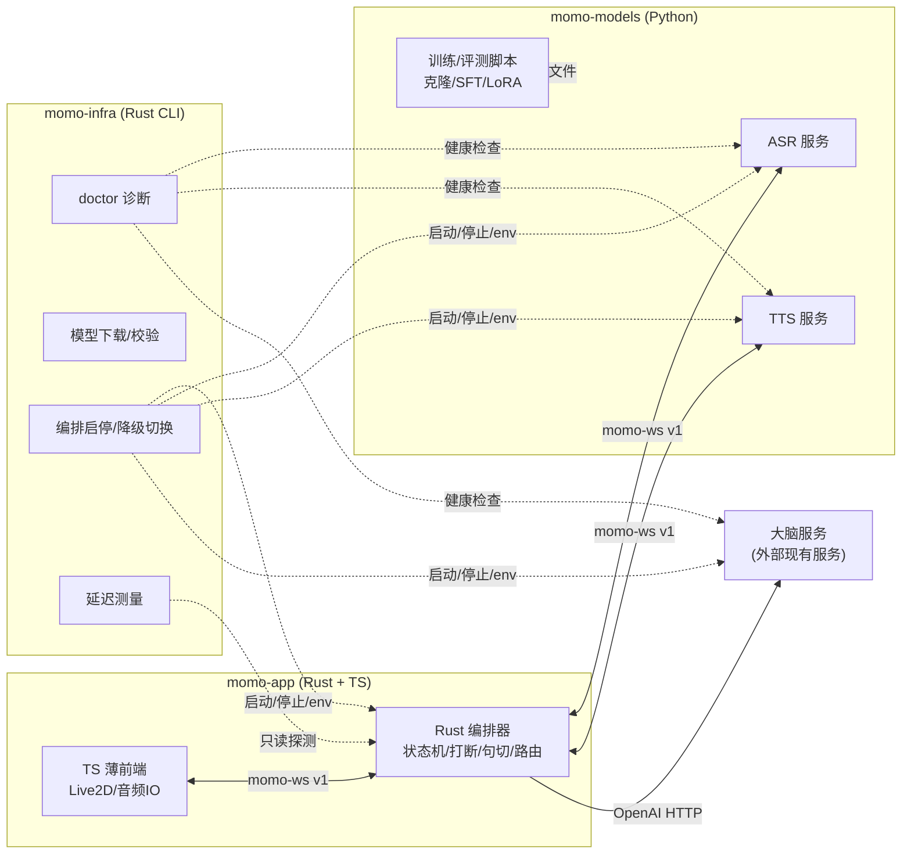

# 仓库边界：momo-app / momo-models / momo-infra

> 决策依据见 [../00-context/decisions.md](../00-context/decisions.md) ADR-001/002/004。本篇定义"什么代码放哪个仓库"，以及跨仓的允许/禁止事项。判断新功能归属时按本篇执行，归属争议回到 decisions.md 补 ADR。

## 边界总图

## momo-app —— 应用主体

**拥有：**

- Rust 编排器：WS 服务（`/ws/ui`、`/ws/action`）、回合状态机、barge-in、取消令牌传播、句切、对话历史（会话内）、过滤钩子、LLM OpenAI-compatible client、模型服务 client；
- TS 薄前端：Live2D 渲染、表情/口型参数驱动、麦采集、音频播放、文本气泡、debug 面板；
- Tauri 2 桌面壳（长期）；
- 前端静态资源托管（axum 在 `:7800` 同时托管 Web UI）。

**不拥有：**

- 任何模型权重、推理代码、训练代码；
- 任何机器部署/诊断/下载逻辑（那是 infra）；
- 跨会话持久记忆存储的实现（P3 记忆检索在 models 侧，app 只通过接口调用）。

## momo-models —— 模型服务与训练

**拥有：**

- ASR 服务（SenseVoice + silero-vad，`momo-ws v1` 服务端）；
- TTS 服务（CosyVoice3 / GPT-SoVITS / Kokoro / F5 / edge provider 抽象，`momo-ws v1` 服务端）；
- 大脑服务的启动适配（如 mac-studio 上拉起 `mlx_lm.server` 的脚本/封装——**不实现推理引擎本身**）；
- 训练与评测：声线克隆/SFT、LLM LoRA、人格评测用例；
- P3 记忆：sqlite-vec + BGE-M3 检索服务（接口待定，属本仓）；
- P4 视觉：DeepSeek vision 调用适配。

**不拥有：**

- 回合状态、打断语义、对话编排——模型服务是**无回合概念**的：收到句子就合成、收到音频就转写，取消由 `control.cancel` 驱动；
- 前端/UI/人设文案（人设 prompt 本体在 app 侧，models 只提供人格微调后的权重）；
- 机器级运维（装驱动、查端口——那是 `momoctl doctor` 的活）。

## momo-infra —— 运维工具集

**拥有：**

- `momoctl doctor`：环境体检（端口可达、GPU 可见、模型文件校验、HF 镜像连通）；
- 模型下载/校验：走 `HF_ENDPOINT=https://hf-mirror.com`，断点续传 + hash 校验；
- 服务编排启停：按 `MOMO_PROFILE` 拉起/停止 normal/degraded 两套进程拓扑；
- 降级切换：改 env + 重启的正确顺序封装；
- 测量工具：首包延迟、RTF、tok/s 探测，输出与文档验收指标可对照的格式；
- **Web 运维控制台**（`momoctl web`）：组件/模型/训练 job/env 配置的浏览器操作面，复用同一 binary 与同一套核心逻辑；含训练 job 编排（本地子进程 + SSH 远程执行器）。

**不能做什么（硬约束）：**

- **不承载人设/对话业务**：infra 不知道 momo 说了什么；
- **不在运行时数据通路上**：任何音频/文本不经过 infra；它只在带外（启动前、诊断时、测量时）出现；
- 不含推理代码；**UI 仅限运维控制台**（舞台/对话界面永远归 momo-app）；
- 必须能在 Python 环境完全坏掉时运行——这也是它是 Rust 单二进制的原因（bootstrap 问题：修 Python 的工具不能依赖 Python）。

## 为什么是"app 编排 / models 推理"这个分法

- **推理在 Python**：目标模型（SenseVoice/CosyVoice3/GPT-SoVITS/MLX）的可用实现、训练脚本、评测生态全在 Python。在 Rust 里重写或绑定等于给每个模型造一次轮，违背"调用现有库"原则。
- **编排在 Rust**：回合状态机是常驻、长连接、高并发取消密集的逻辑，要求可预测的延迟与单二进制分发；它要随前端/桌面壳一起发，依赖必须轻。
- **infra 在 Rust**：与 app 同工具链、同分发形态；且它负责"在一切坏掉时诊断"，不能依赖它要诊断的环境。
- **C++ 例外**：仅当 Rust 生态确实不足时允许引入独立 C++ 组件（如某音频库绑定），**必须在本文档补一行注明理由**。

## 新功能归属速查

| 新功能 | 归属 | 理由 |
|---|---|---|
| 新 TTS provider | models | 推理适配 |
| 新 WS 消息类型 | app + models 双改，先改 protocol.md | 协议跨仓 |
| 记忆检索 | models | BGE-M3 推理在 Python |
| 人设 prompt / character card | app | 对话业务 |
| 一键降级脚本 | infra | 运维操作 |
| 新表情 tag → Live2D 映射 | app（前端） | 渲染逻辑 |
| 截图→视觉调用 | models | 模型调用适配 |
| 延迟看板/压测 | infra | 测量工具 |
| Web 控制台 / 训练 job 编排 | infra | 运维操作面（训练实体仍在 models 仓，infra 只编排执行） |

## 检查表

- [ ] 每个仓库的「拥有/不拥有」表与实际代码结构一致
- [ ] infra 的硬约束（无业务、无数据通路、无推理、可独立运行）未被违反
- [ ] 引入新跨仓依赖前，先更新本表并补 ADR
- [ ] C++ 组件（如有）已逐条注明理由
