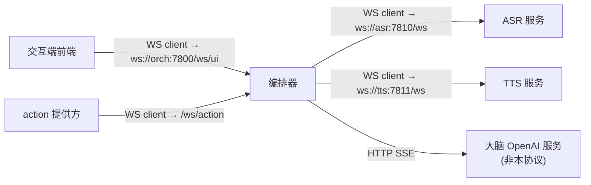
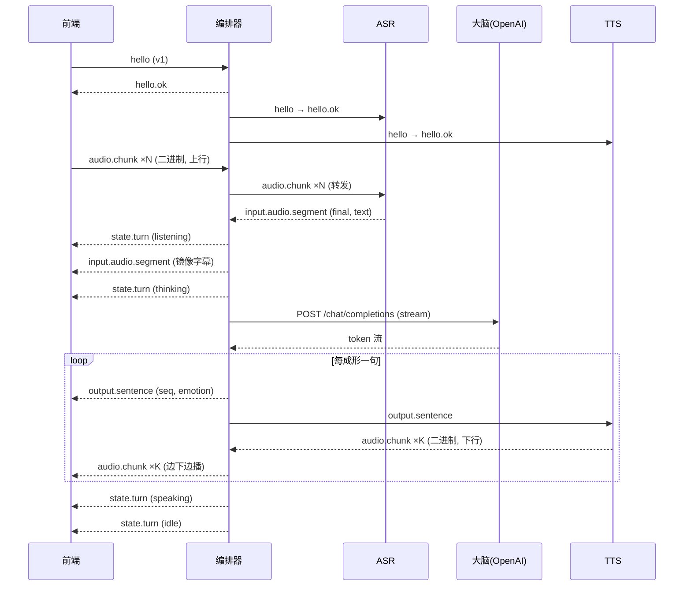

# momo-ws 协议规范 v1

> 进程间通信协议。文本帧 = JSON（UTF-8，`type` 字段多态）；二进制帧 = 音频块（固定 12B 头 + 载荷）。
> LLM 推理**不在本协议内**——编排器对大脑走 OpenAI-compatible HTTP SSE（ADR-006）。
> 状态机语义见 [runtime.md](./runtime.md)；消息里的端口/endpoint 默认值见 [config.md](./config.md)。

## 1. 连接拓扑（谁连谁）



| 链路 | 客户端 → 服务端 | 用途 |
|---|---|---|
| UI 链路 | 前端 → 编排器 `/ws/ui` | 用户输入、字幕/表情下发、播放音频、状态广播 |
| action 链路 | action 提供方 → 编排器 `/ws/action` | 注册/执行 action（P4） |
| 模型链路 | 编排器 → ASR/TTS `/ws` | 音频上行、合成下发、取消 |

> ASR 链路除上行音频与转写回报（`input.audio.segment`）外，还承载 VAD 边界事件 `input.vad`（speech_start/speech_end，见 §6）。

服务端按 `hello.client` 字段区分对端角色；模型链路服务端可同时是多个编排器的依赖（v1 按单编排器假设，多客户端连同一模型服务行为未定义）。

## 2. 通用规则

- **id 规范**：ULID 字符串，按类型加前缀：`t_` 回合、`s_` 音频段、`r_` 用户输入、`a_` action 调用、`sess_` 会话。
- **时间戳**：`at_ms` 字段一律 epoch 毫秒（整数）。
- **枚举**：lower_snake。
- **兼容**：接收方必须忽略未知字段；未知 `type` → 回 `error{BAD_MESSAGE}`，不断连。
- **帧类型**：JSON 一律 WS 文本帧；音频一律 WS 二进制帧，两种帧在一条连接上复用，不设独立 data 连接（v1）。

## 3. 连接建立与版本协商

连接建立后第一条消息必须是 `hello`；服务端以 `hello.ok` 应答，或直接 `error` + 关闭。

### `hello`（client → server）

```json
{
  "type": "hello",
  "protocol": "momo-ws",
  "version": "v1",
  "client": "ui",
  "audio": {
    "uplink":   {"codec": "pcm_s16le", "sample_rate": 16000, "channels": 1, "chunk_ms": 50},
    "downlink": {"codec": "pcm_s16le", "sample_rate": 24000, "channels": 1, "chunk_ms": 50}
  }
}
```

| 字段 | 说明 |
|---|---|
| `version` | 协议版本，v1 固定 `"v1"`；不匹配的版本协商见 §8 |
| `client` | `ui` / `action` / `orchestrator`（编排器连模型服务时用） |
| `audio` | 该连接将使用的二进制音频参数；不发音频的方向可省略对应键 |

### `hello.ok`（server → client）

```json
{
  "type": "hello.ok",
  "version": "v1",
  "session_id": "sess_01JXXX",
  "server": "momod",
  "role": "orchestrator",
  "capabilities": ["barge_in", "actions", "emotion_tags"]
}
```

`role`：服务端自报角色（`orchestrator` / `asr` / `tts`），客户端用于自检连错端口。

## 4. 二进制音频帧（`audio.chunk`）

音频不套 JSON，固定 12 字节头 + 载荷：

| 偏移 | 类型 | 字段 | 说明 |
|---|---|---|---|
| 0 | u8 | `ver` | 恒为 `1` |
| 1 | u8 | `stream` | `0x01` 上行（麦→ASR）；`0x02` 下行（TTS→播放） |
| 2–3 | u16 | `flags` | bit0 = `EOS`（本段/本句最后一帧）；其余保留 |
| 4–7 | u32 | `seq` | 流内单调递增序号，断序检测用 |
| 8–11 | u32 | `tag` | 下行=所属句子的 `output.sentence.seq`；上行=当前 VAD 段计数（首段前为 0） |
| 12+ | bytes | `payload` | `hello` 中协商的 codec 数据（默认 `pcm_s16le`，单声道，50ms/帧） |

- 上行帧归属：由随后到达的 `input.audio.segment` 携带 `segment_id` 对账；UI 与 ASR 之间无需自行分包，转发 `tag` 由 ASR 侧 VAD 段计数回写。
- 下行帧归属：`tag` 对应同连接上已下发的 `output.sentence.seq`，回合绑定取最近一条 `state.turn{speaking}` 的 `turn_id`。
- `EOS`：上行表示一个 VAD 段结束；下行表示该句音频结束。编排器在句边界必须置位。

## 5. 消息目录

| type | 方向（链路） | 何时发 |
|---|---|---|
| `hello` / `hello.ok` | 双向，所有链路 | 建连握手 |
| `input.text` | UI→orch | 用户提交文字 |
| `input.audio.segment` | ASR→orch；orch→UI | ASR 完成一个 VAD 段转写；orch 镜像给 UI 做字幕 |
| `input.vad` | ASR→orch；orch→UI 镜像 | VAD 检出语音开始/结束边界；Speaking 中 `speech_start` 即 barge-in 触发源 |
| `output.sentence` | orch→UI；orch→TTS | LLM 每成形一句（含 emotion tag） |
| `audio.chunk` | 二进制，双向 | 音频流（见 §4） |
| `control.barge_in` | UI→orch；orch→UI/TTS/ASR | 打断请求与打断通知/回报 |
| `control.cancel` | orch→TTS/ASR；orch→action 方 | 取消指定对象 |
| `state.turn` | orch→UI | 回合状态迁移广播 |
| `action.register` / `action.unregister` | action 方→orch | 注册/注销能力（P4） |
| `action.invoke` / `action.result` | orch→action 方 / 反向 | 调用与结果（P4） |
| `error` | 双向 | 协议/运行错误 |

## 6. 消息 Schema

### `input.text`（UI→orch）

用户文字输入。收到后 orch 开新回合（`state.turn{listening→thinking}`）。

```json
{"type": "input.text", "id": "r_01JXXX", "text": "今晚吃什么", "lang": "auto", "at_ms": 1730000000000}
```

| 字段 | 必填 | 说明 |
|---|---|---|
| `id` | 是 | 请求 id，回执 `state.turn`/`error` 的 `ref_id` 引用它 |
| `text` | 是 | UTF-8 文本，长度上限 4000 字符，超长回 `BAD_MESSAGE` |
| `lang` | 否 | `zh`/`en`/`ja`/`auto`，默认 `auto` |

### `input.audio.segment`（ASR→orch；orch→UI 镜像）

ASR 对一个完整 VAD 段的转写结果。`final=true` 触发 orch 进入 thinking；`final=false` 为可选的流式中间结果（v1 可不实现）。

```json
{"type": "input.audio.segment", "segment_id": "s_01JXXX", "duration_ms": 2340,
 "text": "今晚吃什么", "lang": "zh", "speech_emotion": "happy", "final": true}
```

| 字段 | 必填 | 说明 |
|---|---|---|
| `segment_id` | 是 | 段 id，供 `control.cancel{target:segment}` 引用 |
| `text` | 是 | 转写文本；可为空串（空段 orch 直接回 idle） |
| `lang` | 是 | SenseVoice 自动检测结果：`zh/en/ja/ko/yue` |
| `speech_emotion` | 否 | SenseVoice 情感标记归一化值，集合同 `output.sentence.emotion` |
| `duration_ms` | 是 | 段时长 |

### `input.vad`（ASR→orch；orch→UI 镜像）

ASR 侧 silero-vad 检出的语音边界事件，与 `input.audio.segment` 转写回报相互独立：转写要等段结束，边界事件实时上报。

```json
{"type": "input.vad", "event": "speech_start", "segment_id": "s_01JXXX", "at_ms": 1730000000000}
```

| 字段 | 必填 | 说明 |
|---|---|---|
| `event` | 是 | `speech_start`（检测到新语音开始）/ `speech_end`（判停，随后产出 `input.audio.segment`） |
| `segment_id` | 是 | 关联的 VAD 段 id：`speech_start` 为新段，`speech_end` 为刚结束的段 |
| `at_ms` | 是 | 边界检出时刻（epoch ms） |

**barge-in 触发源**：回合处于 `Speaking`（或 `Thinking`）时收到 `speech_start`，orch 即发起 `control.barge_in{reason:"vad_speech"}`（防抖持续时长见 `MOMO_BARGEIN_MIN_MS`）；`Listening` 中的 `speech_start` 只是正常分段边界，不打断。编排器可将 `input.vad` 镜像给 UI（如显示"听到你说话了"），UI 不据此推断音频时序。

### `output.sentence`（orch→UI；orch→TTS）

LLM 输出按句切分后的最小播报单元；同一条消息同时驱动 UI 字幕+表情和 TTS 合成，保证"看到的=听到的"。

```json
{"type": "output.sentence", "turn_id": "t_01JXXX", "seq": 3,
 "text": "吃火锅吧！", "emotion": "happy", "lang": "zh", "final": false}
```

| 字段 | 必填 | 说明 |
|---|---|---|
| `turn_id` | 是 | 所属回合 |
| `seq` | 是 | 回合内句序号，从 1 递增；下行 `audio.chunk.tag` 引用它 |
| `emotion` | 是 | 见下表；未知值按 `neutral` 处理 |
| `lang` | 否 | 句子的主导语言（供 TTS 路由提示），默认随回合 |
| `final` | 是 | 本回合最后一句置 `true` |

**emotion tag 约定（v1 固定 8 值）：**

`neutral` `happy` `sad` `angry` `surprised` `thinking` `shy` `sleepy`

LLM 在流式输出中以 `[happy]` 形式内联标注，编排器句切时剥离并把值写入 `emotion`；缺失或表外取值一律归一为 `neutral`。tag → Live2D 表情参数 / TTS instruct 情感的映射表是前端与 TTS provider 各自的实现细节，不进协议。

### `control.barge_in`

打断。两个用法：

**(a) 请求** UI→orch（用户按插话键 / 前端 PTT）或 orch 内部 VAD 触发：

```json
{"type": "control.barge_in", "turn_id": "t_01JXXX", "reason": "user", "at_ms": 1730000000000}
```

`reason`：`vad_speech`（说话中检测到用户语音）/ `user`（手动）/ `system`。

**(b) 通知** orch→UI / TTS / ASR：orch 决定执行打断后广播同一 `turn_id` 的 `control.barge_in`，附 `"applied": true`。

**(c) 回报** UI→orch：UI 收到通知后清空播放缓冲，回：

```json
{"type": "control.barge_in", "turn_id": "t_01JXXX", "applied": true, "played_seq": 2}
```

`played_seq` = 已完整播完的最后一句 `seq`，orch 据此把已播出文本记账入历史（语义细节见 [runtime.md](./runtime.md)）。三动作时序约束：先停播回报、再取消上游，历史记账在取消确认后完成。

### `control.cancel`（orch→TTS/ASR/action 方）

```json
{"type": "control.cancel", "target": "turn", "id": "t_01JXXX", "reason": "barge_in"}
```

| `target` | `id` 指向 |
|---|---|
| `turn` | `turn_id`：丢弃该回合所有未完成的合成/转写 |
| `segment` | `segment_id`：丢弃该音频段 |
| `invoke` | `invoke_id`：取消未返回的 action 调用 |
| `stream` | 当前连接上指定 `stream` 的全部在途数据 |

`reason`：`barge_in` / `user` / `timeout` / `shutdown`。接收方必须在 200ms 内确认停止产出对应数据；取消后仍到达的同 id 二进制帧由接收方按 `seq`/`tag` 丢弃。

### `state.turn`（orch→UI，广播）

```json
{"type": "state.turn", "turn_id": "t_01JXXX", "state": "thinking", "seq": 3,
 "at_ms": 1730000000000, "ref_id": "r_01JXXX"}
```

`state` 枚举：`idle` / `listening` / `thinking` / `speaking` / `interrupted`（状态机见 [runtime.md](./runtime.md)）。`seq` 为回合内状态序号；`ref_id` 回填触发本回合的 `input.text.id`（语音回合省略）。UI 用它驱动角色动画与气泡，**不得**用它推断音频时序。

### `action.register` / `action.unregister`（action 方→orch）

```json
{"type": "action.register", "provider": "demo-game",
 "actions": [{"name": "move", "description": "向指定方向移动一格",
              "json_schema": {"type": "object", "properties": {"dir": {"enum": ["up","down","left","right"]}}, "required": ["dir"]}}]}
```

```json
{"type": "action.unregister", "provider": "demo-game", "names": ["move"]}
```

同名重复注册覆盖旧 schema；连接断开视为全部注销。提供方声明的 `description`/`json_schema` 原样透传给 LLM 的 tool 列表。

### `action.invoke` / `action.result`

```json
{"type": "action.invoke", "invoke_id": "a_01JXXX", "turn_id": "t_01JXXX",
 "action": "move", "args": {"dir": "up"}, "timeout_ms": 10000}
```

```json
{"type": "action.result", "invoke_id": "a_01JXXX", "ok": true, "data": {"pos": [3,4]}}
```

失败时 `"ok": false, "error": {"code": "...", "message": "..."}`；超时未回由 orch 合成 `error{ACTION_TIMEOUT}` 并对该 invoke 判失败。LLM 侧只见到结构化 args/result，执行与校验完全下沉到注册方（ADR-015）。

### `error`（双向）

```json
{"type": "error", "code": "BAD_MESSAGE", "message": "unknown field type", "ref_id": "r_01JXXX", "fatal": false}
```

| code | 含义 | 处理 |
|---|---|---|
| `VERSION_MISMATCH` | hello 版本协商失败 | fatal，随后断连 |
| `BAD_MESSAGE` | JSON 非法/字段非法/未知 type | 非 fatal |
| `BACKPRESSURE_OVERFLOW` | 缓冲溢出（见 §7） | fatal 于该 turn，连接保留 |
| `MODEL_UNREACHABLE` | 上游模型服务断连 | orch→UI |
| `ASR_FAILED` / `TTS_FAILED` | 模型服务内部错误 | 当前 turn 失败 |
| `ACTION_TIMEOUT` | action 超时 | 非 fatal |
| `INTERNAL` | 其他 | 视 `fatal` |

`fatal=true` 表示连接即将关闭（配合 WS close code）。

## 7. 背压与断线语义

**背压（数字见 [config.md](./config.md)）：**

- 下行音频：orch 每回合缓冲上限 96 帧（50ms×96≈4.8s）。UI 侧 WS 发送缓冲超 512KB → orch 停止拉取 TTS → `sentence_q` 填满 → 暂停读 LLM 流。**下行音频永不静默丢帧**；溢出即 `error{BACKPRESSURE_OVERFLOW}` + `control.cancel{turn}`。
- 上行音频：orch→ASR 转发缓冲 2s，超时**丢旧帧**（实时性优先）并记日志；ASR 对 >30s 的段强制 final。
- JSON 控制帧**永不丢弃**；对端消费不动则关连（close `4400`），因为状态一旦分叉不可恢复。

**断线：**

- UI 断连 → orch 取消活动回合（取消令牌），保留会话历史；UI 重连走 `hello` → orch 回当前 `state.turn`（通常 `idle`）做重同步，**不重放**音频。
- ASR/TTS 断连 → orch 对当前回合发 `error{MODEL_UNREACHABLE}` 并取消；有备用 endpoint 则按配置切换，否则回 `idle`。
- 编排器重启 → 所有对端重连；回合不可恢复（v1）。
- 重连退避：指数 0.5s→8s，±20% 抖动。

## 8. 版本协商

- 客户端 `hello.version` 声明期望版本；服务端只支持 `v1` 时不匹配即回 `error{VERSION_MISMATCH}` + close `4001`。
- 未来多版本时服务端回 `hello.ok.version` = 双方交集内最高版本；`capabilities` 数组承载可选特性协商。
- close code：`1000` 正常；`4001` 版本不匹配；`4400` 协议违反（如首消息非 hello）；`1011` 服务端内部错误。

## 9. 一个完整回合



打断变体：`Speaking` 中 UI 送 `control.barge_in`（或 ASR 上报 `input.vad{speech_start}` 触发）→ orch 广播 `control.barge_in{applied}` → UI 清缓冲并回报 `played_seq` → orch 发 `control.cancel` 至 TTS / 丢弃 LLM 流 → 已播句记账入历史 → `state.turn{interrupted→listening}`。

## 检查表

- [ ] 每条消息有：完整 JSON schema、字段表、方向、发送时机
- [ ] 二进制帧 12B 头各字段可实现且歧义为零
- [ ] emotion tag 集合固定 8 值，LLM 内联语法与剥离规则写明
- [ ] 版本协商、close code、重连退避有确定数字
- [ ] 背压策略区分上行（丢旧）/下行（不丢，溢出报错）/控制帧（不丢，断连）
- [ ] 时序图覆盖一个完整语音回合 + 打断变体文字描述
