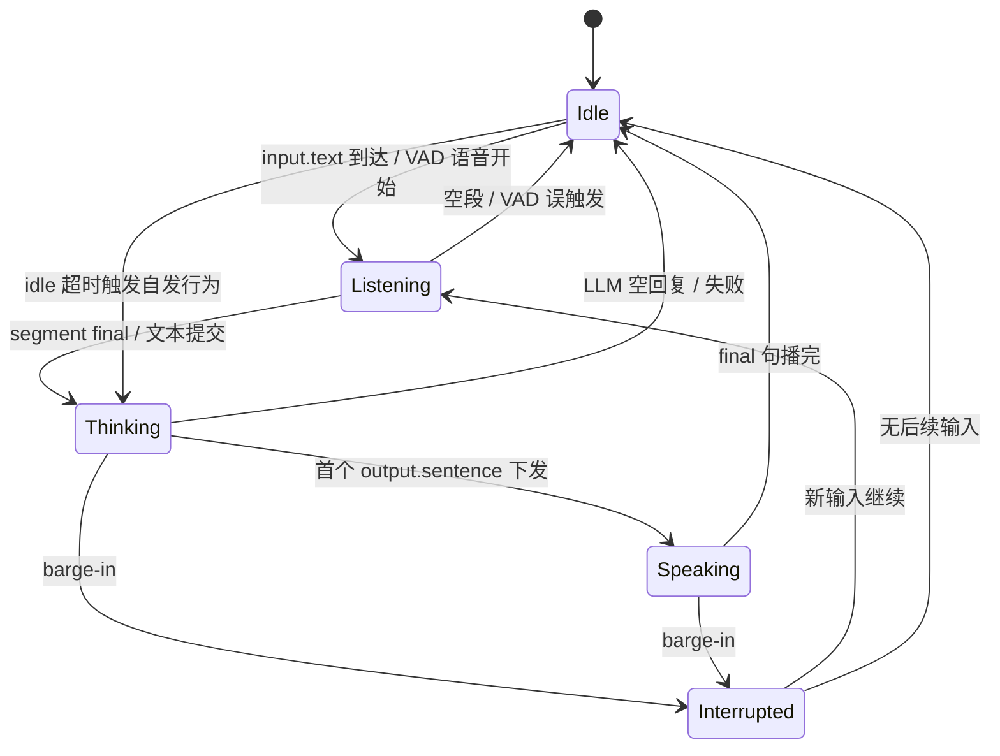
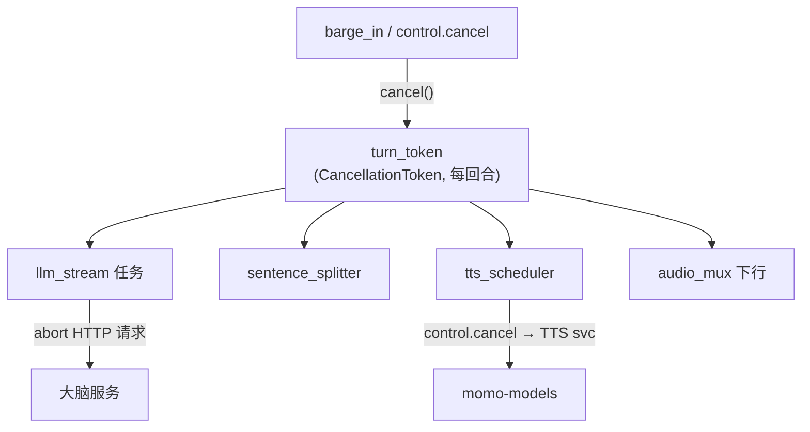

# 编排器运行时

> momo-app 的 Rust 编排器（tokio + axum）内部设计：回合状态机、barge-in、取消传播、句切、队列与延迟预算。
> 协议消息格式见 [protocol.md](./protocol.md)；状态枚举与之一致。

## 1. 回合状态机



各状态进入时动作：

| 状态 | 进入动作 |
|---|---|
| `Idle` | 重置 idle 计时器；广播 `state.turn{idle}` |
| `Listening` | 绑定新 `turn_id`；ASR 接收音频；广播 `state.turn{listening}` |
| `Thinking` | 建取消令牌；组装历史+人设 prompt → 发起 LLM 流；广播 |
| `Speaking` | 句切器消费 token 流 → `output.sentence` 双发（UI+TTS）；广播 |
| `Interrupted` | 执行 barge-in 三动作（§2）；广播 |

**idle 自发行为**：`Idle` 持续 `MOMO_IDLE_TIMEOUT_S`（默认 20s，0=关闭）无输入 → 注入内部情境（最近话题/挂机时长）直接进 `Thinking`，不经过 `Listening`。自发回合同样可被 barge-in。连续自发开口需冷却（v1：每轮后重置计时，最多连续 1 次主动回合，防自言自语刷屏——P3 细调）。

## 2. barge-in 三动作

触发源：ASR 上报 `input.vad{event:"speech_start"}`（`reason:vad_speech`，防抖持续 `MOMO_BARGEIN_MIN_MS`=250ms）/ 用户手动（`user`）/ 系统（`system`）。`Thinking` 与 `Speaking` 均可被断。固定三动作，顺序执行：

1. **停播**：orch→UI 广播 `control.barge_in{applied:true}`；UI 清空播放缓冲并回报 `played_seq`；同时 orch 丢弃下行音频队列未发送部分。
2. **取消上游生成**：回合取消令牌触发（§3）——丢弃 LLM HTTP 流、清空 sentence_q、向 TTS 发 `control.cancel{target:turn}`、向 ASR 发 `control.cancel{target:segment}`（若有在途段）。
3. **已播出文本记账入历史**：`played_seq` 之前的完整句以 assistant 消息入历史，标记 `interrupted:true`；正在播的那一句（`played_seq+1`）按已送出音频估算的文本前缀截断入账；未下发句丢弃。保证模型"记得的"和用户"听到的"一致。

语义约束：三动作幂等（重复 barge_in 同 turn 只执行一次）；`played_seq` 回报超时（500ms）按"已送出即已播"保守估计入账；历史记账完成前不回 `Listening`。

## 3. 取消令牌传播



- 实现：每回合一个 `tokio_util::sync::CancellationToken`，各管线任务持子 token，`select!` 中监听；cancel 后任务在下一个 await 点退出，目标 < 50ms。
- 对模型服务：取消令牌触发后编排器立即发 `control.cancel`；模型侧须在 200ms 内停产出，迟到的帧由编排器按 `turn_id`/`seq` 丢弃。
- 对 LLM：OpenAI 协议无取消语义——直接 abort HTTP 请求/断流；已生成未下发的 token 丢弃，已下发句按 §2-3 记账。
- 令牌不复用：`interrupted` 后进入 `Listening` 是新回合新令牌。

## 4. 句子切分规则

输入：LLM token 流（可能含 `[emotion]` tag）。输出：`output.sentence` 序列。规则按序应用：

1. **强切**：遇到 `。！？!?；;…` 或换行，立即成句。CJK 标点无条件切；ASCII `.`/`!`/`?` 仅当**后随空白或流结束**才切（避免 `Mr.`、`3.14`、`...` 误切）。
2. **弱切**：遇到 `,，、：` 且当前缓冲 ≥ 25 字（`MOMO_SENT_SOFT_CHARS`）时切——避免长句等标点饿死首包。
3. **硬切**：缓冲达 60 字（`MOMO_SENT_MAX_CHARS`）无标点也强制成句，在最后一个空白/CJK 字边界处切。
4. **tag 剥离**：`[xxx]` 形式 tag 先从文本移除再计长度；连续 tag 合并取最后一个；表外值归一 `neutral`。
5. **收尾**：LLM 流结束且缓冲非空 → flush 为 `final:true` 句；空回复 → 回合直接 `Idle`。
6. **语言**：每句做主导语言检测写入 `lang` 提示 TTS；v1 **不按语言拆句**（code-switch 混说效果是开放问题，见 research.md），TTS provider 自处理。

示例：`[happy] 今晚吃火锅吧！你说呢？` → 两句：`{text:"今晚吃火锅吧！",emotion:"happy"}`、`{text:"你说呢？",emotion:"happy"}`（tag 作用于其后直到下一 tag 的全部句子）。

## 5. 队列与背压

| 队列 | 容量 | 溢出策略 |
|---|---|---|
| mic 上行缓冲（orch→ASR） | 2s 音频 | 丢旧帧 + 日志（实时性优先） |
| `sentence_q`（splitter→TTS scheduler） | 8 句 | 暂停读 LLM 流（select 反压） |
| TTS 在途 | 1 句并发 | 逐句串行，保序 |
| 下行音频缓冲（TTS→UI） | 96 帧（≈4.8s@50ms） | 满→停拉 TTS；UI 侧 >512KB→`BACKPRESSURE_OVERFLOW`+取消回合（protocol §7） |
| VAD 段上限 | 30s | ASR 侧强制 final |

原则：音频流可截不可堵死；控制面永不丢消息；反压沿管线逐级上溯到 LLM 流读取。

## 6. 延迟预算分解

目标：文字回合 < 1.5s 出声；语音回合 < 1.5s（从 VAD 判停起算）。

| 环节 | 文字回合 | 语音回合 | 依据 |
|---|---|---|---|
| VAD 尾音判停 | — | 250 ms | silero `silence_ms` 可调 |
| ASR 转写 | — | ~150 ms（3s 语音）/ 337 ms（8.4s） | **实测** RTF 0.040（2026-10-10） |
| 编排开销（历史/过滤/路由） | 20 ms | 20 ms | 目标值 |
| LLM 首 token | 300 ms | 300 ms | **预估**；MLX 8B 实测 121 tok/s（2026-10-10） |
| 首句成形（到首个句末标点） | 200 ms | 200 ms | ~25 tok @121t/s 推算 |
| 句切 + tag 剥离 | 10 ms | 10 ms | 目标值 |
| TTS 首 chunk | 250 ms | 250 ms | Kokoro **实测** 209 ms（2026-10-10）；CosyVoice3 官方标称 150 ms **待实测** |
| 网络 + 解码 + 播放 jitter | 100 ms | 100 ms | LAN |
| **合计** | **~0.9 s** | **~1.3 s** | 预算内，余量 ~200–600 ms |

降级档注：laptop 本地小模型首 token 可能显著变慢，预算放宽至 < 2s；DeepSeek 兜底受外网影响单独测量。优化杠杆：VAD `silence_ms` 调小、ASR 流式 partial 提前送 LLM（v1 未实现，候选优化）。

## 7. 建议模块布局（momo-app 单 package：src/ 模块树，bin=momod）

```
src/
├── main.rs            # 入口：config → 启动 axum + 管线 supervisor
├── config.rs          # MOMO_ env 解析（见 config.md）
├── ws/
│   ├── proto.rs       # 消息 enum 序列化/反序列化（protocol.md §6）
│   ├── binary.rs      # 12B 音频帧 codec
│   ├── ui_link.rs     # /ws/ui
│   ├── model_link.rs  # orch→ASR/TTS client
│   └── action_link.rs # /ws/action (P4)
├── turn/
│   ├── machine.rs     # 状态机 + state.turn 广播
│   ├── barge_in.rs    # 三动作执行器
│   ├── cancel.rs      # CancellationToken 树
│   └── history.rs     # 会话历史 + 打断记账
├── pipeline/
│   ├── sentence_split.rs # §4 规则 + 单测
│   ├── llm_client.rs     # OpenAI SSE stream
│   ├── tts_sched.rs      # sentence_q → TTS
│   └── audio_mux.rs      # 下行帧复用/缓冲
├── idle.rs            # 空闲计时 + 自发情境注入
└── filter.rs          # 输入/输出过滤钩子（空实现，P5 前实装）
```

## 检查表

- [ ] 状态机图与 protocol.md `state.turn` 枚举一致
- [ ] barge-in 三动作顺序、幂等、played_seq 语义可实现
- [ ] 取消令牌覆盖 LLM/句切/TTS/音频全部任务
- [ ] 句切规则有标点集、软/硬上限、tag 剥离、ASCII 例外
- [ ] 每个队列有容量数字与溢出策略
- [ ] 延迟预算表每项有实测/预估标注，合计 < 1.5s
