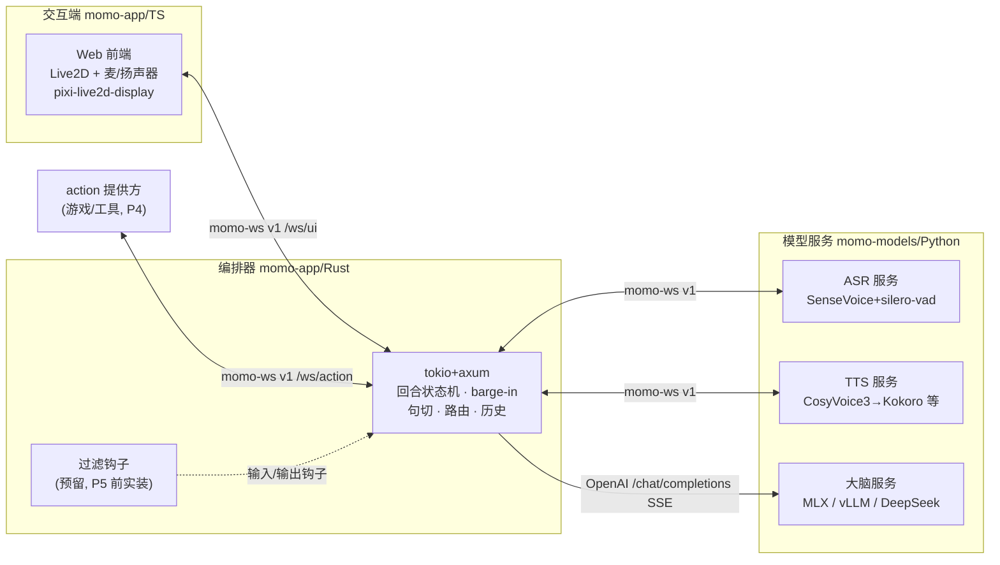
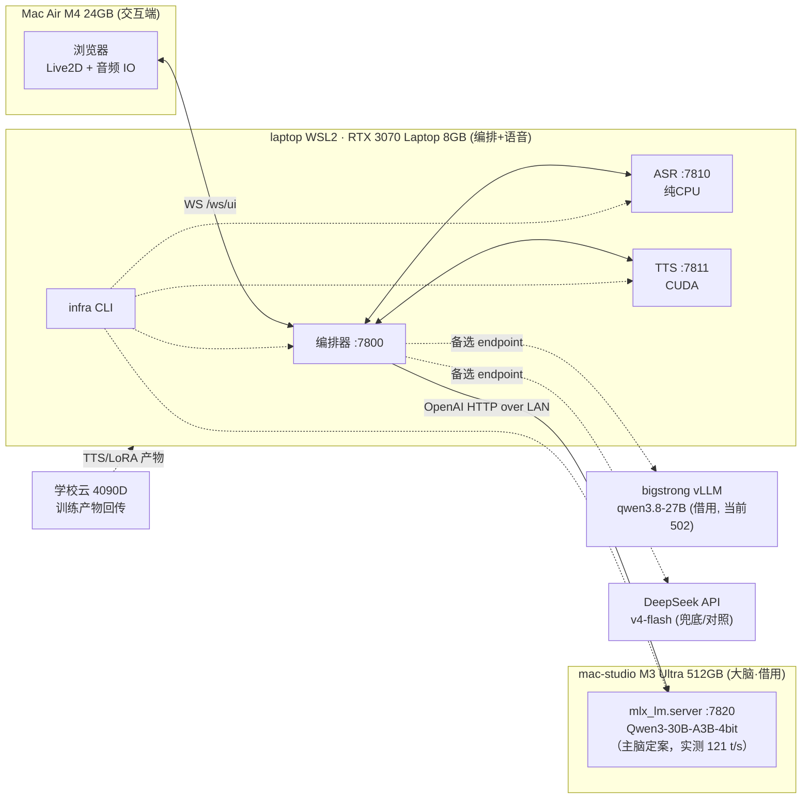
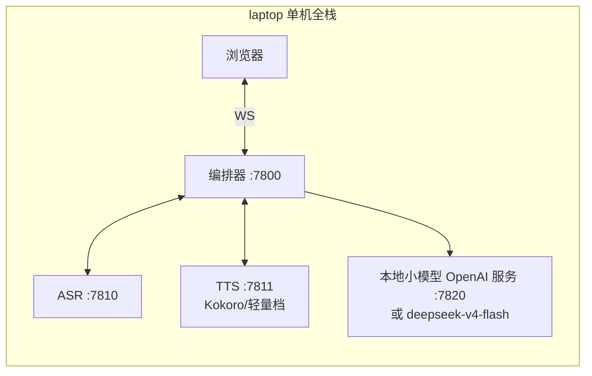

# 总体架构

> 三段式：**交互端**（渲染 + 音频 IO）— **编排器**（回合/打断/路由/状态机）— **模型服务**（LLM/ASR/TTS）。三者进程分离，进程间走 `momo-ws v1`（JSON 控制帧 + 音频二进制帧）与 OpenAI-compatible HTTP（LLM）。

## 架构总览

## 组件职责表

| 组件 | 仓库 | 语言 | 职责 | 对外接口 |
|---|---|---|---|---|
| Web 前端 | momo-app | TS | Live2D 渲染、表情/口型参数、麦采集、音频播放、文字输入、文本气泡 | WS 客户端 → `/ws/ui` |
| 编排器 | momo-app | Rust (tokio+axum) | WS 服务、回合状态机、barge-in、句切、历史、过滤钩子、路由、静态托管前端 | 监听 `:7800`；客户端 → ASR/TTS/LLM |
| ASR 服务 | momo-models | Python | silero-vad 分段 + SenseVoice 转写（纯 CPU，实测 RTF 0.040，2026-10-10） | WS 服务 `:7810` |
| TTS 服务 | momo-models | Python | 逐句合成 + 情感参数，按 audio.chunk 回流 | WS 服务 `:7811` |
| 大脑服务 | 外部现有（mlx_lm.server / vLLM / DeepSeek） | — | OpenAI-compatible chat 流式 | HTTP `:7820`（本地）/ 远端 |
| action 提供方 | 第三方（游戏/工具） | 任意 | 注册 `{name,description,json_schema}` action 并执行 | WS 客户端 → `/ws/action`（P4） |
| infra CLI | momo-infra | Rust | doctor、模型下载/校验、编排启停、降级切换、测量；**不在数据通路上** | env/CLI |

## 部署拓扑：正常档

交互端在 Mac Air（或 laptop），编排器与语音模型在 laptop，大脑在 mac-studio。ASR 纯 CPU 已验证也可放 Mac Air（2026-10-10 实测结论）；默认放 laptop 与 TTS 同机，音频路径零跳数。

## 部署拓扑：降级档

mac-studio 被收回或不可达时，laptop 单机全栈；大脑换本地小模型（7–8B Q4）或 `deepseek-v4-flash`。**同一套协议与代码，只改 env**（ADR-008）。

Mac Air 也可作为二级兜底：ASR 纯 CPU 可跑、8B MLX 可当大脑（2026-10-10 实测能力边界内）。

## 数据流

**语音回合**（主路径）：

1. 前端麦采集 PCM → 二进制 `audio.chunk` 帧 → 编排器 → 转发 ASR 服务；
2. ASR 内部 silero-vad 分段 + SenseVoice 转写 → `input.audio.segment`（含 text/lang）回编排器；
3. 编排器建回合、过输入过滤钩子、组装历史 → OpenAI SSE 调大脑；
4. LLM 流式 token → 句切 + 剥 `[emotion]` tag → 逐句 `output.sentence` 同时下发前端（字幕/表情）与 TTS；
5. TTS 逐句合成 → 二进制 `audio.chunk` → 编排器 → 前端边下边播；
6. 全程 `state.turn` 广播状态；用户中途说话 → `control.barge_in` 三动作（见 [runtime.md](./runtime.md)）。

**文字回合**：前端 `input.text` 直接进入第 3 步。

**训练/产物通路**（离线）：4090D 24h burst 训练 → TTS SFT / LLM LoRA 产物 → 回传 laptop/mac-studio 推理；bigstrong 夜间窗口做备胎（用完恢复）。

## 检查表

- [ ] 三段职责无重叠：交互端无业务逻辑、编排器无推理、模型服务无回合概念
- [ ] 两张拓扑图与 [config.md](./config.md) 的 endpoint 默认值一致
- [ ] infra 不出现在任何数据流箭头的主路径上
- [ ] 降级档与正常档只差异 endpoint，无代码差异
- [ ] 训练通路不进入运行时数据流
