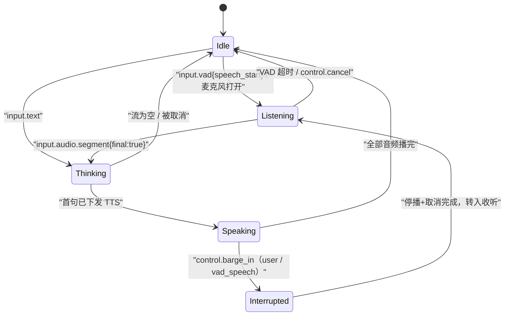
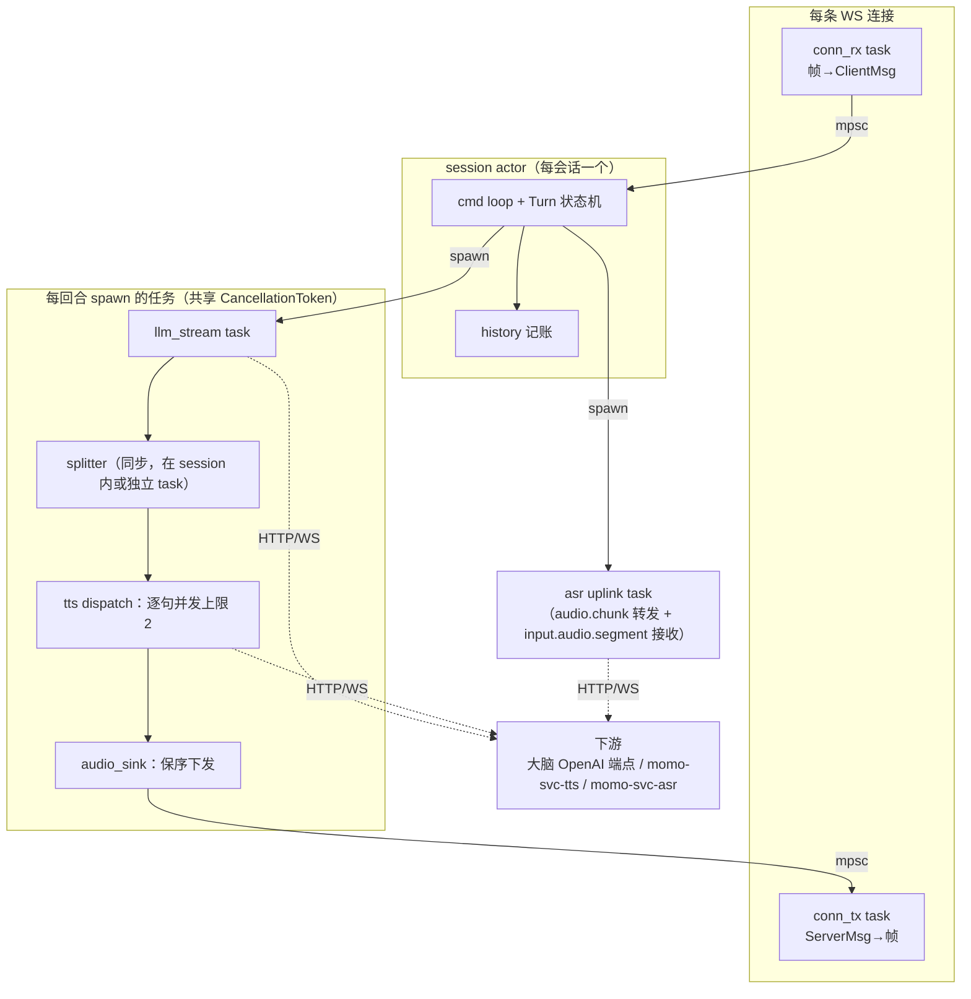
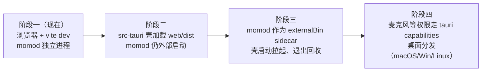

# momo-app：应用仓库设计（Rust 编排器 + TS 薄前端）

> 应用主体仓。Rust 实现 WS 服务、会话/回合状态机、流式管线（LLM→句切→TTS→音频）与模型服务客户端；TypeScript 薄前端负责 Live2D 渲染与音频 IO。短期浏览器访问，长期套 Tauri 2 桌面壳，前后端协议不变。

- 协议 schema 与部署拓扑见 [`../01-architecture/protocol.md`](../01-architecture/protocol.md) 与 [`../01-architecture/system.md`](../01-architecture/system.md)，本篇只定义 Rust 侧实现，不重复定义消息字段。
- 编排器↔模型服务走 `momo-ws v1`（唯一协议规范 = protocol.md，编排器侧 `hello.client=orchestrator`）；各模型服务的实现侧见 [`./momo-models.md`](./momo-models.md)。

## 目的

- 一个可独立运行的编排器进程 `momod`：对上给前端暴露 WS，对下调用 LLM/TTS/ASR 模型服务。
- 实现回合状态机与 barge-in 语义：停播、取消上游、已播文本记账。
- 同一套代码支撑两档部署（正常档/降级档），差异只体现在 env 指向的 endpoint。

## 范围

- 做：WS server、session/turn 管理、句切、音频下发调度、模型服务 client、配置与日志、薄前端、协议 e2e 测试。
- 不做：模型推理（在 momo-models）、进程编排与诊断（在 momo-infra）、人设内容（character card 归 04-tracks）。
- 预留不实现：双向过滤接口（P5 直播前必须实装）、action 总线（P4）、记忆（P3）。

## 仓库结构

单 package（lib + bin），不拆 workspace：当前规模一个 crate 足够，拆分只会拖慢迭代。`src-tauri/` 在演进阶段再加入（见下文 Tauri 路线）。

```
momo-app/
├── Cargo.toml                  # package momo-app，bin 名 momod
├── rust-toolchain.toml         # stable + rustfmt/clippy 组件
├── .env.example                # 仅占位，无真实值
├── README.md
├── LICENSE
├── src/
│   ├── main.rs                 # 入口：load config → init logging → bind ws server
│   ├── lib.rs                  # 对外 re-export，供 e2e 测试以库形式使用
│   ├── config.rs               # MOMO_* env 加载与校验
│   ├── logging.rs              # tracing 初始化（fmt/json）
│   ├── error.rs                # AppError（thiserror），ws 层映射为 error 帧
│   ├── proto/
│   │   ├── mod.rs
│   │   ├── message.rs          # ClientMsg/ServerMsg，serde tag "type" 多态，对齐 protocol v1
│   │   └── codec.rs            # 文本帧 JSON / 二进制音频帧分流、版本握手检查
│   ├── ws/
│   │   ├── mod.rs
│   │   ├── server.rs           # axum router：/ws/ui（/ws/action 为 P4 预留）upgrade、/healthz、静态文件
│   │   └── conn.rs             # 单连接 actor：rx/tx task、帧编解码、背压
│   ├── session/
│   │   ├── mod.rs
│   │   ├── manager.rs          # SessionManager：连接归属、单活跃 session 策略
│   │   ├── session.rs          # Session actor：命令循环、持有当前 Turn
│   │   ├── turn.rs             # Turn 状态机 + barge-in 三动作
│   │   └── history.rs          # 对话历史、已播文本记账
│   ├── pipeline/
│   │   ├── mod.rs
│   │   ├── splitter.rs         # 增量句切：标点 + 上限 + 情感 tag 提取
│   │   ├── llm.rs              # LlmClient trait + OpenAI-compatible 实现
│   │   ├── tts.rs              # TtsClient trait + WS 流式实现（momo-ws v1 客户端）
│   │   ├── asr.rs              # AsrClient trait：上行音频转发 + input.audio.segment 接收
│   │   └── filter.rs           # ContentFilter trait：输入/输出双向，默认 Noop（P5 前实装）
│   ├── audio/
│   │   ├── mod.rs
│   │   └── sink.rs             # AudioSink：按句序排队、二进制帧下发、drain/stop
│   └── action/
│       └── mod.rs              # P4 预留：action 注册表与调用校验
├── web/                        # Vite + TypeScript 薄前端
│   ├── package.json
│   ├── vite.config.ts          # dev server 代理 /ws → momod
│   ├── tsconfig.json
│   ├── index.html
│   └── src/
│       ├── main.ts             # 启动：canvas + ws-client + ui 装配
│       ├── config.ts           # ws url、资源路径（浏览器/Tauri 两态）
│       ├── net/protocol.ts     # 消息类型定义（与 proto/message.rs 对齐）
│       ├── net/ws-client.ts    # 自动重连、二进制帧分发、状态事件
│       ├── audio/player.ts     # 音频 chunk 调度播放（AudioWorklet 环形缓冲）
│       ├── audio/capture.ts    # 麦克风采集 + 分段上送（P2）
│       ├── live2d/stage.ts     # pixi 舞台 + pixi-live2d-display 模型加载
│       ├── live2d/lipsync.ts   # RMS → ParamMouthOpenY + 情感 tag → 表情/动作
│       ├── ui/chat.ts          # 文本气泡、输入框
│       └── ui/status.ts        # 回合状态指示、连接状态
├── tests/
│   ├── splitter_test.rs        # 句切边界用例
│   ├── turn_fsm_test.rs        # 状态机迁移表穷举
│   ├── proto_roundtrip.rs      # 消息序列化与 golden JSON 对拍
│   └── e2e_pipeline.rs         # mock 模型服务 + 真 ws client 全链路
└── .github/workflows/ci.yml
```

## 模块职责与关键接口

以下为签名级描述（伪 Rust，字段以 protocol v1 为准）。

### config.rs

```rust
pub struct Config {
    pub orch_listen: SocketAddr,   // MOMO_ORCH_LISTEN，默认 127.0.0.1:7800
    pub web_origin: String,        // MOMO_WEB_ORIGIN，CORS/连接来源校验
    pub llm_endpoint: Url,         // MOMO_LLM_ENDPOINT → 大脑 OpenAI 端点（直连，无网关）
    pub llm_model: String,         // MOMO_LLM_MODEL
    pub llm_api_key: Option<SecretString>, // MOMO_LLM_API_KEY
    pub llm_timeout: Duration,     // MOMO_LLM_TIMEOUT_MS，默认 30s
    pub tts_endpoint: Url,         // MOMO_TTS_ENDPOINT → momo-svc-tts（ws://…:7811/ws）
    pub asr_endpoint: Url,         // MOMO_ASR_ENDPOINT → momo-svc-asr（ws://…:7810/ws）
    pub ui_dir: Option<PathBuf>,   // MOMO_UI_DIR，存在则 ServeDir 托管 web/dist
    pub log_level: String,         // MOMO_LOG_LEVEL
    pub log_format: LogFormat,     // MOMO_LOG_FORMAT: pretty|json
}
impl Config { pub fn from_env() -> Result<Config, ConfigError>; }
```

只认环境变量（dotenvy 读 `.env`），不引入配置文件；缺失必需项启动即报错并列出缺什么。

### proto/message.rs

serde tag 多态，`#[serde(tag = "type")]`，`rename` 到协议里的点分命名（`input.text`、`input.audio.segment`、`input.vad`、`output.sentence`、`control.barge_in` 等）。音频帧不走 JSON：`codec.rs` 按 ws 帧类型分流——Binary 一律视为 `audio.chunk` 负载，12B 二进制头字段（ver/stream/flags/seq/tag）的布局由 `../01-architecture/protocol.md` 定义，此处不重复。字段 schema 的唯一权威是该文件，本模块是它的机械翻译，新增消息类型必须先改协议文档。

### ws/server.rs + conn.rs

- axum 0.8，`GET /ws/ui` upgrade（`/ws/action` 为 P4 预留）；`GET /healthz` 返回 200（给 momo-infra 的 `momoctl serve status` 探活）。
- 每条连接一对 tokio task：`conn_rx`（读帧→decode→`mpsc` 给 Session）、`conn_tx`（Session→encode→写帧）。tx 用有界 `mpsc`（默认 256）做背压；二进制音频帧优先级不单独建通道，靠 `audio.chunk` 天然顺序。
- 连接握手后第一帧必须是 `hello {protocol:"momo-ws", version:"v1"}`，不匹配直接关闭并带 close code（协商细节见 protocol.md §3/§8）。

### session/*

```rust
pub struct SessionManager { /* 当前活跃 session、连接注册表 */ }
impl SessionManager {
    pub fn attach(&self, conn: WsConn) -> SessionHandle;   // P0-P2：单 session，后连顶掉前连
}

pub struct SessionHandle {
    pub cmd_tx: mpsc::Sender<SessionCmd>,
    pub state_rx: watch::Receiver<TurnState>,
}
enum SessionCmd { ClientMsg(ClientMsg), ConnClosed, Shutdown }

pub enum TurnState { Idle, Listening, Thinking, Speaking, Interrupted }

pub struct Turn {
    pub id: TurnId,
    pub cancel: CancellationToken,        // 取消令牌，扇出给 llm/tts/audio 任务
    pub committed: Vec<Sentence>,         // 已下发/已播出的句，用于打断记账
}
```

Session actor 是唯一可变状态持有者：所有事件（客户端消息、管线回调、定时器）都汇进它的 `mpsc`，内部不共享锁。barge-in 语义在 `turn.rs` 一次实现（protocol.md `control.barge_in` 三动作）：① 向 `AudioSink` 发 `stop` 并向 UI/TTS/ASR 广播 `control.barge_in{applied:true}`，等 UI 回报 `played_seq`；② `turn.cancel.cancel()` 扇出终止 LLM stream，并向 TTS/ASR 发 `control.cancel`；③ `committed` 里的句拼成一条 assistant 消息（标记 partial）写入 `history`。



### pipeline/splitter.rs

```rust
pub struct Sentence { pub index: u32, pub text: String, pub emotion: Option<EmotionTag> }
pub struct SentenceSplitter { /* buf, max_chars=80, 句末标点表 */ }
impl SentenceSplitter {
    pub fn push(&mut self, delta: &str) -> Vec<Sentence>; // 增量喂 token，吐完整句
    pub fn flush(&mut self) -> Option<Sentence>;          // 流结束时吐残句
}
```

规则：句末标点 `。！？!?；;` 立即切；超 `max_chars` 在次级标点 `，,` 处切；行首 `[happy]` 类 tag 提取进 `emotion` 并从 `text` 剔除；code block 内不切。纯字符串操作、无依赖，是单元测试重点。

### pipeline/llm.rs, tts.rs, asr.rs

```rust
#[async_trait]
pub trait LlmClient: Send + Sync {
    async fn chat_stream(&self, req: ChatRequest, cancel: CancellationToken)
        -> Result<ChatStream, AppError>;
}
pub type ChatStream = Pin<Box<dyn Stream<Item = Result<String, AppError>> + Send>>;

#[async_trait]
pub trait TtsClient: Send + Sync {
    async fn synth_stream(&self, sentence: Sentence, cancel: CancellationToken)
        -> Result<AudioStream, AppError>;   // momo-ws v1 连接 momo-svc-tts，PCM s16le 24kHz mono chunk
}
pub type AudioStream = Pin<Box<dyn Stream<Item = Result<AudioChunk, AppError>> + Send>>;

#[async_trait]
pub trait AsrClient: Send + Sync {
    async fn transcribe(&self, seg: AudioSegment) -> Result<Transcript, AppError>;
}
```

LLM 走 OpenAI-compatible HTTP SSE 直连大脑端点（`async-openai` 或手写 reqwest SSE，P0 建议手写可控）；TTS/ASR 走 `momo-ws v1`，报文 schema 见 [`../01-architecture/protocol.md`](../01-architecture/protocol.md)（编排器作为客户端 `hello.client=orchestrator`）。所有 client 接受 `CancellationToken`——取消语义在编排器侧统一，同时按协议向 TTS/ASR 发 `control.cancel`。

### audio/sink.rs

按 `sentence.index` 严格保序把 `AudioChunk` 封装为二进制 `audio.chunk` 帧推给 `conn_tx`；暴露 `stop()`（barge-in 时清空待播队列）与 `drain()` 句柄。播放时机在端侧（前端调度），sink 只管按序下发与统计"已播出文本"——已播出界限以前端回执或已发送帧数为准，协议细节见 protocol.md。

## Tokio 任务拓扑



要点：

- Session actor 单点串行化决策；管线任务只产数据不碰状态，经事件 `mpsc` 回流。
- `CancellationToken` 每回合一枚扇出；barge-in 时新回合用新 token，旧任务自然退出。
- TTS 并发上限 2（当前句+预取下一句），避免下游排队积压导致打断延迟。

## 前端（web/）

- Vite + TS，无框架（原生 DOM 足够）；dev server 代理 `/ws` 到 `MOMO_ORCH_LISTEN`。
- `pixi-live2d-display` 加载 Cubism 免费 sample 模（开发期使用，直播 license P5 前确认）；注意 pixi 主版本必须与 pixi-live2d-display 支持范围对齐，锁定在 package.json。
- 音频链路：`audio.chunk` 二进制帧（PCM s16le 24k）→ AudioWorklet 环形缓冲逐帧排播；worklet 内算 RMS → `lipsync.ts` 平滑 → `ParamMouthOpenY`；`output.sentence` 的 `emotion` 映射表情/动作组。
- `audio/capture.ts`（P2）：getUserMedia → 重采样 16k mono → 前端侧不做 VAD，直接按协议上送二进制 `audio.chunk` 上行帧（VAD/断句在 ASR 服务侧，转写以 `input.audio.segment` 回流，见 protocol.md 与 momo-models）。
- 状态指示跟随 `state.turn`，打断时清空播放队列（与后端 `control.cancel` 对齐）。

## Tauri 2 演进路线

协议不变是前提：前端永远只跟 `ws://127.0.0.1:7800/ws/ui` 说话，壳只是托管。



实施要点：

- `src-tauri/tauri.conf.json` → `bundle.externalBin: ["binaries/momod"]`，CI 按 target triple 产出 `momod-<triple>`；壳启动时 spawn，退出时 kill（失败降级为提示手动启动）。
- capabilities 最小化：不开 `shell`/`fs` 通配，只允许读应用资源目录；`window.__TAURI__` 探测切换 `config.ts` 的 ws 地址与资源 base。CSP 收紧到 `connect-src 'self' ws://127.0.0.1:*`。
- Live2D/音频代码零改动；需要桌面独占能力（如全局快捷键）再单开模块。

## 配置项汇总

env 全集权威为 [`../01-architecture/config.md`](../01-architecture/config.md)，下表只列本仓读取的键：

| env | 默认 | 说明 |
|---|---|---|
| `MOMO_ORCH_LISTEN` | `127.0.0.1:7800` | WS + 静态 UI 监听 |
| `MOMO_WEB_ORIGIN` | — | 允许的前端来源（CORS/WS Origin 校验） |
| `MOMO_LLM_ENDPOINT` / `MOMO_LLM_MODEL` / `MOMO_LLM_API_KEY` | — | 大脑 OpenAI 端点（直连，无网关） |
| `MOMO_TTS_ENDPOINT` | `ws://127.0.0.1:7811/ws` | TTS 服务（momo-svc-tts，momo-ws v1） |
| `MOMO_ASR_ENDPOINT` | `ws://127.0.0.1:7810/ws` | ASR 服务（momo-svc-asr，momo-ws v1） |
| `MOMO_LLM_TIMEOUT_MS` | `30000` | LLM 请求总超时 |
| `MOMO_UI_DIR` | 空 | 设了则托管 `web/dist`（生产单源；打包内嵌时忽略） |
| `MOMO_LOG_LEVEL` / `MOMO_LOG_FORMAT` | `info` / `pretty` | tracing |

`.env.example` 列全部键+注释，仓库不提交真实 `.env`。

## 测试策略

- 单元：`splitter`（标点/tag/超长/code block 边界）、`turn` 状态机迁移表、`history` 打断记账、`proto` 与 golden JSON fixture 对拍。
- 协议 e2e（`tests/e2e_pipeline.rs`）：测试内起 mock LLM SSE / mock TTS-WS / mock ASR，再起真 `momod` 与真 ws client，断言：消息顺序、barge-in 三动作（停播指令发出、上游 cancel 观察到、历史含 partial 记账）、取消后无残留帧。
- 前端：协议编解码与 lipsync 纯函数单测（vitest），不做浏览器 e2e（成本不值）。
- 目标延迟回归由 momo-infra `momoctl bench` 负责（端到端文字回合 <1.5s 出声），本仓不重复造。

## CI 建议（.github/workflows/ci.yml）

- Rust：`fmt --check`、`clippy -D warnings`、`test`（ubuntu + macos；windows 只 build）、`cargo audit`（周跑）、`cargo deny check`。
- web：`pnpm install --frozen-lockfile`、`tsc --noEmit`、`eslint`、`vite build`。
- e2e 测试不依赖真模型服务（全 mock），CI 可全跑。

## 验收

- [ ] `cargo run` 起 `momod`，`/healthz` 200，缺必需 env 时启动报错并列清单
- [ ] mock 下游 + 真 ws client 跑通文字回合：`input.text`→`output.sentence`→`audio.chunk`，历史完整
- [ ] Speaking 中发 `control.barge_in`：观测到停播、上游 cancel、partial 记账三件事
- [ ] `web/` dev 起来能加载 Live2D 并随音量动嘴
- [ ] 协议消息与 `../01-architecture/protocol.md` 字段逐一对齐，golden 测试通过
- [ ] 切 env 指向降级档 endpoints（laptop 全栈）不改一行代码可跑
- [ ] CI 绿灯：fmt/clippy/test/web build
