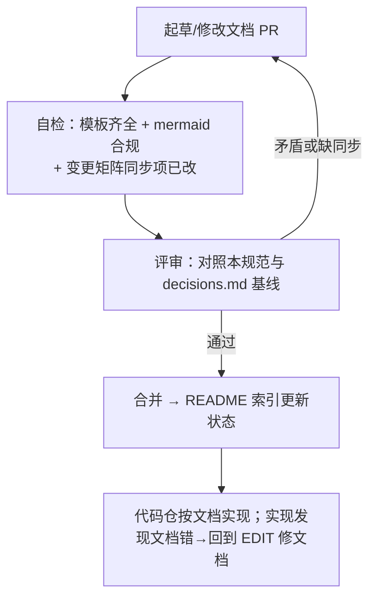

# momo-docs：文档仓库规范

> 本文档约束 momo-docs 仓自身的组织方式：目录怎么放、文件怎么命名、图怎么画、每篇必备什么、改了 A 必须同步改 B 的哪些篇。文档先于代码——代码仓库的实现以本仓文档为准。

## 目的

- 让任何一篇文档可被独立阅读、独立评审，且改动影响面可枚举。
- 固化写作规范，避免不同作者产出风格漂移。

## 范围

- 只管文档仓自身；各代码仓的内部规范（测试、CI、目录）见 `02-repos/` 对应篇。

## 目录约定

```
momo-docs/
├── README.md                   # 文档索引：全部篇目 + 一句话简介 + 状态
├── LICENSE                     # 文档许可（见下文约定）
├── AGENTS.md                   # 提交规范（conventional commit、无 AI trailer）
├── 00-context/                 # 背景与决策：为什么这么选
│   ├── research.md             # 调研（模块、算力、实测数据）
│   ├── roadmap.md              # P0–P5 里程碑总览
│   └── decisions.md            # 决策记录/ADR
├── 01-architecture/            # 跨仓架构：协议、拓扑、运行时语义
│   ├── system.md               # 三段式总体架构与两档部署拓扑
│   ├── boundaries.md           # 组件边界与职责划分
│   ├── protocol.md             # momo-ws 协议 v1：消息 schema 唯一权威
│   ├── runtime.md              # 回合状态机与运行时语义
│   └── config.md               # MOMO_* env 全集权威
├── 02-repos/                   # 各仓库技术设计：怎么实现
│   ├── momo-app.md
│   ├── momo-models.md
│   ├── momo-infra.md
│   └── momo-docs.md            # 本篇
├── 03-phases/                  # P0–P5 每阶段实施细案与验收清单
├── 04-tracks/                  # 并行轨道：声线克隆、人格微调
├── 05-ops/                     # 运维手册：deployment.md（部署操作）、降级手册、model-fetch 等
└── 06-management/              # 项目管理：GitHub Project 用法、评审记录
```

放置规则：

- 「是什么/为什么」→ `00-context/`；「跨仓怎么协作」→ `01-architecture/`；「单仓怎么做」→ `02-repos/`；「什么时候做、做完怎么验收」→ `03-phases/`；「贯穿多阶段的长线工程」→ `04-tracks/`；「跑起来之后怎么维护」→ `05-ops/`；「怎么协同」→ `06-management/`。
- 拿不准放哪：先问"这篇的读者是谁"——给实现者看放 `02/03`，给运维/未来的自己看放 `05`。

## 文件命名

- 一律 `kebab-case.md`，小写，词间连字符（`model-fetch.md`，不是 `modelFetch.md`）。
- 目录内如需排序，用两位数字前缀仅限目录本身已编号处；文档篇内不重复编号。
- 相互引用用**相对路径**（`../01-architecture/protocol.md`），不写绝对路径、不写仓库 URL——保证离线可读、可整体迁移。

## 图表规范

- 只用 mermaid，且**只用三种图型**：`flowchart`、`sequenceDiagram`、`stateDiagram-v2`。不用 classDiagram/gantt/pie——风格统一、渲染稳定。
- **标签含中文一律加引号**：`NODE["中文标签"]`；节点 id 一律英文。sequenceDiagram 的消息文字保持英文/技术词，或同样视为标签处理。
- 每篇设计文档**至少 1 个 mermaid 图**；状态机/时序必须用图表达，不许只用文字描述。
- 图是辅助不是替代：图下配一两句要点，说明图里看不出的约束。

## 每篇必备章节模板

设计/方案类文档按此骨架，章节名固定：

```markdown
# 标题
> 一句话说明这篇解决什么（引用块）

## 目的
## 范围          # 含"不做什么"
## 设计          # 结构/目录树/数据流 + mermaid
## 接口          # 签名/schema/配置项/命令清单（可并入设计）
## 验收          # - [ ] 可勾选项
```

附加硬性规则：

- **实测数据标注「实测」+ 日期**（例：实测 RTF 0.040，2026-10-10）；未跑过的写「预估/待实测」，禁止把估算写成事实。官方标称数据标「官方标称」。
- 技术名词保留英文，正文用中文，工程化语气，不写营销话术。
- 不出现「古法编程」「AI 生成」等字样；commit message 用 conventional commit，不带任何 AI 署名/trailer（见 `AGENTS.md`）。

## 评审与变更流程



**文档先行**：实现中发现文档与现实矛盾，先改文档再改代码，不允许"先写了再说"。

### 变更同步矩阵（改 A 必须同时改 B）

| 变更内容 | 必须同步检查/修改的篇目 |
|---|---|
| 协议消息类型/schema（momo-ws v1） | `01-architecture/protocol.md`（源头）→ `02-repos/momo-app.md`（proto 模块、e2e 测试）→ `02-repos/momo-models.md`（服务侧行为）→ 相关 `03-phases/` 验收项 |
| 编排器↔模型服务端点 | `01-architecture/protocol.md`（源头）→ `02-repos/momo-models.md`（服务端实现）→ `02-repos/momo-app.md`（client 侧）→ `02-repos/momo-infra.md`（doctor 探活项、bench） |
| 部署拓扑/机器角色 | `01-architecture/system.md`（拓扑源头）+ `05-ops/deployment.md`（操作手册）→ `02-repos/momo-infra.md`（profiles、serve/switch）→ `00-context/research.md` 算力表加注 |
| 模型选型结论 | `00-context/research.md`/`decisions.md` → `02-repos/momo-models.md`（provider、MANIFEST）→ `04-tracks/` 声线轨道 |
| 新增/改名 env 键 | `01-architecture/config.md`（源头）→ 所属仓的 `02-repos/*.md` 配置表 + `02-repos/momo-infra.md` doctor 矩阵 + 各仓 `.env.example` |
| 里程碑范围/验收调整 | `00-context/roadmap.md` + 对应 `03-phases/*.md` |

同一逻辑变更必须在一个 PR 内完成同步，避免文档间漂移。

## LICENSE / README 约定

- LICENSE：文档仓建议 CC-BY-4.0；代码仓建议 MIT OR Apache-2.0 双许可（沿用 Rust 生态惯例）。**此项为建议、未经人类确认**，确认后回写本节与各仓。
- README：本仓 README 是文档索引（篇目 + 简介 + 状态：草稿/评审中/已锁定）；新增文档必须同 PR 更新索引。各代码仓 README 面向使用者（装什么、跑什么命令），设计细节一律链回本仓对应篇。

## 验收（本规范自检清单）

- [ ] 每篇文档含：目的/范围/设计/接口/验收五段，`验收` 为可勾选列表
- [ ] 每篇设计文档 ≥1 个 mermaid 图，图型限 flowchart/sequenceDiagram/stateDiagram-v2，中文标签加引号、节点 id 英文
- [ ] 实测数据带「实测 + 日期」，估算标「预估/待实测」
- [ ] 文件名 kebab-case，引用用相对路径
- [ ] 修改命中「变更同步矩阵」时，同 PR 内完成所有同步项
