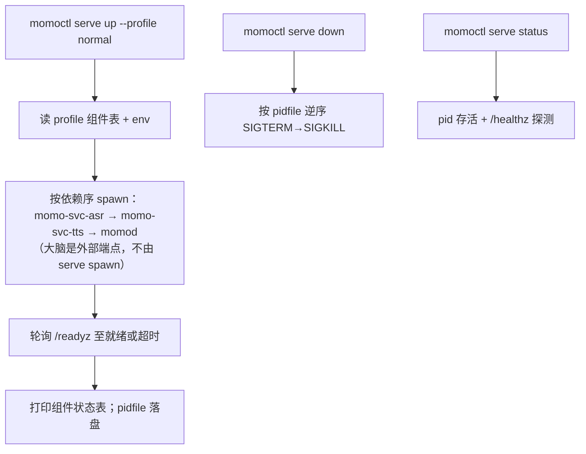
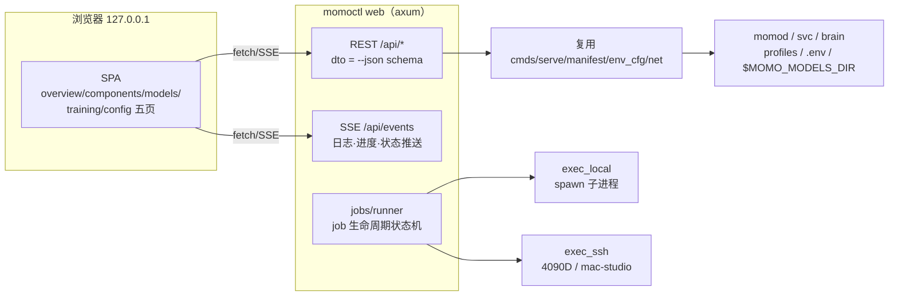
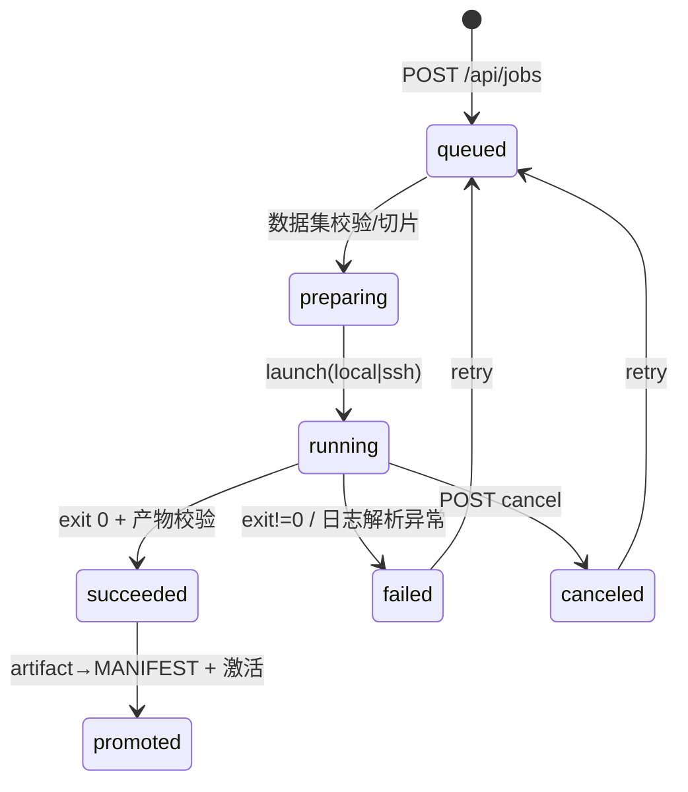

# momo-infra：运维工具仓库设计（Rust CLI）

> 运维与工具链仓：环境诊断、模型下载/校验、本地服务编排启停、降级切换、延迟测量。不承载任何人设/对话业务逻辑。

## 目的

- 把"跑起来 / 坏了查 / 降级救场"三件事收成一条命令：`momoctl doctor`、`momoctl serve`、`momoctl switch`。
- 输出同时面向人（表格/颜色）、脚本（`--json`）和浏览器（`momoctl web` 控制台），退出码可被 CI 与 shell 利用。

## 范围

- 做：env 检查矩阵、MANIFEST 下载校验、进程编排（spawn/pid/log/探活）、profile 切换、端到端延迟 bench、模型 GC、**Web 运维控制台**（`momoctl web`：组件/模型/训练 job/配置的浏览器操作面，见下文专节）。
- 不做：模型推理、协议消息定义、舞台前端（momo-app 的 web 归其自管；本仓 `web/` 仅为控制台自用）。
- 跨仓协作：读 momo-models 的 `models/MANIFEST.toml` 与服务端点约定；探测 momo-app `momod` 的 `/healthz`——本仓是这些约定的消费方，不是定义方。

## 形态决策：单 binary 多子命令

推荐**单 binary `momoctl` + clap 子命令**，而非几个小工具：

- 共享逻辑多（env 解析、MANIFEST、HTTP 探活、输出渲染、退出码），拆开会复制。
- 安装/分发只需一个文件；`momoctl <tab>` 补全天然覆盖全部功能。
- 二进制体积预估 <10MB，无拆分收益。

## 仓库结构

```
momo-infra/
├── Cargo.toml                  # package momo-infra，bin 名 momoctl
├── rust-toolchain.toml
├── .env.example
├── README.md
├── LICENSE
├── src/
│   ├── main.rs                 # cli parse → 初始化输出 → dispatch → 退出码
│   ├── cli.rs                  # clap Command 定义（全局 --json / --env-file / -v）
│   ├── output.rs               # human 表格渲染 / --json 序列化 / 退出码枚举
│   ├── env_cfg.rs              # dotenvy + MOMO_* 解析、profile 定位
│   ├── net.rs                  # HTTP/WS 探活、超时、重试
│   ├── manifest.rs             # 解析 momo-models 的 MANIFEST.toml（口径与其 manifest.py 一致）
│   ├── cmds/
│   │   ├── mod.rs
│   │   ├── doctor.rs           # 环境检查矩阵
│   │   ├── pull.rs             # 模型下载 + sha256 校验
│   │   ├── serve.rs            # up/down/status/logs/restart
│   │   ├── switch.rs           # normal ↔ degraded 切换
│   │   ├── bench.rs            # 端到端延迟测量
│   │   ├── gc.rs               # 模型 GC：N-1 代清理、models.lock 联动
│   │   └── web.rs              # axum 控制台 server：REST API + 内嵌静态 SPA
│   ├── serve/
│   │   ├── proc.rs             # spawn/kill/pidfile/日志落盘
│   │   └── profile.rs          # normal / degraded → 组件清单与启动顺序
│   ├── api/
│   │   ├── mod.rs              # REST 路由：doctor/serve/models/jobs/config 五组
│   │   ├── dto.rs              # API 出入参（与 --json 输出同 schema）
│   │   └── sse.rs              # SSE：日志流、job 进度、组件状态变化
│   └── jobs/
│       ├── mod.rs
│       ├── runner.rs           # job 生命周期：prepare→launch→monitor→artifact→promote
│       ├── exec_local.rs       # 本地子进程执行器（复用 serve/proc.rs）
│       ├── exec_ssh.rs         # SSH 远程执行器（4090D/mac-studio）
│       ├── store.rs            # $XDG_STATE_HOME/momo/jobs/：job 描述+状态+日志索引
│       └── pipeline.rs         # pipeline 定义：voice-sft / persona-qlora（步骤编排+产物登记）
├── profiles/
│   ├── normal.toml             # 正常档组件表（入库，作为默认模板）
│   └── degraded.toml           # 降级档组件表
├── web/                        # 控制台前端：Vite + TS，构建产物经 include_dir 打进二进制
│   ├── package.json
│   ├── vite.config.ts
│   └── src/
│       ├── main.ts             # 单页路由 + API client + SSE client
│       ├── pages/overview.ts   # doctor 可视化（组/检查项/状态色/修复 hint）
│       ├── pages/components.ts # serve：组件表 + up/down/restart + 日志 tail(SSE)
│       ├── pages/models.ts     # MANIFEST 列表 + pull 进度 + 激活项选择（provider/声线/大脑）
│       ├── pages/training.ts   # pipeline 向导 + job 列表 + 实时日志/loss 曲线
│       └── pages/config.ts     # MOMO_* env 编辑（写回 .env.<profile>，敏感键掩码）
├── tests/
│   ├── manifest_test.rs
│   ├── doctor_json_test.rs     # --json 输出 schema 稳定回归
│   └── api_contract_test.rs    # REST 出入参与 --json schema 一致性
└── .github/workflows/ci.yml
```

## 子命令清单

### `momoctl doctor [--profile normal|degraded] [--json]`

环境检查矩阵，按组输出 `check / status(ok|warn|fail) / detail / hint`：

| 组 | 检查项 |
|---|---|
| 系统 | OS/arch；macOS 上 Metal 可用性；Linux 上 `nvidia-smi` 与 CUDA 版本 |
| 工具链 | rustc/cargo、python3、uv、node/pnpm、ffmpeg 存在与版本 |
| Python 依赖 | torch 与 torchaudio 版本对齐、CUDA build 匹配（torch.cuda.is_available） |
| 网络 | huggingface.co 与 hf-mirror.com 可达性（不可达时 hint `HF_ENDPOINT=https://hf-mirror.com`）；PyPI 镜像；DeepSeek API 可达 |
| 环境变量 | 按 profile 校验必需 `MOMO_*` 是否齐（缺失列清单） |
| 模型文件 | MANIFEST 全部条目存在 + sha256 抽查 |
| 端点 | `momod:7800` 与 `momo-svc-asr:7810` / `momo-svc-tts:7811` 的 `/healthz`、`/readyz`；大脑 `:7820` 的 `GET /v1/models`（OpenAI 端点直连探活）；借用 vLLM 连通性（已知会 502，warn 而非 fail） |

退出码：全部 ok → 0；有 fail → 3。`--json` 输出 `{groups:[{name, checks:[{id,status,detail,hint}]}]}`，schema 有测试锁定。

### `momoctl pull [--manifest PATH] [--only NAME] [--check]`

- 清单读 momo-models 仓的 `models/MANIFEST.toml`（`--manifest` 可覆盖路径）；权重落盘到 `MOMO_MODELS_DIR`（默认 `~/.cache/momo/models`）的 `<owner>/<repo>/` 镜像布局。
- 下载走 `HF_ENDPOINT`（未设时提示 laptop 必须设 hf-mirror）；reqwest 直拉 HF resolve URL，支持断点续传（`.part` 文件）。
- 逐文件 sha256 校验，失败删除重下；`--check` 只校验不下载（等价原 `models verify`）。
- `momoctl pull --check` 同时是 `doctor` 模型组的数据源，两者共用 `manifest.rs`；下载完成把 `repo@revision` + 文件 hash 写入 `$MOMO_MODELS_DIR/models.lock`（见 [`../05-ops/model-fetch.md`](../05-ops/model-fetch.md)）。

### `momoctl serve <up|down|status|logs|restart> [--profile X] [--only COMPONENT]`

本地编排，组件清单来自 `profiles/*.toml`：



- profile 差异即部署档位差异：**normal**=本地起 asr/tts/momod，大脑走 `MOMO_LLM_ENDPOINT` 指向的 mac-studio MLX（外部端点，serve 只探活不拉起）；**degraded**=laptop 单机全栈，serve 额外 spawn 本地 `llama-server :7820`（或 `MOMO_LLM_ENDPOINT` 指 DeepSeek 时不 spawn）。改档=改 env 与 profile，不改代码。
- 组件定位：`momod` 经 `PATH` 查找，或 `--app-bin` flag 显式指定路径；python 服务在 momo-models 仓内 `uv run momo-svc-*`。
- 状态目录固定 XDG 默认：`${XDG_STATE_HOME:-~/.local/state}/momo/`（pid/、logs/、active_profile），不提供 env 覆盖；`logs` 子命令 tail 组件日志，`--only` 过滤。

### `momoctl switch --to <normal|degraded> [--restart]`

- 约定 `.env.normal` / `.env.degraded` 两个文件（gitignore，模板进 `.env.example` 说明）；`switch` 把 `.env` 符号链接重指到目标文件，并写 `active_profile` 状态。
- 输出前后关键 env diff（`MOMO_LLM_ENDPOINT` 等），`--restart` 时自动 `serve down && serve up`。
- 适用场景：mac-studio 被收回 → `momoctl switch --to degraded --restart`，一条命令进降级档。

### `momoctl bench [--turns N] [--json] [--strict]`

- 需要已运行的栈；作为 ws 客户端向 `momod` 发固定 `input.text`，计时：发→首个 `output.sentence`、发→首个 `audio.chunk`（端到端出声点）、回合全长。
- N 回合取 p50/p95；目标阈值 **<1.5s 出声**（基线），默认仅报告，`--strict` 时超标返回退出码 3。
- `--json` 供 CI 回归与历史对比；顺带可测降级档各端点延迟分布。

### `momoctl gc [--dry-run] [--keep N] [--json]`

模型 GC，与 `$MOMO_MODELS_DIR/models.lock` 联动（策略见 [`../05-ops/model-fetch.md`](../05-ops/model-fetch.md)）：

- 同一引擎的微调产物（`tts/ft-<engine>-<date>/`）保留 N-1 代（`--keep`，默认 2），老版本删除。
- 扫描 `$MOMO_MODELS_DIR` 中未被 `models.lock` 与 `.env` 引用的目录（评估期模型、半截下载 `.part`），列出待删清单；`--dry-run` 只报告不删（默认行为，显式 `--yes` 才执行删除）。
- 删除同步更新 `models.lock`；删除前先校验 `.env` 与 lock 无引用，有引用则 warn 并跳过。

### `momoctl web [--listen 127.0.0.1:7830] [--open]`

Web 运维控制台：同一 binary 起 axum server，REST API + 内嵌静态 SPA（`web/dist` 经 `include_dir!` 打进二进制，单文件分发不变）。**CLI 与 Web 是同一套核心逻辑的两种前端**——API 出入参与 `--json` 输出同 schema（`api/dto.rs` 唯一维护处），`api_contract_test` 锁定一致性。

参考：LLaMA-Factory **LlamaBoard**（Runner 管训练子进程生命周期、分页 train/eval/infer/export、配置 YAML 持久化、断线恢复进行中的 run）、**llm-systems-manager**（推理服务远程控制：起停/换模型/tail 日志/跨机）。



#### 页面与功能

| 页 | 内容 | 对应 API |
|---|---|---|
| 概览 | doctor 检查矩阵可视化（组/项/ok-warn-fail/修复 hint）、组件健康一览 | `GET /api/doctor`、`GET /api/serve/status` |
| 组件 | profile 组件表、up/down/restart、逐组件日志 tail（SSE）、切换 normal/degraded | `POST /api/serve/{up,down,restart}`、`GET /api/serve/logs?id=`(SSE)、`POST /api/switch` |
| 模型 | MANIFEST 条目表（版本/sha256/大小/在盘状态）、pull 进度条、**激活选择**：TTS provider、克隆声线目录、大脑 endpoint | `GET /api/models`、`POST /api/models/pull`、`POST /api/models/activate` |
| 训练 | pipeline 向导（数据集→超参→执行目标→产物目录）、job 列表与状态、实时日志 + loss 曲线（SSE）、artifact → MANIFEST 登记/回滚 | `GET/POST /api/jobs`、`GET /api/jobs/{id}/logs`(SSE)、`POST /api/jobs/{id}/{cancel,promote}` |
| 配置 | `MOMO_*` env 表单编辑（按 config.md 分组、敏感键掩码、写回 `.env.<profile>` 前留 `.bak`） | `GET/PUT /api/config` |

#### 训练 job 模型



- **pipeline 即数据**：`pipeline.rs` 内置两条流水线——`voice-sft`（参考音频→prepare_dataset→sft_cosyvoice3→盲听 A/B→`MOMO_TTS_MODEL_DIR` 激活）与 `persona-qlora`（对话素材→build_dataset→lora_qwen→regression-20→评估报告）。每步映射到 momo-models `training/` 下对应脚本，pipeline 步骤产出物写入 job store。
- **执行器二选一**：`exec_local`（复用 proc.rs spawn/pidfile/日志落盘）与 `exec_ssh`（ssh 到 4090D/mac-studio：远端拉起 `uv run` 训练脚本、定期 rsync 日志与 checkpoint 回本地 job store；ssh 复用系统 `~/.ssh/config` 别名，不自管密钥）。bigstrong 夜间窗口遵守 [`../05-ops/borrowed-etiquette.md`](../05-ops/borrowed-etiquette.md)：job 允许标记 `borrowed_night_only`，runner 只在配置窗口内调度。
- **job store**：`${XDG_STATE_HOME}/momo/jobs/<job_id>/{job.json,logs/,artifacts/}`；重启 `momoctl web` 后 runner 重扫 store，恢复 running 态监控（参照 LlamaBoard resume 语义）。CLI 侧暴露 `momoctl jobs list|logs|cancel` 子命令共用同一 store——web 与 CLI 操作同一份 job。
- **安全边界**：默认只绑 `127.0.0.1`；`--listen` 显式放宽时才出 localhost，届时要求 `MOMO_WEB_TOKEN`（未设拒绝启动）；所有 POST 走 CSRF token；配置页永不回显敏感值，只写 set/unset。

#### 范围边界（重申）

控制台只做**运维面**：起停组件、管模型文件、跑训练 job、改 env。不做：对话/人设业务（momo-app/momo-models 职责）、协议消息定义（protocol.md 单一来源）、前端发布（自己的 `web/` 只服务控制台，与 momo-app 的舞台前端无关）。

## 输出格式与退出码约定

- 默认人读：对齐表格 + 状态色（ok 绿/warn 黄/fail 红）；进度条/下载速率走 stderr，stdout 保持可管道。
- `--json` 全局 flag：每个子命令输出单一 JSON 对象，schema 版本化（`"schema": 1`），测试锁定稳定性——给 CI、GitHub Project 自动化和未来 GUI 用。
- 日志级别 `-v/-vv`，默认 warn。

| 退出码 | 含义 |
|---|---|
| 0 | 成功（doctor 全 ok / bench 达标） |
| 1 | 运行时错误（IO、进程管理失败等） |
| 2 | 用法/配置错误（clap 解析、缺 env） |
| 3 | 检查未通过（doctor 有 fail / bench --strict 超标） |
| 4 | 网络不可达（下载、端点连接失败） |
| 5 | 校验失败（sha256 不匹配、manifest 损坏） |

## 与 env 配置的关系

- 遵守全局约定：只认 `MOMO_` 前缀 env + `.env`（dotenvy），`--env-file` 可指定路径；不引入自有配置文件格式（profile toml 是组件清单，不是用户配置）。
- 本仓读取的 `MOMO_*` 键：`MOMO_PROFILE`、`MOMO_MODELS_DIR`、`MOMO_BRAIN_BACKEND`/`MOMO_BRAIN_PORT`/`MOMO_BRAIN_MODEL_PATH`（全集权威见 [`../01-architecture/config.md`](../01-architecture/config.md)）；消费 app/models 仓定义的全部端点类 env。momod 定位走 `PATH`/`--app-bin`，状态目录固定 XDG 默认，均不占 env 键。
- `doctor` 是 env 完整性的守门员：每个新 env 键入仓时必须同步 doctor 检查矩阵与 `.env.example`。

## C++ 组件准入

遵守全局约定：Rust 生态不足才允许 C++，且必须在文档注明理由。当前无计划引入；预判场景仅为：

- 音频链路若需要 sherpa-onnx C API 级的绑定而 Rust 侧（sherpa-rs/cpal 等）不满足——先在 `00-context/decisions.md` 记 ADR 再引入；
- 一律以「预编译库 + FFI」方式接入，不在本仓维护 C++ 源码与构建链。

## 测试与 CI

- 单元：manifest 解析/校验、profile 解析、退出码映射、`--json` schema 快照。
- 集成：`serve` 用本地 sleep 假组件跑通 spawn/探活/kill 全流程；`bench` 对 mock momod 断言计时逻辑。
- CI：fmt、clippy -D warnings、test（ubuntu+macos）、release build 三平台产物；cargo audit 周跑。

## 验收

- [ ] `momoctl doctor --json` 在无依赖的干净机器上运行不 panic，缺失项以 fail+hint 报告
- [ ] `momoctl pull` 经 hf-mirror 下载一个真实模型条目并校验 sha256 通过，`models.lock` 同步写入
- [ ] `momoctl serve up --profile degraded` 在 laptop 拉起 asr+tts+momod（含本地 `llama-server :7820`），`status` 全绿，`down` 无残留进程
- [ ] `momoctl switch --to normal/degraded` 切换后 `serve status` 反映新端点
- [ ] `momoctl bench` 对运行中的栈输出 p50/p95 与 <1.5s 判定；`--strict` 退出码正确
- [ ] `momoctl gc --dry-run` 列出待删清单且不删；实删后 `models.lock` 同步更新
- [ ] 所有子命令 `--json` 输出可被 `jq` 解析，schema 测试通过
- [ ] `momoctl web` 起控制台：五个页面可用，REST 出入参与 `--json` schema 一致（api_contract_test 过）
- [ ] 组件页可对真实组件执行 up/down/restart 并 tail 日志；配置页写回 `.env.<profile>` 且敏感键不回显
- [ ] 训练页跑通一条本地 pipeline job（mock 训练脚本亦可）：状态机迁移正确、SSE 日志可达、产物可 promote 进 MANIFEST
