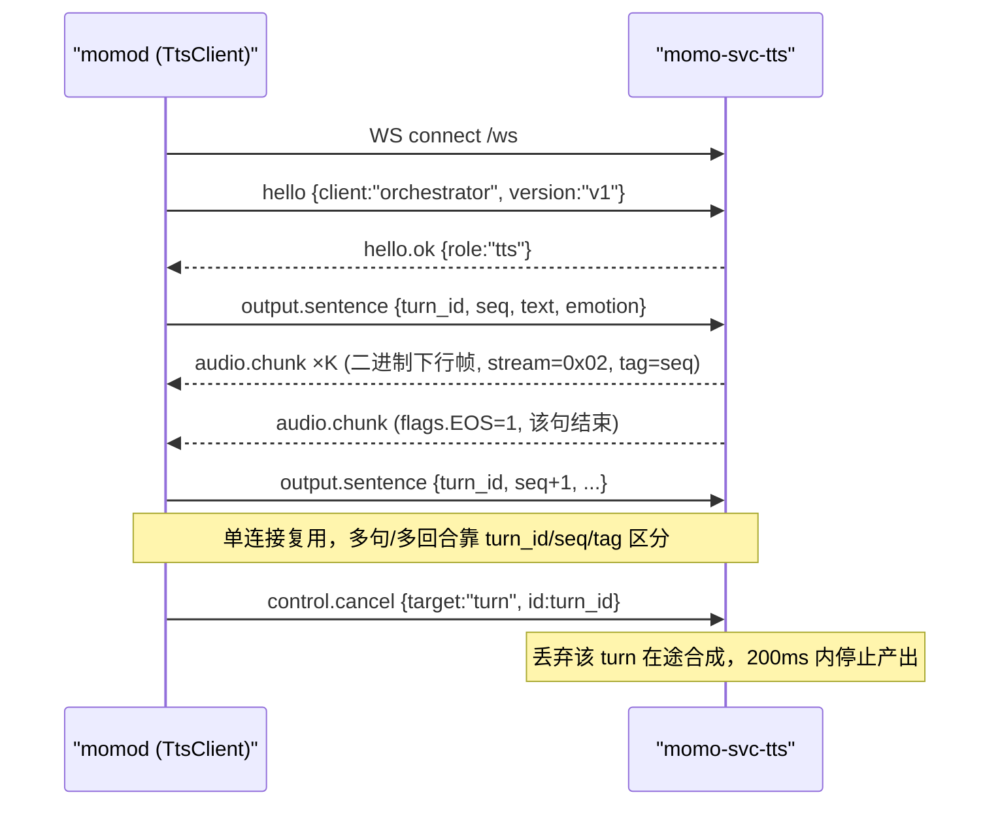
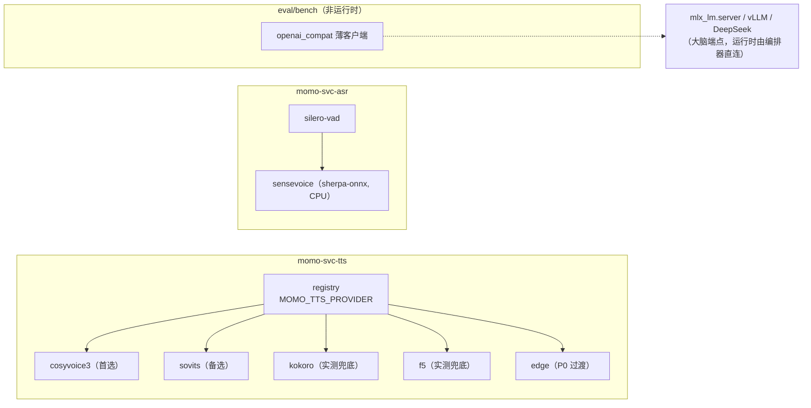

# momo-models：模型服务与训练仓库设计（Python）

> 模型相关业务唯一归属仓：ASR/TTS/embed 模型服务、声线克隆/微调、人格微调、评测。推理一律调用现有库（sherpa-onnx、CosyVoice、GPT-SoVITS、Kokoro 等），不重写推理引擎。**无 LLM 网关**——大脑是外部 OpenAI-compatible 端点，编排器（momo-app 的 `momod`）经 `MOMO_LLM_ENDPOINT` 直连（见 [`../01-architecture/system.md`](../01-architecture/system.md)）。`momod` 是本仓服务的唯一调用方。

## 目的

- 对编排器暴露**统一服务接口**：无论 TTS 后端是 edge-tts 还是 CosyVoice3，对端协议一律 `momo-ws v1`（schema 见 [`../01-architecture/protocol.md`](../01-architecture/protocol.md)）——换后端只改 env，不改编排器代码。
- Provider 适配层隔离第三方库差异与依赖坑。
- 承接训练/微调与评测脚本，产物按 manifest 回灌推理侧。

## 范围

- 做：常驻服务 `momo-svc-asr` / `momo-svc-tts` / `momo-svc-embed`（P3）、provider 适配层、模型清单与目录约定、训练/评测脚本。
- 不做：LLM 推理与网关（大脑是外部端点，归编排器 env 直连）；进程编排启停与环境诊断（momo-infra 的 `momoctl serve`/`momoctl doctor` 负责）；回合/打断语义（编排器侧）。
- ASR 不训练（基线已定）；声线轨道优先零样本试听，SFT 作为增强。

## 仓库结构

pyproject + src layout，uv 管理，Python ≥3.12（laptop 已验证 py3.12+uv 可用）。

```
momo-models/
├── pyproject.toml              # [project.scripts] 注册 momo-svc-* 入口
├── uv.lock
├── .env.example
├── README.md
├── LICENSE
├── src/momo_models/
│   ├── __init__.py
│   ├── config.py               # pydantic-settings，MOMO_* env
│   ├── logging.py              # structlog / logging 统一格式
│   ├── audio.py                # PCM s16le↔numpy、重采样(24k/16k)、wav 封装
│   ├── manifest.py             # models/MANIFEST.toml 解析与 sha256 校验
│   ├── providers/
│   │   ├── __init__.py
│   │   ├── base.py             # LLMProvider / TTSProvider / ASRProvider ABC
│   │   ├── registry.py         # 名称 → provider 类，env 选择
│   │   ├── llm/                # 仅 eval/bench 用的薄客户端，运行时不经它（编排器直连大脑）
│   │   │   ├── openai_compat.py  # 通吃 mlx_lm.server / vLLM / DeepSeek
│   │   │   └── deepseek.py       # 仅承载 DS 特有参数时的薄子类
│   │   ├── tts/
│   │   │   ├── edge.py           # edge-tts（P0 过渡）
│   │   │   ├── kokoro.py         # Kokoro-82M（已实测兜底）
│   │   │   ├── f5.py             # F5-TTS v1 零样本克隆（已实测）
│   │   │   ├── cosyvoice3.py     # Fun-CosyVoice3-0.5B（首选目标）
│   │   │   └── sovits.py         # GPT-SoVITS（备选克隆路线）
│   │   └── asr/
│   │       ├── sensevoice.py     # sherpa-onnx + SenseVoice-Small（纯 CPU）
│   │       └── vad.py            # silero-vad 断句封装
│   └── services/
│       ├── common.py             # app 工厂：momo-ws /ws 挂载 + /healthz + /readyz + 异常→error 帧 + 访问日志
│       ├── tts_service.py        # momo-svc-tts
│       ├── asr_service.py        # momo-svc-asr（内含 VAD 断句 + input.vad/input.audio.segment 产出）
│       └── embed_service.py      # momo-svc-embed：BGE-M3（P3）
├── models/                       # 仓内只放清单；权重实体在 $MOMO_MODELS_DIR，gitignore
│   └── MANIFEST.toml             # 下载清单：repo_id/revision/files/sha256/dest
├── training/
│   ├── voice/
│   │   ├── prepare_dataset.py    # 参考音频切分/去噪/响度归一/标注 → 训练集
│   │   ├── sft_cosyvoice3.py     # CosyVoice3 SFT 驱动脚本（4090D 24h 预算）
│   │   └── sft_sovits.md         # GPT-SoVITS 用其官方流水线，此处只记 pin 版本与步骤
│   └── persona/
│       ├── build_dataset.py      # 对话素材 → SFT 样本（人设修写流程见 04-tracks）
│       └── lora_qwen.py          # Qwen3-8B/14B QLoRA（跟随主脑基座）
├── eval/
│   ├── persona_regression.py     # 固定 20 问回归：打分 + diff 报告
│   ├── tts_ab_test.py            # 盲听 A/B 材料生成与结果汇总
│   └── README.md                 # 评测口径
└── tests/
    ├── test_manifest.py
    ├── test_base_contract.py     # 所有 provider 满足 ABC 契约（假 backend 注入）
    └── providers/                # 各 provider 单测，外部依赖全 mock
```

## 统一服务接口

所有服务同一骨架：console script 入口，对外端点为 `momo-ws v1` 的 `/ws`（协议唯一规范 = [`../01-architecture/protocol.md`](../01-architecture/protocol.md)，服务端按 `hello.client=orchestrator` 识别编排器）加 `/healthz`（进程活）与 `/readyz`（模型已加载、可服务）——momo-infra 的 `momoctl serve status`/`doctor` 只认这两个健康端点。控制面错误统一为 `{"type":"error"}` 帧；调试用 POST 口返回 `{"error": {"code", "message"}}`。

| 服务 | 入口 | 默认端口(env) | 端点 |
|---|---|---|---|
| asr | `momo-svc-asr` | 7810 / `MOMO_ASR_LISTEN` | momo-ws v1 `/ws`（protocol.md）+ `/healthz` + `/readyz`；调试口 `POST /v1/asr/transcribe` |
| tts | `momo-svc-tts` | 7811 / `MOMO_TTS_LISTEN` | momo-ws v1 `/ws`（protocol.md）+ `/healthz` + `/readyz`；调试口 `POST /v1/tts/synthesize` |
| embed（P3） | `momo-svc-embed` | 7812 / `MOMO_EMBED_LISTEN` | momo-ws v1 `/ws`（protocol.md）+ `/healthz` + `/readyz`（embed 消息类型 P3 定稿） |

### TTS 主路径：momo-ws v1（角色 tts）

运行时唯一路径是 WS 长连，schema 全部见 protocol.md，此处只写服务侧行为：



- 上行文本帧只有 `output.sentence` / `control.cancel` / `control.barge_in`（通知）；合成结果只走二进制下行帧，`tag` 回填所属句 `output.sentence.seq`，句末置 `flags.EOS`。
- 取消尽力而为：编排器同时持有自己的 `CancellationToken`（见 momo-app），不等服务端确认；取消后迟到的同 `turn_id` 帧按 `seq`/`tag` 丢弃。
- `POST /v1/tts/synthesize` 为非流式调试口（整段 wav 返回），供 `momoctl bench` 与手测使用，**不在运行时主路径上**。

### ASR 主路径：momo-ws v1（角色 asr）+ POST 调试口

- WS 主路径：编排器连 `/ws`（`hello.client=orchestrator`），上行二进制 `audio.chunk`（stream=0x01，16k mono，`tag`=VAD 段计数，段末 `flags.EOS`）；服务内 silero-vad 断句 → SenseVoice 识别 → 回发 `input.vad{speech_start|speech_end}` 边界事件与 `input.audio.segment{final, text, lang, speech_emotion, duration_ms}`。schema 与字段表见 protocol.md。
- `POST /v1/asr/transcribe`：收一段 PCM/wav 返回 `{text, lang, emotion, events, duration_ms}`，供 `momoctl bench` 与调试使用，**不在运行时主路径上**。

## Provider 适配层

```python
# providers/base.py（签名级）
class LLMProvider(ABC):   # 仅 eval/bench 用；运行时编排器直连大脑，不经本层
    name: ClassVar[str]
    async def chat_stream(self, req: ChatRequest) -> AsyncIterator[ChatDelta]: ...
    async def list_models(self) -> list[str]: ...
    async def aclose(self) -> None: ...

class TTSProvider(ABC):
    name: ClassVar[str]
    def capabilities(self) -> TTSCaps: ...   # streaming/languages/clone/emotion
    async def warmup(self) -> None: ...      # readyz 以此为据
    async def synth_stream(self, text: str, *, voice: VoiceRef,
                           emotion: str | None) -> AsyncIterator[bytes]: ...  # PCM 24k
    async def cancel(self, req_id: str) -> None: ...

class ASRProvider(ABC):
    async def load(self) -> None: ...
    async def transcribe(self, pcm: bytes, *, lang: str | None) -> Transcript: ...
```

`registry.py`：`MOMO_TTS_PROVIDER=edge|kokoro|f5|cosyvoice3|sovits` 选择 TTS 后端；ASR 固定 sensevoice 线（`MOMO_ASR_MODEL` 选模型），embed 单实现，均无需 registry env。无 LLM registry——无网关后上游就是 `MOMO_LLM_ENDPOINT`，归 app 侧。



### 各后端接入方式与已知坑

| provider | 接入方式 | 状态/实测 | 已知坑 |
|---|---|---|---|
| openai_compat（eval/bench） | `openai.AsyncOpenAI` 指向 `MOMO_LLM_ENDPOINT`；**仅评测/bench 脚本用，运行时不经它** | MLX Qwen3-8B-4bit 实测 121 tok/s（2026-10-10，mac-studio） | 借用 vLLM 实测曾 502，评测时需容忍并标注不健康 |
| deepseek（eval/bench） | 同 openai_compat，仅默认参数差异 | key 未部署，待补测 | — |
| edge | `edge-tts` 包 | 实测首包 1937ms（2026-10-10，laptop→微软云） | 依赖外网，仅 P0 过渡 |
| kokoro | `kokoro` pip 包，CUDA | 实测首包 209ms、RTF 0.023、VRAM 0.76GB（2026-10-10，laptop RTX 3070 Laptop） | g2p 依赖 espeak-ng/misaki，按语言懒加载；torch 版本须与 torchaudio 对齐 |
| f5 | `f5-tts` 包，零样本传参考音频 | 实测 RTF 0.535、VRAM 0.8GB（2026-10-10） | 参考音频需干净单人声 |
| cosyvoice3 | CosyVoice 官方推理栈（Fun-CosyVoice3-0.5B），instruct 控情感，双向流式官方标称 150ms | **首选目标；部署需求与 WSL2/py3.12 依赖链待实测** | 依赖重（历史经验 pynini 在 py3.12/WSL 需折腾）；显存需求**待实测**，预留 kokoro 兜底 |
| sovits | GPT-SoVITS 官方 api 或其推理包薄封装 | **备选**；官方标 4060Ti RTF 0.028（未实测） | 生态成熟但代码侵入性强，建议子进程隔离而非 import |
| sensevoice | `sherpa-onnx` Python 轮，sense-voice int8 onnx | 实测 RTF 0.040，CPU×4（2026-10-10）；zh/en/ja/ko/yue + 自动语言 + 情感/事件标记 | 无 GPU 需求；注意 onnx 与 tokens.txt 配套 |
| silero-vad | onnx via sherpa-onnx 或 `silero-vad` 包 | 基线选型 | 只做断句，不做识别 |
| bge-m3（P3） | sentence-transformers / FlagEmbedding | 未实测 | 与 sqlite-vec 的搭配在 app 侧落库 |

全局依赖红线（来自实测，写进 README 与 doctor 检查项）：

- **HF 源**：laptop 访问 huggingface.co 不通，必须 `HF_ENDPOINT=https://hf-mirror.com`；`momoctl pull` 与运行时加载都走它，模型优先选 HF 上有镜像的 repo（CosyVoice/SenseVoice 均有）。
- **torch/torchaudio 版本必须对齐**（已踩坑），在 `pyproject.toml` 用 `torch==2.6.*+cu124` 档锁死，uv.lock 强制。
- **fugashi/MeCab**：laptop 无 sudo 装不了系统 MeCab → MeloTTS 路线已否决；任何引入 fugashi 依赖的 backend 一律拒绝。
- code-switching（一句混中日英）表现待实测，句切语言路由是开放方案，先记 TODO。

## 模型目录布局与下载清单

权重实体放 `$MOMO_MODELS_DIR`（默认 `~/.cache/momo/models`），**镜像 `<owner>/<repo>` 布局**（与 [`../05-ops/model-fetch.md`](../05-ops/model-fetch.md) 对齐）；仓内 `models/` 目录只入库 `MANIFEST.toml` 清单文件。

```
$MOMO_MODELS_DIR/                    # gitignore，本仓外
├── mlx-community/Qwen3-8B-4bit/     # 大脑权重（mac-studio 侧）
├── mlx-community/Qwen3-30B-A3B-4bit/
├── FunAudioLLM/Fun-CosyVoice3-0.5B-2512/
├── hexgrad/Kokoro-82M/
├── SWivid/F5-TTS/
├── sherpa-onnx/sense-voice-*/       # model.int8.onnx + tokens.txt
├── snakers4/silero-vad/
├── tts/ft-<engine>-<date>/          # 自训练 SFT 产物（4090D 回传，保留 N-1 代）
├── voice/ref/                       # 声线参考音频
└── models.lock                      # 校验清单（repo@revision + 文件 size/hash）
```

`MANIFEST.toml` 每条目：`name / repo_id / revision / files[] / sha256 / dest / notes`。下载与校验由 momo-infra `momoctl pull` 执行（本仓 `manifest.py` 负责解析口径，`models.lock` 由 infra 写）；运行时 provider 只读本地路径，不在线拉模型——启动时校验 sha256，不一致则 `readyz` 拒绝就绪。

## 训练 / 微调脚本

- `training/voice/prepare_dataset.py`：原始素材 → 单人声、无 BGM、响度归一、24k mono wav + 文本标注；零样本只需 10-30s 干净参考音，SFT 目标 10-60min。
- `training/voice/sft_cosyvoice3.py`：包官方训练脚本调用，4090D 单卡 24h 预算内出 checkpoint；产物拷回 `$MOMO_MODELS_DIR/tts/ft-cosyvoice3-<date>/` 并追加 MANIFEST 条目。
- `training/voice/sft_sovits.md`：GPT-SoVITS 走其官方流水线（不 vendor 训练码），文档只 pin commit、记录数据放置与产物导出路径。
- `training/persona/`：攒日常对话→人工修写→SFT 样本；`lora_qwen.py` 为 QLoRA 驱动，基座跟随主脑（P3 后认真做）；算力首选学校云 4090D，次选 bigstrong 夜间窗口（用完必须恢复其常驻 vLLM）。

## 评测脚本

- `eval/persona_regression.py`：固定 20 个问题跑当前主脑+人设 prompt，输出逐题打分与与上次基线的 diff；LoRA 候选也用同一套。
- `eval/tts_ab_test.py`：给定文本集批量合成（各候选 backend）→ 盲听 A/B 打分表 → 汇总"像不像/稳不稳/情感范围"。
- 链路延迟不在此测——归 momo-infra `momoctl bench`。

## CI 建议

- `uv lock --check`、`ruff check` + `ruff format --check`、`pytest -m "not gpu and not slow"`（全 mock，CI 无 GPU 也可跑）。
- GPU/真实模型用例打 `gpu`/`slow` marker，本机或夜间手动触发；`momoctl doctor` 的端到端检查兜底集成正确性。
- pyproject 里为 mac-studio（torch 不需要 CUDA）与 laptop（cu124）分别维护 dependency group，README 说明安装命令。

## 验收

- [ ] `momo-svc-asr` / `momo-svc-tts` 各自可启动，`/healthz` 立即 200、`/readyz` 在模型加载完成后 200（embed 随 P3）
- [ ] 切换 `MOMO_TTS_PROVIDER` 在 kokoro/edge 间替换，编排器侧零改动通过 e2e
- [ ] momo-ws `/ws` 上 `hello{client:orchestrator}` → `hello.ok{role}` 握手通过；同连接多回合 `output.sentence` 交错下发可按 `turn_id`/`seq`/`tag` 区分回流 chunk；`control.cancel{turn}` 后不再出该 turn 帧
- [ ] ASR 上行 `audio.chunk` → 收到 `input.vad` 边界事件与 `input.audio.segment{final}` 转写
- [ ] `momoctl pull`（infra 侧）按 MANIFEST 下载后，sha256 校验通过，服务 `readyz` 通过
- [ ] 全部 provider 通过 `test_base_contract`；CI 在无 GPU 环境全绿
- [ ] torch/torchaudio 锁版本；任何 fugashi/MeCab 依赖出现即 CI 失败（dependency lint）
