# P0：管道骨架 —— 文字 → LLM → TTS → 扬声器

> 阶段目标：打字输入，momo 开口回话。打通最小可运行闭环，验证三段式部署（交互端—编排器—模型服务）与流式管线（LLM stream → 句切 → TTS → 边下边播）。
> 上游文档：[roadmap](../00-context/roadmap.md)「P0 管道骨架」、[research](../00-context/research.md)。
> 协议 schema 与回合状态机的完整定义见 `../01-architecture/`（protocol.md / runtime.md，架构篇维护）；本文只列出 P0 用到的消息子集，如有出入以架构篇为准。

## 目标

- 终端 REPL：输入一行文字 → LLM 流式生成 → 按句切分 → edge-tts 逐句合成 → 本机扬声器播放。
- 进程形态：`momod`（Rust 编排器 + REPL，momo-app 仓）一个进程，`momo-svc-tts`（Python edge-tts 服务，momo-models 仓）一个进程，LLM 走远端 OpenAI-compatible API。
- 每个回合打印逐环节耗时，为后续阶段延迟预算留数据。

## 范围与非范围

**范围内**

- `momo-app` 仓库骨架：workspace、`momod` 二进制（`repl` 子命令）、`momo-core` 库（配置/LLM/TTS/句切/播放/metrics）。
- `momo-models` 仓库骨架：`momo-svc-tts` WS 服务（edge-tts 包装，`MOMO_TTS_PROVIDER=edge`）。
- LLM 接入：OpenAI-compatible chat 流式接口，endpoint 可切换（`deepseek-v4-flash` 或借用 bigstrong vLLM `qwen3.8-27B-FP8`）。
- 回合内历史：内存中维护多轮 messages，重启即清空。
- 单向过滤接口留空 hook（`filter.in`/`filter.out` 类型定义 + no-op 实现），P5 前实装。

**范围外**

- 语音输入（麦克风、VAD、ASR）→ P2。
- Live2D / WebUI / 浏览器前端 → P1。
- 打断（barge-in）、回合状态机完整实现 → P2；P0 只需顺序执行单回合。
- 本地 TTS（Kokoro/CosyVoice3）、声线克隆 → P2/P3。
- 记忆、人格、工具调用 → P3/P4。
- 降级档部署（laptop 全栈）暂不需要——P0 LLM 本来就是远端 API。

## 涉及组件

| 组件 | 仓库 | 语言 | 说明 |
|---|---|---|---|
| `momod` | momo-app | Rust | 二进制入口（momo-cli crate 产出），P0 只有 `momod repl` |
| `momo-core` | momo-app | Rust | 编排核心：config / llm / tts / sentence / audio / metrics / pipeline |
| `momo-svc-tts` | momo-models | Python | TTS WS 服务；P0 provider=edge（edge-tts 包装） |
| LLM endpoint | — | — | DeepSeek `deepseek-v4-flash`（默认）或 bigstrong vLLM（实测 2026-10-10 当前 502 不通，仅备选） |
| 扬声器 | 本机 | — | rodio + 解码器直接出 |

硬件：全部跑在 laptop（WSL2）即可，无 GPU 需求。

## 具体实现步骤

### 1. momo-app 仓库骨架（Rust，tokio + axum）

```
momo-app/
  Cargo.toml                 # workspace: momo-cli, momo-core
  .env.example               # MOMO_* 占位，无真实值
  crates/
    momo-cli/
      src/main.rs            # clap 入口，二进制名 momod，P0 注册 repl 子命令
      src/repl.rs            # stdin 读行 → pipeline → 打印 metrics
    momo-core/
      src/config.rs          # envy/dotenvy 读 MOMO_* 环境变量
      src/llm.rs             # OpenAI-compatible SSE stream client
      src/tts.rs             # TTS WS client
      src/sentence.rs        # 流式句切分器
      src/audio.rs           # mp3 流解码 + rodio 播放队列
      src/metrics.rs         # TurnMetrics：各环节耗时打点
      src/filter.rs          # Filter trait + NoopFilter（预留）
      src/pipeline.rs        # run_turn(text) 编排一个回合
```

关键接口签名（模块级约定，实现可微调）：

```rust
// llm.rs —— OpenAI-compatible，endpoint/model 全走配置
async fn chat_stream(&self, messages: &[Message])
    -> Result<impl Stream<Item = Result<String>>>;   // 逐 token delta

// sentence.rs —— 有状态切分器
struct SentenceSplitter { buf: String, /* ... */ }
impl SentenceSplitter {
    fn push(&mut self, delta: &str) -> Vec<String>;  // 返回 0..n 个完整句
    fn flush(self) -> Option<String>;                // 收尾残句
}

// tts.rs
async fn speak(&self, seq: u32, text: &str)
    -> Result<impl Stream<Item = Result<Bytes>>>;    // mp3 chunk 流

// audio.rs —— 内部解码线程 + 顺序播放队列
fn enqueue(&self, seq: u32, chunk: Bytes);
async fn wait_idle(&self);                            // 播完为止
```

句切规则（`sentence.rs`，完整规则见 runtime.md §4）：逐 token 累积，遇到 `。！？!?；;…\n` 即切出一句立即送 TTS（ASCII `.`/`!`/`?` 仅在后随空白或流结束时切）；遇 `,，、：` 且缓冲 ≥ `MOMO_SENT_SOFT_CHARS`（默认 25）弱切；缓冲达 `MOMO_SENT_MAX_CHARS`（默认 60）时在最近的 `，,、` 或字边界处强制切；首句优先级最高（拿到就发，不等更多）。残句在 stream 结束时 `flush`。

### 2. momo-models：`momo-svc-tts` 服务

```
momo-models/
  pyproject.toml             # uv 管理；依赖 edge-tts, websockets
  .env.example
  services/tts/main.py       # WS server，console script: momo-svc-tts
```

行为：收到 `output.sentence` → 调 `edge_tts.Communicate(text, voice)` 流式拉 mp3 → 逐 chunk 以二进制帧回发 → 末尾发 `flags.bit0=EOS` 置位的二进制帧（protocol.md §4，不发 JSON 标记帧）。

### 3. P0 用到的协议子集（protocol v1）

完整 schema 见 `../01-architecture/protocol.md`。编排器 ↔ `momo-svc-tts` 一条 WS（建连先 `hello`/`hello.ok`，编排器侧 `client:"orchestrator"`），仅用三类帧：

| 方向 | type | 载荷 | 说明 |
|---|---|---|---|
| 编排器→TTS | `output.sentence` | `{turn_id, seq, text, emotion, final}` | 文本句；`final` 表示本回合最后一句 |
| TTS→编排器 | `audio.chunk`（二进制帧） | 12B 头 + mp3 片段 | `tag`=所属句 `seq`；句音频结束 = 头 `flags.bit0=EOS` 置位 |
| 编排器→TTS | `control.cancel` | `{target:"turn", id:turn_id}` | 本阶段定义好但不触发（打断在 P2） |

REPL 端不走 WS——`repl.rs` 直接调 `pipeline.run_turn()`，避免 P0 就起 axum server。

### 4. REPL 回合流程（pipeline.rs）

1. stdin 读一行 → 追加到 `messages`（in-memory history）。
2. `llm.chat_stream()` 开流；同时 `SentenceSplitter` 接收 token。
3. 每切出一句：`seq++`，立即 `tts.speak(seq, text)`（不等待上一句播完），音频 chunk 进 `audio.enqueue`。
4. stream 结束 → `flush` 残句送 TTS → `audio.wait_idle()`。
5. assistant 完整文本追加到 `messages`；打印 `TurnMetrics`。

### 5. metrics 输出格式

```
[metrics] turn#3
  llm_ttft=412ms  llm_done=1830ms  sentences=4
  s1: tts_first=1937ms tts_done=3200ms audio_len=8.4s
  s2: tts_first=980ms  tts_done=1500ms  audio_len=3.1s
  e2e(input→first_audio)=2349ms
```

`e2e` 从回车按下到第一段音频出声。edge-tts 首包基线：**实测 1937ms**（2026-10-10，laptop→微软云，8.4s 音频总耗时 3.2s），P0 不做延迟达标要求，但数据必须打出来。

## 时序图

```mermaid
sequenceDiagram
    participant U as "用户(stdin)"
    participant R as "repl.rs"
    participant P as "pipeline"
    participant L as "LLM API(DeepSeek/vLLM)"
    participant T as "momo-svc-tts(edge)"
    participant S as "扬声器(rodio)"

    U->>R: 输入一行文字
    R->>P: run_turn(text)
    P->>L: chat_stream(messages)
    L-->>P: token delta 流
    P->>P: SentenceSplitter.push()

    rect rgb(40, 40, 40)
        note over P,T: 流式管线：逐句合成与播放并行
        P->>T: output.sentence(seq=1)
        T-->>P: audio.chunk*(mp3)
        P->>S: 解码入队，边下边播
        P->>T: output.sentence(seq=2)
        T-->>P: audio.chunk*
        P->>S: 入队续播
    end

    L-->>P: stream 结束
    P->>T: output.sentence(seq=n, final)
    T-->>P: audio.chunk(EOS)
    P->>S: wait_idle 播完
    P->>R: TurnMetrics 打印
    note over T: edge-tts 首包实测 1937ms(2026-10-10)
```



## 配置项

全部走环境变量，前缀 `MOMO_`；仓库只提交 `.env.example`。

| 变量 | 默认 | 说明 |
|---|---|---|
| `MOMO_LLM_ENDPOINT` | `https://api.deepseek.com/v1` | OpenAI-compatible base URL；借 vLLM 时指 bigstrong |
| `MOMO_LLM_API_KEY` | — | 必填，DS key（部署状态见 roadmap 风险备忘） |
| `MOMO_LLM_MODEL` | `deepseek-v4-flash` | 借 vLLM 时为 `qwen3.8-27B-FP8` 实际服务名 |
| `MOMO_LLM_TEMPERATURE` | `0.8` | |
| `MOMO_TTS_ENDPOINT` | `ws://127.0.0.1:7811/ws` | momo-svc-tts 地址 |
| `MOMO_TTS_PROVIDER` | `edge` | TTS provider，P0 固定 edge |
| `MOMO_TTS_VOICE` | `zh-CN-XiaoxiaoNeural` | edge-tts 音色，P0 过渡用 |
| `MOMO_SENT_SOFT_CHARS` | `25` | 弱切阈值 |
| `MOMO_SENT_MAX_CHARS` | `60` | 强制切句上限 |
| `MOMO_AUDIO_DEVICE` | （空=默认输出） | rodio 输出设备名 |
| `MOMO_LOG_LEVEL` | `info` | tracing 等级 |

## 验收检查表

- [ ] `momod repl` 启动后终端打字，momo 用 edge-tts 声音回话（出声即闭环）。
- [ ] 连续对话 3 轮以上，上下文历史生效（能指代上一轮内容）。
- [ ] 每回合打印 `TurnMetrics`：含 `llm_ttft`、`llm_done`、逐句 `tts_first`/`tts_done`、`e2e`。
- [ ] LLM 输出多句长回复时，第一句音频不等待全文生成完（观察 `e2e < llm_done + tts` 即证明流式）。
- [ ] `MOMO_LLM_ENDPOINT`/`MOMO_LLM_MODEL` 改 env 可切换 LLM endpoint，代码零改动。
- [ ] momo-svc-tts 断开时 REPL 报明确错误而非 panic/无声挂死。
- [ ] `.env.example` 已提交且无真实密钥；`momoctl doctor` 类检查可后置，env 缺失时启动报错信息可读。

## 退出标准

- 上述验收项全部可勾选。
- `e2e` 数据在 laptop 上记录过至少 10 个回合，作为 P2 延迟预算对照基线；P0 预期 e2e 约 2–4s（edge-tts 1937ms 首包为已知瓶颈，**实测**），不阻塞进入 P1。
- 代码提交 momo-app / momo-models 两仓，README 写明 `uv run`/`cargo run` 启动顺序。
- 遗留问题登记：edge-tts 延迟偏高（P2 换本地 TTS 解决）；bigstrong vLLM 502 待主人恢复；DS key 部署状态确认。
