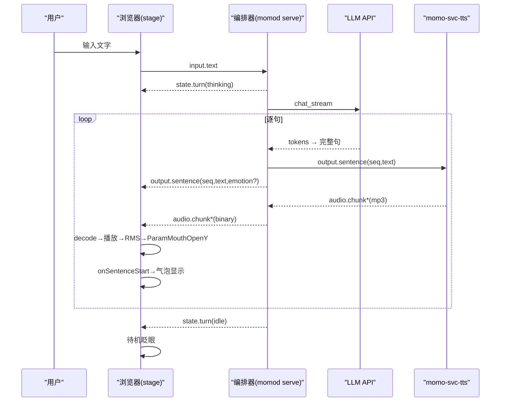

# P1：有脸 —— WebUI + Live2D + 音量口型

> 阶段目标：浏览器里看得见 momo——Live2D 模型随说话开合嘴、待机眨眼、文本气泡同步。P0 的管道骨架不变，交互端从终端换成浏览器。
> 上游文档：[roadmap](../00-context/roadmap.md)「P1 有脸」、[p0-pipeline](./p0-pipeline.md)。
> 协议 schema 与状态机完整定义见 `../01-architecture/`（protocol.md / runtime.md）；本文只列 P1 用到的消息子集。

## 目标

- `momod serve`：axum 提供 WS endpoint + 静态文件，浏览器打开即舞台。
- pixi-live2d-display 加载 Cubism 官方免费 sample 模型。
- 音量 RMS → `ParamMouthOpenY` 口型；idle 眨眼 + 待机小动作。
- WS 三类消息打通：文本（`output.sentence` 含情感 tag）、音频（`audio.chunk` 二进制）、状态（`state.turn`）。
- P0 的 `momod repl` 保留为调试入口。

## 范围与非范围

**范围内**

- momo-app 新增 `serve` 子命令（axum WS server + 静态资源服务），`momod serve` 启动。
- momo-app 新增 `web/` TypeScript 薄前端（vite + pixi.js + pixi-live2d-display）。
- protocol v1 前端子集落地：连接、收发、断线重连。
- 音频播放链：`audio.chunk` → WebAudio 解码 → 顺序播放 → AnalyserNode。
- 文本气泡与音频按 `seq` 对齐。

**范围外**

- 麦克风采集、VAD、ASR → P2（P1 输入仍是打字）。
- 表情动作由情感 tag 驱动 → tag 字段本阶段透传，映射表 P2 实装。
- Tauri 桌面壳 → 远期，前端代码保持不依赖浏览器专有 API 之外的假设。
- 口型的音素级方案（viseme/音量之外）→ 不排期，RMS 够用为止。
- 直播用的 OBS/虚拟声卡 → P5。

## 涉及组件

| 组件 | 仓库 | 语言 | 说明 |
|---|---|---|---|
| `momod serve` | momo-app | Rust | axum：`/ws/ui` WS endpoint + `/` 静态文件（`MOMO_UI_DIR`） |
| `web/` | momo-app | TypeScript | vite 工程，pixi 渲染 + WebAudio 播放 + WS client |
| Live2D 模型 | web/assets | — | Cubism 官方免费 sample（Hiyori/Mao 等），license 限制见下 |
| pipeline | momo-app | Rust | P0 复用，`run_turn` 产物改为广播到 WS |

模型 license：Cubism sample 模型允许示例/个人用途，**直播/商用授权未确认，列为 P5 前置**（见 [p5-streaming](./p5-streaming.md)）。

## 具体实现步骤

### 1. `momod serve`（Rust 侧）

`momod` 新增子命令 `serve`：

- axum 起 HTTP（监听 `MOMO_ORCH_LISTEN`，默认 `127.0.0.1:7800`）：`GET /` → `MOMO_UI_DIR`（默认 `./web/dist`）静态文件；`GET /ws/ui` → WS upgrade。
- 每个 WS 连接注册为"交互端"；`pipeline.run_turn` 改为：LLM 句切结果 → 广播 `output.sentence` 给前端 + 发 `output.sentence` 给 TTS；TTS 回流的 `audio.chunk` 原样转发前端。
- 前端发来的 `input.text` 触发新回合（P1 单回合顺序执行，新输入在播完前排队，打断在 P2）。
- 广播 `state.turn`：`listening → thinking → speaking → idle`（P0 无此概念，P1 起维护最小状态）。

### 2. P1 协议子集（前端 ↔ 编排器，protocol v1）

| 方向 | type | 载荷 | 说明 |
|---|---|---|---|
| 前端→编排器 | `input.text` | `{id, text, lang?}` | 打字输入 |
| 编排器→前端 | `output.sentence` | `{turn_id, seq, text, emotion, final}` | 文本句；`emotion` 为 `[happy]` 类 tag，P1 透传暂不用 |
| 编排器→前端 | `audio.chunk` | 二进制帧（mp3） | 归属最近 `seq` 的 `output.sentence` |
| 编排器→前端 | `state.turn` | `{turn_id, state}` | `listening/thinking/speaking/idle` |

约定：`output.sentence` 一定先于同 `seq` 的 `audio.chunk` 到达（编排器顺序保证），前端以此对齐气泡与音频。

### 3. frontend 模块布局

```
momo-app/web/
  package.json               # pixi.js, pixi-live2d-display, vite
  index.html                 # canvas + 输入框 + 气泡 DOM
  assets/model/<name>/       # Cubism sample 模型文件（model3.json 等）
  src/
    main.ts                  # 入口：初始化 stage/ws/player
    config.ts                # WS url = location.origin 换算 ws(s)://
    ws.ts                    # protocol client：收发、自动重连(指数退避 0.5s→8s，±20% 抖动)
    player.ts                # 音频队列：chunk → decodeAudioData → 顺序播放
                             #   回调 onSentenceStart(seq)/onSentenceEnd(seq)
    lipsync.ts               # AnalyserNode → RMS → ParamMouthOpenY
    stage.ts                 # PIXI.Application + 模型加载 + 每帧参数更新
    blink.ts                 # idle 眨眼与待机动作调度
    bubble.ts                # 气泡 DOM 随 seq 显示/淡出
    input.ts                 # 输入框 → input.text
```

### 4. 音频播放与口型（player.ts / lipsync.ts）

- `audio.chunk` 到达 → 按 `seq` 分组累积或直接流式 decode（mp3 分片 decodeAudioData 兼容性不稳，**预估需按句聚合后 decode**，待实测；不稳则按 12B 头 `flags.bit0=EOS` 聚合整句后 decode）。
- WebAudio `AudioContext`：source → `AnalyserNode`（fftSize 512）→ destination。
- 每 `requestAnimationFrame`：取时域数据算 RMS → 归一化（噪声门限 `MOMO_LIPSYNC_FLOOR` 对应前端常量）→ attack/decay 平滑 → `model.internalModel.coreModel.setParameterValueById("ParamMouthOpenY", v)`，v ∈ [0,1]。

### 5. 待机动作（blink.ts）

- 优先用模型自带 idle motion group（sample 模型一般带 `Idle`）。
- 兜底手动眨眼：随机 2.5–6s 间隔，`ParamEyeLOpen`/`ParamEyeROpen` 1→0→1 插值 150ms。
- Speaking 状态口型驱动优先于 idle motion 的嘴部参数。

### 6. 气泡同步（bubble.ts）

- `output.sentence(seq, text)` → 记录待播文本。
- `player.onSentenceStart(seq)` → 气泡显示该句文本；`onSentenceEnd` → 淡出；回合结束清空。
- 语音与文字错位容忍：±200ms 内视为同步（人工验收口径）。

## 时序图



## 配置项

| 变量 | 默认 | 说明 |
|---|---|---|
| `MOMO_ORCH_LISTEN` | `127.0.0.1:7800` | `momod serve` 监听地址 |
| `MOMO_UI_DIR` | `./web/dist` | 静态文件目录 |
| `MOMO_STAGE_MODEL` | `hiyori` | assets/model 下模型目录名 |
| `MOMO_LIPSYNC_FLOOR` | `0.02` | RMS 噪声门限（前端常量，可后续挪配置） |
| 其余 | — | 继承 P0 全部 `MOMO_*` |

## 验收检查表

- [ ] 浏览器打开舞台页，Live2D 模型加载成功（白屏/黑屏有明确报错，非静默）。
- [ ] 打字发送后：气泡出现 → momo 出声时嘴随音量开合（`ParamMouthOpenY` 明显随声音强弱变化，不是随机抖动）。
- [ ] 无输入待机 ≥10s 有眨眼/待机动作。
- [ ] 多句回复时气泡文本逐句切换，与音频起始点对齐在 ±200ms 内。
- [ ] 刷新页面/断开 WS 后自动重连，重连后可正常发起新回合。
- [ ] `momod repl` 仍可用作调试入口。
- [ ] 控制台无未捕获异常；`state.turn` 各阶段在 UI 有可见反馈（如 thinking 指示）。

## 退出标准

- 验收项全勾；录制一段 30s 屏录（打字→回话→口型→气泡）作为阶段演示。
- 已知取舍登记：整句 decode 方案是否成立（预估/待实测）；RMS 口型在安静环境下门限是否需调。
- Live2D sample 模型 license 状态写入 P5 前置清单（见 [p5-streaming](./p5-streaming.md)）。
