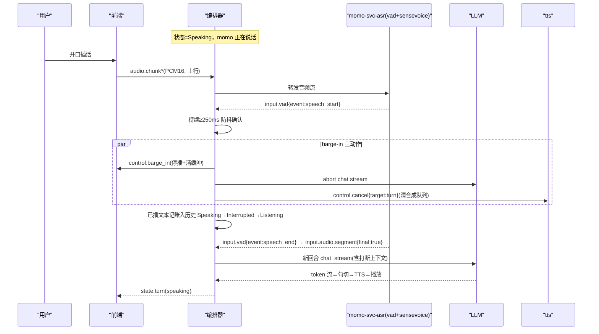

# P2：会听会打断 —— 语音输入 + barge-in + 本地 TTS

> 阶段目标：动嘴不动手——麦克风输入经 VAD/ASR 进回合，momo 说话时可以插话打断；edge-tts 换成本地 TTS；情感 tag 驱动表情。端到端语音回合 <1.5s。
> 上游文档：[roadmap](../00-context/roadmap.md)「P2 对话」、[p1-stage](./p1-stage.md)。
> 协议 schema 与状态机完整定义见 `../01-architecture/`（protocol.md / runtime.md）；本文列 P2 子集与 barge-in 时序。

## 目标

- 语音输入链：浏览器麦克风 → PCM16 流 → silero-vad 分段 → SenseVoice-Small 识别 → 文本进回合。
- 打断（barge-in）：Speaking 中检测到用户语音 → 停播 → 取消上游生成/TTS → 已播文本记账 → 转入新回合。
- TTS 本地化：先 Kokoro-82M（兜底，已实测达标）替换 edge-tts，再上 Fun-CosyVoice3-0.5B。
- 情感 tag：`[happy]` 类前缀 → 剥离后驱动 Live2D 表情 + 预留 TTS instruct。
- 端到端延迟（用户说完 → momo 出声）目标 <1.5s，逐环节预算分解见下。

## 范围与非范围

**范围内**

- 前端 `mic.ts`：getUserMedia + AudioWorklet → PCM16 16kHz mono → `audio.chunk` 二进制上行帧。
- momo-models `momo-svc-asr` 服务：silero-vad + SenseVoice-Small（sherpa-onnx，纯 CPU）。
- 编排器回合状态机完整实装：`Idle→Listening→Thinking→Speaking→Idle`，Speaking 可被 `Interrupted`。
- barge-in 三动作：停播、取消上游、已播文本记账。
- `momo-svc-tts` 本地 provider：`MOMO_TTS_PROVIDER=kokoro`（兜底，已实测达标）替换 edge；`cosyvoice3` 接口占位。
- 情感 tag 解析与表情映射表。
- 逐环节延迟打点扩展（接入 P0 metrics）。

**范围外**

- 记忆/自发说话 → P3。工具调用 → P4。
- 回声消除自研算法：用浏览器 `echoCancellation` 约束 + 防抖参数兜底，AEC 专项优化不排期。
- ASR 训练（明确不做）；Whisper turbo 备选评估（仅当语言广度不满足时）。
- 多说话人区分、连续语义 VAD → 远期。

## 涉及组件

| 组件 | 仓库 | 语言 | 说明 |
|---|---|---|---|
| `mic.ts` | momo-app/web | TS | 麦采集，`echoCancellation:true`，AudioWorklet 输出 PCM16 |
| `turn.rs` / `bargein.rs` | momo-app/momo-core | Rust | 状态机驱动 + 打断编排 |
| `emotion.rs` | momo-app/momo-core | Rust | tag 解析：剥离文本 → 表情名 + TTS instruct 参数 |
| `momo-svc-asr` | momo-models | Python | sherpa-onnx：silero-vad 分段 + SenseVoice-Small 识别 |
| `momo-svc-tts` | momo-models | Python | `MOMO_TTS_PROVIDER` 切换：`kokoro`=Kokoro-82M 流式合成（3070 CUDA，实测达标）；`cosyvoice3`=Fun-CosyVoice3-0.5B，部署需求待实测 |
| 表情映射 | momo-app | — | `emotion.map.yaml`：tag → Live2D expression/motion 名 |

## 具体实现步骤

### 1. 前端麦采集（mic.ts）

- `getUserMedia({audio:{echoCancellation:true, noiseSuppression:true, channelCount:1, sampleRate:16000}})`。
- AudioWorklet 聚合成 ~50ms 帧 PCM16 → WS 二进制帧 `audio.chunk`（12B 头，`stream=0x01` 上行；一段结束由头 `flags.bit0=EOS` 置位标记）连续上送。
- 推流状态显示（录音指示）；仅在 `state.turn` 为 `listening/speaking` 时上送（speaking 期间也要送——打断靠它）。

### 2. `momo-svc-asr` 服务（momo-models/services/asr/main.py）

- 依赖 sherpa-onnx（python）+ silero-vad ONNX；全部 CPU 推理，可放交互端同机。
- 输入：上行 `audio.chunk` 二进制流；内部 silero-vad 状态机产出：
  - `input.vad{event:"speech_start", segment_id, at_ms}`（进入语音段即发，供 barge-in 使用）
  - `input.vad{event:"speech_end", segment_id, at_ms}`（尾静音超过 `MOMO_VAD_SILENCE_MS` 判停）
- 语音段送 SenseVoice-Small → 回 `input.audio.segment`，载荷 `{segment_id, text, lang, speech_emotion?, duration_ms, final:true}`（SenseVoice 自带情感标记归一化进 `speech_emotion`；`lang` 为自动检测结果 zh/en/ja/ko/yue）。ASR 终稿与打字输入（`input.text`）走同一回合入口，但消息类型不复用。
- 实测基线（2026-10-10，laptop CPU×4）：RTF 0.040，8.4s 音频解码 337ms。

### 3. P2 协议子集

| 方向 | type | 载荷 | 说明 |
|---|---|---|---|
| 前端→编排器 | `audio.chunk`（二进制） | 12B 头 + PCM16 | 连续上行流；段尾 `flags.bit0=EOS` |
| ASR→编排器 | `input.vad` | `{event:"speech_start"\|"speech_end", segment_id, at_ms}` | 语音段边界；编排器可向 UI 镜像 |
| ASR→编排器 | `input.audio.segment` | `{segment_id, text, lang, speech_emotion?, duration_ms, final:true}` | 一段语音的识别终稿；编排器镜像给 UI 做字幕 |
| 编排器→前端 | `control.barge_in` | `{turn_id, applied:true}` | 打断通知：停播 + 清播放缓冲 + 关气泡；前端回报 `{turn_id, applied:true, played_seq}` |
| 编排器→TTS | `control.cancel` | `{target:"turn", id:turn_id, reason:"barge_in"}` | 清空该回合合成队列 |
| 编排器→LLM | — | HTTP abort | 断开 SSE stream |
| 编排器→前端 | `state.turn` | `{turn_id, state}` | 含 `interrupted` |

VAD/ASR 消息的 type 与字段以 `../01-architecture/protocol.md` 为准。

### 4. barge-in（bargein.rs）

编排器在 `Speaking` 状态收到 `input.vad{event:"speech_start"}`：

1. **防抖**：持续语音 ≥ `MOMO_BARGEIN_MIN_MS`（默认 250ms）才触发，防扬声器漏音/咳嗽误触（浏览器 AEC 有效性**待实测**，差则调高阈值或建议戴耳机）。
2. 触发后三动作并发：
   - `control.barge_in` → 前端：停止当前 source、清空音频队列、关气泡。
   - LLM stream abort；`control.cancel` → TTS 清队。
   - **记账**：已完整播出的句子 + 当句已播部分（按播放进度截断估算）写入 history，标注 `[被打断]`；未送出的句子丢弃。
3. 状态 `Speaking→Interrupted→Listening`，等 `input.vad{event:"speech_end"} → input.audio.segment{final:true}` 开启新回合。
4. 新回合 prompt 上下文中保留被打断的半句，LLM 自然衔接。

### 5. 本地 TTS 替换

- 同一 `momo-svc-tts` 服务、同一 momo-ws v1 接口（`output.sentence` → `audio.chunk`），provider 切换 = 改 `MOMO_TTS_PROVIDER`，`MOMO_TTS_ENDPOINT`（`ws://127.0.0.1:7811/ws`）与编排器代码零改动。
- `MOMO_TTS_PROVIDER=kokoro`：Kokoro-82M。实测（2026-10-10，laptop 3070）：首包 209ms，RTF 0.023，VRAM 0.76GB。
- `MOMO_TTS_PROVIDER=cosyvoice3`：Fun-CosyVoice3-0.5B，官方标称双向流式首包 150ms（**官方标称，非本机实测**）；显存/依赖需求**待实测**，失败则保持 Kokoro，换机评估。
- 注意：laptop 拉模型必须 `HF_ENDPOINT=https://hf-mirror.com`；torch/torchaudio 版本必须对齐（已踩坑）。

### 6. 情感 tag → 表情（emotion.rs）

- System prompt 约束 LLM 每句以 `[tag]` 开头，tag 集合为 protocol.md 固定 8 值：`neutral/happy/sad/angry/surprised/thinking/shy/sleepy`。
- `emotion.rs` 用正则 `^\[(?<tag>[a-z_]+)\]\s*` 剥离：气泡与 TTS 拿干净文本；tag 经 `emotion.map.yaml` 映射到 Live2D expression 名 → 随 `output.sentence.emotion` 下发前端；同时预留 TTS instruct 字段（CosyVoice3 用，Kokoro 忽略）。
- 非法/缺失 tag → `neutral`，不报错。

### 7. 端到端延迟预算（语音回合：用户说完 → momo 出声，目标 <1.5s）

| 环节 | 预算 | 依据 |
|---|---|---|
| VAD 判停（尾静音） | 250ms | `MOMO_VAD_SILENCE_MS`，预估/待实测 |
| SenseVoice 解码（按 3s 语音） | ~120ms | RTF 0.040 **实测** 系数换算 |
| ASR→编排器（LAN/本机 WS） | 10ms | 预估 |
| LLM TTFT | 400ms | DS API 预估/待实测；MLX Qwen3-8B-4bit 预估 <250ms（生成速率 121t/s **实测**） |
| 首句凑齐（token→句） | 200ms | 首句 ~25 字，按 121t/s **实测**速率估算 |
| TTS 首包 | 209ms | Kokoro **实测** |
| 前端 decode+jitter | 100ms | 预估 |
| **合计** | **~1.34s** | 余量小，超标先砍 VAD 尾静音与首句长度（prompt 约束"首句说短点"） |

metrics 扩展：每回合打印 `vad_tail / asr_ms / llm_ttft / first_sent_ms / tts_first / e2e`，P2 验收按 p50 统计 ≥5 轮。

## barge-in 时序图

## 配置项

| 变量 | 默认 | 说明 |
|---|---|---|
| `MOMO_ASR_ENDPOINT` | `ws://127.0.0.1:7810/ws` | momo-svc-asr 地址（编排器侧） |
| `MOMO_ASR_LISTEN` | `127.0.0.1:7810` | momo-svc-asr 监听地址（服务侧） |
| `MOMO_VAD_SILENCE_MS` | `250` | VAD 判停尾静音 |
| `MOMO_BARGEIN_ENABLED` | `true` | 允许打断 |
| `MOMO_BARGEIN_MIN_MS` | `250` | 打断防抖持续时长 |
| `MOMO_TTS_ENDPOINT` | `ws://127.0.0.1:7811/ws` | momo-svc-tts 地址 |
| `MOMO_TTS_PROVIDER` | `kokoro` | `kokoro`→`cosyvoice3` 切换 |
| `MOMO_EMOTION_MAP` | `config/emotion.map.yaml` | tag→表情映射文件 |
| `HF_ENDPOINT` | `https://hf-mirror.com` | laptop 拉模型必须 |
| 其余 | — | 继承 P0/P1 全部 `MOMO_*` |

## 验收检查表

- [ ] 全程动嘴不动手完成 ≥5 轮对话（ASR 识别正确率可接受，错字不阻塞流程）。
- [ ] momo 说话中插话：≤800ms 内停嘴（预估目标，以实测记录为准）且音频队列已清。
- [ ] 打断后日志可见已播文本记账（含 `[被打断]` 标注），momo 能把打断上下文接进新回合。
- [ ] 连续快速插话 3 次不死锁、不复读已取消内容。
- [ ] 端到端 5 轮 p50 <1.5s，逐环节耗时打印齐备。
- [ ] 出声走 Kokoro（或 CosyVoice3），edge-tts 已不在音频路径上。
- [ ] 情感 tag 生效：对话中至少观察到 2 种表情切换；非法 tag 不崩。
- [ ] 关闭麦克风权限/拔掉麦时有可读错误提示，文字输入仍可降级使用。

## 退出标准

- 验收项全勾；p50 端到端延迟数据写入 WORKING-NOTES 级别的实测记录。
- AEC/防抖实测定论（扬声器外放 vs 耳机），结论登记。
- CosyVoice3 部署可行性有结论（能跑则进入 P3 声线轨道；不能跑则记录瓶颈，Kokoro 继续兜底）。
- 遗留：打断后半句的"截断估算"精度、VAD 在安静/嘈杂环境阈值，登记待调项。
