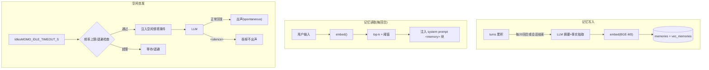

# P3：灵魂 —— 记忆 + 自发说话 + 人设 + 声线/人格微调接入

> 阶段目标：重启后记得上次聊过什么；挂机会自己找话题；人设可版本化、可回归评测；声线 SFT 与 LLM LoRA 有明确接入点。
> 上游文档：[roadmap](../00-context/roadmap.md)「P3 灵魂」+ 并行轨道 A/B、[p2-dialogue](./p2-dialogue.md)。
> 协议 schema 与状态机完整定义见 `../01-architecture/`；本阶段不新增对外消息类型，改动集中在编排器内部与 momo-models 服务。

## 目标

- 记忆：sqlite-vec + BGE-M3，会话摘要入库、检索注入 prompt。
- 空闲 scheduler：无输入超时 → 注入情境让 LLM 自发开口，带频率控制与防打扰。
- 人设：character card（YAML）→ system prompt 渲染，配 20 题固定回归评测集。
- 声线 SFT 接入点：TTS 服务接口不变，零样本 → SFT 产物可热替换。
- LLM LoRA 实验流程：数据导出 → 人工修写 → 4090D QLoRA → 评测对比。

## 范围与非范围

**范围内**

- momo-app `memory/` 模块：rusqlite + sqlite-vec，schema 见下。
- momo-models `momo-svc-embed` 服务：BGE-M3 embedding（CPU 可跑）。
- 摘要 job：会话结束 / 每 N 回合触发，LLM 生成摘要+事实抽取 → 入库。
- `idle.rs`：空闲触发、退避、频率上限、`<silence>` 克制协议。
- `persona/momo.card.yaml` + prompt 渲染模板。
- `momo-models/eval/`：评测集 + 跑分脚本 + 结果存档。
- 训练轨道接入文档与脚本骨架（训练在 4090D，不在本仓库机器跑）。

**范围外**

- 权重级人格"完成态"：LoRA 是实验流程接入，不承诺本阶段出成品。
- 歌声克隆、RVC → 远期。
- 多模态记忆（图像/语音片段）→ 远期。
- 记忆可视化编辑 UI → 远期，sqlite 可直查即可。

## 涉及组件

| 组件 | 仓库 | 语言 | 说明 |
|---|---|---|---|
| `memory/{mod,store,recall,summarize}.rs` | momo-app/momo-core | Rust | sqlite-vec 存储、检索、摘要 job |
| `idle.rs` | momo-app/momo-core | Rust | 空闲 scheduler |
| `persona.rs` + `persona/momo.card.yaml` | momo-app | Rust+YAML | card 加载 → system prompt 渲染 |
| `momo-svc-embed` | momo-models | Python | BGE-M3 dense 1024 维，momo-ws v1 连接 `embed(text)→vec` |
| `eval/` | momo-models | Python | questions.yaml + persona_eval.py + runs/ |
| `training/` | momo-models | Python+文档 | tts_sft / llm_lora 脚本与流程 |

## 具体实现步骤

### 1. 记忆 schema（momo.db，rusqlite + sqlite-vec 扩展）

```sql
CREATE TABLE sessions (
  id INTEGER PRIMARY KEY,
  started_at INTEGER NOT NULL,
  ended_at INTEGER,
  summary TEXT
);

CREATE TABLE turns (
  id INTEGER PRIMARY KEY,
  session_id INTEGER NOT NULL REFERENCES sessions(id),
  role TEXT NOT NULL,            -- user | assistant
  text TEXT NOT NULL,
  interrupted INTEGER DEFAULT 0,
  ts INTEGER NOT NULL
);

CREATE TABLE memories (
  id INTEGER PRIMARY KEY,
  kind TEXT NOT NULL,            -- episode | fact | preference
  text TEXT NOT NULL,
  source TEXT,                   -- session_id:turn_range
  importance REAL DEFAULT 0.5,   -- 0..1，摘要时由 LLM 打分
  created_at INTEGER NOT NULL,
  last_recalled INTEGER,
  recall_count INTEGER DEFAULT 0
);

CREATE VIRTUAL TABLE vec_memories USING vec0(
  embedding float[1024]          -- BGE-M3 dense 维度
);
```

### 2. 写入路径：摘要入库（summarize.rs）

- 触发：会话结束（`momod serve` 收到退出/前端关闭超时）或每 `MOMO_SUMMARY_EVERY_TURNS`（默认 20）回合。
- 流程：取未摘要 turns → LLM 一次调用产出 `{summary, memories:[{kind,text,importance}]}` → 每条 `embed()` → `memories` + `vec_memories` 同事务写入。
- `momo-svc-embed` 服务：BGE-M3 dense，CPU 推理延迟预估 100–300ms/条（**预估/待实测**），摘要异步跑不阻塞回合。

### 3. 读取路径：检索注入（recall.rs）

- 每个用户输入回合：input → `embed()` → `vec_memories` top-k（`MOMO_RECALL_K=5`）→ 距离阈值过滤（`MOMO_RECALL_MIN_SCORE=0.45`，**预估/待调**）。
- 命中项更新 `last_recalled`/`recall_count`；渲染进 system prompt 的 `<memory>` 块（最近会话 summary + 命中记忆，带时间戳）。
- 无命中不注入，不占 context。

### 4. 空闲 scheduler（idle.rs）

- 计时器：任一用户输入/`input.audio.segment{final:true}`/自发回合结束即重置。
- 触发条件：状态 `Idle` 且空闲 ≥ `MOMO_IDLE_TIMEOUT_S`（默认 20s，config.md 口径；P3 按实测可调）。
- 注入情境：内部事件（非 user 消息）→ LLM：包含空闲时长、最近话题摘要、当前时段；LLM 可输出正常回复或 `<silence>`（编排器吞掉不出声）。
- 频率控制：每次自发触发后间隔 ×`MOMO_IDLE_BACKOFF`（默认 1.5，封顶 10min）；`MOMO_IDLE_MAX_PER_10MIN=3` 硬上限；用户输入后立即复位 backoff。
- 防打扰：仅在 `Idle` 触发（Listening/Thinking/Speaking 一律不触发）；所有自发回合打 `spontaneous=true` 日志供评测抽查。

### 5. character card（persona/momo.card.yaml）

```yaml
name: momo
version: 1
description: ...            # 一句话形象
personality: [...]          # 性格要点
speech_style:               # 口癖/语气/句长约束/禁用助手腔清单
  rules: [...]
emotion_tags: [neutral, happy, sad, angry, surprised, thinking, shy, sleepy]
greeting: ...               # 开场白
example_dialogues: [...]    # few-shot 示例
boundaries: [...]           # 拒绝/不演范围
```

`persona.rs` 加载 → 模板渲染 system prompt（persona + memory 块 + 情境事件三段式）；改卡只改 yaml + 重启，不动代码；card 变更必须跑评测集。

### 6. 评测集（momo-models/eval/）

- `questions.yaml`：固定 20 题，类别配比：身份一致 4 / 记忆回忆 4 / 口癖风格 6 / 边界拒绝 3 / 多语切换 3。每题 `{id, category, question, checks}`，checks 支持 `must_contain` / `must_not_contain` / `rubric`（人工 1–5 分）。
- `persona_eval.py`：跑完整回合（可指向本地编排器或直接 LLM endpoint）→ `runs/<ts>.jsonl` 存题、答、分项分。
- 回归口径：persona 或主脑模型变更后跑一遍，与上一 run 对比，类别均分下降 >0.5 视为回退（人工复核）。

### 7. 声线 SFT 接入点（并行轨道 A 落点）

- TTS 服务接口不变：`momo-svc-tts` 同一 momo-ws v1 接口，`MOMO_TTS_PROVIDER`/`MOMO_TTS_VOICE_REF` 换实现即可，编排器侧 `MOMO_TTS_ENDPOINT` 不动。
- 路径：攒 10–60min 干净素材 → 4090D 单卡（24h 窗口）跑 CosyVoice3 训练脚本或 GPT-SoVITS（更轻，备选）→ 产物回传 → `MOMO_TTS_MODEL_DIR` + `MOMO_TTS_VOICE_REF` 指向新模型 → 重启服务。
- 零样本先行：`MOMO_TTS_VOICE_REF`（10–30s 参考音 + 文本）即可试克隆；不满意再走 SFT。
- 评估：盲听 A/B——像不像 / 稳不稳 / 情感范围，结论登记。

### 8. LLM LoRA 实验流程（并行轨道 B 落点）

1. 数据：`training/llm_lora/export.py` 从 `turns` 表导出对话 → 人工修写成符合人设的回复 → `data/sft.jsonl`（几百条起步）。
2. 训练：4090D 单次 24h 窗口，8B–14B QLoRA（框架建议 LLaMA-Factory，**待实测**）；>14B 等夜间 bigstrong 窗口或拆多次。
3. 产物：adapter 合入或 MLX 侧加载 → 基座跟随主脑（主脑定谁就微调谁）。
4. 验收：先过 20 题评测集 + 盲聊对比，不优于 prompt 版就不换。

## 流程图



## 配置项

| 变量 | 默认 | 说明 |
|---|---|---|
| `MOMO_MEMORY_ENABLED` | `true` | 记忆检索开关（P3 开启） |
| `MOMO_MEMORY_DB` | `data/momo.vec.db` | sqlite-vec 库文件 |
| `MOMO_EMBED_LISTEN` | `127.0.0.1:7812` | momo-svc-embed 监听地址（服务侧） |
| `MOMO_EMBED_ENDPOINT` | `ws://127.0.0.1:7812/ws` | 编排器→embed 连接地址 |
| `MOMO_RECALL_K` | `5` | 检索 top-k |
| `MOMO_RECALL_MIN_SCORE` | `0.45` | 相似度阈值（预估/待调） |
| `MOMO_SUMMARY_EVERY_TURNS` | `20` | 摘要触发回合数 |
| `MOMO_IDLE_TIMEOUT_S` | `20` | 空闲触发秒数 |
| `MOMO_IDLE_BACKOFF` | `1.5` | 退避倍率 |
| `MOMO_IDLE_MAX_PER_10MIN` | `3` | 自发说话硬上限 |
| `MOMO_PERSONA_CARD` | `persona/momo.card.yaml` | 人设卡路径 |
| `MOMO_TTS_MODEL_DIR` | — | SFT 产物目录（CosyVoice3/Sovits） |
| `MOMO_TTS_VOICE_REF` | — | 零样本参考音路径 |

## 验收检查表

- [ ] 会话 A 告诉 momo 一个事实 → 重启 `momod serve` 与 momo-svc-embed → 新会话提问能回忆起（日志可见检索命中注入）。
- [ ] 摘要 job 跑过后 `memories`/`vec_memories` 表有记录，`sessions.summary` 非空。
- [ ] 挂机 10 分钟自发开口 2–3 次（roadmap 口径）；含 `<silence>` 克制生效的日志。
- [ ] 自发说话不超 `MOMO_IDLE_MAX_PER_10MIN`；用户输入后 backoff 复位。
- [ ] 自发说话从不在 momo 说话/思考中插入（无状态混乱）。
- [ ] 改 character card 的口癖规则后评测集 20 题可跑出 `runs/*.jsonl`，两版可对比。
- [ ] 非法/空 yaml、momo-svc-embed 挂掉时行为可读（报错或降级无记忆运行），不 panic。

## 退出标准

- 验收项全勾；"重启记得"与"挂机自发开口"录屏演示。
- BGE-M3 CPU 实测延迟、检索阈值调定值、`<silence>` 克制比例写入实测记录。
- 声线轨道结论：零样本是否够用 / SFT 是否已排期（素材量、4090D 窗口）。
- LoRA 轨道产出：sft.jsonl 已积累条数、首次实验结论（可仅为"已跑通流程"）。
- 遗留登记：记忆误检/漏检案例、评测集待补题目。
