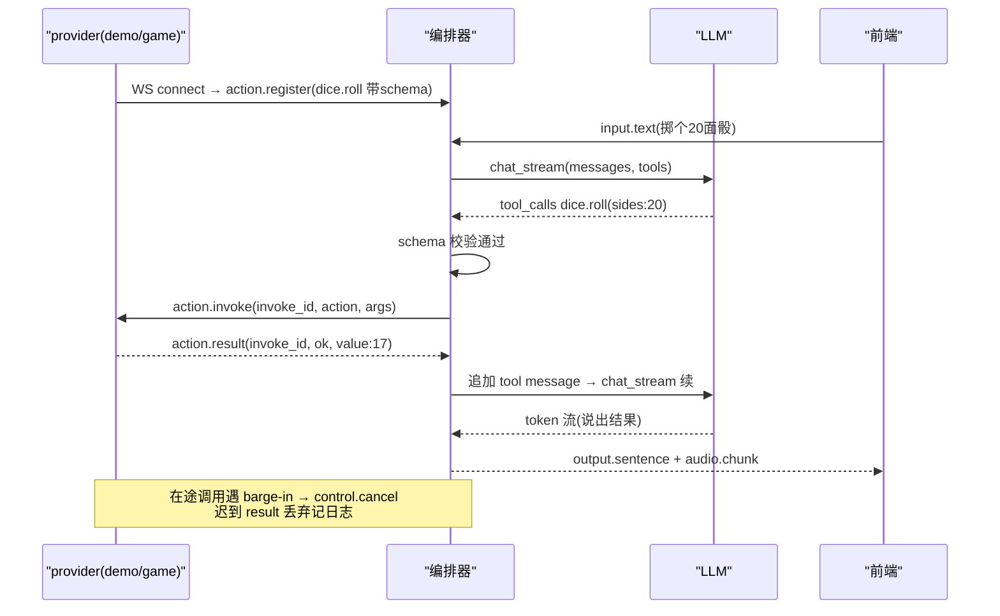

# P4：能力 —— action 总线 + 视觉 + 工具调用

> 阶段目标：momo 不止会聊天——外部程序（游戏/工具适配器）通过本地 WS 注册 action，LLM 输出结构化调用，执行下沉到提供方；截图可经 `deepseek-v4-flash-vision-exp` 进入上下文。
> 上游文档：[roadmap](../00-context/roadmap.md)「P4 能力」、[p3-soul](./p3-soul.md)。协议完整定义见 `../01-architecture/`（protocol.md）；action 协议设计参考 neuro-game-sdk，但只走本地 WS，不接其外部平台语义。

## 目标

- action 总线：注册 / schema / 调用 / 结果 / 取消 / 生命周期管理，跑通一个 demo action 端到端。
- 工具调用：内置 provider（时间、搜索）复用同一总线。
- 视觉输入：截图 → DeepSeek vision → 文本描述注入上下文。
- action 调用参与回合状态机：可与打断、记忆共存不出错。

## 范围与非范围

**范围内**

- momo-app `action/` 模块：registry、dispatcher、schema 校验、超时与竞态处理。
- `/ws/action` provider 接入 endpoint（独立于前端 `/ws/ui`）。
- LLM tools 桥接：registry → OpenAI `tools` 参数；`tool_calls` → `action.invoke`；`action.result` → tool message 回灌。
- 内置 provider：`time.now`、`search.query`（引擎可配）。
- `vision.rs`：截图字节 → vision API → 描述注入。
- `examples/action_demo.py`（momo-models 或 momo-app/examples）：demo provider。

**范围外**

- 游戏深度集成（具体某款游戏的适配）→ 有 demo 即可，实战另起。
- forced action / action 优先级抢占（neuro-sdk 的高级语义）→ v1.1。
- 视觉连续流/视频理解 → 远期；本阶段一次性截图。
- 自建 VLM → 明确不做，用 `deepseek-v4-flash-vision-exp`。
- action 调用的用户授权/权限系统 → 本地可信前提，不建权限层。

## 涉及组件

| 组件 | 仓库 | 语言 | 说明 |
|---|---|---|---|
| `action/{mod,registry,dispatch,schema}.rs` | momo-app/momo-core | Rust | 总线核心 |
| `tools/{time,search}.rs` | momo-app/momo-core | Rust | 内置 provider（进程内直挂总线） |
| `vision.rs` | momo-app/momo-core | Rust | 截图 → vision API → 上下文注入 |
| `action_demo.py` | examples | Python | demo provider：注册 `dice.roll` |

## 具体实现步骤

### 1. action 协议子集（provider ↔ 编排器，`/ws/action`）

| 方向 | type | 载荷 | 说明 |
|---|---|---|---|
| provider→编排器 | `action.register` | `{provider, actions:[{name,description,json_schema}]}` | 连接建立后即注册，可重复注册（后者覆盖） |
| provider→编排器 | `action.unregister` | `{provider, names:[...]}` | 注销；连接断开视为全部注销 |
| provider→编排器 | `action.result` | `{invoke_id, ok, data?|error?}` | 调用回报 |
| 编排器→provider | `action.invoke` | `{invoke_id, turn_id, action, args, timeout_ms}` | 一次调用 |
| 编排器→provider | `control.cancel` | `{target:"invoke", id:invoke_id}` | barge-in/超时取消 |

对前端协议不变：工具回合照常 `state.turn` 广播，momo 可"边想边说"（tool 等待期间允许继续生成过渡句，策略见下）。

### 2. registry 与 LLM 桥接

- registry：`name → {provider_conn, json_schema}`；对外暴露名统一为 `provider.action`（如 `dice.roll`），防跨 provider 撞名。
- 回合开始时把当前 registry 转成 OpenAI `tools`（`description` + `parameters=json_schema` 直译）传给 LLM；LLM 返回 `tool_calls` → 逐条校验（名字存在 + args 过 schema）→ 发 `action.invoke`。
- `action.result` 回来 → 以 tool message 追加 messages → 继续 `chat_stream` 完成本回合输出。
- 校验失败（未注册名/schema 不符）：不下发，直接以 tool error 回灌让 LLM 重试一次；再错则告知用户"做不到"，不静默吞。

### 3. 竞态与生命周期注意点（dispatch.rs）

1. **provider 断连**：其全部 action 从 registry 摘除；在途 `action.invoke` 合成 error 结果回灌 LLM；registry 变更要反映到下一回合的 tools 列表（不回溯改本回合）。
2. **超时**：`MOMO_ACTION_TIMEOUT_MS`（默认 10s，action 可带 `timeout_ms` 覆盖）→ 超时视同 error + 发 `control.cancel`。
3. **barge-in 中在途调用**：用户打断 → 对所有 pending call 发 `control.cancel`；迟到的 `action.result` 丢弃并记日志；LLM 侧记录 `cancelled` 而非假结果。
4. **并发**：不同 provider 的 call 可并行；同一 provider 默认串行排队（`concurrent:true` 声明可放开）。
5. **断连重注册**：同名 action 由新连接注册覆盖，旧连接在途 call 全部按断连处理。

### 4. 内置工具

- `time.now`：`{tz?}` → ISO 时间，进程内实现，挂 `builtin.time`。
- `search.query`：`{query, n?}` → 引擎由 `MOMO_SEARCH_PROVIDER`/`MOMO_SEARCH_API_KEY` 配（具体引擎**待选定**，先留 mock 实现跑通链路）。
- 内置 provider 走同一 registry/dispatch 路径，唯一区别是连接是进程内 channel 而非 WS。

### 5. 视觉输入（vision.rs）

- 触发两路：用户点前端"看一眼"按钮 / LLM 调 `builtin.vision.look`。
- 取图：P4 先做文件路径/前端截屏上传（stage canvas 或用户拖图）→ base64 → `deepseek-v4-flash-vision-exp`（OpenAI 兼容 chat，image_url）→ 返回描述。
- 描述作为情境块注入当前/下一回合上下文：`[视觉输入] ...`，与记忆块并列。
- key 用 `MOMO_DEEPSEEK_API_KEY`（与 LLM 兜底共用），endpoint/model 由 `MOMO_VISION_ENDPOINT`/`MOMO_VISION_MODEL` 可换。延迟预估 1–3s（**待实测**），不进 <1.5s 主链路，异步注入。

## action 调用时序图

## 配置项

| 变量 | 默认 | 说明 |
|---|---|---|
| `MOMO_ACTION_WS_PATH` | `/ws/action` | provider 接入路径 |
| `MOMO_ACTION_TIMEOUT_MS` | `10000` | 默认调用超时 |
| `MOMO_SEARCH_PROVIDER` | `mock` | 搜索引擎适配（待选定真引擎） |
| `MOMO_SEARCH_API_KEY` | — | 搜索 key |
| `MOMO_VISION_ENDPOINT` | `https://api.deepseek.com/v1` | 视觉 API endpoint |
| `MOMO_VISION_MODEL` | `deepseek-v4-flash-vision-exp` | 视觉 endpoint 模型名 |
| `MOMO_VISION_MAX_BYTES` | `4194304` | 截图体积上限 |

## 验收检查表

- [ ] `action_demo.py` 启动后注册 `dice.roll{sides:int}`，编排器日志可见注册。
- [ ] 对 momo 说"掷个 20 面骰"：观察到 `action.invoke` → `action.result` → momo 说出点数（日志+出声双确认）。
- [ ] 关掉 demo provider 再提掷骰：momo 表示做不到，不调用幽灵 action。
- [ ] LLM 给出 schema 外参数时，错误回灌路径可见（日志有 tool error）。
- [ ] 故意让 demo sleep 20s：触发超时 error，不挂死回合。
- [ ] `builtin.time` 问时间正确回答；`search.query` mock 链路可走通。
- [ ] 视觉：上传/截图一张图，momo 能描述内容（走 vision endpoint）。
- [ ] action 等待期间插话打断：在途 call 收到 `control.cancel`，新回合正常。

## 退出标准

- 验收项全勾；demo action 端到端录屏。
- 竞态五条（断连/超时/打断取消/并发/重注册）各有一条日志证据。
- vision 链路延迟实测记录；搜索引擎选型结论登记（可延期）。
- 遗留登记：forced action 语义、多 action 并发的顺序保证边界。
