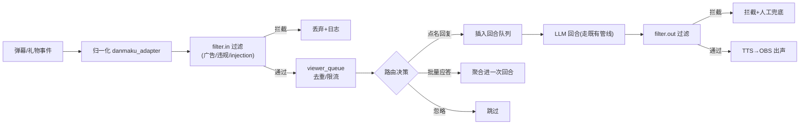

# P5：直播 —— 暂缓，范围与前置条件

> 阶段目标：**本阶段暂不启动开发**。本文只框定范围、硬前置条件与拆解方向，供日后启动时对照检查；详细设计**另起详细调研文档**（拟 `00-context/research-streaming.md`）。
> 上游文档：[roadmap](../00-context/roadmap.md)「P5 直播」、[research](../00-context/research.md) 开放问题。

## 目标

- 明确"做直播要动哪些东西"，以及启动前必须清零的阻塞项。
- 不写实现方案——所有方案级内容标注"待调研"，防止把未验证假设写成决策。

## 范围与非范围

**范围内（届时要做的事）**

- OBS 接入：舞台画面与声音进 OBS 的两条路线待选型——
  - 画面：OBS browser source 直连舞台页（最省事，预估首选）vs 窗口/虚拟摄像头采集。
  - 声音：虚拟声卡路由（macOS BlackHole / Windows VB-Cable / Linux pulse/pipewire virtual sink）把 momo 输出送入 OBS 音频源；平台矩阵待实测。
- 弹幕平台接入：弹幕/礼物事件 → 统一观众输入流。目标平台、可用 SDK/协议（如 blivedm 类现成库 vs 官方开放平台）、ToS 合规**全部待调研**；不自己写协议爬虫。
- **过滤层（硬前置）**：双向过滤接口 P0 起已留 hook，开播前必须实装——
  - 输入过滤：广告/违规/刷屏，以及**弹幕 prompt injection**（观众文字直接进 LLM context，是真实攻击面）。
  - 输出过滤：TTS 出声前的内容审查兜底；过滤策略（规则/模型/黑白名单）待调研，但必须可观测、可旁路日志。
- 观众队列：弹幕 → 归一化 → 过滤 → 队列（按用户去重、速率限制）→ 路由策略：点名回复 / 批量应答 / 忽略；优先级（醒目留言/礼物）属于平台差异化功能，待调研。
- 直播态会话管理：观众回合与私人回合共存的路由规则、上下文污染控制。

**范围外（明确不做）**

- 多平台同播（先单平台跑通）。
- 自动开播/下播、直播排班系统。
- 会员/礼物/打赏业务逻辑（只消费事件，不做账）。
- 全自动无人值守合规承诺：过滤层是兜底不是免责，直播始终需要人在回路。
- 歌声/点歌系统 → 远期独立子系统。

## 涉及组件（届时预估）

| 组件 | 位置 | 说明 |
|---|---|---|
| `filter.in` / `filter.out` | momo-app 编排器 | 已有 no-op hook，开播前实装，**硬前置** |
| `danmaku_adapter` | momo-models 或独立进程 | 平台事件 → `input.text` 归一化；选型待调研 |
| `viewer_queue` | momo-app | 去重/限流/路由决策 |
| OBS / 虚拟声卡 | 外部 | browser source + virtual audio sink，平台矩阵待实测 |
| 前端直播态 UI | momo-app/web | 弹幕列表/队列可视化（可选） |

## 前置条件清单（启动 P5 的必要条件）

- [ ] **过滤层实装并验收**：input/output 双向，含 prompt injection 用例测试。
- [ ] **License 清零**：Live2D sample 模型的直播/商用授权确认（免费 sample 大概率不允许直播，可能需换模型或购授权——待调研）；克隆声线的原声授权与平台规则确认。
- [ ] P2–P4 稳定：barge-in、打断、action、记忆在长时间运行下无内存/状态泄漏（≥2h 挂机测试，待实测）。
- [ ] 弹幕平台选定 + SDK 可行性结论（调研文档产出）。
- [ ] 音频路由方案在本机实测通过（目标平台各跑通一次）。
- [ ] 明确"人在回路"盯播约定与一键熔断（`control.cancel` + 静音 + 下播）预案。

## 观众输入处理流程（概念图，细节待调研）

## 配置项（届时预估，非最终）

| 变量 | 说明 |
|---|---|
| `MOMO_STREAM_PLATFORM` | 目标平台标识 |
| `MOMO_STREAM_ROOM_ID` | 房间号 |
| `MOMO_FILTER_*` | 过滤层策略开关与名单路径 |
| `MOMO_VIEWER_RATE_*` | 观众限流参数 |
| `MOMO_STREAM_KILL_SWITCH` | 熔断开关 |

## 验收检查表（本阶段文档的验收 = 调研产出物）

- [ ] `research-streaming.md` 产出：平台选型、SDK 可行性、音频路由矩阵实测、过滤层方案、license 结论。
- [ ] 前置条件清单逐项有结论（通过/阻塞/ workaround）。
- [ ] 启动 go/no-go 评审记录。

## 退出标准

- 本阶段**无代码退出标准**；调研文档评审通过、前置条件清零后才允许拆 P5 实施任务。
- 若任一硬前置（过滤层/license）无法清零 → 直播继续冻结，回到 P4 及以前迭代。
