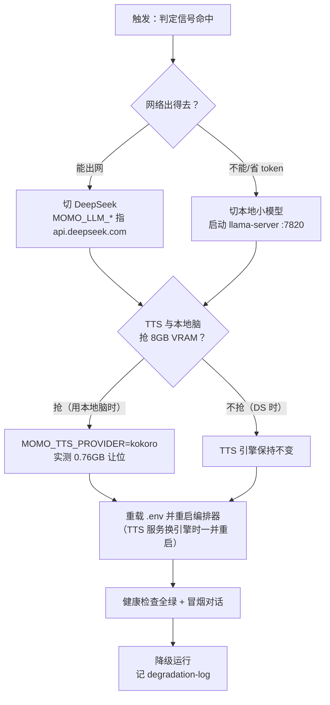

# 降级手册（degradation）

> 前提：**mac-studio 是借来的，随时可能被收回**。降级不是异常处理，是常态预案。
> 目标：检测 → 切换 → 验证全程 <10 分钟，且只改 env 不改代码。配套启动/env 见 [./deployment.md](./deployment.md)。

## 判定信号（mac-studio 不可用）

满足任一即触发降级流程：

| 信号 | 检测方式 | 阈值 |
|---|---|---|
| 编排器健康检查 LLM 项失败 | `GET http://laptop:7800/healthz` → `llm` 非 `ok` | 连续 3 次（每次间隔 10s） |
| MLX server 无响应 | `curl -m 5 http://mac-studio:7820/v1/models` | 超时或 5xx |
| 主机不可达 | `ping -c 3 mac-studio` / SSH 失败 | 全丢包 |
| 会话中断 | 编排器日志出现 LLM 连接 reset/timeout | 持续 60s |
| 人为收回 | 实验室通知 / 机器不在了 | 立即 |

`momoctl doctor` 会聚合前三项（工具就绪后）。

## 切换流程



操作步骤（DeepSeek 路径，推荐）：

```bash
cd momo-app                                # 或 .env 所在位置
cp deploy/env/degraded.env .env            # 或直接改三个变量：
#   MOMO_LLM_ENDPOINT=https://api.deepseek.com/v1
#   MOMO_LLM_MODEL=deepseek-v4-flash
#   MOMO_LLM_API_KEY=sk-...
momoctl serve restart                      # 工具未就绪时：pkill -f momod && cargo run --bin momod &
curl -sf http://laptop:7800/healthz        # llm 回 ok 即完成
```

本地小模型路径：先 `llama-server -m $MOMO_MODELS_DIR/Qwen/Qwen3-8B-GGUF/...gguf --port 7820`（吞吐待实测），再把 `MOMO_LLM_ENDPOINT` 指 `http://127.0.0.1:7820/v1`，其余同上；此时按上表把 `MOMO_TTS_PROVIDER` 改为 `kokoro`。

## 降级后能力损失表

| 能力 | 正常档 | 降级档 | 损失 |
|---|---|---|---|
| 大脑 | mac-studio MLX Qwen3-30B-A3B-4bit（实测 121 t/s，2026-10-10） | DS `deepseek-v4-flash`（云端，速度看网络）或本地 8B GGUF（3070 8GB，吞吐待实测） | 人格 LoRA 若是按 MLX 基座训练的需重挂/不生效；本地脑更笨更慢 |
| TTS | 克隆声线（首选 Fun-CosyVoice3） | DS 路径下不变；本地脑路径退 Kokoro（无克隆音色） | 用本地脑时**丢声线**，只剩兜底音色 |
| ASR | SenseVoice CPU | 不变 | 无 |
| 打断/回合/记忆 | 编排器全量 | 不变 | 无 |
| 延迟 | 首 token <300ms 级（实测链路达标 <1.5s 目标） | DS 增加公网 RTT；本地脑变慢 | 可能超 1.5s 目标，体验降级但可用 |
| 依赖 | 全内网 | DS 路径依赖外网 + API key 有效 | 新故障面：key 过期/欠费 |

## 恢复回切

mac-studio 回来且确认稳定后：

1. `curl -sf http://mac-studio:7820/v1/models` 确认 MLX server 已起（没起先拉起）。
2. `cp deploy/env/normal.env .env`，重启编排器。
3. 健康清单全绿 + 冒烟一轮（文字+语音+barge-in）。
4. 把降级期间记在 `degradation-log` 的事件（起止时间、原因、损失）关闭。

注意：回切与降级互为镜像，同一清单双向使用；若降级期间改过 `MOMO_TTS_PROVIDER`，回切时记得改回克隆引擎（`cosyvoice3`）。

## 演练要求

- **频率**：每月至少 1 次完整演练（真改 env 真重启），mac-studio 借用期每加一次「差点被收回」事件就补一次。
- **计时**：从判定到冒烟通过全程计时，目标 <10min；超时找瓶颈补文档或工具。
- **记录**：演练结果追加到 `degradation-log.md`（日期、触发方式、耗时、卡在哪）。
- **覆盖**：每季度至少演练一次「本地小模型」路径，防止 DS key 失效变成单点。

## 检查表

- [ ] 判定信号的检测命令都跑过一遍，知道每条长什么样
- [ ] degraded.env 就位，`MOMO_LLM_API_KEY` 有效（DS key 已部署——P0 前置项）
- [ ] 切换 → 健康绿 → 冒烟通过 <10min
- [ ] 能力损失表知情：本地脑路径会丢克隆声线
- [ ] 回切步骤跑通，TTS 引擎已改回
- [ ] degradation-log 已记录本次事件
