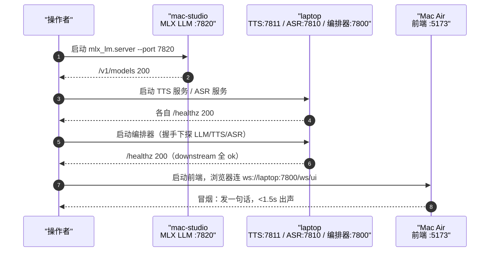

# 部署手册（deployment）

> 两档部署形态，同一套协议，差异只在 env。整体拓扑与进程划分见 [../01-architecture/system.md](../01-architecture/system.md)，本文只写操作层：启动顺序、端口、健康检查、env。
> 所有服务启停、诊断统一走 momo-infra 的 CLI `momoctl`（Rust，规划名，未实现前用等价手动命令）。

## 两档一览

| 档位 | 交互端 | 编排器 | 大脑 LLM | TTS | ASR |
|---|---|---|---|---|---|
| 正常档 | Mac Air（浏览器） | laptop | mac-studio MLX（Qwen3-30B-A3B-4bit，实测 121 t/s，2026-10-10；8B-4bit 备档） | laptop（克隆引擎 / Kokoro） | laptop（SenseVoice，CPU） |
| 降级档 | Mac Air 不变（或 laptop 本地浏览器兜底） | laptop | laptop 本地小模型 / DeepSeek `deepseek-v4-flash` | laptop（同上，VRAM 紧张时回退 Kokoro） | laptop（同上） |

降级触发与操作细节见 [./degradation.md](./degradation.md)。

## 端口 / endpoint 约定

| 服务 | 机器 | 地址 | 说明 |
|---|---|---|---|
| 前端 dev server | Mac Air | `http://mac-air:5173` | Vite；长期 Tauri 壳同端口 |
| 编排器 WS + 健康检查 | laptop | `ws://laptop:7800/ws/ui`，`GET http://laptop:7800/healthz` | 客户端唯一入口（momod） |
| LLM（MLX server） | mac-studio | `http://mac-studio:7820/v1` | OpenAI-compatible `/v1/chat/completions` |
| LLM（降级本地） | laptop | `http://127.0.0.1:7820/v1` | llama.cpp / 兼容 server |
| TTS 服务 | laptop | `ws://127.0.0.1:7811/ws` + `/healthz` | momo-models，流式合成（momo-svc-tts） |
| ASR 服务 | laptop | `ws://127.0.0.1:7810/ws` + `/healthz` | momo-models，SenseVoice（momo-svc-asr） |

主机名（`mac-studio` / `laptop` / `mac-air`）替换为实际局域网 IP 或 mDNS 名，写入 `.env`。编排器对模型服务的调用全部走 env，不写死。

## 正常档启动顺序

原则：**模型服务先起，编排器居中，交互端最后**；编排器启动时对下游做握手，任一失败即拒绝就绪。



手动命令（`momoctl` 就绪前的等价操作）：

```bash
# 1) mac-studio
mlx_lm.server --model "$MOMO_MODELS_DIR/mlx-community/Qwen3-30B-A3B-4bit" --port 7820

# 2) laptop（momo-models 仓 console script，端口读 MOMO_TTS_LISTEN / MOMO_ASR_LISTEN）
momo-svc-tts &
momo-svc-asr &

# 3) laptop（momo-app 仓）
cargo run --bin momod                 # 读 .env，监听 :7800（MOMO_ORCH_LISTEN）

# 4) Mac Air（momo-app 仓前端）
pnpm dev                              # :5173
```

停止顺序反过来：前端 → 编排器 → TTS/ASR → mac-studio LLM。

## 健康检查清单

启动后逐项过，全绿才算 up：

- [ ] `curl -sf http://mac-studio:7820/v1/models` 返回模型列表
- [ ] `curl -sf http://127.0.0.1:7811/healthz`（TTS，laptop）
- [ ] `curl -sf http://127.0.0.1:7810/healthz`（ASR，laptop）
- [ ] `curl -sf http://laptop:7800/healthz` 返回 `{"llm":"ok","tts":"ok","asr":"ok"}`
- [ ] `nvidia-smi`（laptop）：TTS VRAM 在预算内（Kokoro 实测 0.76GB，2026-10-10）
- [ ] Mac Air 浏览器开前端，WS 握手成功，发「你好」：<1.5s 出声，状态机走完 Idle→Thinking→Speaking→Idle
- [ ] 语音回合：麦克风说一句话，ASR 出文本、回复出声、Speaking 中插话能 barge-in
- [ ] `momoctl doctor` 全绿（工具就绪后以此条替代逐 curl）

## `.env` 示例

仓库只提交 `.env.example`；本地 `.env` 不入库。完整变量表以各仓 example 为准，这里给两档关键差异。

### 正常档 `deploy/env/normal.env`

```env
MOMO_PROFILE=normal
MOMO_MODELS_DIR=~/.cache/momo/models

# 编排器（laptop 自身，momod）
MOMO_ORCH_LISTEN=0.0.0.0:7800
MOMO_WEB_ORIGIN=http://mac-air:5173

# 大脑：mac-studio MLX
MOMO_LLM_ENDPOINT=http://mac-studio:7820/v1
MOMO_LLM_MODEL=qwen3-30b-a3b-4bit       # 主脑实测 121 t/s；8B-4bit 为备档
MOMO_LLM_API_KEY=EMPTY

# 语音服务：laptop 本地（编排器侧 endpoint）
MOMO_TTS_ENDPOINT=ws://127.0.0.1:7811/ws
MOMO_ASR_ENDPOINT=ws://127.0.0.1:7810/ws

# 模型服务侧（momo-svc-tts / momo-svc-asr 读）
MOMO_TTS_LISTEN=127.0.0.1:7811
MOMO_TTS_PROVIDER=cosyvoice3            # 未就绪时 kokoro
MOMO_TTS_VOICE_REF=$MOMO_MODELS_DIR/voice/ref/ref_calm.wav
MOMO_ASR_LISTEN=127.0.0.1:7810
MOMO_ASR_MODEL=sensevoice-small

MOMO_DATA_COLLECTION=on
```

### 降级档 `deploy/env/degraded.env`

```env
MOMO_PROFILE=degraded
MOMO_MODELS_DIR=~/.cache/momo/models

MOMO_ORCH_LISTEN=0.0.0.0:7800
MOMO_WEB_ORIGIN=http://mac-air:5173      # Mac Air 也没了则 http://localhost:5173

# 大脑二选一：
# A) DeepSeek API（推荐，不占 laptop 显存）
MOMO_LLM_ENDPOINT=https://api.deepseek.com/v1
MOMO_LLM_MODEL=deepseek-v4-flash
MOMO_LLM_API_KEY=sk-...                   # 只存在本地 .env
# B) laptop 本地小模型（无网/省 token 时）
# MOMO_LLM_ENDPOINT=http://127.0.0.1:7820/v1
# MOMO_LLM_MODEL=qwen3-8b-q4
# MOMO_LLM_API_KEY=EMPTY

MOMO_TTS_ENDPOINT=ws://127.0.0.1:7811/ws
MOMO_ASR_ENDPOINT=ws://127.0.0.1:7810/ws
MOMO_TTS_LISTEN=127.0.0.1:7811
MOMO_TTS_PROVIDER=kokoro                  # 本地大脑占显存时回退 Kokoro
MOMO_ASR_LISTEN=127.0.0.1:7810
MOMO_ASR_MODEL=sensevoice-small

MOMO_DATA_COLLECTION=on
```

## 检查表

- [ ] `.env` 两档文件就位且不在 git 中
- [ ] 正常档按顺序启动，健康清单全绿
- [ ] 降级档切 env 后无需改代码即可起服务
- [ ] 端到端冒烟（文字+语音+barge-in）通过，文字回合 <1.5s
- [ ] 停止顺序执行后无端口残留（`lsof -i :7800,7810,7811` 为空）
