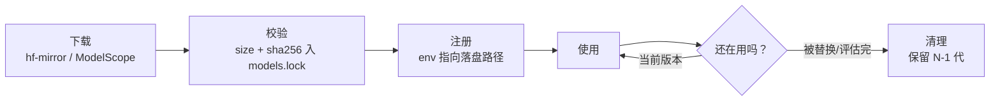

# 模型获取手册（model-fetch）

> 事实前提（2026-10-10 实测）：**laptop 访问 huggingface.co 不通，必须走 hf-mirror**；mac-studio 直连慢，镜像更快。PyPI 同理建议镜像源。
> 落盘、校验、GC 最终由 momo-infra 的 `momoctl` 子命令执行（`pull` / `gc`，规划名），本文先给等价手动命令。

## 环境变量与镜像

```bash
# 必配（laptop 上没它拉不动）
export HF_ENDPOINT=https://hf-mirror.com

# 可选加速；hf_transfer 装不上就删
export HF_HUB_ENABLE_HF_TRANSFER=1

# PyPI 镜像（uv/pip）
export UV_INDEX_URL=https://pypi.tuna.tsinghua.edu.cn/simple   # 或阿里云镜像

# ModelScope 备选（HF 镜像也不通时）
export MODELSCOPE_CACHE=$MOMO_MODELS_DIR/.modelscope
```

优先级：`hf-mirror` 为主 → ModelScope 为备 → mac-studio 直连为兜底。工具：`huggingface-cli`（或 `hf download`）与 `modelscope download`，二选一按仓库可得性。

## 落盘路径约定

统一根目录 `${MOMO_MODELS_DIR}`（默认 `~/.cache/momo/models`），布局镜像 repo 路径：

```text
$MOMO_MODELS_DIR/
  <owner>/<repo>/           # 例：mlx-community/Qwen3-8B-4bit
  tts/ft-<engine>-<date>/   # 自训练产物（4090D 回传）
  voice/ref/                # 声线参考音频
  models.lock               # 校验清单（repo@revision + 文件 size/hash）
```

## 拉取命令清单

> 体积均为粗估，首次拉取后以实测为准并回写。repo id 以各项目发布页为准。

### LLM（大脑）

| 模型 | 放哪 | repo id | 命令 |
|---|---|---|---|
| Qwen3-30B-A3B-4bit（MLX，主脑定案，实测 121 t/s，2026-10-10） | mac-studio | `mlx-community/Qwen3-30B-A3B-4bit` | `HF_ENDPOINT=https://hf-mirror.com huggingface-cli download mlx-community/Qwen3-30B-A3B-4bit --local-dir $MOMO_MODELS_DIR/mlx-community/Qwen3-30B-A3B-4bit`（下载较慢，可后台 + 看日志） |
| Qwen3-8B-4bit（MLX，备档，实测 121 tok/s） | mac-studio | `mlx-community/Qwen3-8B-4bit` | 同上换 repo |
| Qwen3-8B GGUF（降级本地脑，llama.cpp） | laptop | `Qwen/Qwen3-8B-GGUF` | `huggingface-cli download Qwen/Qwen3-8B-GGUF --include "*Q4_K_M*" --local-dir $MOMO_MODELS_DIR/Qwen/Qwen3-8B-GGUF` |
| qwen3.8-27B-FP8 | bigstrong | 主人的，不拉 | 白嫖 endpoint，不下载 |

DeepSeek `deepseek-v4-flash` 为 API，无本地模型。

### TTS（声线）

| 模型 | 放哪 | repo id | 说明 |
|---|---|---|---|
| Fun-CosyVoice3-0.5B（首选克隆引擎） | laptop | `FunAudioLLM/Fun-CosyVoice3-0.5B-2512` | `huggingface-cli download FunAudioLLM/Fun-CosyVoice3-0.5B-2512 --local-dir ...`；HF 与 ModelScope 同名，显存需求待实测 |
| GPT-SoVITS（备选） | laptop | GitHub `RVC-Boss/GPT-SoVITS` + 预训练权重 | 按其官方脚本拉预训练模型；MIT |
| IndexTTS-2（评估项） | laptop | `IndexTeam/IndexTTS-2` | 仅评估期间保留 |
| Kokoro-82M（兜底，实测 209ms/0.76GB） | laptop | `hexgrad/Kokoro-82M` | 任何档位都建议装着 |
| F5-TTS v1（参照系，实测 RTF 0.535） | laptop | `SWivid/F5-TTS` | 零样本参照，可留可删 |

edge-tts 无本地模型。

### ASR / VAD / Embedding

| 模型 | 放哪 | repo id | 说明 |
|---|---|---|---|
| SenseVoice-Small | laptop（CPU 跑） | `iic/SenseVoiceSmall`；onnx 版 `sherpa-onnx-sense-voice-zh-en-ja-ko-yue-*` | ModelScope 主源：`modelscope download iic/SenseVoiceSmall`；sherpa-onnx 发行包从其 release 拉 |
| silero-vad | laptop | `snakers4/silero-vad`（onnx） | 单文件 onnx，几 MB |
| BGE-M3（P3 记忆） | laptop | `BAAI/bge-m3` | P3 才需要，暂缓拉 |

## 校验与 GC 策略



- **校验**：每次下载后把 `repo@revision`、文件数、总大小、关键权重 sha256 写进 `models.lock`；`momoctl pull --check` 按 lock 复算，防止半截下载进生产。
- **GC**：
  - 同一引擎的微调产物保留 N-1 代，老版本 `momoctl gc` 清掉。
  - 评估期模型（IndexTTS-2、F5-TTS）在选型定稿后删。
  - HF/uv 缓存定期 `huggingface-cli scan-cache` / `uv cache clean`。
  - 删除前先确认 `.env` 与 `models.lock` 无引用。

## 磁盘预算表

| 机器 | 内容 | 估算 | 预算上限 |
|---|---|---|---|
| laptop | LLM GGUF（降级脑） | ~5GB | |
| laptop | TTS 全家（CosyVoice3 + GPT-SoVITS + Kokoro + F5 + IndexTTS-2 评估期） | ~8-10GB | |
| laptop | ASR + VAD + BGE-M3 | ~3GB | |
| laptop | SFT 产物 ×2 代 + 参考音 | ~4GB | |
| **laptop 合计** | | **~20-22GB** | **30GB** |
| mac-studio | MLX 8B-4bit + 30B-A3B-4bit | ~22GB | 40GB（可全删重下） |
| 4090D | 单 session 训练临时数据+ckpt | 按任务，≤50GB | 机器随 release 清零 |

laptop 磁盘逼近上限时按 GC 顺序清：评估期模型 → 旧微调代 → GGUF 备选 → 缓存。

## 检查表

- [ ] laptop shell rc 里 `HF_ENDPOINT=https://hf-mirror.com` 生效
- [ ] `$MOMO_MODELS_DIR` 目录结构与命名约定一致
- [ ] 每个在用模型在 `models.lock` 有条目且 `momoctl pull --check` 通过
- [ ] 磁盘占用在预算表上限内
- [ ] 新拉模型的实测大小已回写本文档（标「实测 + 日期」）
