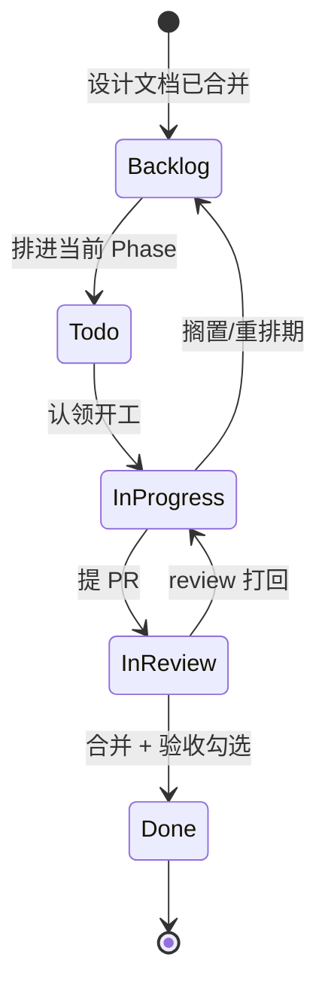

# GitHub 管理设计（github-project）

> 4 个 public 仓 + 1 个 GitHub Project（Projects V2）排需求，均挂 `Momoyeyu` 账户。**文档先于代码**：对应设计文档合并后才允许开实现 issue。

## 仓库列表与定位

| 仓库 | 语言 | 定位 |
|---|---|---|
| `momo-docs` | Markdown | 全部设计文档（本目录即其本地工作副本） |
| `momo-app` | Rust + TypeScript | 应用主体：Rust 编排器/运行时/服务；TS 薄前端（Live2D、音频 IO）。短期 Web，长期 Tauri 2 桌面壳，协议不变 |
| `momo-models` | Python | 模型服务与训练：LLM 适配、ASR、TTS、声线克隆/微调、人格微调、评测。推理调现有库，不重写引擎 |
| `momo-infra` | Rust | 运维工具集：doctor 诊断、模型下载/校验（hf-mirror）、服务编排启停、降级切换、测量工具。不承载业务 |

上一级 `momo/` 只是本地统合目录，不是 monorepo，不建 git。

## Project 字段设计（Projects V2）

单 Project 看板聚合 4 仓 issue，字段：

| 字段 | 类型 | 取值 |
|---|---|---|
| Status | 单选 | `Backlog` / `Todo` / `In Progress` / `In Review` / `Done` |
| Phase | 单选 | `P0` `P1` `P2` `P3` `P4` `P5` / `Track`（声线、人格等并行轨道） |
| Area | 单选 | `app` `models` `infra` `docs` `voice` `persona` |
| Priority | 单选 | `High` / `Medium` / `Low` |

仓库归属直接用 Projects V2 内置 `Repository` 列（自动填充，无需自定义 `Repo` 字段——`Repo` 为保留名不可建）。

视图建议：按 Phase 分组的 Board（主线推进）+ 按 Area 分组的 Table（轨道视角）+ `Priority=High` 过滤的「本周」视图（Projects V2 API 不支持创建视图，需在建好的 Project 页面手动配置）。

> 已落地（2026-10-10）：Project #2 <https://github.com/users/Momoyeyu/projects/2>，四仓已 link，28 条首批 issue 全部挂载——P0=Todo+High，P1/P2/Track=Backlog+Medium，P3+=Backlog+Low。

## 标签体系

各仓统一同名标签（颜色各仓一致）：

- 阶段：`phase:p0` … `phase:p5`，并行轨道任务标 `phase:track`
- 领域：`area:app` `area:models` `area:infra` `area:docs` `area:voice` `area:persona`
- 类型（按需）：`type:bug` `type:chore` `type:spike`（调研/试水）
- 状态修饰（按需）：`status:blocked` `status:needs-decision`

issue 至少带 1 个 `phase:*` + 1 个 `area:*`，与 Project 字段保持同名同步。

## 里程碑

每仓建同名里程碑 `P0`–`P5`，对应 [../00-context/roadmap.md](../00-context/roadmap.md) 的阶段定义与验收标准；并行轨道不另设里程碑，用 `phase:track` 标签挂在所属仓。里程碑描述里抄 roadmap 对应阶段的「验收」原文，完成判定以验收为准。

## Issue 生命周期



## 初始 issue 清单（第一批任务卡）

每条 = 一句话任务 + 验收指针。phase/area 标注为标签值。

**P0 管道骨架**

| 仓 | issue | 验收指针 |
|---|---|---|
| momo-app | Rust workspace 骨架：orchestrator binary + 配置/日志/事件总线 | roadmap P0；`cargo build` 过 |
| momo-app | LLM client：OpenAI-compatible async stream，可配 endpoint/key | 接 DS 或借用 vLLM 出 token 流 |
| momo-app | 编排器最小版：text in → stream → 句切 → TTS 队列 → 播放 + 回合状态机骨架 | runtime.md 状态机节 |
| momo-app | REPL：终端打字输入、听到回复 | roadmap P0 验收：打字出声 + 各环节耗时打印 |
| momo-models | edge-tts 流式合成 + 播放管道（sounddevice/mpv） | 文本进、音频出、可打断预留 |
| momo-docs | WS 协议 v1 schema 定稿（type 多态 + 二进制音频帧） | protocol.md |
| momo-infra | `momoctl doctor` 雏形：端口探测 + /healthz 聚合 | deployment.md 健康清单 |
| momo-infra | DS key 部署到机器 + 连通性自测脚本 | P0 前置项 |

**P1 有脸**

| 仓 | issue | 验收指针 |
|---|---|---|
| momo-app | 前端骨架：Vite + WS client（协议 v1 三类消息） | 浏览器连编排器 |
| momo-app | pixi-live2d-display 加载 Cubism 免费 sample | 角色显示 + idle 眨眼 |
| momo-app | 音量 RMS → `ParamMouthOpenY` 口型 | roadmap P1 验收：说话开合嘴 |
| momo-app | 文本气泡 + 情感 tag 显示位 | roadmap P1 |

**P2 对话**

| 仓 | issue | 验收指针 |
|---|---|---|
| momo-models | ASR 服务：silero-vad + SenseVoice（sherpa-onnx，CPU） | 实测 RTF 0.040 复现 |
| momo-app | barge-in：检测用户语音→停播/取消生成/已播记账 | roadmap P2 验收 |
| momo-models | TTS 服务：Kokoro 兜底上线 + 引擎抽象接口 | 实测 209ms 复现 |
| momo-models | 克隆引擎零样本接入（选定基座后） | voice-clone.md 评估流程 |
| momo-models | LLM 输出情感 tag 解析 → 驱动表情/TTS | roadmap P2 |

**P3 灵魂**

| 仓 | issue | 验收指针 |
|---|---|---|
| momo-models | 记忆：sqlite-vec + BGE-M3，摘要入库检索注入 | roadmap P3 验收：重启记得上次 |
| momo-app | idle scheduler：N 秒无输入注入情境自发开口 | roadmap P3：10min 主动 2-3 次 |
| momo-models | persona.yaml schema + prompt 组装器 + 热加载 | persona.md |
| momo-models | regression-20 评测集 + 自动跑分脚本 | persona.md 评测节 |
| momo-models | 声线 SFT pipeline（切片→标注→4090D→回传） | voice-clone.md SFT 节 |
| momo-models | LLM QLoRA 实验（可选，基座跟主脑） | persona.md QLoRA 节 |

**并行轨道（phase:track，随时可开）**

| 仓 | issue | 验收指针 |
|---|---|---|
| momo-docs | 声线素材收集 + manifest 授权记录 | voice-clone.md 素材规范 |
| momo-models | 三基座零样本试听 + 盲听 A/B 报告 | voice-clone.md 盲听节 |
| momo-docs | character card 初稿（≥5 组人工修写示范对话） | persona.md card 结构 |

**P4 / P5（暂不建细卡，只挂占位）**

| 仓 | issue | 验收指针 |
|---|---|---|
| momo-app | action 总线占位（P4 启动时再拆卡） | roadmap P4 |
| momo-models | 视觉/过滤占位 | roadmap P4/P5 |

## Issue 模板与 PR 规范

`.github/ISSUE_TEMPLATE/task.md`（各仓同款）：

```markdown
## 任务
一句话说清楚做什么。

## 验收标准
- [ ] （抄对应设计文档的验收条目）

## 关联
- 设计文档：momo-docs/<path>
- Phase / Area: phase:pX / area:xxx
```

PR 规范：

- commit message 用 **conventional commit**：`feat|fix|docs|refactor|test|chore|perf: 描述`，scope 可选（如 `feat(orchestrator): ...`）。
- commit/PR 中**不加任何 AI 相关 trailer 或署名**（`Co-Authored-By`、`Generated with` 等一律不加，仓库 AGENTS.md 规则）；只写改动本身。
- 一个 PR 做一件事；描述里 `Closes #n` 关联 issue；合并前 CI 绿 + 验收条目勾选。
- 设计文档 PR 与代码 PR 同标准：文档改动也要过 review，引用实测数据必须标「实测 + 日期」。

## 检查表

- [ ] 4 仓建好、public、挂 `Momoyeyu`，各仓 `.env.example` 占位入库
- [ ] Project V2 建好，5 个字段按上表配置，3 个视图建好
- [ ] 各仓 `phase:*`/`area:*` 标签建齐且同名同色
- [ ] 各仓里程碑 P0-P5 建好，描述含 roadmap 验收原文
- [ ] P0 + Track 的 issue 全部建出并挂到 Project
- [ ] issue 模板与 PR 模板落 `.github/`，conventional commit 写进 CONTRIBUTING
