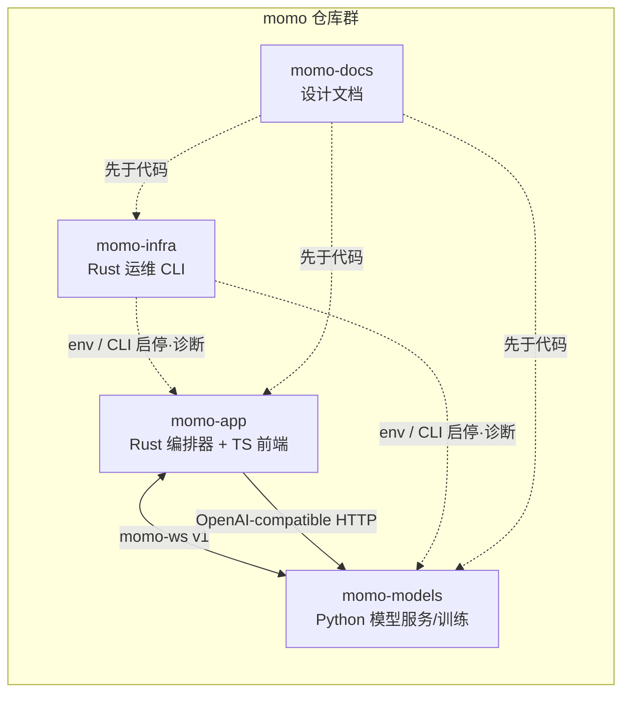

# momo-docs

momo 的全部设计文档。momo 是一个本地优先的 AI 虚拟伙伴：Live2D 形象、语音对话、回合状态机、可打断，三段式进程架构（交互端 / 编排器 / 模型服务）。项目原则是**文档先于代码**：协议、状态机、配置先在文档里定稿，再动手实现。

## 仓库地图

momo 由 4 个独立 GitHub 仓库组成（均 public，挂在 `Momoyeyu` 账户），外加 1 个 GitHub Project（Projects V2）排需求。上一级目录 `momo/` 只是本地统合目录，**不是 monorepo**，不建 git、不放跨仓构建。

| 仓库 | 语言 | 内容 |
|---|---|---|
| `momo-docs` | Markdown | 全部设计文档（本仓库） |
| `momo-app` | Rust + TypeScript | 应用主体：Rust 实现编排器/运行时/服务；TS 薄前端（Live2D 渲染、音频采集与播放）。短期 Web，长期 Tauri 2 桌面壳，前后端协议不变 |
| `momo-models` | Python | 模型服务与训练：LLM 接入适配、ASR、TTS、声线克隆/微调、人格微调、评测。推理调用现有库，不重写推理引擎 |
| `momo-infra` | Rust | 运维工具集 `momoctl`：doctor 诊断、模型下载/校验（hf-mirror）、服务编排启停、降级切换、测量工具、Web 运维控制台（`momoctl web`，P2）。**不承载人设/对话业务，不在运行时数据通路上** |



跨仓协作只有两类接口：

- **运行时**：`momo-ws v1` 协议（见 [protocol.md](./01-architecture/protocol.md)）+ OpenAI-compatible HTTP（LLM 推理）。
- **部署期**：`MOMO_` 前缀环境变量（见 [config.md](./01-architecture/config.md)）+ infra CLI。

## 目录结构与阅读顺序

```
momo-docs/
├── README.md                  ← 本文档
├── 00-context/                ← 项目背景与决策
│   ├── product.md             产品定义：是什么、为谁、体验指标、非目标
│   ├── research.md            技术调研：模块划分、算力盘点、选型对比
│   ├── roadmap.md             分阶段开发路线 P0–P5 + 并行训练轨道
│   └── decisions.md           ADR 汇总：所有已锁定决策
├── 01-architecture/           ← 系统设计
│   ├── system.md              总体架构：三段式、组件职责、两档部署拓扑
│   ├── boundaries.md          app / models / infra 仓库边界
│   ├── protocol.md            momo-ws v1 协议规范
│   ├── runtime.md             编排器运行时：状态机、打断、句切、背压、延迟预算
│   └── config.md              MOMO_ 环境变量规范
├── 02-repos/                  ← 各仓库内部设计
│   ├── momo-app.md            应用仓：Rust 编排器 + TS 薄前端
│   ├── momo-models.md         模型服务与训练仓（Python）
│   ├── momo-infra.md          运维工具仓（Rust CLI + Web 控制台，momoctl）
│   └── momo-docs.md           文档仓自身规范
├── 03-phases/                 ← 阶段详细设计
│   ├── p0-pipeline.md         P0 管道骨架：文字→LLM→TTS→出声
│   ├── p1-stage.md            P1 有脸：WebUI + Live2D + 口型
│   ├── p2-dialogue.md         P2 对话：语音输入 + barge-in + 本地 TTS
│   ├── p3-soul.md             P3 灵魂：记忆 + 自发行为 + 微调接入
│   ├── p4-capabilities.md     P4 能力：action 总线 + 视觉 + 工具
│   └── p5-streaming.md        P5 直播：暂缓，范围与前置条件
├── 04-tracks/                 ← 并行训练轨道
│   ├── persona.md             人格轨道：prompt 逼近 → QLoRA 权重
│   └── voice-clone.md         声线轨道：克隆声线选型与 SFT
├── 05-ops/                    ← 运维手册
│   ├── borrowed-etiquette.md  借用机器规则
│   ├── degradation.md         降级手册（mac-studio 收回预案）
│   ├── deployment.md          部署手册：两档拓扑、启动顺序、端口
│   └── model-fetch.md         模型获取手册（hf-mirror）
└── 06-management/             ← 项目管理
    └── github-project.md      GitHub 仓 + Projects V2 排期设计
```

**新加入者按此顺序读：**

1. `00-context/product.md` — 先知道在做什么、不做什么
2. `00-context/research.md` → `roadmap.md` — 了解选型依据与里程碑
3. `00-context/decisions.md` — 所有"为什么这么定"的答案集中在这里
4. `01-architecture/system.md` → `boundaries.md` — 知道自己要写的代码放哪个仓库
5. `01-architecture/protocol.md` → `runtime.md` → `config.md` — 动手前把接口、语义、配置读透
6. `02-repos/` 对应仓库篇 → `03-phases/` 当前阶段篇 → `05-ops/` 运维手册，按需阅读

## 文档变更约定

- **文档先于代码**：改协议、状态机、配置项、仓库边界时，先改本文档库再改实现。实现与文档不一致视为 bug。
- **决策单点定论**：设计决策只在 `00-context/decisions.md` 写完整理由；其他文档引用结论、不重述理由。
- **基线优先**：内容与 `00-context/decisions.md` 矛盾时以 decisions.md 为准，并先修正决策再改文档。
- **实测标注**：引用实测数据必须标「实测」与日期；未实测的量标「预估/待实测」，禁止把估算写成事实。
- **格式**：文件名 `kebab-case.md`；相互引用用相对路径；每篇至少 1 个 mermaid 图（只用 `flowchart`/`sequenceDiagram`/`stateDiagram-v2`，中文标签一律加引号，节点 id 用英文）；每篇结尾附「检查表」或「验收」一节。
- **提交**：conventional commit，提交信息只写改动本身。

## 检查表

- [ ] 新文档命名 `kebab-case.md`，放对应编号目录
- [ ] 每篇 ≥1 个 mermaid 图且符合图型/引号/id 规范
- [ ] 每篇结尾有可勾选检查表
- [ ] 实测/预估标注齐全
- [ ] 新增决策已写入 `00-context/decisions.md`（含被否选项）
- [ ] 跨文档引用使用相对路径
