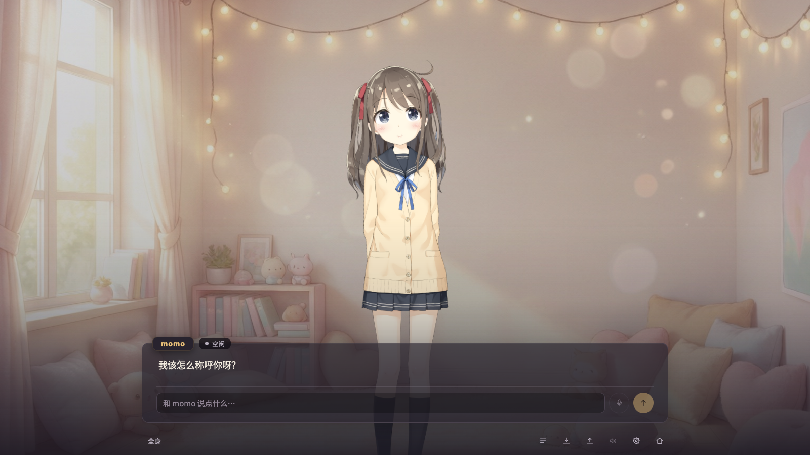

  

<h1 align="center">momo</h1>

<strong>A little more familiar, every day.</strong> An AI companion game about time together, memories, and growing closer.

  <a href="README.md">简体中文</a> · <strong>English</strong> · <a href="README_JA.md">日本語</a>

  <a href="https://momoyeyu.github.io/momo/en/">Meet momo</a> ·
  <a href="docs/usage/getting-started.md">Start guide</a> ·
  <a href="https://github.com/Momoyeyu/momo/releases">Release status</a> ·
  <a href="CONTRIBUTING.md">Join in</a>

  
  
  

## Start with “How was your day?”

You do not need a perfect question. Tell momo about your day, hear what she has to say, and watch her expressions and movements respond. When you return, your name, preferences, and little things you discussed can stay in memory.

momo has a consistent core personality, with room for shared experiences. We want to make a game you can settle into: revisit conversations, keep saves, change your settings, and decide what is worth remembering.

  

<a href="https://momoyeyu.github.io/momo/en/">Watch real silent footage and turn through a few moments together</a>

The scene uses isolated demo data and the Hiyori sample model, with no private conversations or settings. [Material sources and notes](site/docs/public/media/asset-notice.txt).

## What you can do together today

| Experience | Available now |
| --- | --- |
| **A first hello** | An opening greeting, a question about your name, and your own conversations from there. |
| **Text or microphone** | Type or speak; speech recognition comes with the app. |
| **A face that responds** | A Live2D avatar, expressions, and motion; optionally connect GPT-SoVITS for spoken replies, interruption, and recovery. |
| **Memories you can shape** | View, edit, or delete memories, including little things she gets wrong. |
| **Keep it, or take it with you** | Conversation history, saves, and data export / import for records you can restore. |
| **Your way to spend time** | Change avatars and motions, switch between 中文 / English / 日本語, and connect trusted extension tools. |

More natural long-term companionship, with shared experiences making a finer difference to your conversations, is a direction we are still working on. Release notes describe what you can experience now.

## Your first meeting

**[Download momo v0.2.0](https://github.com/Momoyeyu/momo/releases/tag/v0.2.0)** · [macOS Apple Silicon](https://github.com/Momoyeyu/momo/releases/download/v0.2.0/momo_0.2.0_macos_arm64.dmg) · [Windows x64](https://github.com/Momoyeyu/momo/releases/download/v0.2.0/momo_0.2.0_windows_x64_setup.exe)

Verified on macOS 14+ (Apple Silicon) and Windows 11 x64. Builds are not developer-signed or notarized; see release notes for installation, checksums and limitations. To run from source, read the [development guide](docs/development/migration.md).

Once you have a preview build, start with three small things:

1. Add a compatible conversation service URL, API key, and model in settings, then test the connection.
2. Say hello through text or your microphone. Text chat does not require a speech synthesis deployment.
3. If you want spoken replies, connect optional TTS and supply a reference recording you have the right to use, with its transcript.

Conversations are sent to the model provider you choose. When speech synthesis is enabled, your reference recording is also sent to your selected voice service. No default voice sample ships with the project; third-party services set their own prices and terms.

| What you want to know | Where to start |
| --- | --- |
| First launch, conversation model, and avatar settings | [Getting started](docs/usage/getting-started.md) |
| Reference audio, voice connections, and optional GPU deployment | [Voice setup](docs/usage/tts.md) |
| Where records live, backups, and moving installations | [Backups and migration](docs/usage/data.md) |
| Developing, running, and building from source | [Development guide](docs/development/migration.md) · [Runtime configuration](docs/development/configuration.md) |

The detailed guides currently contain the Chinese originals. The website and application offer Chinese, English, and Japanese.

This release provides **macOS Apple Silicon / Windows x64** installers; see release notes for validation and limitations. **Linux** is not offered. momo is for computers, with no phone or tablet app.

## Help make this place better

Code is one way to help. A specific experience report, a more natural translation, or a thoughtful avatar and interaction design suggestion can make your time together better, too.

- **Try it and share feedback**: [report a problem or suggest an idea](https://github.com/Momoyeyu/momo/issues), including what happened and how you hoped the experience would feel.
- **Writing, translation, and design**: help improve Chinese, English, and Japanese wording, or share an interface proposal we can discuss.
- **Code and tools**: work on the interface, memory experience, voice, or trusted extensions. The [contributing guide](CONTRIBUTING.md) links to development and validation instructions.

## Thanks and licenses

Thank you to open-source projects such as [AIRI](https://github.com/moeru-ai/airi) for inspiring work on AI characters and companionship. The default Hiyori model is by Live2D Inc.; the fonts, speech recognition, retrieval models, and voice service build on their respective upstream projects.

Project code is available under the [MIT license](LICENSE.md). Third-party models, Cubism Core, fonts, dependencies, and showcase materials retain their own terms; the repository’s MIT license does not replace them. See [third-party notices](THIRD_PARTY_NOTICES.md) for sources, licenses, and redistribution considerations.

## v3 development preview

Shared UI, inference and plugin logic now iterate in [momo-web, v3/development](https://github.com/Momoyeyu/momo-web/tree/v3/development). This repository owns the desktop shell, website, TTS deployment and releases; reviewed Web revisions are promoted into `app/` with content hashes.

The candidate uses one continuous life, automatic persistence, history and full-profile backups instead of parallel save slots. v3 is awaiting acceptance and does not change the currently published release.
