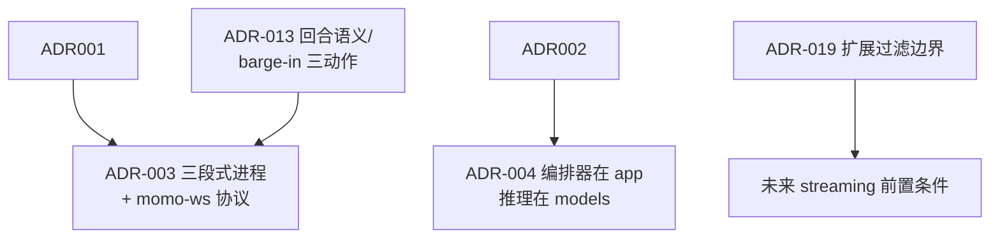

# 决策汇总（ADR）

> 所有已确认设计决策的单点定论。每条：标题 + 决策 + 理由 + 被否选项。其他文档引用结论，不重述理由。
> 状态均为「已锁定」，除非特别注明。推翻任何一条都需要先改本文档。

## 仓库与工程

### ADR-002 语言分工：Rust=运行时与工具，Python=模型，TS=薄前端

- **决策**：Python 只做模型相关业务；Rust 做应用运行时与 infra 小工具；TS 仅限薄前端。Rust 生态不足处允许单独引入 C++ 组件，**须文档注明理由**。
- **理由**：模型生态（torch/onnx/MLX/训练脚本）全在 Python；回合状态机要稳定并发、低延迟、可分发单二进制；前端只需渲染与音频 IO。
- **被否**：全 Python（GIL 下并发管线与分发都吃力）；全 Rust（模型绑定生态不足，推理侧会反复造轮）。

### ADR-005 一切环境差异走 `MOMO_` 环境变量

- **理由**：密钥不进 git；env 是部署平台最通用的注入面；降级切换=改 env。
- **被否**：配置文件入库（密钥泄露风险、多机差异难管）；CLI-only（对配置发布平台不友好，且长参数难维护）。

### ADR-020 文档先于代码 + 单一 GitHub Project

- **理由**：单人项目最大的风险是决策漂移，文档是唯一的对齐物。
- **被否**：先代码后补文档（单人也会忘）；每仓各自 issue 分散排期（全局优先级不可见）。

## 架构与协议

### ADR-003 三段式进程分离 + 进程间 WebSocket

- **决策**：三层进程分工 + momo-ws 事件与音频协议；LLM 使用 OpenAI-compatible SSE。规范见 [../01-architecture/protocol.md](../01-architecture/protocol.md)。

### ADR-004 编排器放 momo-app（Rust），模型推理放 momo-models（Python）

- **决策**：编排器（tokio+axum）与前端同属 `momo-app`；ASR/TTS/LLM 接入与训练在 `momo-models`；边界细则见 [../01-architecture/boundaries.md](../01-architecture/boundaries.md)。
- **理由**：推理代码迭代快、依赖重（torch/onnx 数 GB），独立成 Python 服务按需起停；编排器轻依赖、要随前端/桌面壳一起分发。
- **被否**：推理内嵌 Rust（ort/candle 对目标模型生态覆盖不足）；编排放 Python（回到 ADR-002 被否理由）。

### ADR-006 LLM 统一 OpenAI-compatible chat 接口抽象

- **被否**：把 LLM 也纳入 momo-ws 自定义消息（要为每个后端写适配层，违背"调用现有库"原则）。

### ADR-013 回合状态机与 barge-in 三动作语义

- **决策**：`TurnCoordinator` 独占回合状态；`Speaking` 从 `playback.started` 开始。barge-in 先同步停本地播放/嘴型并原子失效旧回合，同时并行取消 LLM/TTS/句切/音频，绝不等待 ACK；随后按 playback ledger 结算确认听见的完整句与部分审计。capture 生命周期独立保留。细则见 [../01-architecture/runtime.md](../01-architecture/runtime.md)。
- **理由**：「能插话」是桌面陪伴的体验核心；ACK 账本让模型上下文不虚构用户听见的内容。
- **被否**：打断即整回合丢弃（用户听到的和模型记得的不一致）；排队制不打断（破坏"像人"第一指标）。

### ADR-019 为外部 ingress/egress 预留过滤边界

- **理由**：外部内容的风险模型与本地 companion 不同，过滤必须在公开接入前完成，同时不能污染 turn core。

### ADR-022 编排器与语音服务共享通信契约

- **决策**：编排器与语音服务使用同一份 momo-ws 契约，统一流标识、取消与播放回执；调试接口独立于实时对话通路。
- **理由**：打断、取消、流式音频、VAD 事件（`input.vad`）语义已在 momo-ws 定义；再立一套 REST 主协议要维护两份语义且打断语义难表达。
- **被否**：为模型服务另定义 REST `/v1/*` 作为运行时主协议。

### ADR-012 Live2D = Pixi 7 adapter + 官方许可 sample；口型来自实际播放

- **理由**：先复用官方资源验证真实 Live2D，同时保持角色与 renderer 可替换。Runtime Core、sample 与应用代码许可证分别核验。
- **被否**：自研 Runtime；用假 CSS 角色替代实际 Live2D；让 emotion motion 覆盖 lipsync。

- **决策**：工具/action 使用独立扩展消息组；每次请求向用户展示动作、范围和数据去向，只有 allow 后执行，deny/cancel/late-result 都有显式路径。
- **理由**：LLM 不直接执行；用户授权与结构化 schema 共同形成安全边界。
- **被否**：LLM 直接执行代码；本地可信即默认永久授权；把工具业务写进 turn core。

- **决策**：截图先展示采集范围与数据去向；allow once 后交给可配置 vision provider，不自建 VLM。
- **理由**：屏幕内容敏感，授权边界比具体 provider 更稳定。
- **被否**：后台自动截图；把单一远端 provider 写死为产品能力。

## 检查表

- [ ] 每条 ADR 含：决策、理由、被否选项
- [ ] 实测数据均标注「实测 + 日期」，未达标量标「预估/待实测」
- [ ] 其他文档只引用本文档结论，不重述理由
