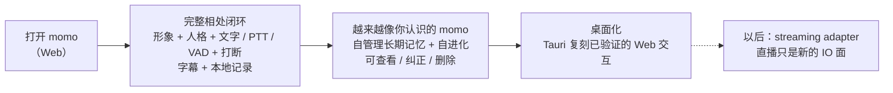

# 产品定义：momo

> **让桌面多一个，懂得回应的存在。**
>
> momo 是一个有形象、有性格、有自己记忆的伙伴：她能听你说话，也懂得怎么陪你。

## 产品定位

momo 是一个独立的数字存在——不是助手，也不以完成任务为本职；「像人」是最高标准：有自己的样子、情绪和过去，对话有留白也有脾气，相处越久越像她该有的样子。Live2D 是她现在的身体；人格、记忆与自进化才是产品本身。

当前没有直播需求，先把完整的相处体验做到位：通过文字、按住说话与连续语音交流，有自己的情绪和记忆，会回应你的触碰，在你插话时停下来。直播（streaming adapter）作为架构上保留的扩展方向，不锁死、也不计入当前交付。

默认形象使用桃濑日和 Hiyori 官方 sample，许可说明见 [Live2D 素材与许可](./resources.md)；Live2D 模型本身是**可替换资源**，Hiyori 只是默认，不是产品的一部分。

## 三个产品支柱

| 支柱 | 基础体验 | 持续方向 |
|---|---|---|
| **在场** | Live2D 形象、idle、注视、触碰回应；Web 页面先行，桌面宿主复刻 | 窗口置顶/拖拽/缩放等桌面集成 |
| **接话** | 文字、PTT、主动开启的连续麦克风、字幕、口型、Stop 与 barge-in | 工具与截图扩展、更自然的打断节奏 |
| **像人** | 稳定人格（persona card）、情绪标签、字幕与语音同步 | **momo 自管理的长期记忆**：自主归纳、引用与遗忘，随相处自我进化 |

persona/连接状态、回合状态、动画状态使用彼此独立的时钟；界面不能用某一个状态推导另外两个状态。

## 体验旅程

## 架构定位（仓库视角）

- **`app/` 是终端用户产品本身**（未来的独立仓库 `momo`）：用户可配置自己的 OpenAI-compatible LLM 端点、ASR 与 TTS 服务接口，可替换 Live2D 模型（默认 Hiyori）。app 只持有每类能力的**单个** endpoint 配置，不做内置多 provider 降级——降级/容灾属于服务侧。
- **`models/` + `infra/` 演化为 `momo-infra`**：自有的 AI 基础设施——LLM 后训练、ASR/TTS 全训练 pipeline，以及复用开源底座（vLLM 等）的统一 serving gateway。内部可做多模型容灾与负载均衡，对外暴露单一接口；ASR/TTS 接口形态对齐主流云服务。
- 当前 monorepo 只是协作期的组织形态，不是终态架构。

## 本地优先与可降级

- 对话 audit、correction、persona 与长期记忆默认本地保存；用户可查看、编辑、删除与导出。
- 产品默认中文；中、英、日输入与输出按 provider capability 启用。
- LLM 通过 OpenAI-compatible SSE 连接本地或远端端点；ASR/TTS 走可配置的 provider 接口。
- 连续麦克风始终由用户主动开启；静态网站不连接本地 API，不索取 API key，也不请求麦克风权限。
- provider 不可用时的体验兜底（字幕降级为纯文字、语音输入禁用等）属于 app 的 UI 呈现职责；多模型容灾/负载均衡不属于 app，由服务侧或 momo-infra gateway 承担。

## 范围

### 完整相处闭环（当前主线）

Web 端完整交互：真实 Live2D 形象、人格化对话、文字 + PTT + 主动开启的 VAD、字幕与实际播放驱动的口型、Stop/barge-in、本地 transcript/correction、模型与服务设置（LLM/ASR/TTS endpoint、avatar 替换）。

### 像人 companion

momo 自主管理的长期记忆（自动归纳与引用，可审计、可纠正、可删除）、quiet/focus/companion 模式、用户明确启用的主动建议、获授权的声线个性化。主动行为在专注、通话、收听和安静时段内保持沉默。

### 受控扩展与长期方向

逐次授权的工具与截图、Tauri 桌面宿主（复刻 Web 交互）；自训模型与 serving 能力由独立的 momo-infra 仓承担。streaming adapter 作为独立入口适配器，复用同一个 turn core，不把直播业务写进运行时。

## 非目标

- 账号体系、多租户和移动端。
- 自研 Live2D Runtime、推理引擎、KV cache（一律复用上游/开源实现）。
- 默认常开麦、默认主动打扰，或未经授权的声音克隆。
- app 内的多 provider 容灾/降级编排（属于服务侧/momo-infra gateway）。
- 当前交付直播、平台接入或公开角色授权（方向保留，不锁死）。

## 相关文档

- [路线图](./roadmap.md)
- [总体架构](../01-architecture/system.md)
- [模块边界](../01-architecture/boundaries.md)
- [桌面宿主](../01-architecture/desktop.md)
- [操作路径图谱](../01-architecture/workflows.md)
