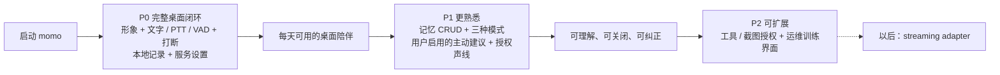

# 产品定义：momo

> **让桌面多一个，懂得回应的存在。**
>
> momo 是本地优先的 AI 桌宠：有形象，能听你说话，也能安静陪着你。

## 产品定位

momo 以 Live2D 形象住在桌面，通过文字、按住说话与连续语音和你交流。它会回应你的触碰，在你插话时停下来，也把对话与记忆留在你能掌握的地方。

网站互动预览使用的 桃濑日和 Hiyori sample 与 Cubism Core 许可说明见 [Live2D 素材与许可](./resources.md)。

## 三个产品支柱

| 支柱 | P0 体验 | 后续增强 |
|---|---|---|
| **在场** | Live2D 可用 idle、注视、点击抚摸、拖拽、缩放与桌面置顶 | P2 可授权感知更多桌面情境 |
| **接话** | 文字、PTT、主动开启的连续麦克风、字幕、口型、Stop 与 barge-in | P2 工具与截图扩展 |
| **熟悉** | 本地会话记录、correction + persona | P1 用户可控记忆、模式与主动行为 |

persona/连接状态、回合状态、动画状态使用彼此独立的时钟；界面不能用某一个状态推导另外两个状态。

## P0 / P1 / P2 旅程

## 本地优先与可降级

- 对话 audit、correction、persona 和 P1 记忆默认本地保存；用户可查看、改标题、删除与导出。
- 产品默认中文；中、英、日输入与输出按 provider capability 启用。
- ASR/TTS 可本地运行，LLM 通过 OpenAI-compatible SSE 连接本地或受控远端端点。
- 连续麦克风始终由用户主动开启；静态网站不连接本地 API，不索取 API key，也不请求麦克风权限。
- Wayland、透明窗口或 system menu 不支持时使用普通可见窗口；menu 不可靠时禁用 click-through。

## 范围

### P0：完整桌面闭环

Tauri 2 桌面窗口、system menu、拖拽/缩放、置顶、聊天浮层、真实 Live2D、文字 + PTT + 主动开启的 VAD、字幕与实际播放驱动的口型、Stop/barge-in、本地 transcript/correction、模型与服务设置。浏览器用于网站与开发预览。

### P1：可信赖的 companion

记忆提议与 CRUD、quiet/focus/companion 模式、用户明确启用的主动建议、获授权的声线个性化。主动行为在专注、通话、收听和安静时段内保持沉默。

### P2：受控扩展

逐次授权的工具与截图、infra 控制台和训练 UI。streaming adapter 作为独立入口适配器，复用同一个 turn core，不把直播业务写进运行时。

## 非目标

- 账号体系、多租户和移动端。
- 自研 Live2D Runtime、推理引擎或模型基础设施。
- 默认常开麦、默认主动打扰，或未经授权的声音克隆。
- 在 P0/P1/P2 中承诺直播、平台接入或公开角色授权。

## 相关文档

- [路线图](./roadmap.md)
- [总体架构](../01-architecture/system.md)
- [桌面宿主](../01-architecture/desktop.md)
- [操作路径图谱](../01-architecture/workflows.md)
