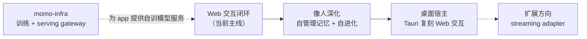

# momo 路线图

> 先在 Web 上把「像人」的相处体验做透，再由 Tauri 把它复刻成桌面形态。momo-infra 独立成长为自己的模型与算力底座。

## 方向总览

## Web 交互闭环（当前主线）

体验与流程：[pipeline.md](../03-features/pipeline.md)。

- `momod` + Web UI 是当前唯一交付形态：真实 Live2D 形象（默认 Hiyori，可替换）、人格化对话、字幕。
- 文字、PTT、用户主动开启的连续 VAD；字幕、AudioWorklet 实际播放进度驱动口型、Stop/barge-in、本地 transcript。
- 会话历史查看、改标题、correction、删除、导出与新对话；原 audit entry 不被改写。
- Rust tokio+axum session actor + `TurnCoordinator`；LLM 走用户配置的 OpenAI-compatible SSE 端点；ASR/TTS 走用户配置的 provider 接口。
- 服务设置：LLM/ASR/TTS endpoint 配置（每类单槽位）、avatar 替换、就绪探测。
- 事件、字幕与音频通过 momo-ws 统一协作。

## 像人深化

体验与流程：[stage.md](../03-features/stage.md)。

- **momo 自管理的长期记忆**：自主归纳、整理、引用与遗忘；用户保留查看/纠正/删除入口（可解释、可撤销），但不需要逐条人工确认——记忆归 momo 所有，归用户监督。
- correction 影响未来 context，并使相关 derived memory 失效后重新归纳。
- quiet / focus / companion 三种模式，与麦克风 mute 分离。
- 用户明确启用的主动建议；专注、通话、收听、安静时段不触发，dismiss 后保持安静。
- 仅使用获授权素材的声音个性化，复用 frozen evaluation gate 与回滚门槛。

## 桌面宿主（Tauri，后置）

交互在 Web 定稿后由 Tauri 复刻，不做双轨并行开发。范围见 [desktop.md](../01-architecture/desktop.md)：透明窗口、system menu、拖拽/缩放、置顶与有可靠恢复入口时的 click-through；普通可见窗口是保底。

## 受控扩展

体验与流程：[dialogue.md](../03-features/dialogue.md)。

- 工具与截图逐次请求权限，allow/deny/cancel/result 全路径可见。
- streaming adapter 只做输入归一化与输出 overlay，复用 turn core——直播方向保留，当前不交付。

## momo-infra（独立 AI 基础设施）

`models/` + `infra/` 演化为独立的 momo-infra 仓，**不是** app 的一部分：自有训练 pipeline 与 serving 底座，对内可做多模型容灾与负载均衡，对 app 暴露单一接口——LLM 为 OpenAI-compatible，ASR/TTS 接口形态对齐主流云服务，使 app 的 provider 配置天然兼容第三方云与 momo-infra。其内部路线与运维细则在 momo-infra 仓维护。

## 语言与长期轨道

产品默认中文；中、英、日输入与输出按 ASR/TTS/LLM provider 的 capability 声明启用。

- 声线：先使用现成语音服务，逐步形成有授权、可替换的个人声线（见 [stage.md](../03-features/stage.md)）。
- [人格](../04-tracks/persona.md)：稳定人设与可纠正上下文优先；微调是可选后续工具。
