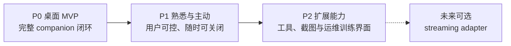

# momo 路线图

> **设计目标：** 只有 P0 / P1 / P2 三个优先级，不承诺日期。当前代码仍是 v1 handshake/scaffold；旧 P3/P4/P5 路径只作兼容入口。

## 优先级总览

## P0：桌面 MVP

权威实施页：[p0-pipeline.md](../03-phases/p0-pipeline.md)。

- `app/src-tauri` Tauri 2 桌面宿主（规划）：透明窗口、system menu、拖拽/缩放、置顶与有可靠恢复入口时的 click-through；普通可见窗口是保底。
- Pixi 7 + Live2D 实际模型：可用 idle、注视、抚摸、拖拽；`PresentationDirector` 统一动作优先级。
- 聊天浮层、文字、PTT、用户主动开启的连续 VAD；拒绝麦克风后保留文字路径。
- 字幕、AudioWorklet 实际播放进度驱动口型、Stop/barge-in、本地 transcript。
- 会话历史查看、改标题、correction、删除、导出与新对话；原 audit entry 不被改写。
- Rust tokio+axum session actor + `TurnCoordinator`；Python 推理 adapters；LLM 走 OpenAI-compatible SSE。
- 模型/服务配置、就绪探测、normal/degraded 部署。
- `momo-ws v2` 是目标协议；现有 app/models 仍为 v1 handshake/scaffold。

## P1：熟悉的 companion

权威实施页：[p1-stage.md](../03-phases/p1-stage.md)。

- correction 影响未来 context，并使相关 derived memory 失效后重新提议。
- 记忆先提议、用户确认后保存；可编辑、检索与彻底删除正文和 index。
- quiet / focus / companion 三种模式，与麦克风 mute 分离。
- 用户明确启用的主动建议；专注、通话、收听、安静时段不触发，dismiss 后保持安静。
- 仅使用获授权素材的声音个性化，复用 frozen evaluation gate 与回滚门槛。

## P2：受控扩展

权威实施页：[p2-dialogue.md](../03-phases/p2-dialogue.md)。

- 工具与截图逐次请求权限，allow/deny/cancel/result 全路径可见。
- infra 控制台：配置草稿验证、测试、原子应用与回滚；密钥独立保存。
- 模型下载校验、激活与回滚；训练 job 本地/SSH 执行及恢复。
- future streaming adapter 只做输入归一化与输出 overlay，复用 turn core。

## 语言与长期轨道

产品默认中文；中、英、日输入与输出按 ASR/TTS/LLM provider 的 capability 声明启用。

- [声线](../04-tracks/voice-clone.md)：P0 使用现成语音服务，P1 形成有授权、可替换的个人声线。
- [人格](../04-tracks/persona.md)：稳定人设与可纠正上下文优先；微调是可选后续工具。
