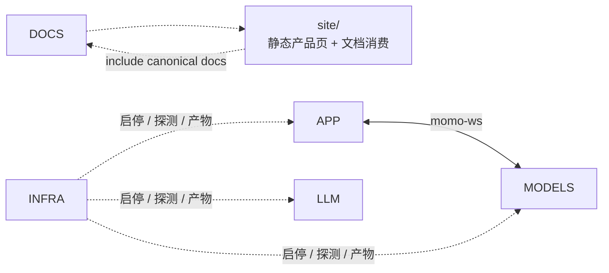

## 工作所有权图

拥有：

## `site/` 与 `docs/`

## 边界 API

| 自有抽象 | 目的 | 可替换实现 |
|---|---|---|
| `MotionDirector` | 动作优先级与互斥 | 模型映射表 |
| `AudioPlayer` | AudioWorklet 播放与 ACK | 浏览器/Tauri webview |
| `TurnCoordinator` | turn 真相、取消与历史 ledger | Rust session actor |
| `ConversationRepository` | transcript、correction、persona、memory 正文/index | Rust 本地 repository |
| `EmbeddingProvider` | 文本到向量 | Python provider adapter |

## 新功能归属速查

| 需求 | 归属 |
|---|---|
| 公共指南 | canonical `docs/` + `site/` include wrapper |
