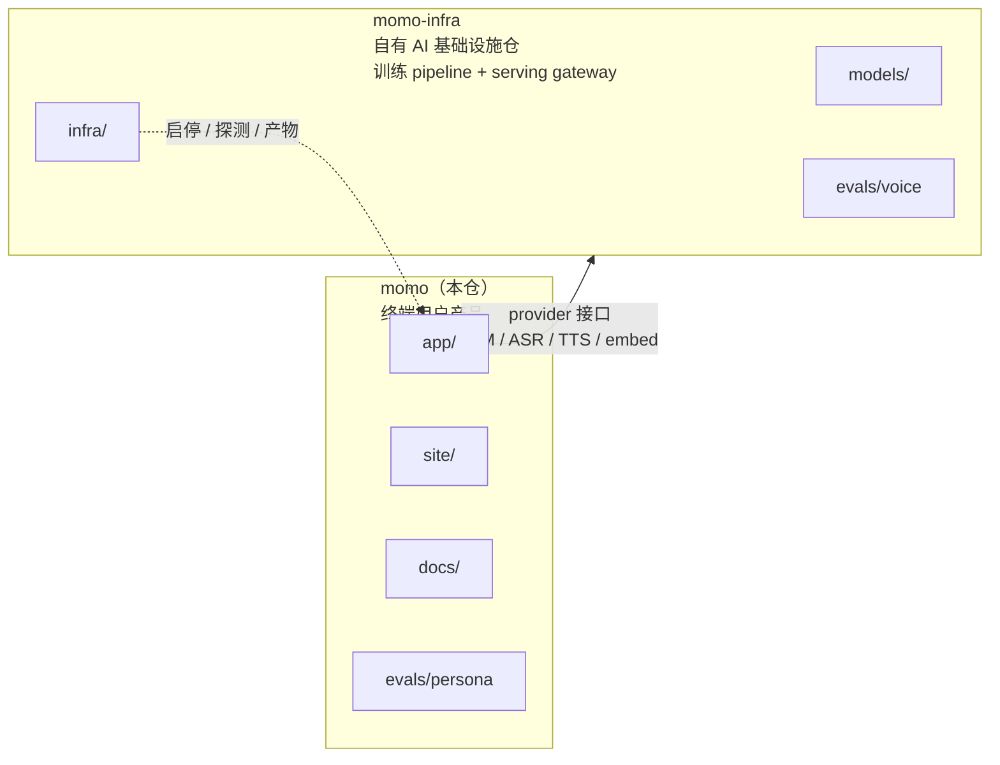
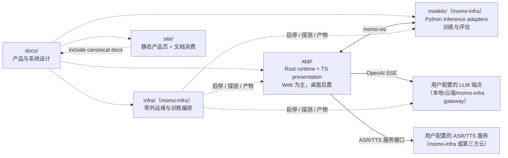

# 模块边界与所有权

> 仓库已按 ADR-027 拆分：本仓（`momo`）= `app` + `site` + `docs` + `evals/persona`；`models/`、`infra/`、`evals/voice/` 与 `config.schema.toml` 已迁往 `momo-infra` 仓。本文保留模块边界口径，`models/`、`infra/` 小节描述其在 momo-infra 仓的职责。

## 仓库演进

## 工作所有权图

## `app/`：用户产品（本仓）

拥有：

- Web presentation 与运行时宿主（`momod` + Web UI，当前唯一交付形态）；未来的 Tauri 桌面壳复刻同一交互；
- TS Pixi 7 Live2D presentation、`AvatarAdapter`、`MotionDirector`、`PresentationDirector`、`AudioPlayer`；Live2D 模型为用户可替换资源（默认 Hiyori）；
- Rust tokio+axum session actor、`TurnCoordinator`、协议与本地 transcript/persona/记忆 repository；
- **用户配置的 provider 接入面**：每类能力一个 endpoint——OpenAI-compatible LLM（`MOMO_LLM_*`）、ASR、TTS；单槽位，不做多 provider 容灾（ADR-028）。

不拥有：模型权重与推理实现、训练编排、运维控制台、**多 provider 降级/负载均衡**（属服务侧/momo-infra gateway）。退出只停止 app 自己启动的 owned child，不关闭 attached remote provider。

## `models/`：推理 adapters 与训练实体（`momo-infra` 仓）

拥有：ASR/VAD、TTS、`EmbeddingProvider`、provider 封装、模型 manifest、声线/persona 训练与评估脚本。

不拥有：memory 归纳/正文/vector index、persona/context 决策、turn/打断状态、窗口、用户许可决策与服务编排。模型服务接到取消后停止产出；最终丢弃迟到结果仍由 `TurnCoordinator` 兜底。

## `infra/`：带外运维与训练编排（`momo-infra` 仓）

拥有：`momoctl`、健康探测、模型下载/校验/激活/回滚、normal/degraded profile、配置草稿原子应用、训练 job 本地/SSH 编排与恢复。**演进方向**（ADR-029）：LLM 后训练、ASR/TTS 全训练 pipeline、复用 vLLM 等开源底座的 serving 能力、统一对外 gateway（对内多模型容灾/LB，对外单接口 + 云化 ASR/TTS API）。

硬约束：不读对话内容，不转发音频，不进入 turn 数据路径，不实现推理引擎。

## `site/` 与 `docs/`

`docs/` 是规范单一来源；`site/docs/guide/` 通过 VitePress include 消费 canonical 文档。`site/` 静态页面不索取 API key、麦克风或本地服务连接。两者随 `app/` 归属本仓。

## 边界 API

| 自有抽象 | 目的 | 可替换实现 |
|---|---|---|
| `AvatarAdapter` | 模型加载、参数/动作、dispose | pixi-live2d-display adapter / fork；Live2D 模型用户可换 |
| `MotionDirector` | 动作优先级与互斥 | 模型映射表 |
| `AudioPlayer` | AudioWorklet 播放与 ACK | 浏览器/Tauri webview |
| `CompanionShell` | menu/窗口/权限/平台降级 | Tauri commands/plugins（后置） |
| `TurnCoordinator` | turn 真相、取消与历史 ledger | Rust session actor |
| `ConversationRepository` | transcript、correction、persona、memory 正文/index | Rust 本地 repository |
| `EmbeddingProvider` | 文本到向量 | Python provider adapter |

## 新功能归属速查

| 需求 | 归属 |
|---|---|
| 新 Live2D model manifest / gesture / 用户换模型 | `app/` |
| provider endpoint 配置项（LLM/ASR/TTS） | `app/` |
| 新 TTS/ASR/embedding provider 实现 | `models/`（momo-infra 仓）adapter + `app/` 配置消费 |
| 多模型容灾 / 负载均衡 / 统一 gateway | `infra/`（momo-infra 仓） |
| 新协议消息 | 先 `docs/01-architecture/protocol.md`，再 `app/` + `models/`（momo-infra 仓） |
| 会话 correction 与 memory 归纳/正文/index | `app/` Rust repository |
| 模型下载、训练编排与恢复 | `infra/`（momo-infra 仓） |
| 公共指南 | canonical `docs/` + `site/` include wrapper |
