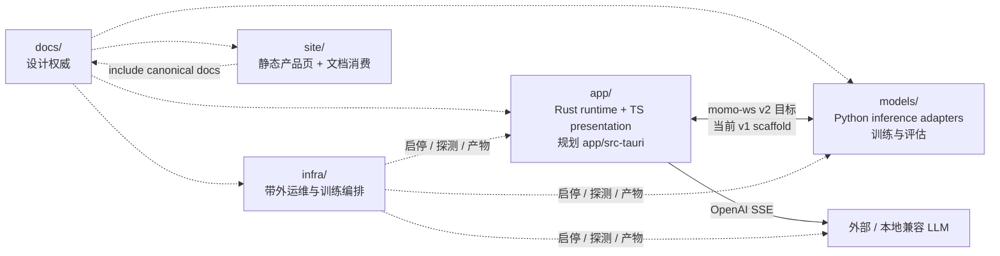

# Monorepo 边界与所有权

> momo 是单一 monorepo，以目录而不是独立仓库划分职责。跨边界先改 `docs/01-architecture/`。

## 工作所有权图

## `app/`：companion、回合与本地数据

拥有：

- Tauri 2 host、窗口/menu/权限/单实例/睡眠唤醒与 owned child 生命周期；
- TS Pixi 7 Live2D presentation、`AvatarAdapter`、`MotionDirector`、`PresentationDirector`、`AudioPlayer`；
- Rust tokio+axum session actor、`TurnCoordinator`、协议与本地 transcript/persona；
- conversation repository：session、correction、memory proposal/正文/CRUD 与 vector index；
- LLM OpenAI-compatible SSE client、ASR/TTS/Embedding adapters 的调用侧。

不拥有：模型权重与推理实现、训练编排、运维控制台。退出只停止 app 自己启动的 owned child，不关闭 attached remote provider。

## `models/`：推理 adapters 与训练实体

拥有：ASR/VAD、TTS、`EmbeddingAdapter`、provider 封装、模型 manifest、声线/persona 训练与既有评估脚本。

不拥有：memory proposal、memory 正文、vector index、persona/context 决策、turn/打断状态、桌面窗口、用户许可决策与服务编排。模型服务接到取消后停止产出；最终丢弃迟到结果仍由 `TurnCoordinator` 兜底。

## `infra/`：带外运维

拥有：`momoctl`、健康探测、模型下载/校验/激活/回滚、normal/degraded profile、配置草稿原子应用、训练 job 本地/SSH 编排与恢复。

硬约束：不读对话内容，不转发音频，不进入 turn 数据路径，不实现推理。

## `site/` 与 `docs/`

`docs/` 是规范单一来源；`site/docs/guide/` 通过 VitePress include 消费 canonical 文档。`site/` 静态页面不索取 API key、麦克风或本地服务连接。

## 边界 API

| 自有抽象 | 目的 | 可替换实现 |
|---|---|---|
| `AvatarAdapter` | 模型加载、参数/动作、dispose | pixi-live2d-display adapter / fork |
| `MotionDirector` | 动作优先级与互斥 | 模型映射表 |
| `AudioPlayer` | AudioWorklet 播放与 ACK | 浏览器/Tauri webview |
| `CompanionShell` | menu/窗口/权限/平台降级 | Tauri commands/plugins |
| `TurnCoordinator` | turn 真相、取消与历史 ledger | Rust session actor |
| `ConversationRepository` | transcript、correction、persona、memory 正文/index | Rust 本地 repository |
| `EmbeddingAdapter` | 文本到向量 | Python provider adapter |

## 新功能归属速查

| 需求 | 归属 |
|---|---|
| 新 Live2D model manifest / gesture | `app/` |
| 新 TTS/ASR/embedding provider | `models/` adapter + `app/` 配置消费 |
| 新协议消息 | 先 `docs/01-architecture/protocol.md`，再 `app/` + `models/` |
| 会话 correction 与 memory CRUD/index | `app/` Rust repository |
| 模型下载、训练恢复 | `infra/` |
| 公共指南 | canonical `docs/` + `site/` include wrapper |
