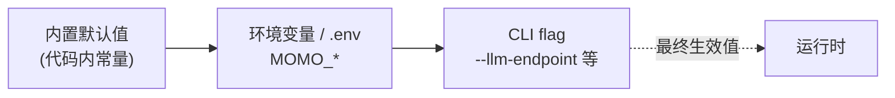

# 配置规范：`MOMO_` 环境变量

> 一切环境差异与密钥走 `MOMO_` 前缀环境变量（ADR-005）。仓库只提交 `.env.example`（占位无值），本地 `.env` 不入库。

## 1. 解析优先级



内置默认 < 环境变量 < CLI flag，高优先级覆盖低优先级。CLI flag 命名 = env 名去 `MOMO_` 前缀转 kebab-case（`MOMO_LLM_ENDPOINT` → `--llm-endpoint`）。启动时各组件把**生效值**打进日志（敏感项打码，见 §4）。


### 2.1 通用（多组件共用，读取组件见表）

| 名称 | 含义 | 默认值 | 取值 | 读取组件 | 敏感 |
|---|---|---|---|---|---|
| `MOMO_ENV` | 运行环境标识 | `dev` | `dev`/`prod` | 全部 | 否 |
| `MOMO_LOG_LEVEL` | 日志级别 | `info` | `trace/debug/info/warn/error` | 全部 | 否 |
| `MOMO_LOG_FORMAT` | 日志输出格式 | `pretty` | `pretty`/`json` | 全部 | 否 |

### 2.2 编排器（app 读）

| 名称 | 含义 | 默认值 | 取值 | 读取组件 | 敏感 |
|---|---|---|---|---|---|
| `MOMO_UI_DIR` | 前端静态目录（打包内嵌时忽略） | `./web/dist` | path | app | 否 |
| `MOMO_WEB_ORIGIN` | 浏览器来源（CORS/WS Origin 白名单） | `http://localhost:5173` | URL | app | 否 |
| `MOMO_UI_TOKEN` | `/ws/ui` hello 的期望 `auth_token`；desktop 启动时注入，空=standalone dev 不比对（字段仍必填） | 空 | str | app | **是** |
| `MOMO_LLM_TIMEOUT_MS` | LLM 请求总超时 | `30000` | ms | app | 否 |
| `MOMO_BARGEIN_ENABLED` | 允许打断 | `true` | bool | app | 否 |
| `MOMO_BARGEIN_MIN_MS` | 打断防抖：`input.vad{speech_start}` 须持续该时长才触发 barge-in | `250` | ms | app | 否 |
| `MOMO_IDLE_TIMEOUT_S` | 空闲多少秒触发自发行为 | `20` | s，0=关闭 | app | 否 |
| `MOMO_SENT_SOFT_CHARS` | 句切弱切阈值 | `25` | 字符数 | app | 否 |
| `MOMO_SENT_MAX_CHARS` | 句切硬上限 | `60` | 字符数 | app | 否 |
| `MOMO_HISTORY_TURNS` | 注入 LLM 的历史回合数 | `20` | int | app | 否 |
| `MOMO_FILTER_ENABLED` | 未来外部 ingress/egress 过滤开关（streaming adapter 前置） | `false` | bool | app | 否 |
| `MOMO_DATA_COLLECTION` | 会话采集开关（语料落盘供训练/微调） | `on` | `on`/`off` | app | 否 |
| `MOMO_DATA_KEEP_AUDIO` | 原始麦音频短期保留（仅显式开启且授权时，供 ASR 排错） | `off` | `on`/`off` | app | **是** |
| `MOMO_EMOTION_MAP` | emotion tag → Live2D 表情映射文件路径 | `config/emotion.map.yaml` | path | app | 否 |


## 3. `.env.example`（提交入库的完整模板）

```dotenv
# ===== momo .env.example —— 复制为 .env 后填值；.env 不入库 =====
# 通用
MOMO_ENV=dev
MOMO_LOG_LEVEL=info
MOMO_LOG_FORMAT=pretty         # pretty | json
MOMO_MODELS_DIR=~/.cache/momo/models

# 编排器（momo-app / momod）
MOMO_ORCH_LISTEN=127.0.0.1:7800
MOMO_UI_DIR=./web/dist
MOMO_WEB_ORIGIN=http://localhost:5173   # 浏览器来源白名单（vite dev）
MOMO_UI_TOKEN=               # 敏感：/ws/ui hello auth_token；desktop 启动注入，空=dev 不校验
MOMO_LLM_ENDPOINT=http://mac-studio.local:7820/v1
MOMO_LLM_MODEL=qwen3-30b-a3b-4bit
MOMO_LLM_TIMEOUT_MS=30000
MOMO_BARGEIN_ENABLED=true
MOMO_BARGEIN_MIN_MS=250        # speech_start 持续该时长才触发打断
MOMO_IDLE_TIMEOUT_S=20
MOMO_SENT_SOFT_CHARS=25
MOMO_SENT_MAX_CHARS=60
MOMO_HISTORY_TURNS=20
MOMO_FILTER_ENABLED=false
MOMO_DATA_COLLECTION=on        # 会话采集开关（语料落盘）
MOMO_DATA_KEEP_AUDIO=off       # 敏感产物：授权排错时短期保留原始麦音频
MOMO_EMOTION_MAP=config/emotion.map.yaml   # tag → Live2D 表情映射
```

配置覆盖记忆、语音和视觉服务；具体能力按产品优先级启用。

## 4. 敏感项与安全

- **敏感数据（非 key）**：`MOMO_DATA_KEEP_AUDIO=on` 时落盘的原始麦音频属隐私数据——key 本身只是开关，但其产物按敏感数据同等纪律处理（短期保留、仅 ASR 排错用途、到期清理、不外传）。
- `.env` 已在各仓 `.gitignore`；`.env.example` 中敏感项**只留空值占位**，禁止提交真实 key。

## 5. 与配置发布平台的兼容


- 配置面是**扁平 key=value 环境变量**，无嵌套配置文件——任何支持 env 注入的平台（systemd/Docker/k8s/自研发布平台）都可直接消费。

## 6. 机器可读 schema：`config.schema.toml`


```toml
schema = 1            # 文件格式版本
passthrough = [ { name, type?, default, files, description } ]   # 非 MOMO_ 前缀，第三方库自读
```

| 字段 | 口径 |
|---|---|
| `name` | env 键名，`MOMO_` 前缀；非前缀变量进 `passthrough` |
| `type` | `string`/`bool`/`int`/`path`/`url`/`enum`；供配置页渲染与校验用 |
| `values` | `type=enum` 时的合法取值集合 |
| `readers` | 代码中消费该键的模块：`app`/`models`/`infra` |
| `description` | 含义，与 §2「含义」列保持一致 |


## 检查表

- [ ] 默认值与 protocol.md、runtime.md 中的数字一致（端口、队列、句切阈值、VAD）
