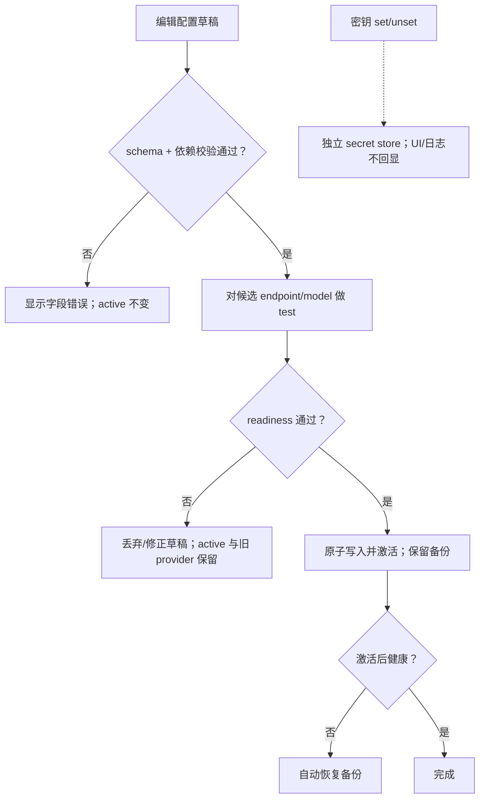

# 配置规范：`MOMO_` 环境变量

> 一切环境差异与密钥走 `MOMO_` 前缀环境变量（ADR-005）。仓库只提交 `.env.example`（占位无值），本地 `.env` 不入库。
> 读取组件缩写：`app`=momo-app 编排器/前端；`models`=momo-models 服务；`infra`=momo-infra CLI。

## 1. 解析优先级


内置默认 < 环境变量 < CLI flag，高优先级覆盖低优先级。CLI flag 命名 = env 名去 `MOMO_` 前缀转 kebab-case（`MOMO_LLM_ENDPOINT` → `--llm-endpoint`）。启动时各组件把**生效值**打进日志（敏感项打码，见 §4）。

## 2. 变量全集

### 2.1 通用（所有组件）

| 名称 | 含义 | 默认值 | 取值 | 读取组件 | 敏感 |
|---|---|---|---|---|---|
| `MOMO_ENV` | 运行环境标识 | `dev` | `dev`/`prod` | 全部 | 否 |
| `MOMO_LOG_LEVEL` | 日志级别 | `info` | `trace/debug/info/warn/error` | 全部 | 否 |
| `MOMO_LOG_FORMAT` | 日志输出格式 | `pretty` | `pretty`/`json` | 全部 | 否 |
| `MOMO_PROFILE` | 部署档位 | `normal` | `normal`/`degraded` | infra（决定启停拓扑与健康检查对象）；app/models 不直接读 | 否 |
| `MOMO_MODELS_DIR` | 模型文件根目录 | `~/.cache/momo/models` | path | models, infra | 否 |

### 2.2 编排器（app 读）

| 名称 | 含义 | 默认值 | 取值 | 敏感 |
|---|---|---|---|---|
| `MOMO_ORCH_LISTEN` | WS + 静态 UI 监听地址 | `127.0.0.1:7800` | host:port | 否 |
| `MOMO_UI_DIR` | 前端静态目录（打包内嵌时忽略） | `./web/dist` | path | 否 |
| `MOMO_WEB_ORIGIN` | 浏览器来源（CORS/WS Origin 白名单） | `http://localhost:5173` | URL | 否 |
| `MOMO_WEB_TOKEN` | `momoctl web` 控制台鉴权 token；`--listen` 放宽出 localhost 时必填（未设拒绝启动） | 空 | str | **是** |
| `MOMO_LLM_ENDPOINT` | 大脑 OpenAI-compatible base URL | `http://mac-studio.local:7820/v1` | URL | 否 |
| `MOMO_LLM_MODEL` | 传给大脑的 model 字段 | `qwen3-8b-4bit` | str | 否 |
| `MOMO_LLM_API_KEY` | 大脑端点鉴权 key；本地可为空 | 空 | str | **是** |
| `MOMO_LLM_TIMEOUT_MS` | LLM 请求总超时 | `30000` | ms | 否 |
| `MOMO_ASR_ENDPOINT` | ASR 服务 WS 地址 | `ws://127.0.0.1:7810/ws` | ws:// | 否 |
| `MOMO_TTS_ENDPOINT` | TTS 服务 WS 地址 | `ws://127.0.0.1:7811/ws` | ws:// | 否 |
| `MOMO_EMBED_ENDPOINT`（P1） | embed 服务 WS 连接地址（编排器→momo-svc-embed） | `ws://127.0.0.1:7812/ws` | ws:// | 否 |
| `MOMO_BARGEIN_ENABLED` | 允许打断 | `true` | bool | 否 |
| `MOMO_BARGEIN_MIN_MS` | 打断防抖：`input.vad{speech_start}` 须持续该时长才触发 barge-in | `250` | ms | 否 |
| `MOMO_IDLE_TIMEOUT_S` | 空闲多少秒触发自发行为 | `20` | s，0=关闭 | 否 |
| `MOMO_SENT_SOFT_CHARS` | 句切弱切阈值 | `25` | 字符数 | 否 |
| `MOMO_SENT_MAX_CHARS` | 句切硬上限 | `60` | 字符数 | 否 |
| `MOMO_HISTORY_TURNS` | 注入 LLM 的历史回合数 | `20` | int | 否 |
| `MOMO_FILTER_ENABLED` | 未来外部 ingress/egress 过滤开关（streaming adapter 前置） | `false` | bool | 否 |
| `MOMO_DEEPSEEK_API_KEY` | DeepSeek key：LLM 兜底与 P2 视觉 provider 共用 | 空 | str | **是** |
| `MOMO_DATA_COLLECTION` | 会话采集开关（语料落盘供训练/微调） | `on` | `on`/`off` | 否 |
| `MOMO_DATA_KEEP_AUDIO` | 原始麦音频短期保留（仅显式开启且授权时，供 ASR 排错） | `off` | `on`/`off` | **是** |
| `MOMO_EMOTION_MAP` | emotion tag → Live2D 表情映射文件路径 | `config/emotion.map.yaml` | path | 否 |

### 2.3 模型服务（models 读）

| 名称 | 含义 | 默认值 | 取值 | 敏感 |
|---|---|---|---|---|
| `MOMO_ASR_LISTEN` | ASR WS 监听 | `127.0.0.1:7810` | host:port | 否 |
| `MOMO_ASR_PROVIDER` | ASR 后端 | `sensevoice` | `sensevoice`；云端实现经 registry 同级注册 | 否 |
| `MOMO_ASR_MODEL` | ASR 模型 | `sensevoice-small` | str | 否 |
| `MOMO_ASR_THREADS` | sherpa-onnx CPU 线程 | `4` | 1–16 | 否 |
| `MOMO_VAD_SILENCE_MS` | VAD 判停静音时长 | `250` | ms | 否 |
| `MOMO_TTS_LISTEN` | TTS WS 监听 | `127.0.0.1:7811` | host:port | 否 |
| `MOMO_TTS_PROVIDER` | TTS 后端 | `kokoro` | `edge`/`kokoro`/`f5`/`cosyvoice3`/`sovits` | 否 |
| `MOMO_TTS_DEVICE` | TTS 推理设备 | `cuda` | `cuda`/`cpu`/`mps` | 否 |
| `MOMO_TTS_VOICE_REF` | 克隆用参考音频路径 | 空 | path | 否 |
| `MOMO_TTS_MODEL_DIR` | SFT 克隆产物目录（灰度切换/回滚指向） | 空 | path | 否 |
| `MOMO_TTS_LANG` | 合成默认语言 | `auto` | `zh`/`en`/`ja`/`auto` | 否 |
| `MOMO_MEMORY_ENABLED`（P1） | 记忆检索开关 | `false` | bool | 否 |
| `MOMO_MEMORY_DB`（P1） | sqlite-vec 库路径 | `data/momo.vec.db` | path | 否 |
| `MOMO_VISION_ENDPOINT`（P2） | 视觉 API | `https://api.deepseek.com/v1` | URL | 否 |
| `MOMO_VISION_MODEL`（P2） | 视觉模型 | `deepseek-v4-flash-vision-exp` | str | 否 |
| `MOMO_EMBED_LISTEN`（P1） | embed 服务 WS 监听（记忆检索） | `127.0.0.1:7812` | host:port | 否 |

### 2.4 大脑服务启停（infra 读，mac-studio 侧由 infra 远程/本地拉起）

| 名称 | 含义 | 默认值 | 取值 | 敏感 |
|---|---|---|---|---|
| `MOMO_BRAIN_BACKEND` | 大脑后端类型 | `mlx` | `mlx`/`vllm`/`deepseek`/`local` | 否 |
| `MOMO_BRAIN_MODEL_PATH` | 本地模型目录 | `~/models/Qwen3-8B-4bit` | path | 否 |
| `MOMO_BRAIN_PORT` | 大脑服务端口（对应 `MOMO_LLM_ENDPOINT`） | `7820` | port | 否 |

降级档本地脑（laptop 上 llama.cpp GGUF）同样监听 `MOMO_BRAIN_PORT`（默认 7820）；切换只是 `MOMO_LLM_ENDPOINT` 换 host，端口不变。

### 2.5 上游工具直通变量（非 `MOMO_` 前缀，第三方库自读）

| 名称 | 含义 | 默认值 | 说明 |
|---|---|---|---|
| `HF_ENDPOINT` | HF 镜像 | `https://hf-mirror.com` | **laptop 必须**（huggingface.co 不通，ADR-017）；mac-studio 用镜像同样更快 |
| `UV_INDEX_URL` / `PIP_INDEX_URL` | PyPI 镜像 | 各机自选 | 仅安装期生效 |
| `HTTPS_PROXY` | 代理 | 空 | 如有需要 |

infra 在拉起 Python 服务前负责把 `HF_ENDPOINT` 注入子进程环境。

## 3. `.env.example`（提交入库的完整模板）

```dotenv
# ===== momo .env.example —— 复制为 .env 后填值；.env 不入库 =====
# 通用
MOMO_ENV=dev
MOMO_LOG_LEVEL=info
MOMO_LOG_FORMAT=pretty         # pretty | json
MOMO_PROFILE=normal            # normal | degraded（降级=改 env 不改代码）
MOMO_MODELS_DIR=~/.cache/momo/models

# 编排器（momo-app）
MOMO_ORCH_LISTEN=127.0.0.1:7800
MOMO_UI_DIR=./web/dist
MOMO_WEB_ORIGIN=http://localhost:5173   # 浏览器来源白名单（vite dev）
MOMO_LLM_ENDPOINT=http://mac-studio.local:7820/v1
MOMO_LLM_MODEL=qwen3-8b-4bit
MOMO_LLM_API_KEY=              # 敏感：本地 mlx_lm 可空；DeepSeek 时填 sk-...
MOMO_LLM_TIMEOUT_MS=30000
MOMO_ASR_ENDPOINT=ws://127.0.0.1:7810/ws
MOMO_TTS_ENDPOINT=ws://127.0.0.1:7811/ws
MOMO_EMBED_ENDPOINT=ws://127.0.0.1:7812/ws   # P3 编排器→momo-svc-embed
MOMO_BARGEIN_ENABLED=true
MOMO_BARGEIN_MIN_MS=250        # speech_start 持续该时长才触发打断
MOMO_IDLE_TIMEOUT_S=20
MOMO_SENT_SOFT_CHARS=25
MOMO_SENT_MAX_CHARS=60
MOMO_HISTORY_TURNS=20
MOMO_FILTER_ENABLED=false
MOMO_DEEPSEEK_API_KEY=         # 敏感：LLM 兜底 + P4 视觉
MOMO_DATA_COLLECTION=on        # 会话采集开关（语料落盘）
MOMO_DATA_KEEP_AUDIO=off       # 敏感产物：授权排错时短期保留原始麦音频
MOMO_EMOTION_MAP=config/emotion.map.yaml   # tag → Live2D 表情映射

# 模型服务（momo-models）
MOMO_ASR_LISTEN=127.0.0.1:7810
MOMO_ASR_PROVIDER=sensevoice   # 本地 sherpa；云端实现注册后同级可选
MOMO_ASR_MODEL=sensevoice-small
MOMO_ASR_THREADS=4
MOMO_VAD_SILENCE_MS=250
MOMO_TTS_LISTEN=127.0.0.1:7811
MOMO_TTS_PROVIDER=kokoro       # 目标 cosyvoice3；部署需求待实测
MOMO_TTS_DEVICE=cuda
MOMO_TTS_VOICE_REF=
MOMO_TTS_MODEL_DIR=            # SFT 克隆产物目录（灰度切换/回滚）
MOMO_TTS_LANG=auto
MOMO_MEMORY_ENABLED=false
MOMO_MEMORY_DB=data/momo.vec.db
MOMO_VISION_ENDPOINT=https://api.deepseek.com/v1
MOMO_VISION_MODEL=deepseek-v4-flash-vision-exp
MOMO_EMBED_LISTEN=127.0.0.1:7812   # P3 记忆检索服务

# 大脑启停（momo-infra）
MOMO_BRAIN_BACKEND=mlx
MOMO_BRAIN_MODEL_PATH=~/models/Qwen3-8B-4bit
MOMO_BRAIN_PORT=7820

# 上游直通（非 MOMO_ 前缀）
HF_ENDPOINT=https://hf-mirror.com   # laptop 必须
# UV_INDEX_URL=
# HTTPS_PROXY=

# ===== 降级档参考（degraded）：只改这几行 =====
# MOMO_PROFILE=degraded
# MOMO_LLM_ENDPOINT=http://127.0.0.1:7820/v1   # 或 https://api.deepseek.com/v1
# MOMO_LLM_MODEL=qwen3-8b-local                # 或 deepseek-v4-flash
# MOMO_LLM_API_KEY=                            # DeepSeek 时必填
# MOMO_TTS_PROVIDER=kokoro
```

配置覆盖记忆、语音和视觉服务；具体能力按产品优先级启用。

## 4. 敏感项与安全

- **敏感清单**：`MOMO_LLM_API_KEY`、`MOMO_DEEPSEEK_API_KEY`、`MOMO_WEB_TOKEN`、`MOMO_DATA_KEEP_AUDIO`（后续新增一律按"值即密钥/隐私开关"判断）。
- **敏感数据（非 key）**：`MOMO_DATA_KEEP_AUDIO=on` 时落盘的原始麦音频属隐私数据——key 本身只是开关，但其产物按敏感数据同等纪律处理（短期保留、仅 ASR 排错用途、到期清理、不外传）。
- `.env` 已在各仓 `.gitignore`；`.env.example` 中敏感项**只留空值占位**，禁止提交真实 key。
- 日志/诊断输出对敏感值打码（显示前 4 位 + `…`）；`momoctl doctor` 只做"是否设置"检查，不回显。
- 组件间不转发敏感变量：models/infra 不需要 DS key，由 app 单独持有（P2 视觉若下沉到 models，届时在 decisions.md 补记）。

## 5. 与配置发布平台的兼容

P2 控制台只编辑配置草稿；UI 偏好（窗口位置、scale、置顶、穿透、输入模式、设备、companion mode）保存在本地 settings，不新增或覆盖本页 env 默认值。



- 配置面是**扁平 key=value 环境变量**，无嵌套配置文件——任何支持 env 注入的平台（systemd/Docker/k8s/自研发布平台）都可直接消费。
- 平台对接约定：以 `.env.example` 的 key 集合为 schema；敏感项由平台密钥管理注入，不写文件。
- 新增变量流程：同一 PR 内更新 `config.md` 表格 + `.env.example` + 代码默认值，三者不一致视为 bug。
- 配置变更通过改 env + 重启生效，由 infra 封装正确顺序。

## 检查表

- [ ] 每个变量有：含义/默认值/取值范围/读取组件/敏感标记
- [ ] `.env.example` 与 §2 表格 key 集合完全一致
- [ ] 默认值与 protocol.md、runtime.md 中的数字一致（端口、队列、句切阈值、VAD）
- [ ] 敏感项在日志与 doctor 输出中打码
- [ ] 降级档切换所需修改的行已在模板注释中列出
