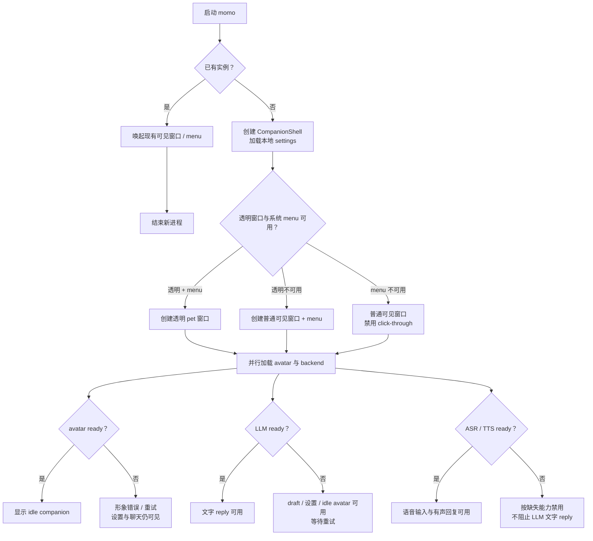
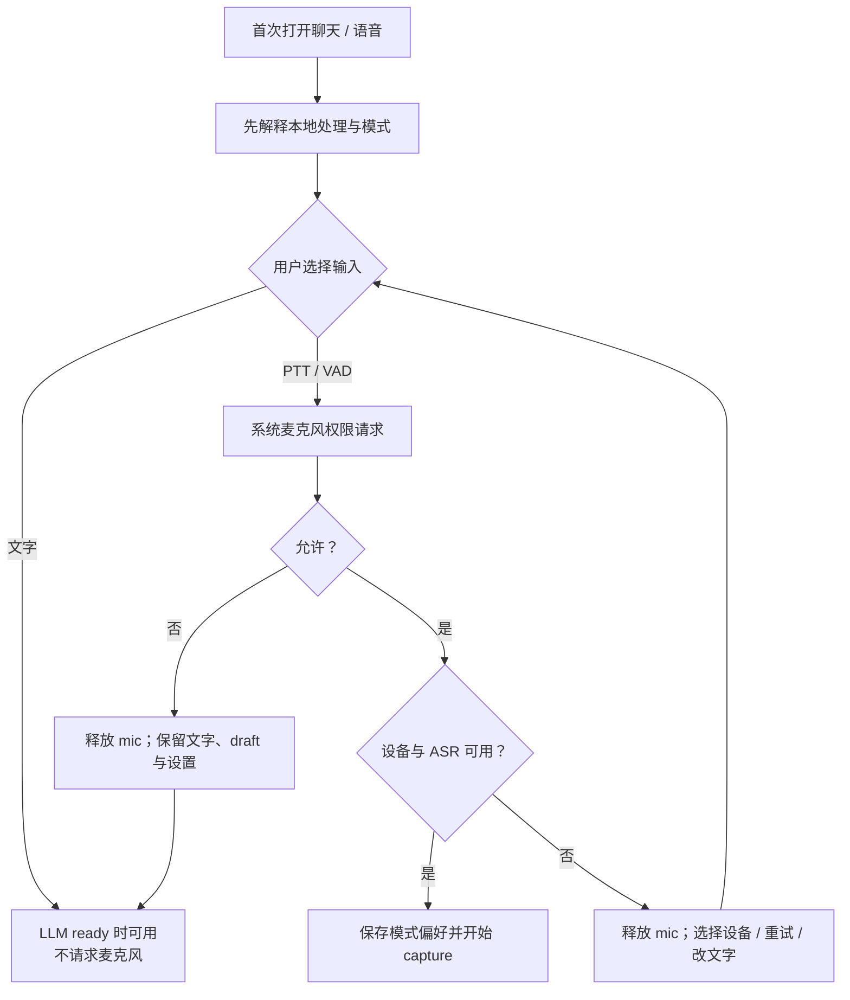
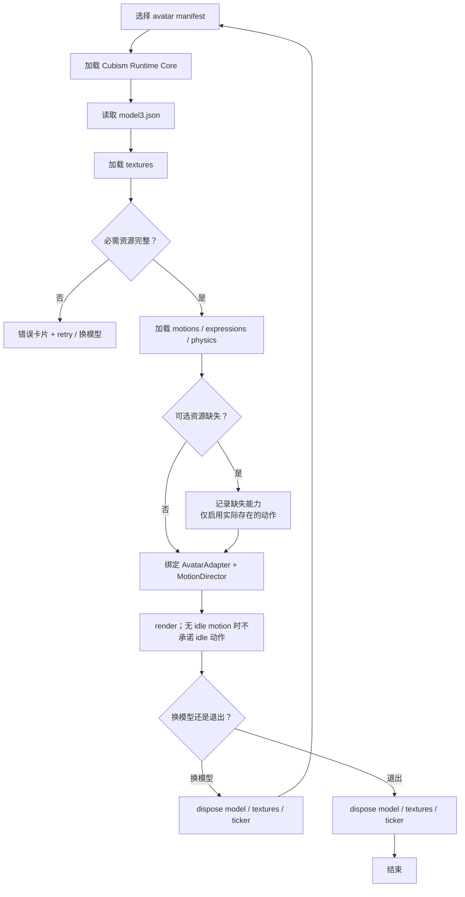
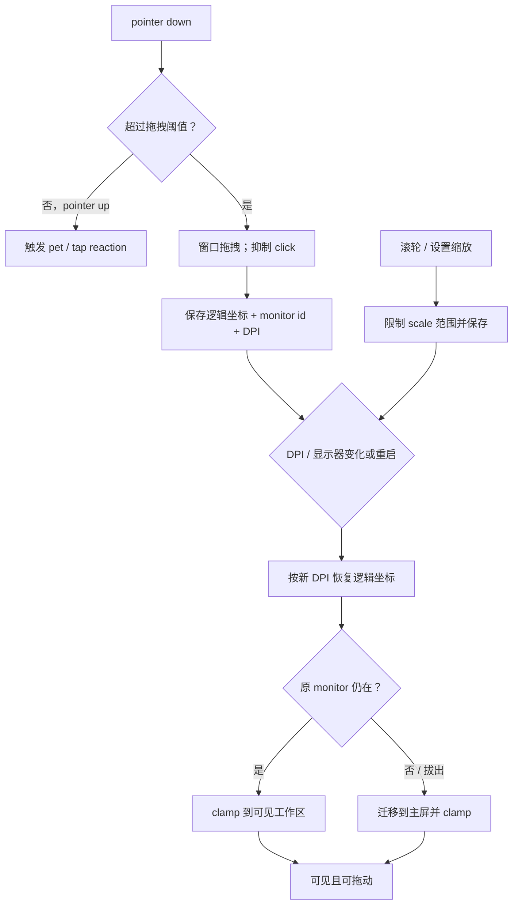
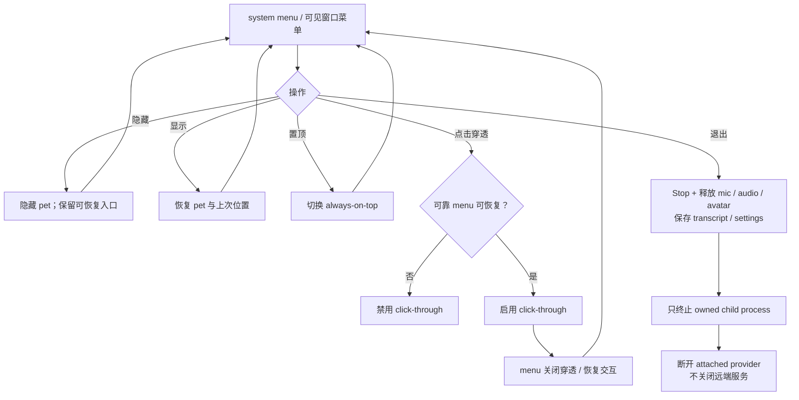
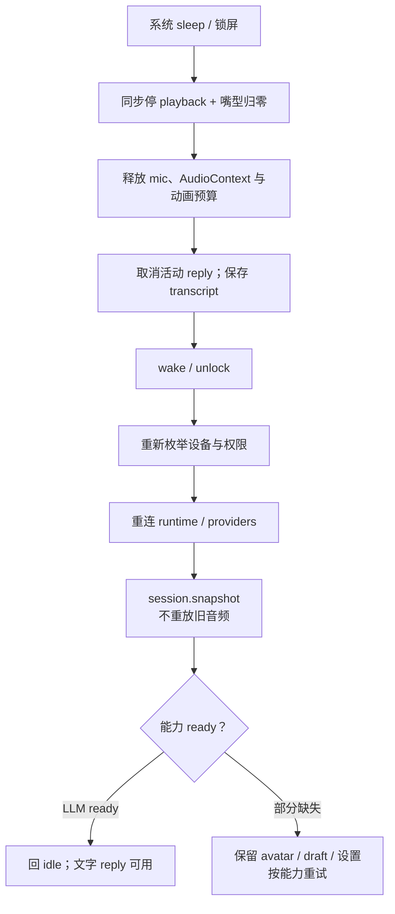

# 桌面宿主与形象生命周期

> 桌面宿主让 momo 成为日常桌面的一部分：可拖动、可交互、可收起，也能在设备切换和休眠后自然回到你身边。

## 启动、单实例与 readiness

不支持 Wayland/global shortcut/transparency 时使用普通可见窗口。系统 menu/tray 不可用时禁止 click-through，恢复入口必须留在可见窗口内。

## 首次运行、权限与文字保底

连续麦克风始终 opt-in；静态网站不请求该权限。LLM 不可用时可编辑和保留 draft，但不能生成 AI reply。

## avatar 加载与释放

桃濑日和 Hiyori 是网站固定互动 demo，保持官方模型与角色设计原样。网站使用的 sample data、Cubism Core 与应用代码适用不同许可。未来桌面版若开放任意 avatar 导入与公开发布，必须按目标 SDK 与素材用途重新核对 publication license。

## 拖拽、点击、缩放与显示器恢复

## menu、穿透与退出

## sleep / wake

## 本地 UI settings

窗口位置、scale、置顶、穿透、输入模式、设备选择和 companion mode 是本地 UI settings，不是部署环境变量；密钥和服务 endpoint 仍由服务端配置管理。
