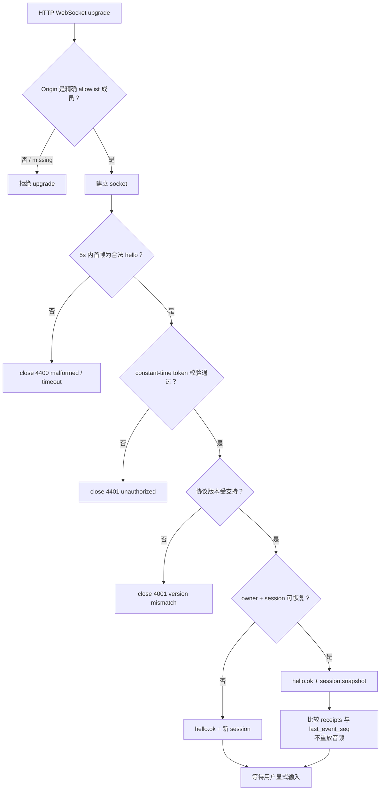
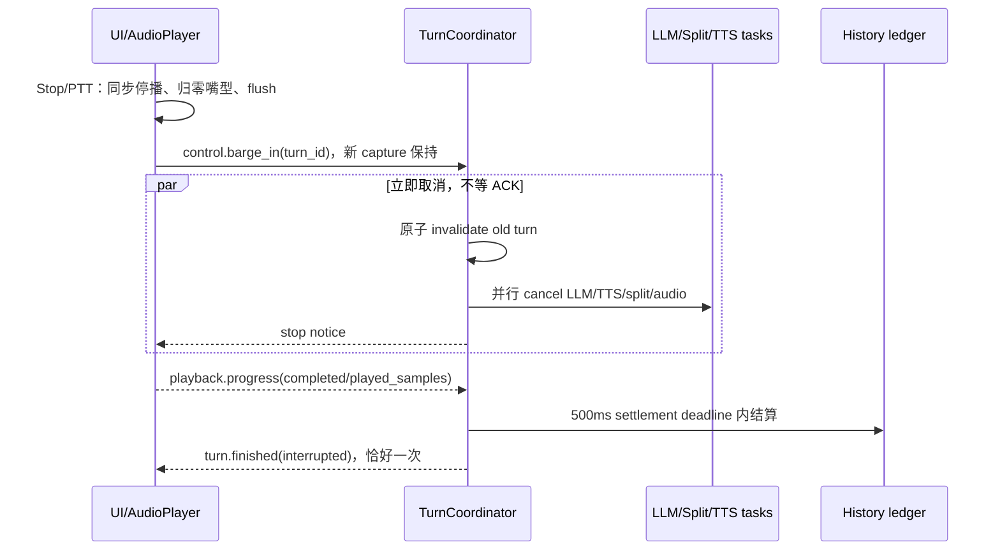

# momo-ws 通信协议

> momo-ws 连接桌面交互、回合编排和语音服务，统一传递输入、状态、字幕与音频。每个事件和音频流都有明确归属，使播放、打断与重连保持一致。

LLM 不使用本协议：`TurnCoordinator` 直接调用 OpenAI-compatible HTTP SSE。

## 1. 核心类型

```ts
type TurnState = 'idle' | 'listening' | 'thinking' | 'speaking' | 'interrupted'
type Hello = { type: 'hello'; protocol: 'momo-ws'; version: 'v2'; client: 'ui' | 'orchestrator'; auth_token: string; resume_session_id?: string }
type Envelope = { type: string; session_id: string; event_id: string; at_ms: number; turn_id?: string; reply_to?: string }
type ServerEnvelope = Envelope & { event_seq: number }
type InputReceipt = { id: string; turn_id: string; status: 'accepted' | 'completed' | 'interrupted' | 'failed' }
type SessionSnapshot = { type: 'session.snapshot'; session_id: string; turn: { id: string; state: TurnState } | null; receipts: InputReceipt[]; capabilities: string[]; last_event_seq: number }
type AudioOpen = Envelope & { type: 'audio.open'; stream_id: string; direction: 'uplink' | 'downlink'; capture_id?: string; sentence_seq?: number; codec: 'pcm_s16le'; sample_rate: 16000 | 24000; channels: 1 }
type PlaybackProgress = Envelope & { type: 'playback.progress'; stream_id: string; sentence_seq: number; played_samples: number; completed: boolean }
```

`event_id`、`turn_id`、`stream_id`、`capture_id` 使用 ULID。握手发生在 session 建立前，不带 envelope。服务端业务消息带单调递增的 `event_seq`；客户端保存 `last_event_seq`，忽略 `event_seq <= last_event_seq` 的 duplicate/stale event。序列缺口无法通过 snapshot 收敛时关闭连接并重新握手。

## 2. 必需字段、方向与用途

| type | sender → receiver | 必需字段 | 用途 |
|---|---|---|---|
| `hello` | UI→orchestrator；orchestrator→ASR/TTS | `protocol,version,client,auth_token`；UI 可带 `resume_session_id` | 5s 内完成角色、凭据与版本协商 |
| `hello.ok` | server→client | `version,session_id,capabilities,role` | 确认 server role 与能力 |
| `session.snapshot` | orchestrator→UI | `session_id,turn,receipts,capabilities,last_event_seq` | 无音频重放的状态收敛 |
| `input.text` | UI→orchestrator | `id,text,lang` | 幂等文字输入 |
| `input.accepted` | orchestrator→UI | `ref_id,turn_id` | receipt cache 回执 |
| `input.rejected` | orchestrator→UI | `ref_id,reason` | 输入拒绝 |
| `input.audio.start/end/cancel` | UI→orchestrator | `capture_id`；start 另含 `mode` | capture 生命周期 |
| `input.vad` | ASR→orchestrator→UI | `capture_id,event` | speech_start / speech_end |
| `input.audio.segment` | ASR→orchestrator→UI | `capture_id,text,final` | partial 预览或 final 输入 |
| `audio.open` uplink | UI→orchestrator→ASR | `stream_id,direction,capture_id,codec,sample_rate,channels` | stream 绑定 capture；UI 不绕过 orchestrator；不得带 sentence_seq |
| `audio.open` downlink | TTS→orchestrator→UI | `stream_id,direction,turn_id,sentence_seq,codec,sample_rate,channels` | stream 绑定 turn/sentence；TTS 不绕过 orchestrator；不得带 capture_id |
| `audio.end` | stream sender→receiver | `stream_id,last_chunk_seq` | 显式结束 stream |
| `output.complete` | orchestrator→UI | `turn_id,last_sentence_seq` | generation 结束 |
| `playback.started` | UI→orchestrator | `stream_id,sentence_seq` | 实际开播并进入 speaking |
| `playback.progress` | UI→orchestrator | `stream_id,sentence_seq,played_samples,completed` | 听见账本 |
| `control.barge_in` | UI→orchestrator；或 orchestrator 内部 VAD 事件 | `turn_id,reason` | 请求立即打断指定 turn；ASR 不发送任意 barge_in control |
| `control.cancel` | orchestrator→UI/models | `target,id`；turn stop 时 `id=turn_id` | 向各方向取消同一个指定 turn/object |
| `turn.finished` | orchestrator→UI | `turn_id,outcome` | 每 turn 恰好一次终态 |
| `state.turn` | orchestrator→UI | `turn_id,state` | turn domain event |

`hello.client='orchestrator'` 用于 app 连接模型服务；ASR/TTS 的 `hello.ok.role` 分别为 `asr` / `tts`。UI 连接 runtime 时 `client='ui'`，协议不把所有连接强制成 UI 角色。`/ws/ui` route 只接受 `client='ui'` 的 hello，其余取值按 malformed 处理 close `4400`。

固定 emotion：`neutral` `happy` `sad` `angry` `surprised` `thinking` `shy` `sleepy`。tool action 使用独立的工具扩展消息组。

## 3. Golden 向量

`app/tests/golden/` 入库 23 个 golden JSON fixture，逐 `type` 覆盖上表必需字段，是 wire 格式的对拍基准：

| 文件 | 覆盖消息 |
|---|---|
| `hello.json` / `hello.ok.json` | 握手与能力确认 |
| `session.snapshot.json` | 无音频重放的状态收敛 |
| `input.text.json` / `input.accepted.json` / `input.rejected.json` | 幂等文字输入与回执 |
| `input.audio.start/end/cancel.json` `input.vad.json` `input.audio.segment.json` | capture 生命周期、VAD、partial/final 段 |
| `audio.open.uplink.json` / `audio.open.downlink.json` / `audio.end.json` | stream 绑定（方向约束两形态）与显式结束 |
| `output.sentence.json` / `output.complete.json` | 逐句输出与 generation 结束 |
| `playback.started.json` / `playback.progress.json` | 播放账本 |
| `control.barge_in.json` / `control.cancel.json` / `turn.finished.json` / `state.turn.json` | 打断、取消、turn 终态与状态事件 |
| `error.json` | 错误帧（带完整 ServerEnvelope） |

用途：固定字段名/枚举值/ULID 形态，防 serde rename、flatten envelope 或 snake_case 漂移。对拍方式：`app/tests/proto_roundtrip.rs` 对每个 fixture 做 decode→断言字段 + encode→字节级比对的双向对拍；二进制音频帧以 `audio.open` 绑定的 `stream_id` 与 32B 头布局在 codec 单测中对拍（不落 golden JSON）。

代表性向量（`hello.json` 与 `error.json`）：

```json
{"type":"hello","protocol":"momo-ws","version":"v2","client":"ui","auth_token":"ephemeral-token","resume_session_id":"sess_01J5M0N8T1RZ8K2W4V7H6X9P3A"}
```

```json
```

## 4. 认证、Origin 与 session restore

Tauri 每次启动生成 ephemeral token，经 desktop IPC 只交给内嵌 UI。UI 把 token 放在 WebSocket 的第一条 `hello.auth_token` 中，**不**放 query URL、日志或 Authorization header。browser dev 由本地 setup 手动取得同类 per-process token；静态网站不持有 token、不连接 localhost，也不请求 API key 或麦克风。

UI route 在 HTTP upgrade 前检查精确配置的 desktop origin / browser-dev origin allowlist，missing 或未批准 Origin 直接拒绝。allowlist = `MOMO_WEB_ORIGIN`（browser-dev）+ desktop origin `tauri://localhost` / `http://tauri.localhost` / `https://tauri.localhost`（Tauri webview 各平台形态）。upgrade 后 5s 内必须收到格式正确且含 token 的 hello；在 token 与版本通过前不接受任何 business frame。token 使用 constant-time comparison。malformed/timeout close `4400`，unauthorized close `4401`，version mismatch close `4001`。

momod 侧期望 token 由 desktop 启动时经 `MOMO_UI_TOKEN` 注入；standalone dev 下该键未配置时不做比对（`hello.auth_token` 字段仍必填）。同一时刻最多一个活跃 UI 连接：新连接完成握手即顶掉旧连接（旧连接收 close `1000` 断开），session 状态经 `resume_session_id` + snapshot 收敛。

per-process UI token 只保护本机 desktop/dev transport。远端模型 transport 使用独立配置的 peer credential，不能复用 UI token，也不能把本地 launch token 带到公网。ASR/TTS server 在远程部署时同样要求自己的 configured peer credential；具体 credential binding 随实现定稿，不新增本页 env key。

resume 必须同时满足：session 仍由服务端保存、属于同一本地认证 owner，且本次 hello token 有效；仅知道 `session_id` 不足以恢复。未知/过期 session 返回新 session，不播放旧声音。



## 5. receipt cache 与重连

服务端每 session 持久化最近 256 个 accepted receipts；超出后按最旧项淘汰，淘汰结果是 `unknown`，不是自动重放保证。客户端把 accepted receipt 与本地 session 一起保存。

- snapshot 中已有 id：采用现有 receipt/turn，绝不再生成 turn。
- 已恢复同一 session 但 id unknown：展示本地 draft，由用户决定是否用**同一 id**重发。
- 新 session 或服务端 cache 已淘汰且无法证明原 session：展示 draft，用户显式发送时生成**新 id**。
- 重连不会自动提交输入。failed state resync 关闭连接，不带着分叉状态继续。

## 6. 32-byte 二进制帧

| 字节 | 字段 | 规范 |
|---|---|---|
| 0 | version | `2` |
| 1 | direction | `1` uplink / `2` downlink |
| 2..3 | flags | u16 little-endian；仅 bit0=`EOS`，reserved bits 非零即拒绝 |
| 4..19 | stream_id | 原始 ULID 128-bit；不是文字前缀 |
| 20..23 | chunk_seq | u32 little-endian；每个 stream 从 `0` 开始严格递增 |
| 24..27 | sentence_seq | u32 little-endian；uplink 固定 `0` |
| 28..31 | sample_offset | u32 little-endian；从 `0` 开始，按每声道 PCM sample 累计 |
| 32.. | payload | PCM s16le |

上行 16 kHz mono / 下行 24 kHz mono，PCM s16le；两端统一 **50 ms/帧**（16 kHz → 800 samples/帧，24 kHz → 1200 samples/帧），帧时长不随链路变化。

正常数据帧 payload 必须非空且 byte length 为偶数。`EOS` 可用空 payload 表示零长度 capture 结束，但下行可播放 sentence 不允许零长度音频。`audio.end.stream_id` 必须与已打开 stream 匹配，`last_chunk_seq` 必须与最后接收帧一致。

每个 stream 先由 `audio.open` 绑定；不能从最近的 `state.turn` 推断归属。接收方拒绝 unknown stream、错误 direction/format、已取消 turn、重复 seq、seq gap、错误 sample_offset、非法 payload/size 与 reserved flag。gap 中止 stream 并提供重试；旧音频不得进入新 turn。

`EOS` 表示 sentence/capture stream 数据结束；`audio.end` 显式结束生命周期；`output.complete` 独立表示 generation 结束，不依赖末尾标点。

## 7. 输入与回合语义

- `input.text` 以 `(session_id,id)` 去重；文字回执使用 `input.accepted.ref_id = input.text.id`。重复输入 ACK 已有 turn，绝不新建 turn。
- 新输入到达活动 turn 时，actor 先原子 invalidate 旧 turn，再接受新 turn。UI 在 IME composing 时忽略 Enter；空输入忽略；上限 4000 字符。
- voice partial 仅预览，只有 `input.audio.segment{final:true}` 启动 reply；语音回执使用 `input.accepted.ref_id = capture_id`。
- VAD 段上限 **30 s**：达上限强制 `speech_end` 并把长段切给 ASR，避免单段无限增长。
- capture 与 reply turn 生命周期分离：用于打断的用户语音不能随旧 reply 取消而被删除。
- 静音/纯文字 turn 保持 `thinking` 到 `output.complete` 后回 idle；有声 turn 同时收到 `output.complete` 和全部 required completed ACK 后回 idle。
- `Speaking` 由首个 `playback.started` 触发，不由 token、sentence 或 audio.open 触发。

## 8. 打断与 settlement



500ms 是 settlement deadline，不是取消等待。`control.cancel` 对上游是**尽力取消**：模型服务在收到后 **200 ms** 内在下一 chunk 边界停止继续产出，已产出帧由接收侧按 stale 规则丢弃。`played_samples` 必须单调、不得超过 stream total samples；`completed=true` 只有在 total samples 与 EOS/audio.end 一致时有效。deadline 后未知部分保持 unconfirmed，actor 幂等 finalize，不让 turn 无限悬挂。迟到 ACK 可补充 audit annotation，但不能改写已经用于后续模型上下文的 spoken context。`turn.finished` 每 turn 只发一次。

## 9. 失败与 provider 切换

| 失败 | 行为 |
|---|---|
| TTS 中途失败 | 归零嘴型、从 pending set 清除无效 stream；剩余文本完成并显示 text-only badge；不重播已听文本 |
| LLM 首答前失败 | turn failed；提供 retry |
| LLM 部分输出后失败 | 保留可见文本并标 incomplete；不静默整轮重试 |
| ASR/设备失败 | 保留 typed draft；结束 capture、释放 mic，提供重录/文字/重新启用 |
| playback progress stall | `playback.started` 后且 AudioContext running 时 2000ms 无 progress：停止 stream、转 text-only；unconfirmed audit 后关闭 turn；queued audio 未开始前不计 stall |

provider 只在下一 turn 前执行 warmup → probe → 原子 activate；成功前保留旧 provider，失败 rollback。活动 turn 存在时先由用户明确取消。凭据只在服务端保存。

## 10. close code

`1000` 正常；`4001` 版本不匹配；`4400` hello timeout / malformed / 协议违反；`4401` unauthorized；`1011` 服务端错误。未知 message type 可回 non-fatal `error`；无法恢复的状态分叉关闭连接。控制消息不得静默丢弃。500ms 仅是 interruption settlement；LLM/synthesis stall 使用 `MOMO_LLM_TIMEOUT_MS` 或 turn provider timeout。
