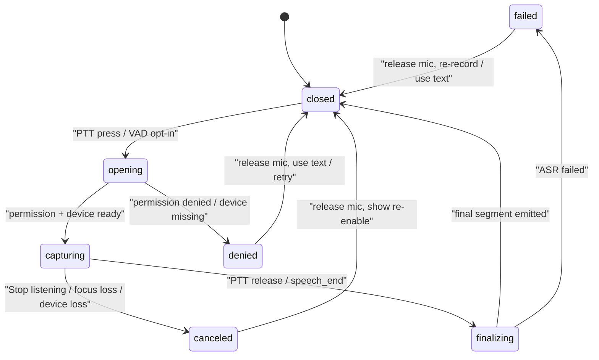
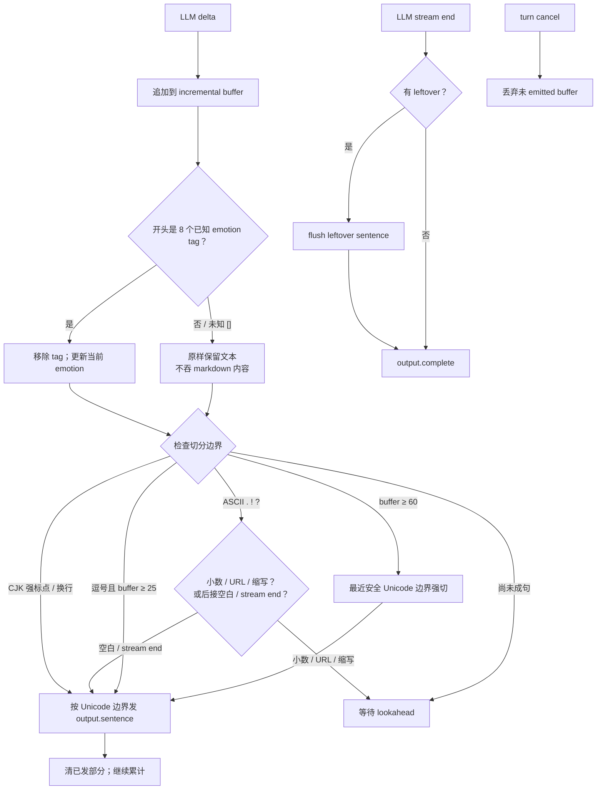
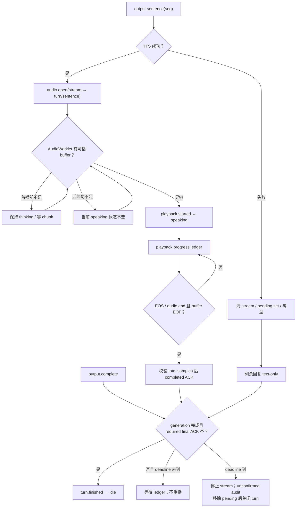
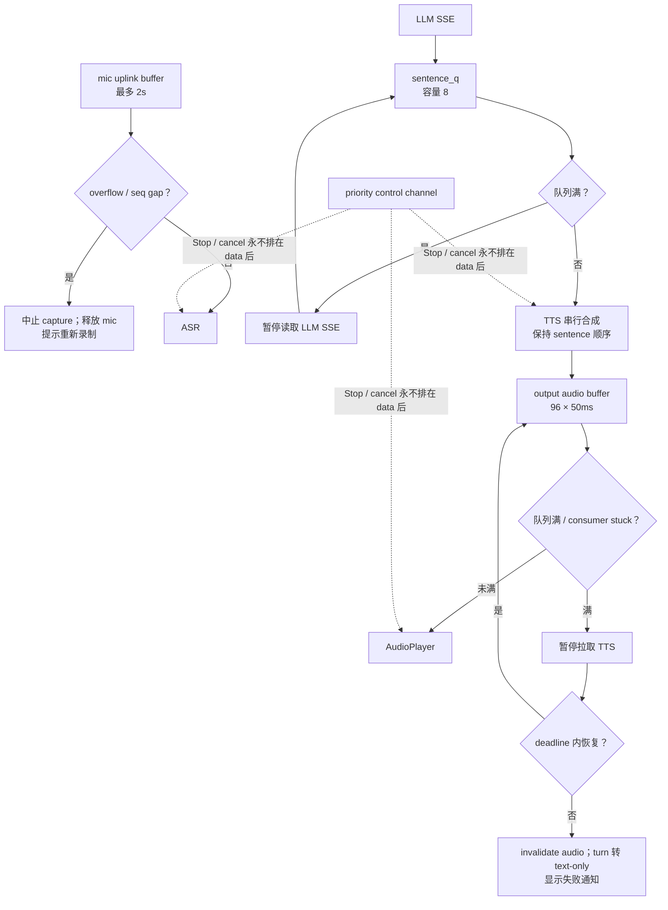
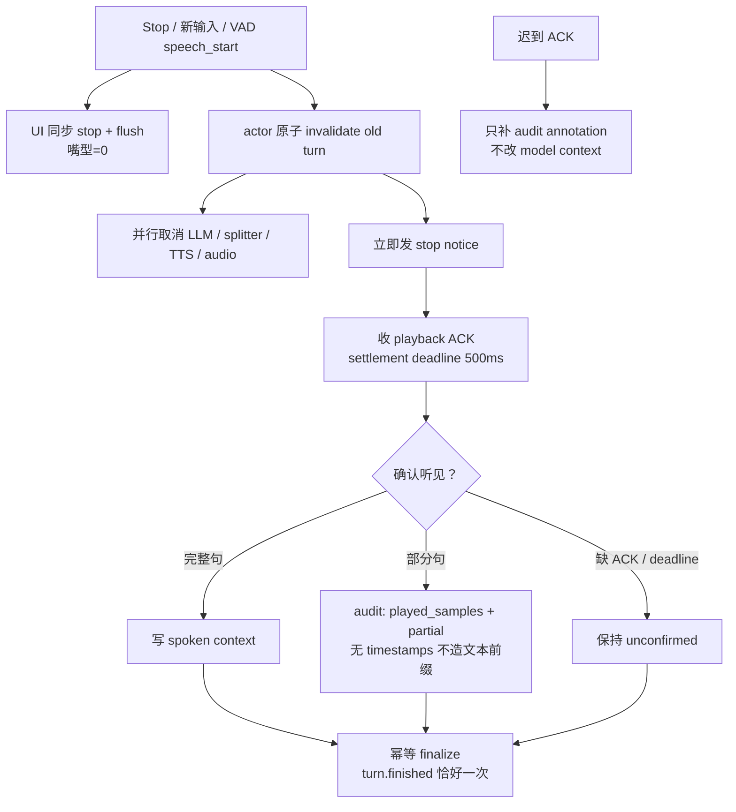
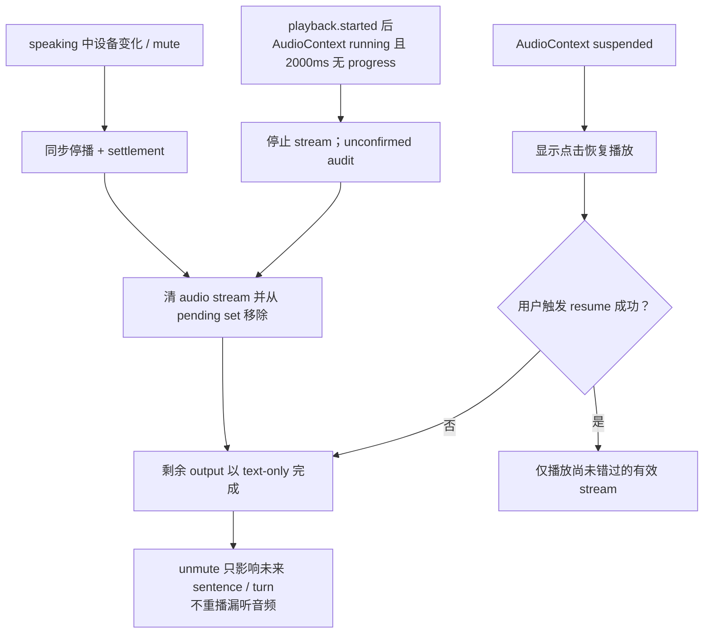
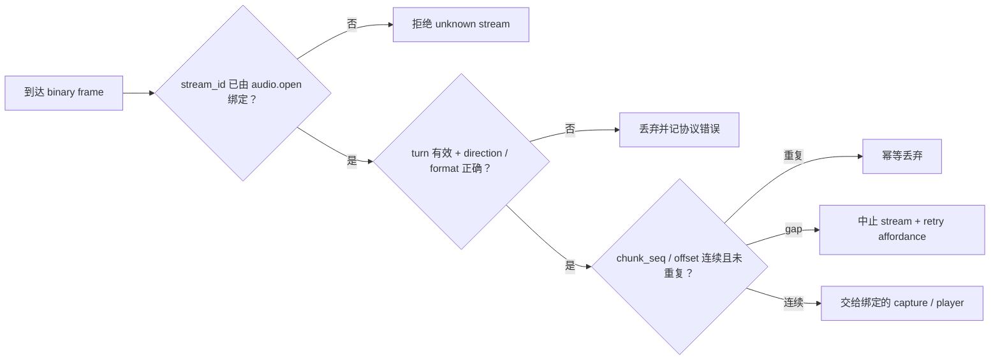
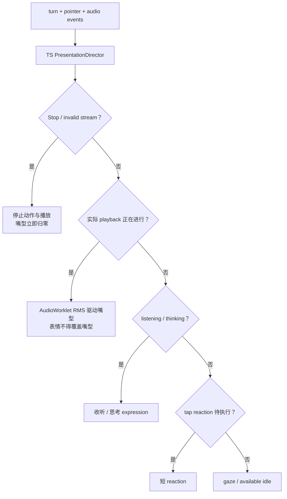

# 编排器运行时

> 每次交流都围绕一轮完整的回应展开：接收输入、生成表达、同步播放、接受插话，并保存真实发生的对话。

## 三个独立时钟

- persona / connection：角色配置、连接与 provider readiness；
- turn：`TurnCoordinator` 唯一拥有的对话状态；
- presentation：TS `PresentationDirector` 的动作与嘴型仲裁。

收到文本不等于正在说话，表情动作也不能改变 turn。

## turn 状态机

```mermaid
stateDiagram-v2
    [*] --> idle
    idle --> listening: "input.audio.start / VAD speech_start"
    idle --> thinking: "input.text accepted / voice final"
    listening --> thinking: "input.audio.segment final"
    listening --> idle: "cancel / empty / false positive"
    thinking --> speaking: "playback.started"
    thinking --> thinking: "new text invalidates old turn then accepts new"
    thinking --> interrupted: "Stop / PTT / VAD speech_start"
    thinking --> idle: "LLM failed + turn.finished(failed)"
    thinking --> idle: "text-only output.complete"
    speaking --> interrupted: "Stop / PTT / VAD speech_start"
    speaking --> interrupted: "new input.text"
    speaking --> thinking: "device / mute / TTS failure; failed streams removed"
    speaking --> idle: "output.complete + all required completed ACK"
    speaking --> idle: "LLM failed + invalidate audio + turn.finished(failed)"
    interrupted --> listening: "new capture remains active"
    interrupted --> thinking: "new text accepted"
    interrupted --> idle: "no new input after settlement"
```

`Speaking` 只由实际 AudioWorklet 的 `playback.started` 进入。静音/纯文字 turn 不进入 speaking。正常完成只有在 `output.complete` 与 required completed ACK 齐备后回 idle；图中的 LLM failure 是显式异常终态，必须先 invalidate audio、清除 pending set 并发送 `turn.finished(failed)`。

## capture 状态机

capture 不属于 reply turn；打断旧回复时不得取消正在形成的新 capture。

## 增量句切

软切阈值使用既有 `MOMO_SENT_SOFT_CHARS=25`，硬上限使用 `MOMO_SENT_MAX_CHARS=60`。只有固定 8 个 emotion tag 被剥离；其他方括号内容保留。

## generation、TTS 与播放

TTS 失败后不重播已经听过的文字。LLM 部分失败保留可见输出并标记 incomplete。

## bounded queue 与 backpressure

上行不静默丢旧帧，否则 chunk sequence 与 transcript 都不可信。控制通道具有独立优先级；data backlog 不能阻塞 Stop/cancel。

## interruption：立即取消，限时结算

取消不等待 ACK；新 capture 单独保留。completed ACK 必须单调、在 total samples 范围内，并与 EOS/audio.end 对齐。

## audio device、mute 与 AudioContext

普通播放的 stall deadline 是 `playback.started` 之后、AudioContext 处于 running 时连续 2000ms 无进度；尚未开始的 queued audio 不计 stall。500ms 只用于 interruption settlement。LLM/synthesis stall 使用既有 `MOMO_LLM_TIMEOUT_MS` 或 turn provider timeout，不复用 500ms。

## stale stream 防线

不能用“最近一次 state.turn”绑定音频。已取消 turn 的迟到帧、TTS 结果或 LLM delta 都不可见。

## presentation 仲裁

固定优先级：`stop > speaking mouth from actual AudioWorklet playback > listening/thinking expressions > tap reaction > gaze/idle`。

## 任务与错误所有权

Session actor 串行处理命令；每个 reply turn 建立独立 cancellation token tree，扇出到 LLM、splitter、TTS scheduler、audio mux。任务只能回传事件，不能直接修改 actor 状态。
