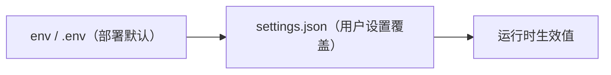

# 设置面：用户可配的 provider 与形象

> 面向终端用户的配置入口：app 内 UI 设置，不要求用户接触 env。
> 每类能力一个 endpoint 槽位（ADR-028）；容灾/降级由服务侧负责，app 只消费。

## 用户面

设置页字段：

| 字段 | 对应 | 说明 |
|---|---|---|
| LLM Endpoint | `llm.endpoint` | OpenAI-compatible base URL（http/https） |
| LLM Model | `llm.model` | 传给大脑的 model 字段 |
| LLM API Key | `llm.api_key` | 上游鉴权；留空不变，显式清空可删 |
| ASR Endpoint | `asr.endpoint` | 语音转写服务端点（ws/wss）：path=`/ws` 为 momo-ws 内部链路，其余路径为 Deepgram 对齐 `/v1/listen`（protocol.md §11） |
| TTS Endpoint | `tts.endpoint` | 语音合成服务端点：http(s) 为 OpenAI 对齐 `/v1/audio/speech`，ws/wss 为 momo-ws 内部链路（protocol.md §11） |
| 形象 | 前端 localStorage | 下拉选择 `/api/avatars` manifest 项，末位「自定义 URL」回退手输；保存前校验 `.model3.json` 可达且 `FileReferences.Moc` 存在（详见下文形象 manifest），空=默认 Hiyori，保存即热替换 |

保存即生效：LLM 下一请求走新 endpoint/model/key；ASR/TTS 下一次连接落到新地址（当前链路作废）。形象字段不发给服务端，本地保存并即时重载模型。

## 生效顺序



`{config_dir}/momo/settings.json`（`dirs::config_dir()`：macOS `~/Library/Application Support/momo/`、Linux `~/.config/momo/`、Windows `%APPDATA%/momo/`）。文件只覆盖 provider 五项；其余 `MOMO_*` 仍走 env。文件存在但解析失败 → 启动报错不静默。

`api_key` 明文落本地文件（~/.aws/credentials 同类），文件模式 0600（unix）。

## REST 契约

| 方法 | 路径 | 说明 |
|---|---|---|
| GET | `/api/settings` | 生效配置；`api_key` 只回 `api_key_set` 布尔不回显 |
| PUT | `/api/settings` | 按节更新；校验失败 422 级 400 + `error.fields` 归因；成功回生效视图 |
| GET | `/api/avatars` | 形象 manifest：`{schema, avatars:[{id,name,url}]}`；内置 Hiyori（`id=builtin`）在首位，其后为 `{config_dir}/momo/avatars/*/` 扫描项 |

```json
{
  "llm":  { "endpoint": "https://api.deepseek.com/v1", "model": "deepseek-chat", "api_key": "sk-…" },
  "asr":  { "endpoint": "ws://127.0.0.1:7810/ws" },
  "tts":  { "endpoint": "ws://127.0.0.1:7811/ws" }
}
```

- 字段缺省 = 不修改；`api_key: null` = 显式清除。
- 校验：llm endpoint 须 http/https；asr endpoint 须 ws/wss；tts endpoint 须 http/https 或 ws/wss（形态分发见 protocol.md §11.1）；非法值不落盘不生效。
- 写序：先落盘（tmp+rename 原子写）再热应用——持久化失败不出现「生效了但没记住」的半状态。
- 鉴权：`MOMO_UI_TOKEN` 已设时须 `Authorization: Bearer <token>`；未设（standalone dev）放行，与 `/ws/ui` hello 口径一致。`/api/avatars` 同此口径。
- 热应用：LLM `set_conf` 换连接面（在途请求用旧快照）；ASR/TTS `set_endpoint` 写新端点并丢活链，下一次建连/请求落到新版——endpoint 形态跨协议切换（如 tts 由 ws 改 http）时 client 实装同步重建。接入面鉴权 key（`MOMO_ASR_API_KEY`/`MOMO_TTS_API_KEY`）走 env 不进设置面，改 key 需重启。

## 形象 manifest

`{config_dir}/momo/avatars/<包名>/` 每个子目录为一个 Live2D 模型包：包内含一个 `*.model3.json` 入口与其引用的资源（moc3/贴图/动作等）。扫描规则：

- 子目录须含至少一个 `*.model3.json`（多个取文件名排序首个）；无入口的包、隐藏目录、顶层散落文件均不出现在 manifest。
- `id`/`name` 取目录名，manifest 项按 `id` 排序；内置 Hiyori（`app/web/public/live2d/` 素材由 `scripts/fetch-hiyori.sh` 拉取、不入库，随 web dist 分发）恒为 `{id:"builtin", url:"/live2d/hiyori/Hiyori.model3.json"}` 在首位。
- momod 将 `{config_dir}/momo/avatars/` 静态托管在 `/avatars/`（目录可后建，不存在的路径即 404；与 UI 静态资源同级，无鉴权），manifest 项 `url` 形如 `/avatars/<包名>/<入口文件>`（段级 percent-encode）。

设置页保存形象前的校验（manifest 项与自定义 URL 同路径）：GET 入口 `.model3.json` 须为合法 JSON 且含非空 `FileReferences.Moc`；将其相对入口 URL 解析后 HEAD 检查须可达。校验失败不落 localStorage、不热替换。

## 与 env 的关系

env/`MOMO_*` 是部署默认与运维面（属 momo-infra 管理域）；settings.json 是用户面。终态拆分后 app 仓不再随包发布 env 文档，用户配置一律走设置 UI；env 仅保留给开发者与自托管场景。
