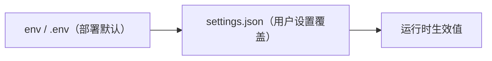

# 设置面：用户可配的 provider 与形象

> 面向终端用户的配置入口：app 内 UI 设置，不要求用户接触 env。
> 每类能力一个 endpoint 槽位（ADR-028）；容灾/降级由服务侧负责，app 只消费。

## 用户面

设置页字段：

| 字段 | 对应 | 说明 |
|---|---|---|
| LLM Endpoint | `llm.endpoint` | OpenAI-compatible base URL（http/https） |
| LLM Model | `llm.model` | 传给大脑的 model 字段 |
| LLM API Key | `llm.api_key` | 上游鉴权；留空不变，显式清空可删 |

保存即生效：LLM 下一请求走新 endpoint/model/key；ASR/TTS 下一次连接落到新地址（当前链路作废）。形象字段不发给服务端，本地保存并即时重载模型。

## 生效顺序



`{config_dir}/momo/settings.json`（`dirs::config_dir()`：macOS `~/Library/Application Support/momo/`、Linux `~/.config/momo/`、Windows `%APPDATA%/momo/`）。文件只覆盖 provider 五项；其余 `MOMO_*` 仍走 env。文件存在但解析失败 → 启动报错不静默。

`api_key` 明文落本地文件（~/.aws/credentials 同类），文件模式 0600（unix）。

## REST 契约

| 方法 | 路径 | 说明 |
|---|---|---|
| GET | `/api/settings` | 生效配置；`api_key` 只回 `api_key_set` 布尔不回显 |
| PUT | `/api/settings` | 按节更新；校验失败 422 级 400 + `error.fields` 归因；成功回生效视图 |

```json
{
  "llm":  { "endpoint": "https://api.deepseek.com/v1", "model": "deepseek-chat", "api_key": "sk-…" },
  "asr":  { "endpoint": "ws://127.0.0.1:7810/ws" },
  "tts":  { "endpoint": "ws://127.0.0.1:7811/ws" }
}
```

- 字段缺省 = 不修改；`api_key: null` = 显式清除。
- 写序：先落盘（tmp+rename 原子写）再热应用——持久化失败不出现「生效了但没记住」的半状态。

## 与 env 的关系

env/`MOMO_*` 是部署默认与运维面（属 momo-infra 管理域）；settings.json 是用户面。终态拆分后 app 仓不再随包发布 env 文档，用户配置一律走设置 UI；env 仅保留给开发者与自托管场景。
