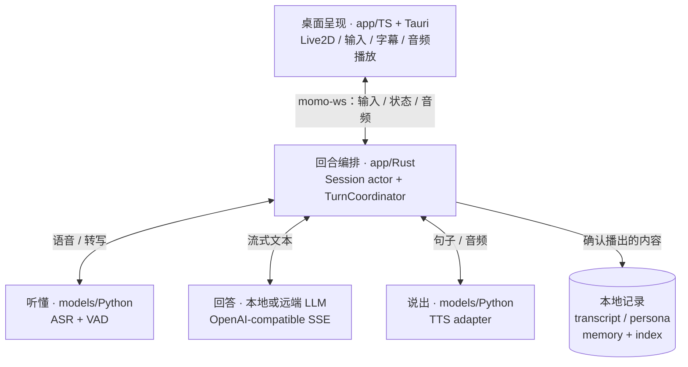
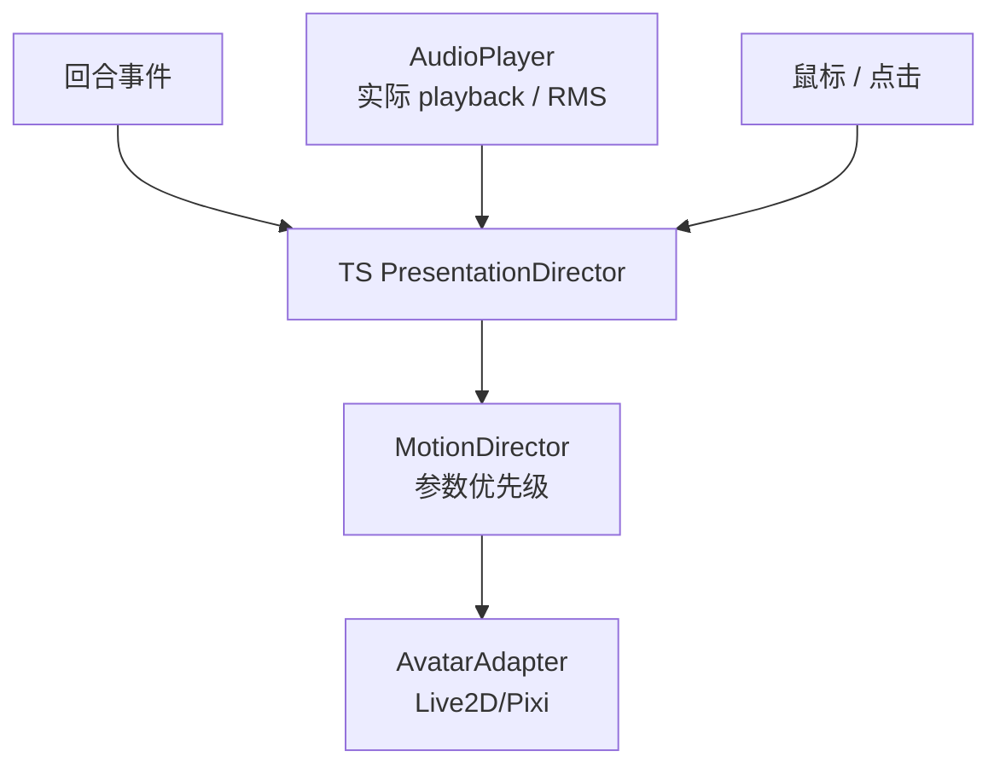
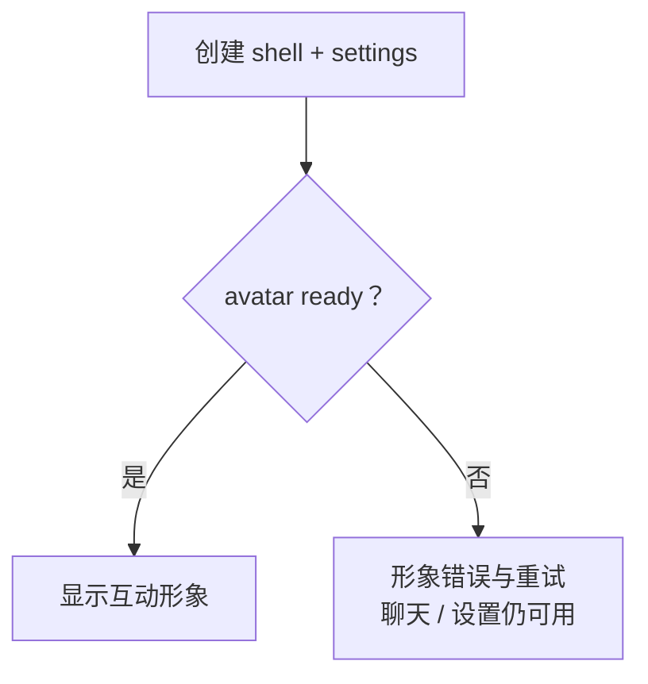
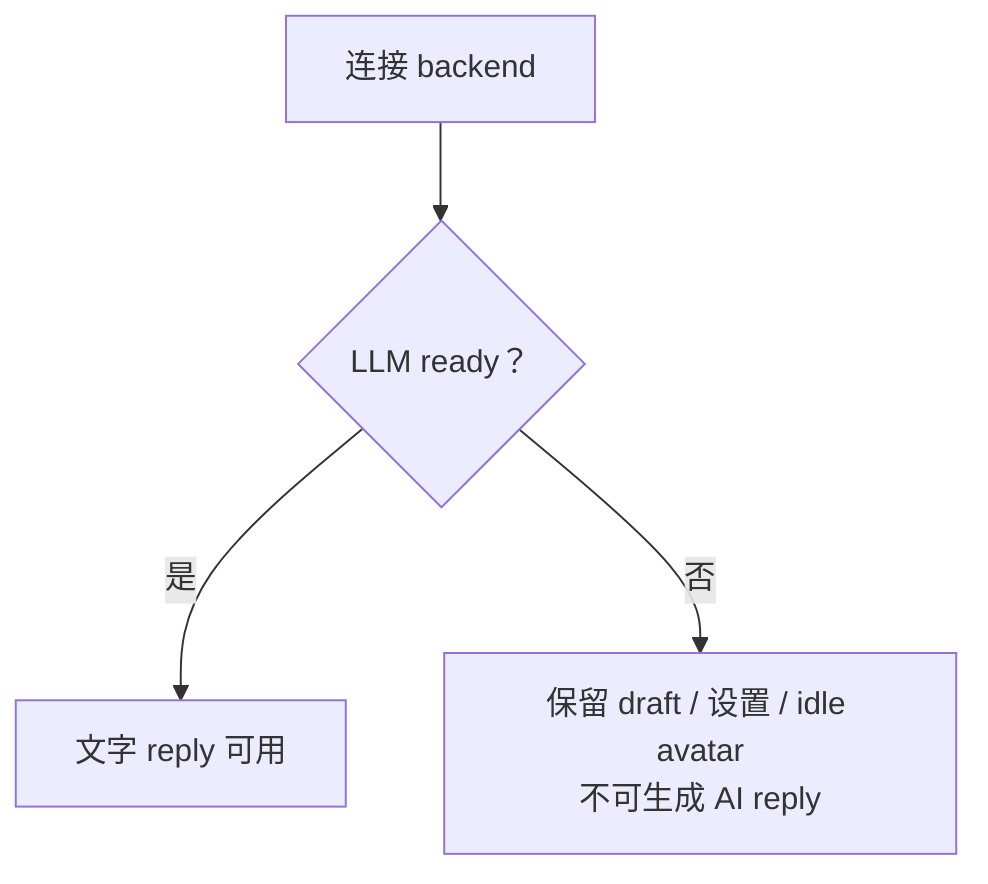
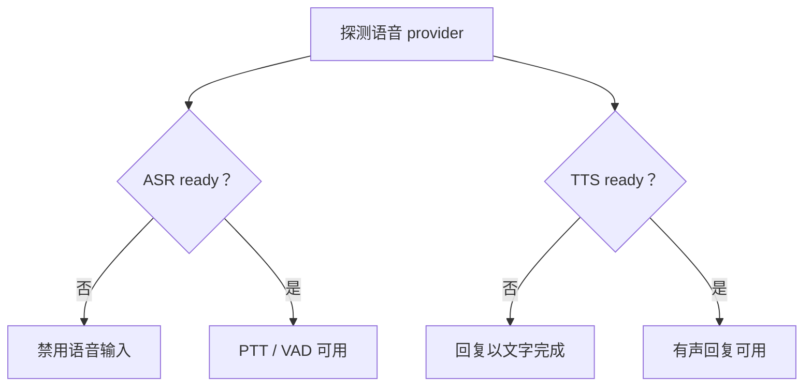

# 总体架构

> 桌面呈现负责在场，回合编排负责接话，模型服务提供理解与表达能力。三层通过清晰的事件与音频边界协作。

## 运行时组件

`app/src-tauri` 承载桌面产品，浏览器用于网站与开发预览。infra 是独立控制面，只负责启停、探测和产物管理，不承载 conversation 数据；详见 [模块边界](./boundaries.md) 与 [infra 控制面](../02-repos/momo-infra.md)。

## 呈现的内部协作

## 自有边界与上游复用

应用拥有 `AvatarAdapter`、`MotionDirector`、`AudioPlayer`、`CompanionShell`、`TurnCoordinator` 与本地 conversation repository。Live2D/Pixi/ASR/TTS/LLM 推理优先复用上游库和许可清晰的模型；Runtime Core、sample model 与应用代码分别适用各自许可。

| 层 | 拥有 | 不拥有 |
|---|---|---|
| TS presentation | avatar 适配、`PresentationDirector`、动作仲裁、音频 IO、用户操作 | 回合真相、模型推理 |
| Rust runtime | session actor、turn/取消/历史、provider 激活、persona 与 memory 正文及 vector index | Live2D 参数细节、推理实现 |
| Python models | ASR/TTS/embedding inference adapter、训练/评估入口 | memory 决策、正文/index、turn 状态、桌面业务 |
| infra | 启停、诊断、模型/训练/配置运维 | 对话文本/音频数据通路 |

## readiness 与可用能力

shell/settings、avatar 与 backend 并行准备，各自决定对应能力。

ASR/TTS 不就绪不阻止 LLM 文字回复；LLM 不就绪时只保留 draft、设置与 idle avatar。

## normal 与 degraded

normal/degraded 使用同一代码与协议；差异是本机拥有的 child process 与连接的 provider。应用退出只终止自己启动并记录为 owned 的 child process，绝不关闭 attached remote provider。provider 切换先 warmup/probe，成功后原子激活；活动回合存在时先显式取消。

## 核心不变量

1. `TurnCoordinator` 是 turn 的唯一所有者；persona/连接、turn、animation 三类状态彼此独立。
2. `Speaking` 只由 `playback.started` 进入，不由文本生成推导。
3. Stop 同步停本地播放与归零嘴型；actor 同时取消 LLM/TTS/句切/音频，不等待播放 ACK。
4. 旧 turn 的帧按 `stream_id` + turn/sentence 绑定丢弃，不能进入新 turn。
5. infra 永远在 turn 数据路径外；静态网站永远不连接本地 API。
6. 产品默认中文，并在 provider 声明能力时支持中、英、日输入与输出。

## 操作入口

- [桌面宿主与窗口生命周期](./desktop.md)
- [运行时与状态机](./runtime.md)
- [通信协议](./protocol.md)
- [用户操作路径图谱](./workflows.md)
- [模块边界](./boundaries.md)
