# 用户操作路径图谱

### 文字回合

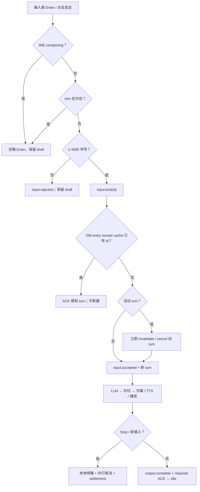

文字输入回执固定使用 `input.accepted.ref_id = input.text.id`。

### PTT

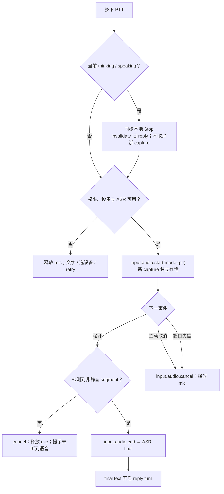

focus loss 始终取消 PTT。旧 reply 的 cancellation token 不包含新 capture。

### 连续 VAD

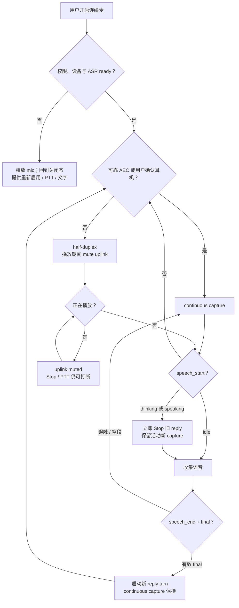

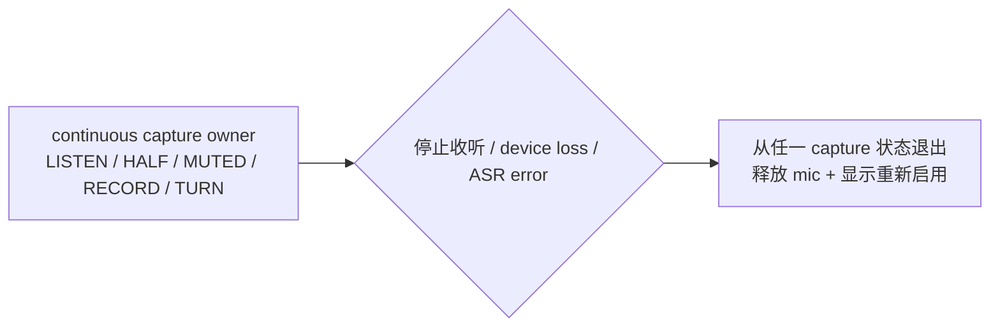

没有可靠 AEC 且没有确认使用耳机时只允许 half-duplex；不能用一次风险确认冒充 full-duplex 回声抑制。全局 capture owner 让用户主动停止、设备断开或 ASR 错误从任一 listening/half-duplex/muted/recording 状态退出。

### 正常语音序列

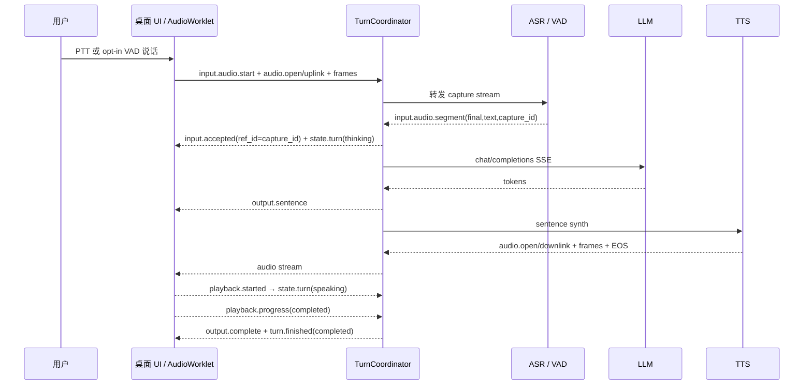

### 断线、resume 与 receipt

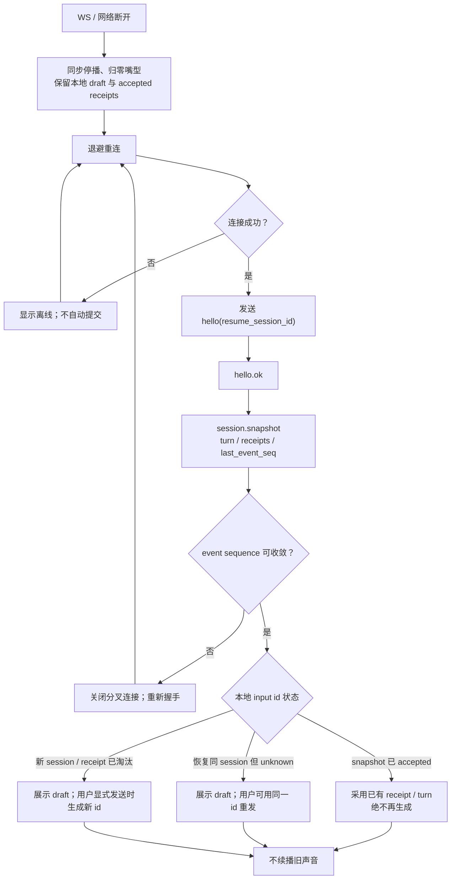

每 session 持久化最近 256 个 accepted receipts。客户端忽略 `event_seq <= last_event_seq` 的 duplicate/stale event；重连从不自动发送 draft。

### provider 切换

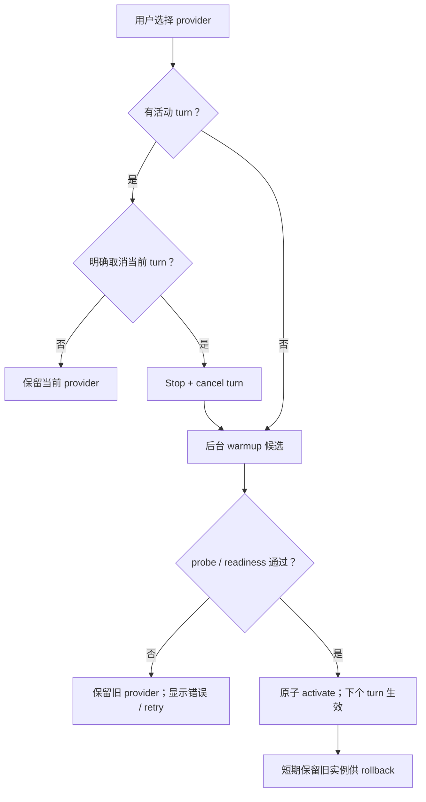

### 会话历史、correction 与文件事务

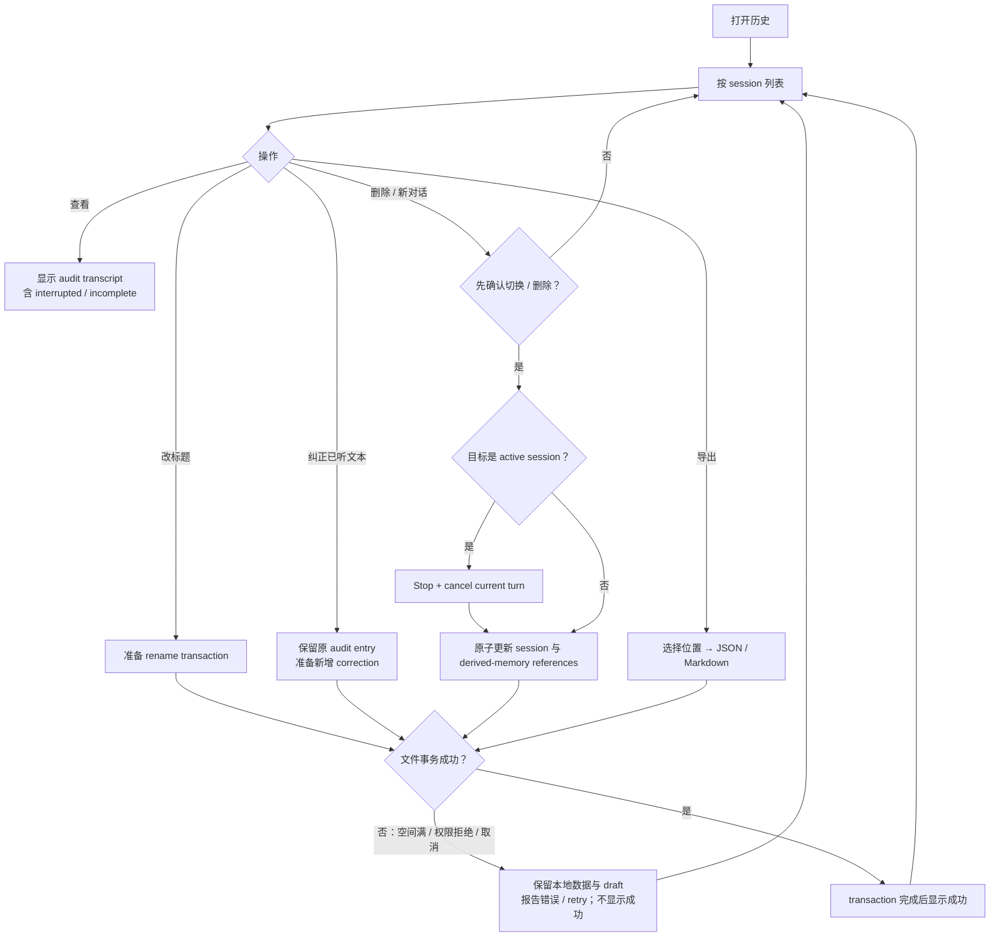

### quiet / focus / companion

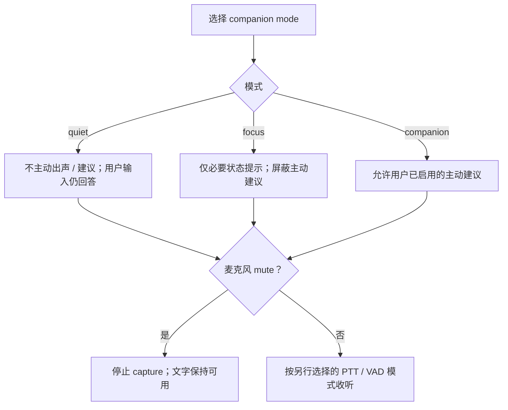

模式不是 mute；quiet 仍可使用 PTT，companion 也不能绕过麦克风关闭。

### 记忆提议、correction 与 CRUD

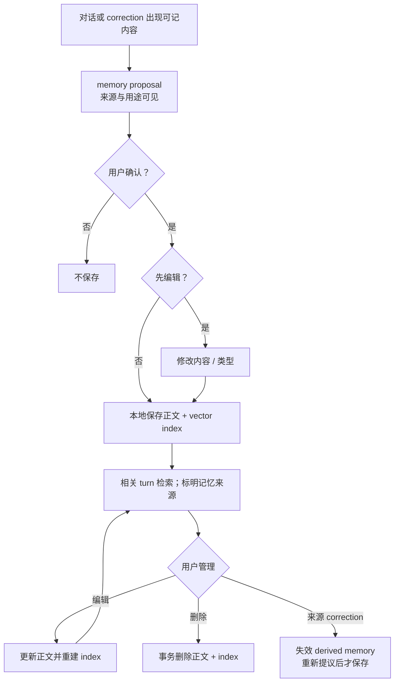

### 主动建议

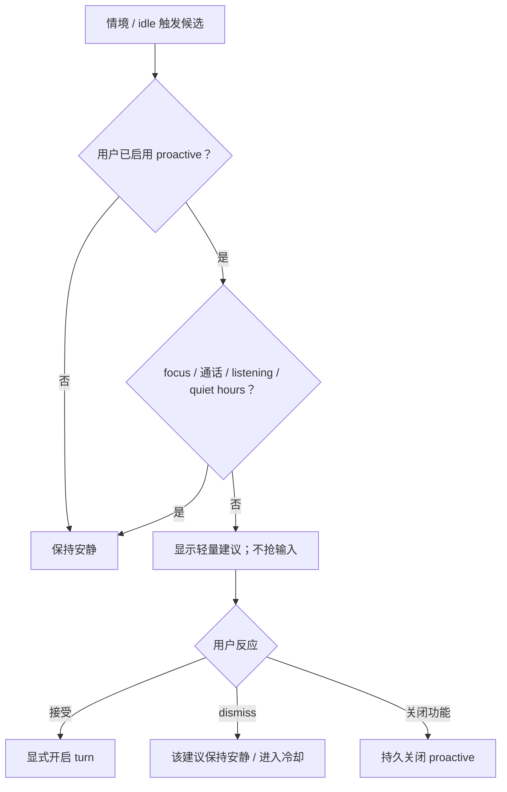

### 工具与截图

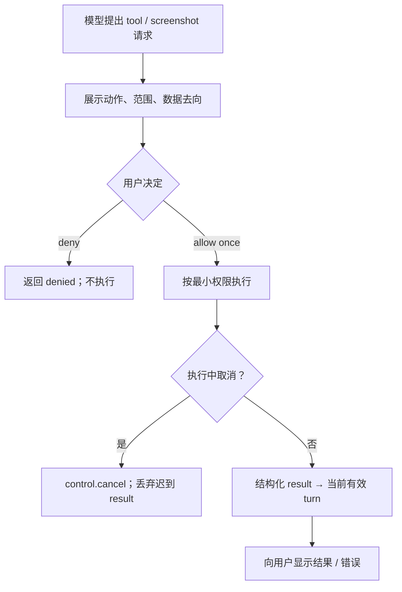

### streaming adapter（以后）

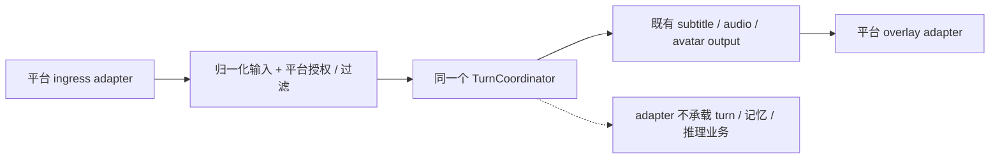

