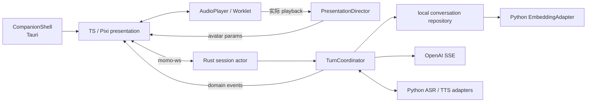
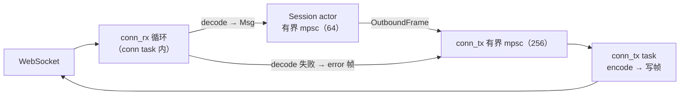

# `app/`：桌面 companion 与运行时

> 应用层把桌面宿主、形象交互和对话运行时连接起来：Tauri 管理窗口与系统集成，TypeScript 呈现角色，Rust 编排完整回合。

## 模块结构

```text
app/
├── src-tauri/                 # 窗口/menu/权限/生命周期/sidecar
├── web/src/
│   ├── avatar/               # AvatarAdapter + Live2D manifest/load/dispose
│   ├── presentation/         # PresentationDirector + MotionDirector
│   ├── audio/                # AudioPlayer/AudioWorklet capture/playback/ACK
│   ├── shell/                # CompanionShell web-facing adapter
│   └── chat/                 # overlay、文字/PTT/VAD、历史/设置
└── src/
    ├── session/              # session actor
    ├── turn/                 # TurnCoordinator、取消、playback ledger
    ├── protocol/             # momo-ws 消息与音频 codec
    ├── repository/           # transcript/correction/persona/memory/index
    └── providers/            # LLM SSE、ASR/TTS/Embedding clients
```

## 所有权



- `TurnCoordinator` 唯一拥有 reply turn；capture 独立。
- `PresentationDirector` 位于 TS presentation，只消费 domain/audio events。
- Rust repository 拥有 session、correction、persona、memory 正文与 vector index；Python 只计算 embedding。
- `AudioPlayer` 以实际播放生成 started/progress ACK，Stop 同步清 buffer 与嘴型。
- Tauri 能力失败时 `CompanionShell` 使用普通可见窗口；menu 不可用时禁用 click-through。
- 退出只终止 app 自己启动的 owned child，attached remote provider 只断开连接。

## ws 子系统

每条 `/ws/ui` 连接是一个独立 actor，tokio 任务拓扑：



- 出站统一走 `OutboundFrame`（Json / Audio / Close）经 `conn_tx` 有界 mpsc：单队列天然保序，背压 = 生产者 `send().await` 阻塞，**不丢帧、不换序**。
- JSON 控制帧永不丢弃；对端消费不动时 `conn_tx` 每帧发送有 stall deadline，超时直接关连（protocol「控制消息不得静默丢弃」）。
- 解码异常（JSON 非法、未知 `type`、非法音频帧头）一律回 `error` 帧（non-fatal `BAD_MESSAGE`），连接保持；握手期/不可恢复异常回 `error` + 按 close code 表断连。
- `conn_rx` 只 decode 与转发，业务判断全在 Session actor；上行音频帧解码出头后经 stream 归属检查交给 ASR uplink task（P2）。
- 单活跃 UI 连接：`SessionManager::attach` 让新连接顶掉旧 session，旧连接随之关连；session restore 走 `resume_session_id` + snapshot（protocol §认证）。

## P0 验收指针

见 [P0 桌面 MVP](../03-phases/p0-pipeline.md)、[desktop](../01-architecture/desktop.md)、[runtime](../01-architecture/runtime.md) 与 [protocol](../01-architecture/protocol.md)。
