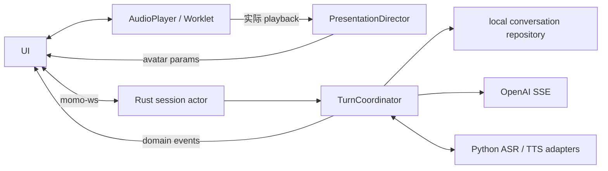

## 模块结构

```text
app/
│   ├── presentation/         # PresentationDirector + MotionDirector
│   ├── audio/                # AudioPlayer/AudioWorklet capture/playback/ACK
│   ├── shell/                # CompanionShell web-facing adapter
│   └── chat/                 # overlay、文字/PTT/VAD、历史/设置
└── src/
    ├── session/              # session actor
    ├── turn/                 # TurnCoordinator、取消、playback ledger
    ├── protocol/             # momo-ws 消息与音频 codec
    ├── repository/           # transcript/correction/persona/memory/index
```

## 所有权



- `TurnCoordinator` 唯一拥有 reply turn；capture 独立。
- `PresentationDirector` 位于 TS presentation，只消费 domain/audio events。
- Rust repository 拥有 session、correction、persona、memory 正文与 vector index；Python 只计算 embedding。
- `AudioPlayer` 以实际播放生成 started/progress ACK，Stop 同步清 buffer 与嘴型。
- 退出只终止 app 自己启动的 owned child，attached remote provider 只断开连接。


