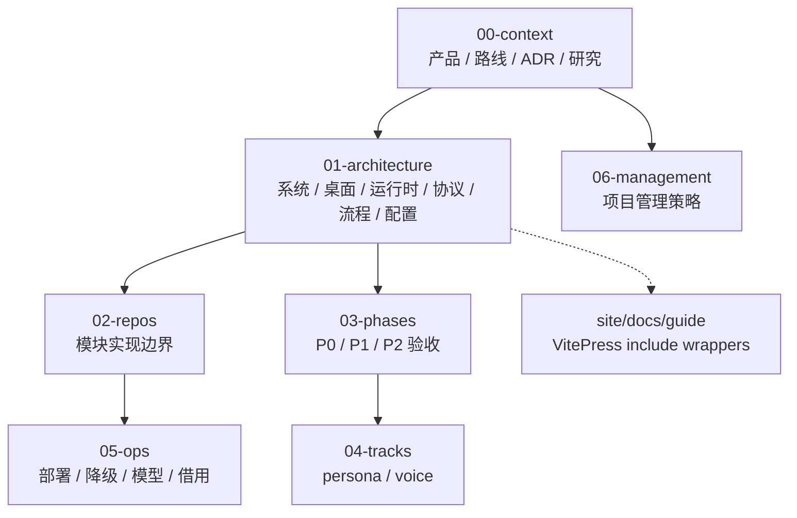

# `docs/`：设计权威

> monorepo 中 `docs/` 是产品、协议、状态机、边界与操作路径的单一来源；`site/` 通过 include 呈现同一份内容。

## 信息架构

## 写作约束

- Mermaid 使用标准 fenced `flowchart`、`sequenceDiagram`、`stateDiagram-v2`；小图优先，每个用户操作包含入口、决策、效果、terminal/retry/cancel。
- 不杜撰性能；历史实测带日期，未验证能力写“规划/待实测”。
- 协议/状态机先改 `01-architecture/`，再同步引用。
- env 默认值与模板只有 [config.md](../01-architecture/config.md) 是权威；UI settings 不伪装成 env。
- public guide 不复制图或协议，通过 include 消费 canonical 文件。

## 当前入口

1. [产品](../00-context/product.md)
2. [路线图](../00-context/roadmap.md)
3. [系统](../01-architecture/system.md)
4. [桌面](../01-architecture/desktop.md)
5. [运行时](../01-architecture/runtime.md)
6. [协议](../01-architecture/protocol.md)
7. [操作路径](../01-architecture/workflows.md)

## 变更检查

- [ ] 设计目标与当前实现边界清楚。
- [ ] P0/P1/P2 与旧兼容路径映射一致。
- [ ] 历史实验规格仍可复现。
- [ ] guide wrapper 与 canonical 路由映射一致。
