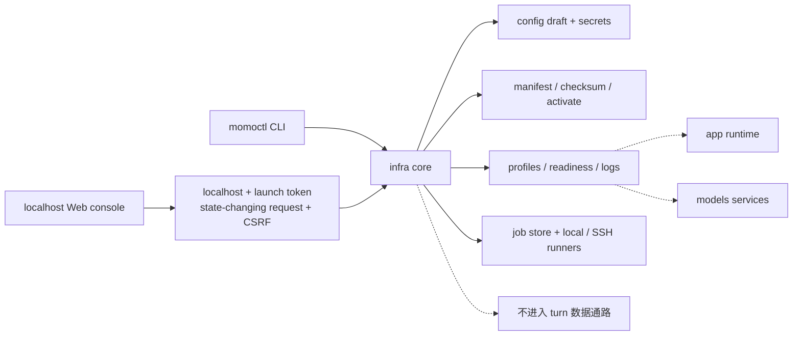
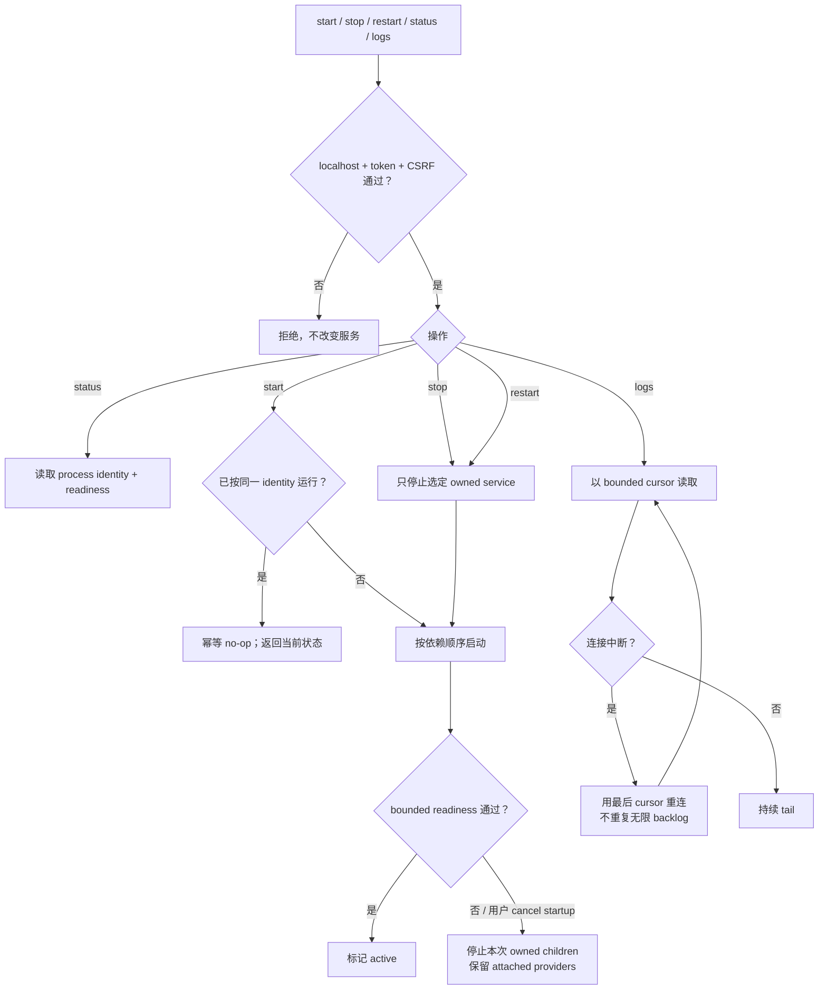
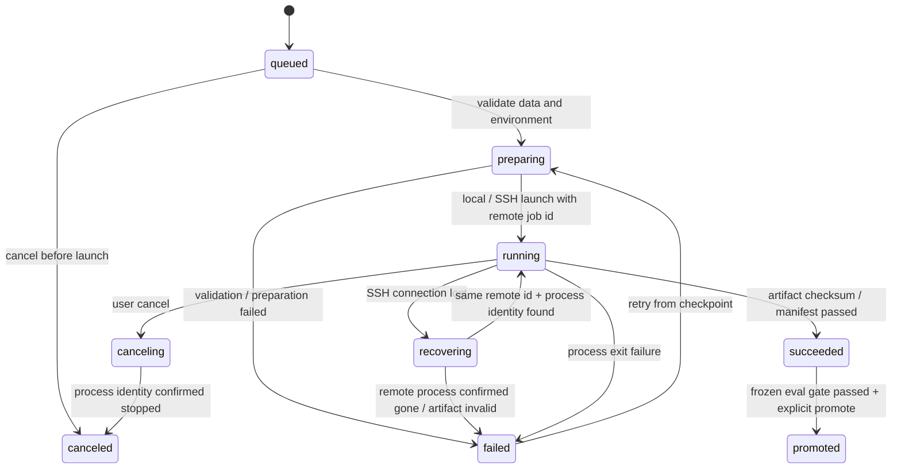

# `infra/`：带外运维与训练编排

> `momoctl` 承担基础运维，Web 控制台与训练可视化属于 P2；不读取对话内容，不转发 turn 音频/文本，不实现推理。

## 能力

- doctor/readiness、normal/degraded profile 与服务启停；
- manifest fetch/checksum/probe/activate/rollback；
- 配置 draft validate/test/atomic apply/rollback，secret 独立保存；
- 训练 job 本地/SSH 执行、日志、cancel、checkpoint 恢复、promotion；
- CLI 与 Web 共用核心和 schema，控制台默认仅监听 localhost。

## 子命令清单

> `momoctl` 是 infra CLI 的唯一命令名（ADR-023）。本节是命令行契约的 single source of truth：`infra/src/cli.rs` 的 clap 定义与本节一一对应，退出码、全局 flag 与 `--json` schema 也以本节为准；`infra/README.md` 只保留摘要并指回本节。

子命令集（ADR-023 锁定命名，实现状态见下）：

| 子命令 | 说明 | 状态 |
|---|---|---|
| `doctor` | 环境检查矩阵（system/toolchain/python/network/env/models/endpoints） | 已实现 |
| `pull` | 按 momo-models `MANIFEST.toml` 下载 + sha256 校验 | 已实现 |
| `serve up\|down\|status\|logs\|restart` | profile 组件表启停、存活/就绪探测、日志 tail | 已实现 |
| `switch --to` | normal ↔ degraded 档位切换（`.env` 符号链接重指） | 已实现 |
| `bench` | 端到端延迟测量（p50/p95，目标 <1.5s 出声） | 已实现 |
| `gc` | 模型 GC：N-1 代清理、`models.lock` 联动 | 已实现 |
| `config check` | env schema 漂移检查（`config.schema.toml` ↔ 三侧 `.env.example` / `config.md`） | 已实现 |

### 子命令参数

`serve` 五个动作共用 `ServeCommon`，`serve logs` 在此基础上追加行数/跟随参数：

| 子命令 | 参数 | 默认 | 说明 |
|---|---|---|---|
| `doctor` | `--profile normal\|degraded` | 读 `MOMO_PROFILE`，缺省 `normal` | 按档位校验必需 env 与端点 |
| `pull` | `--manifest PATH` | 自动探测 momo-models `models/MANIFEST.toml` | MANIFEST.toml 路径 |
| `pull` | `--only NAME`（可重复） | 全部条目 | 只处理指定清单条目 |
| `pull` | `--check` | off | 只校验不下载（按 `models.lock` / MANIFEST 复算 sha256） |
| `serve` | `--profile normal\|degraded` | 读 `MOMO_PROFILE`，缺省 `normal` | 组件清单档位 |
| `serve` | `--only COMPONENT`（别名 `--component`，可重复） | 全部组件 | 只作用于指定组件 |
| `serve` | `--app-bin PATH` | PATH 查找 | `momod` 二进制路径 |
| `serve logs` | `-n, --lines N` | `50` | 每个组件输出最后 N 行 |
| `serve logs` | `-f, --follow` | off | 持续跟随新增日志（Ctrl-C 退出） |
| `switch` | `--to normal\|degraded` | — | 目标档位 |
| `switch` | `--restart` | off | 切换后自动 `serve down && serve up` |
| `bench` | `--turns N` | `5` | 测量回合数（取 p50/p95） |
| `bench` | `--strict` | off | 超标（≥1.5s 出声）时以退出码 3 结束 |
| `gc` | `--dry-run` | 默认行为 | 只报告不删除 |
| `gc` | `--keep N` | `2` | 微调产物保留代数（N-1 中保留最新两代） |
| `gc` | `--yes` | off | 确认执行删除（不带 `--yes` 时等价 `--dry-run`） |
| `config check` | `--root PATH` | 从 CWD 向上定位 `config.schema.toml` | 仓库根目录 |

### 全局 flag

| flag | 说明 |
|---|---|
| `--json` | 以 JSON 输出单一对象（顶层恒带 `"schema": 1`，供 CI/脚本消费） |
| `--env-file PATH` | `.env` 文件路径（默认自动发现 `./.env`；显式指定但不存在 → exit 2） |

CLI 不提供 `-v/-vv`：日志级别由 `MOMO_LOG_LEVEL`（内置默认 `info`，见 [config.md §2.1](../01-architecture/config.md)）控制，`infra/.env.example` 里的 `warn` 是 schema `examples.infra` 的**模板示例值**，不是内置默认值。infra 当前不输出分级日志（详见 [config.md §6](../01-architecture/config.md) `examples` 字段口径）。

### 退出码

`infra/src/output.rs` 的 `ExitCode` 与之对应：

| code | 含义 |
|---|---|
| 0 | 成功（doctor 全 ok / bench 达标） |
| 1 | 运行时错误（IO、进程管理失败、未实现 stub） |
| 2 | 用法/配置错误（clap 解析之外：缺 env、env-file 不存在等） |
| 3 | 检查未通过（doctor 有 fail / bench --strict 超标） |
| 4 | 网络不可达（下载、端点连接失败） |
| 5 | 校验失败（sha256 不匹配、manifest 损坏） |

### doctor JSON schema

`tests/doctor_json_test.rs` 锁定 `momoctl doctor --json` 的结构：

```json
{
  "schema": 1,
  "profile": "normal",
  "groups": [
    { "name": "system", "checks": [
      { "id": "os", "status": "ok", "detail": "<os> <version> (<arch>)", "hint": null }
    ] }
  ],
  "summary": { "ok": 1, "warn": 0, "fail": 0 }
}
```

`status` ∈ `ok|warn|fail`；`hint` 恒出现（可为 `null`）；`groups` 固定含 system/toolchain/python/network/env/models/endpoints 七组。

## 控制面



## service 操作



## 状态目录与进程管理

`serve` 的运行态落在固定状态目录，内容是本机临时产物（pidfile、组件日志、active 标记），不是部署配置：

- 路径：`${XDG_STATE_HOME:-~/.local/state}/momo/`，下含 `pid/<component>.pid`、`logs/<component>.log`、`active_profile`。
- 可配性：不提供 `MOMO_*` env 键覆盖，`XDG_STATE_HOME` 是唯一重指手段（测试隔离也走它）。固定路径消掉 profile/env 漂移面——状态目录漂移会让 `down`/`status` 读不到 `up` 写的 pidfile，幂等判定失效。
- 各平台落点：`~` 按 `env_cfg` home 候选解析——unix `$HOME`；Windows `%USERPROFILE%`（`HOME` 兜底，全空退 `.`），即 `%USERPROFILE%\.local\state\momo`。早期方案曾定 `%LOCALAPPDATA%/momo`（#44③），后收口为全平台统一 XDG 默认形、未实装 LOCALAPPDATA 特判。

进程探活与终止不依赖 PATH 上的外部命令（原 `kill`/`ps`/`tasklist` 外部依赖已移除）：

- 存活探测 `is_alive`：unix 先 `waitpid(WNOHANG)` 收本进程 child 的尸（替代 `ps stat` 排僵尸），非本进程 child 落 `kill(pid, 0)`——送达或 `EPERM`（存在但属其他用户）判活，`ESRCH` 等判死；Windows `OpenProcess(PROCESS_QUERY_LIMITED_INFORMATION)`——打不开且 `ERROR_ACCESS_DENIED` 判活、其余判死，打开后 `GetExitCodeProcess` 判 `STILL_ACTIVE`，查询失败保守判活（宁 down 不收敛，勿 up 重复拉起）。
- 终止阶梯 `stop_pid`：unix `SIGTERM` → grace 轮询 → `SIGKILL`；Windows `taskkill`（不带 `/F` 的温和请求，缺失不阻塞升级）→ `TerminateProcess`。

## 训练 lifecycle 与恢复



重连按 remote job id 与 process identity 查询；未确认前绝不重复 launch。`canceled` 是独立终态，不写成 failed。rollback 只切回 active artifact version，不修改原 job 的 `succeeded` / `promoted` 历史状态。恢复沿用已有 checkpoint 与 training manifest，不新增训练配置或评分门槛。

## 模型激活

fetch 写临时目录 → checksum/revision 校验 → provider warmup/probe → 原子 activate。任一步失败保留 active 版本；promotion 后至少保留可回滚版本。详见 [model-fetch.md](../05-ops/model-fetch.md)。

## 验收

- [ ] CLI/Web 对同一操作给出同一 schema 与状态。
- [ ] 配置或模型 probe 失败时 active 不变。
- [ ] secret 不出现在 GET、日志、导出和静态网站。
- [ ] queued/preparing/canceling/recovering 路径不会报告假成功或重复启动。
- [ ] runtime 音频与对话文本不经过 infra。
