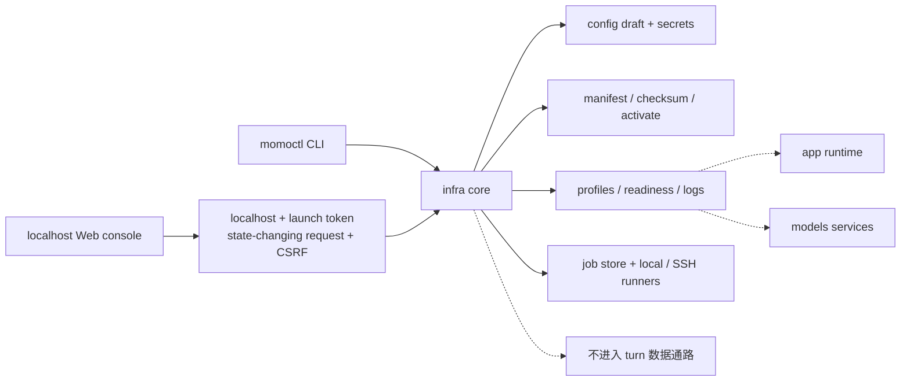
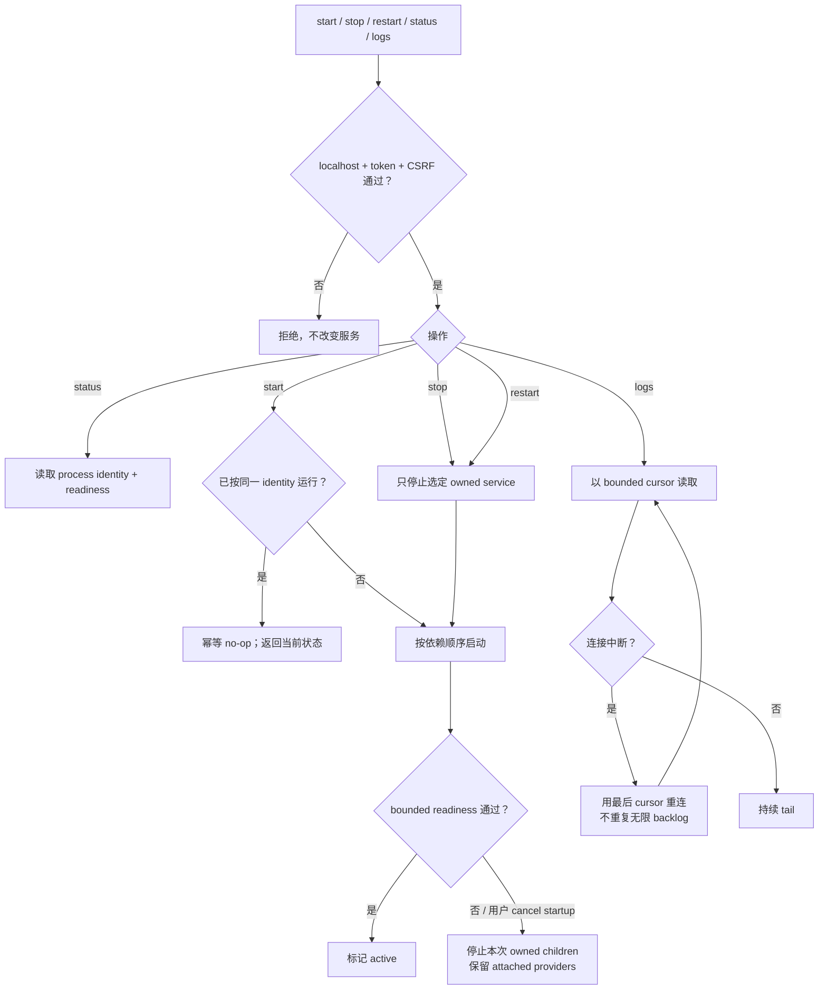
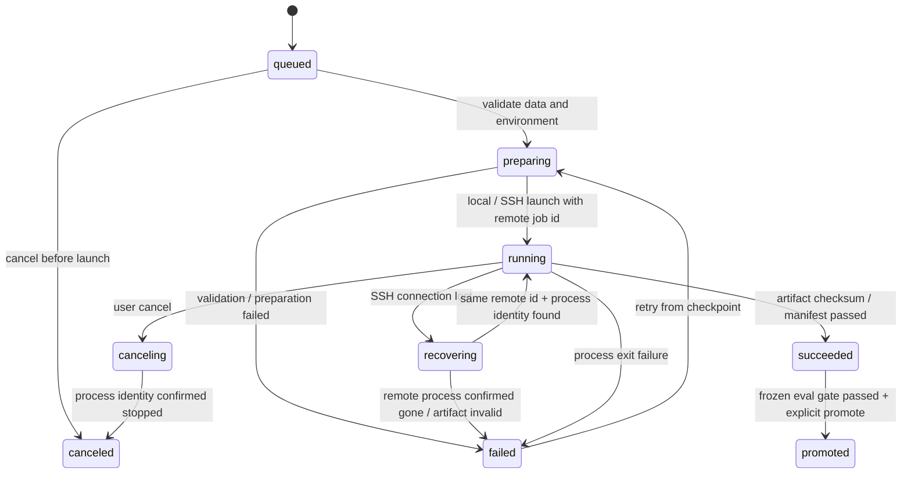

# `infra/`：带外运维与训练编排

> `momoctl` 承担基础运维，Web 控制台与训练可视化属于 P2；不读取对话内容，不转发 turn 音频/文本，不实现推理。

## 能力

- doctor/readiness、normal/degraded profile 与服务启停；
- manifest fetch/checksum/probe/activate/rollback；
- 配置 draft validate/test/atomic apply/rollback，secret 独立保存；
- 训练 job 本地/SSH 执行、日志、cancel、checkpoint 恢复、promotion；
- CLI 与 Web 共用核心和 schema，控制台默认仅监听 localhost。

## 控制面

## service 操作

## 训练 lifecycle 与恢复

重连按 remote job id 与 process identity 查询；未确认前绝不重复 launch。`canceled` 是独立终态，不写成 failed。rollback 只切回 active artifact version，不修改原 job 的 `succeeded` / `promoted` 历史状态。恢复沿用已有 checkpoint 与 training manifest，不新增训练配置或评分门槛。

## 模型激活

fetch 写临时目录 → checksum/revision 校验 → provider warmup/probe → 原子 activate。任一步失败保留 active 版本；promotion 后至少保留可回滚版本。详见 [model-fetch.md](../05-ops/model-fetch.md)。

## 验收

- [ ] CLI/Web 对同一操作给出同一 schema 与状态。
- [ ] 配置或模型 probe 失败时 active 不变。
- [ ] secret 不出现在 GET、日志、导出和静态网站。
- [ ] queued/preparing/canceling/recovering 路径不会报告假成功或重复启动。
- [ ] runtime 音频与对话文本不经过 infra。
