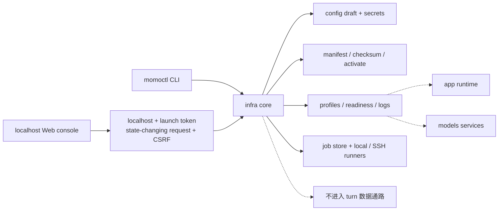
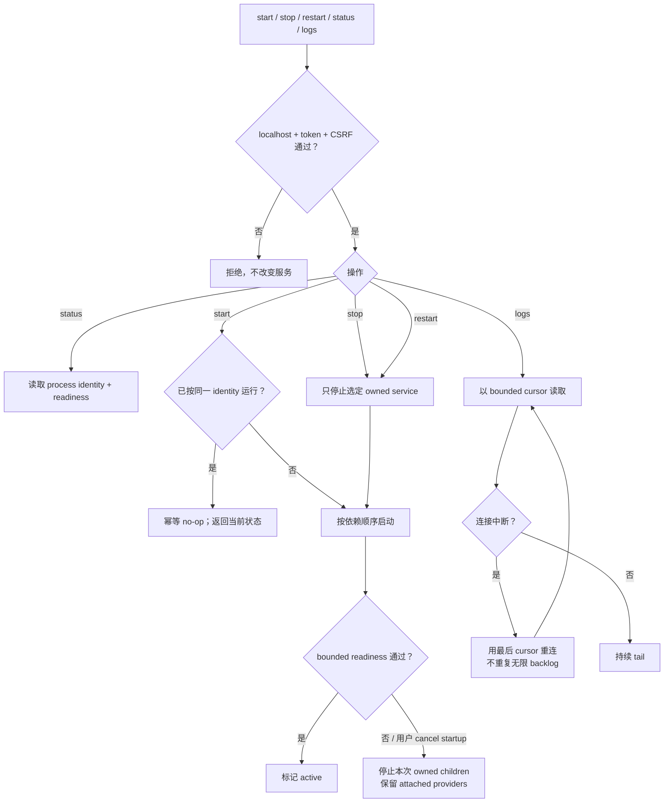
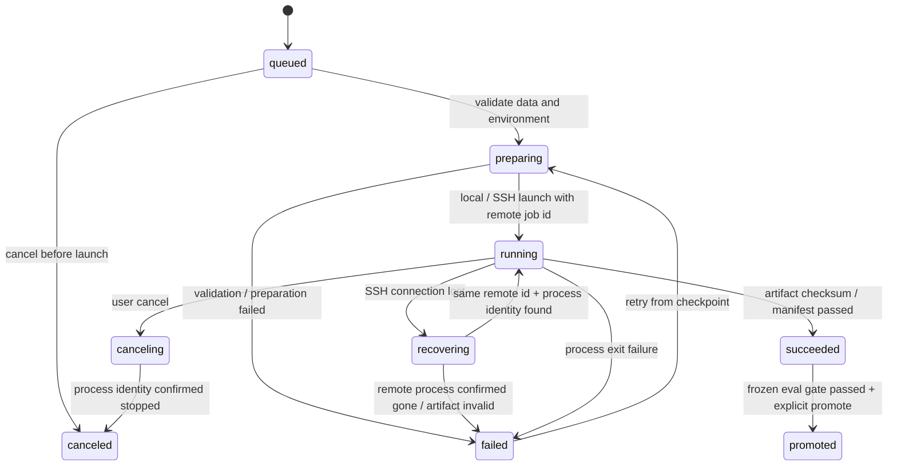

# `infra/`：带外运维与训练编排

> `momoctl` 承担基础运维，Web 控制台与训练可视化属扩展能力；不读取对话内容，不转发 turn 音频/文本，不实现推理。

## 能力

- doctor/readiness、normal/degraded profile 与服务启停；
- manifest fetch/checksum/probe/activate/rollback；
- 配置 draft validate/test/atomic apply/rollback，secret 独立保存；
- 训练 job 本地/SSH 执行、日志、cancel、checkpoint 恢复、promotion；
- CLI 与 Web 共用核心和 schema，控制台默认仅监听 localhost。

## 子命令清单

> `momoctl` 是 infra CLI 的唯一命令名（ADR-023）。本节是命令行契约的 single source of truth：`infra/src/cli.rs` 的 clap 定义与本节一一对应，退出码、全局 flag 与 `--json` schema 也以本节为准；`infra/README.md` 只保留摘要并指回本节。

子命令集（ADR-023 锁定命名，实现状态见下）：

| 子命令 | 说明 | 状态 |
|---|---|---|
| `doctor` | 环境检查矩阵（system/toolchain/python/network/env/models/endpoints） | 已实现 |
| `pull` | 按 momo-models `MANIFEST.toml` 下载 + sha256 校验 | 已实现 |
| `serve up\|down\|status\|logs\|restart` | profile 组件表启停、存活/就绪探测、日志 tail | 已实现 |
| `switch --to` | normal ↔ degraded 档位切换（`.env` 符号链接重指） | 已实现 |
| `bench` | 端到端延迟测量（p50/p95，目标 <1.5s 出声） | 已实现 |
| `gc` | 模型 GC：N-1 代清理、`models.lock` 联动 | 已实现 |
| `config check` | env schema 漂移检查（`config.schema.toml` ↔ 三侧 `.env.example` / `config.md`） | 已实现 |
| `web` | Web 控制台基座：axum server + include_dir 内嵌 SPA + `/api` 路由树 + SSE | 已实现 |
| `jobs submit\|list\|status\|log\|cancel` | job runner：exec_local 执行器、状态机、日志 tail；store 落 state dir（`jobs exec` 为内部 helper） | 已实现 |

### 子命令参数

`serve` 五个动作共用 `ServeCommon`，`serve logs` 在此基础上追加行数/跟随参数：

| 子命令 | 参数 | 默认 | 说明 |
|---|---|---|---|
| `doctor` | `--profile normal\|degraded` | 读 `MOMO_PROFILE`，缺省 `normal` | 按档位校验必需 env 与端点 |
| `pull` | `--manifest PATH` | 自动探测 momo-models `models/MANIFEST.toml` | MANIFEST.toml 路径 |
| `pull` | `--only NAME`（可重复） | 全部条目 | 只处理指定清单条目 |
| `pull` | `--check` | off | 只校验不下载（按 `models.lock` / MANIFEST 复算 sha256） |
| `serve` | `--profile normal\|degraded` | 读 `MOMO_PROFILE`，缺省 `normal` | 组件清单档位 |
| `serve` | `--only COMPONENT`（别名 `--component`，可重复） | 全部组件 | 只作用于指定组件 |
| `serve` | `--app-bin PATH` | PATH 查找 | `momod` 二进制路径 |
| `serve logs` | `-n, --lines N` | `50` | 每个组件输出最后 N 行 |
| `serve logs` | `-f, --follow` | off | 持续跟随新增日志（Ctrl-C 退出） |
| `switch` | `--to normal\|degraded` | — | 目标档位 |
| `switch` | `--restart` | off | 切换后自动 `serve down && serve up` |
| `bench` | `--turns N` | `5` | 测量回合数（取 p50/p95） |
| `bench` | `--strict` | off | 超标（≥1.5s 出声）时以退出码 3 结束 |
| `gc` | `--dry-run` | 默认行为 | 只报告不删除 |
| `gc` | `--keep N` | `2` | 微调产物保留代数（N-1 中保留最新两代） |
| `gc` | `--yes` | off | 确认执行删除（不带 `--yes` 时等价 `--dry-run`） |
| `config check` | `--root PATH` | 从 CWD 向上定位 `config.schema.toml` | 仓库根目录 |
| `web` | `--listen ADDR` | `127.0.0.1:7900` | 监听地址；解析结果任一非 loopback 时 `MOMO_WEB_TOKEN` 必填，未设拒启（exit 2） |
| `jobs submit` | `--kind pull\|serve\|train` | `train` | job 来源域（执行器恒为 exec_local） |
| `jobs submit` | `--desc TEXT` | join(argv) | 可读描述 |
| `jobs submit` | `-- CMD [ARGS...]` | 必填 | payload 命令行；`--` 之后的参数全部按 argv 传给子进程 |
| `jobs status` | `ID` | 必填 | job id（ULID） |
| `jobs log` | `-n, --lines N` | `50` | 输出最后 N 行 |
| `jobs log` | `-f, --follow` | off | 跟随新增输出；job 进终态且日志排空后退出 |
| `jobs cancel` | `ID` | 必填 | 非终态 → canceling + SIGTERM→SIGKILL（payload pid）；终态幂等 |

### 全局 flag

| flag | 说明 |
|---|---|
| `--json` | 以 JSON 输出单一对象（顶层恒带 `"schema": 1`，供 CI/脚本消费） |
| `--env-file PATH` | `.env` 文件路径（默认自动发现 `./.env`；显式指定但不存在 → exit 2） |

CLI 不提供 `-v/-vv`：日志级别由 `MOMO_LOG_LEVEL`（内置默认 `info`，见 [config.md §2.1](../01-architecture/config.md)）控制，`infra/.env.example` 里的 `warn` 是 schema `examples.infra` 的**模板示例值**，不是内置默认值。infra 当前不输出分级日志（详见 [config.md §6](../01-architecture/config.md) `examples` 字段口径）。

### 退出码

`infra/src/output.rs` 的 `ExitCode` 与之对应：

| code | 含义 |
|---|---|
| 0 | 成功（doctor 全 ok / bench 达标） |
| 1 | 运行时错误（IO、进程管理失败、未实现 stub） |
| 2 | 用法/配置错误（clap 解析之外：缺 env、env-file 不存在等） |
| 3 | 检查未通过（doctor 有 fail / bench --strict 超标） |
| 4 | 网络不可达（下载、端点连接失败） |
| 5 | 校验失败（sha256 不匹配、manifest 损坏） |

### doctor JSON schema

`tests/doctor_json_test.rs` 锁定 `momoctl doctor --json` 的结构：

```json
{
  "schema": 1,
  "profile": "normal",
  "groups": [
    { "name": "system", "checks": [
      { "id": "os", "status": "ok", "detail": "<os> <version> (<arch>)", "hint": null }
    ] }
  ],
  "summary": { "ok": 1, "warn": 0, "fail": 0 }
}
```

`status` ∈ `ok|warn|fail`；`hint` 恒出现（可为 `null`）；`groups` 固定含 system/toolchain/python/network/env/models/endpoints 七组。

## 控制面



## Web 控制台

`momoctl web` 起 axum server（tokio runtime，Ctrl-C 优雅退出），默认监听 `127.0.0.1:7900`：

- **启动守卫**：`--listen` 的解析结果任一非 loopback（`to_socket_addrs`，`localhost` 需全部回环）且 `MOMO_WEB_TOKEN` 未设 → 拒启，exit 2。
- **请求级认证链**（`require_auth` 中间件，layer 到 `/api` 子树；SPA 不经认证层）：
  - **token**：`MOMO_WEB_TOKEN` 已设 → `/api` 全请求（含 loopback）须 `Authorization: Bearer <token>`，缺失/不匹配 → 401；未设 → 仅 loopback peer 且 Host 回环放行（Host 检查防 DNS rebinding），否则 403。token 比对常量时间；token 值不落日志不回显（config.md §4）。
  - **CSRF**：state-changing 方法（非 GET/HEAD/OPTIONS；SSE 走 GET 属只读）须以 `X-CSRF-Token` 头回带 `GET /api/csrf` 签发的进程级 token（每启动重签发），且 `Origin`（若携带）authority 须等于 `Host`；缺失/不匹配 → 403。`/api/csrf` 响应不加 CORS 允许头，跨源页面读不到 token（SOP）。
  - 认证失败与路由错误统一 `{schema:1, error:{code,message}}`（`code` ∈ `unauthorized`/`forbidden`/`csrf`/`not_found`/`not_implemented` 等）。
- **`/api` 路由树**：集中注册。`GET /api/` 路由索引；`GET /api/healthz` / `readyz`（server 自身探针）；`GET /api/events` SSE 通道（broadcast 基座，jobs/serve 日志复用）；`GET /api/csrf` CSRF token 签发；`GET /api/doctor`（`doctor` 检查矩阵）、`GET /api/serve/status`（组件快照）、`GET /api/serve/components`（内置 profile 组件表，order 升序 + external/local_endpoint_only 标记）——复用 cmds 同名 core 函数，`?profile=normal|degraded` 可选（缺省读 `MOMO_PROFILE`），检查有 fail 仍 200（fail 是数据非 HTTP 错误，对应 CLI exit 3 语义），其余方法 → 405；`POST /api/serve/{up|down|restart}`（body `{only:[..]?}`，与 `momoctl serve` 同 inner core，`only` 未命中组件 → 400）为 state-changing 端点，须 CSRF；`GET /api/serve/logs/{name}/stream` 为 SSE 日志 tail（`id:` 帧号 = 字节 offset，断线以 `?cursor=` 或 `Last-Event-ID` 续传，无 cursor 时只发有界 backlog）；`/api/jobs` 已挂真实 handler（见「jobs runner 与 store」）；`models`/`config` 其余路由为 501 占位，由各功能 issue 挂 handler。`/api` 子树内未命中 → JSON 404。
- **`/api` 路由树**：集中注册。`GET /api/` 路由索引；`GET /api/healthz` / `readyz`（server 自身探针）；`GET /api/events` SSE 通道（broadcast 基座，jobs/serve 日志复用）；`GET /api/csrf` CSRF token 签发；`GET /api/doctor`（`doctor` 检查矩阵）、`GET /api/serve/status`（组件快照）——两者复用 cmds 同名 core 函数，`?profile=normal|degraded` 可选（缺省读 `MOMO_PROFILE`），检查有 fail 仍 200（fail 是数据非 HTTP 错误，对应 CLI exit 3 语义），其余方法 → 405；`serve`/`models`/`jobs` 其余路由为 501 占位，由各功能 issue 挂 handler。`/api` 子树内未命中 → JSON 404。
- **配置页（`/api/config`，对应 SPA 路由 `/config`）**：编辑对象为 `.env` 同目录的 `.env.<profile>`（与 `switch` 生成口径一致；`.env` 定位 = `--env-file` > dotenvy > `./.env`，profile 白名单 `normal|degraded`，无路径穿越面）。
  - `GET /api/config[?profile=]` → `{profile, active_profile, env_file, file_exists, entries:[{key, value, sensitive, set}]}`；`?profile=` 缺省按 `active_profile` 状态文件 > `MOMO_PROFILE` > `normal` 解析。**敏感键（schema `sensitive` ∪ `*_API_KEY/*_TOKEN/*_SECRET`）只回打码值（前 4 位 + `…`，短值全遮）或 `set/unset`，GET/日志/diff 绝不回显明文**（config.md §4）；schema 键序在前，文件内 schema 外键（passthrough/游离键）列尾只读展示。
  - `PUT /api/config {profile?, changes:{key:value}}`：先校验——非 `MOMO_` 前缀、schema 未知键、值域越界（enum/bool/int/url）→ **422 `error.fields` 字段级归因，不写盘**；通过 → copy `.env.<profile>` 为 `.env.<profile>.bak` → 同目录 tmp + `rename` 原子替换（保行尾注释/键序，未命中键追加尾部）→ 返回掩码 diff + `restart_hint`（env 变更经 `serve restart` 生效）；任何一步失败 active 不变。目标文件缺失 → 404（先 `momoctl switch --to <profile>` 生成）。敏感键留空不进 `changes` 即不变更。
  - `POST /api/config/rollback {profile?}`：从 `.env.<profile>.bak` 原子恢复（bak 保留），返回掩码 diff；无 `.bak` → 404。
  - `GET /api/config/schema` → `{schema:1, keys:[{name, type, default, values?, sensitive, description, component}]}`：`config.schema.toml` 单源直出（服务端不维护第二份键表），`type` 对外口径 `str|int|bool|enum|url|path`（schema 文件的 `string` 在 API 边界映射为 `str`），`component` ∈ `common|app|models|infra` 对齐 config.md §2.1–2.4。SPA 据此渲染控件与分组（enum→select、bool→switch、int→number、敏感键掩码控件、未知 type 只读降级），前端不内置键表——schema 增删键下次拉取即生效；前后端双重校验同一值域。
  - 写操作走同一认证链：Bearer（token 模式）+ `X-CSRF-Token` + Origin 一致。
- **DTO 契约**：REST 出入参与 `momoctl --json` 共用 `infra/src/api/dto.rs` 一套 serde 类型（`DoctorReport`/`ServeReport`/`Check`/`Summary` 等），handler 只做「解参 → 调同一 core 函数 → 包 DTO」，不手写 `json!`；JSON 顶层恒 `schema:1`；错误统一 `{schema:1, error:{code,message}}`。`tests/api_contract_test.rs` 对同一操作两侧对跑（tower `oneshot` 免端口），锁定字段名/类型/必选性，防 CLI/Web 漂移（验收：「CLI/Web 对同一操作给出同一 schema 与状态」）。- **SPA**：`include_dir!` 编译期内嵌 `infra/web/`（无部署目录依赖）；命中按扩展名给 content-type，未命中回退 `index.html`（前端路由），与 `/api` 404 分流不误判。
- **输出**：启动打印监听地址与 token 提示（值不落日志）；`--json` 输出 `{schema:1, command:"web", listen, url}`。

## service 操作



## 状态目录与进程管理

`serve` 的运行态落在固定状态目录，内容是本机临时产物（pidfile、组件日志、active 标记），不是部署配置：

- 路径：`${XDG_STATE_HOME:-~/.local/state}/momo/`，下含 `pid/<component>.pid`、`logs/<component>.log`、`active_profile`。
- 可配性：不提供 `MOMO_*` env 键覆盖，`XDG_STATE_HOME` 是唯一重指手段（测试隔离也走它）。固定路径消掉 profile/env 漂移面——状态目录漂移会让 `down`/`status` 读不到 `up` 写的 pidfile，幂等判定失效。
- 各平台落点：`~` 按 `env_cfg` home 候选解析——unix `$HOME`；Windows `%USERPROFILE%`（`HOME` 兜底，全空退 `.`），即 `%USERPROFILE%\.local\state\momo`。早期方案曾定 `%LOCALAPPDATA%/momo`（#44③），后收口为全平台统一 XDG 默认形、未实装 LOCALAPPDATA 特判。

进程探活与终止不依赖 PATH 上的外部命令（原 `kill`/`ps`/`tasklist` 外部依赖已移除）：

- 存活探测 `is_alive`：unix 先 `waitpid(WNOHANG)` 收本进程 child 的尸（替代 `ps stat` 排僵尸），非本进程 child 落 `kill(pid, 0)`——送达或 `EPERM`（存在但属其他用户）判活，`ESRCH` 等判死；Windows `OpenProcess(PROCESS_QUERY_LIMITED_INFORMATION)`——打不开且 `ERROR_ACCESS_DENIED` 判活、其余判死，打开后 `GetExitCodeProcess` 判 `STILL_ACTIVE`，查询失败保守判活（宁 down 不收敛，勿 up 重复拉起）。
- 终止阶梯 `stop_pid`：unix `SIGTERM` → grace 轮询 → `SIGKILL`；Windows `taskkill`（不带 `/F` 的温和请求，缺失不阻塞升级）→ `TerminateProcess`。

## 训练 lifecycle 与恢复



重连按 remote job id 与 process identity 查询；未确认前绝不重复 launch。`canceled` 是独立终态，不写成 failed。rollback 只切回 active artifact version，不修改原 job 的 `succeeded` / `promoted` 历史状态。恢复沿用已有 checkpoint 与 training manifest，不新增训练配置或评分门槛。

## jobs runner 与 store

通用 job runner（`infra/src/jobs/`）实装上述状态机的本地执行子集：`queued → preparing → running → succeeded/failed`，`canceling → canceled` 独立终态；`recovering` 留给 SSH runner，`promoted` 与 `failed → preparing` retry 留给后续 issue（枚举保留取值，store/API 可反序列化）。

**store 布局**：复用状态目录 `${XDG_STATE_HOME:-~/.local/state}/momo/jobs/`（不提供 `MOMO_*` 覆盖键，口径同 pidfile）：

- `jobs.jsonl`：每次状态迁移 append 一行 `{id, kind, status, ts, detail?}` 并 fsync——索引是迁移的权威记录，重建时按序回放取最后态；
- `meta/<id>.json`：`JobRecord` 全量（`id/kind/desc/args/status/created_at/updated_at/remote_id?/pid?/runner_pid?/log_path/exit?/error?`），tmp+rename 原子写；
- `logs/<id>.log`：payload stdout/stderr 合流追加，log cursor=字节偏移。runner 诊断行以 `[runner]` 前缀写同一文件。

迁移写入顺序固定「先索引后 meta」：crash 只丢 meta 新版本，rescan 以索引最后态回补；反过来会把已生效迁移回滚成旧态。

**exec_local**：`jobs submit`（或 `POST /api/jobs`）建档后 spawn detached helper `momoctl jobs exec <ID>`（内部命令，CLI 不可见）。helper 是状态机的唯一写入方：写 `runner_pid` 认领 → `preparing` → spawn payload 记 `pid`（process identity）→ `running` → stdout/stderr 增量并入 `logs/<id>.log` → 按 exit code 落 `succeeded`/`failed`；cancel 请求（`canceling`）由 helper 的 wait 返回或 cancel 命令自身收尾到 `canceled`。主进程退出后 helper 继续跑，CLI 与 Web 读写同一 store 无内存共享；非 queued 状态下 exec 是 no-op，绝不重复 launch。

**rescan（重启恢复）**：`momoctl web` 对外接 API 前、以及 CLI/Web 每次读侧入口（list/status/log/cancel）先跑 `store.reconcile()`：回放 `jobs.jsonl`（坏行跳过 warn）对齐落后 meta（终态不反转），再按 process identity 收口非终态 job——`runner_pid` 活着说明迁移仍由 runner 负责（`recovering` 回 `running`）；runner 死亡则探 payload `pid`：确认存活 → `running`（adopt，不重复 launch）；确认消亡 → `failed("interrupted: runner restart")`（`canceling` 中 → `canceled`）；无法确认（`remote_id` 的 SSH job 或 pid 缺失）→ `recovering` 等 #51 接管；`queued/preparing` 未被认领超 60s 宽限 → `failed("interrupted: runner never claimed the job")`。每条修正 append 索引 + fsync，与 runner 写路径同构。

**REST**（`/api/jobs`，JSON 顶层恒 `schema:1`）：

| 端点 | 说明 |
|---|---|
| `GET /api/jobs` | 全量列表（created_at 升序） |
| `POST /api/jobs` | 提交：`{kind?, desc?, args:[argv...]}`，同 `jobs submit` |
| `GET /api/jobs/{id}` | 单条 record；未知 id → JSON 404 |
| `POST /api/jobs/{id}/cancel` | 同 `jobs cancel`；终态幂等 |
| `GET /api/jobs/{id}/logs?cursor=N` | SSE tail：`event: log` 携 `{cursor, chunk}`；终态排空后 `event: end` 关流；cursor 越界（截断）从 0 重读 |

## 模型激活

fetch 写临时目录 → checksum/revision 校验 → provider warmup/probe → 原子 activate。任一步失败保留 active 版本；promotion 后至少保留可回滚版本。详见 [model-fetch.md](../05-ops/model-fetch.md)。

## 验收

- [ ] CLI/Web 对同一操作给出同一 schema 与状态。
- [ ] 配置或模型 probe 失败时 active 不变。
- [ ] secret 不出现在 GET、日志、导出和静态网站。
- [ ] queued/preparing/canceling/recovering 路径不会报告假成功或重复启动。
- [ ] runtime 音频与对话文本不经过 infra。
