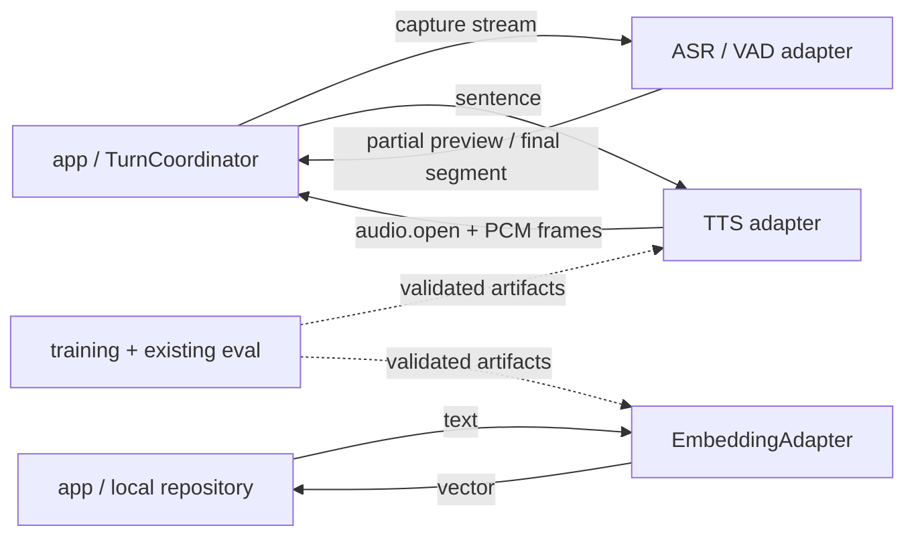

# `models/`：Python inference adapters 与训练实体

> 模型模块复用上游推理/训练库，不重写引擎。服务无 turn 或 memory 所有权；当前通信实现仍是 v1 scaffold，v2 是协调迁移目标。

## 边界

- ASR partial 不能触发 reply，final 才能。
- TTS stream 绑定 turn/sentence/stream；取消后停止产出，迟到帧仍由 app 丢弃。
- `EmbeddingAdapter` 只把文本转换为向量；不持有 proposal、memory 正文/index、persona 或检索决策。
- provider 先 warmup/readiness；activate 由 app/infra 原子完成。
- 模型、Runtime、sample 各自服从上游许可；应用许可证不覆盖它们。

## provider 与产物

目标抽象：`AsrAdapter`、`TtsAdapter`、`EmbeddingAdapter`。manifest 固定 revision/checksum；推理服务只读已校验本地产物，不在活动 turn 中在线下载。

现有模型选型、官方标称与 2026-10-10 历史实测保留在 [research.md](../00-context/research.md) 与 [decisions.md](../00-context/decisions.md)，旧测量不是当前环境保证。

## 训练边界

- 声线与 persona 训练实体、checkpoint、评估脚本在 `models/`。
- job 生命周期、本地/SSH 执行、恢复与 promotion 编排在 `infra/`。
- 声线复用 [voice-clone.md](../04-tracks/voice-clone.md) 的 frozen gate；persona 复用 [persona.md](../04-tracks/persona.md) 的历史实验规格。

## 验收指针

- v2 handshake/frame/schema 与 [protocol.md](../01-architecture/protocol.md) 一致；迁移 app/models 同步完成。
- cancel、seq gap、duplicate、wrong direction、unknown stream 与 stale turn 有确定行为。
- ASR/TTS 失败遵循 [runtime.md](../01-architecture/runtime.md) 的用户可见降级。
- manifest checksum 失败不 ready、不 activate。
