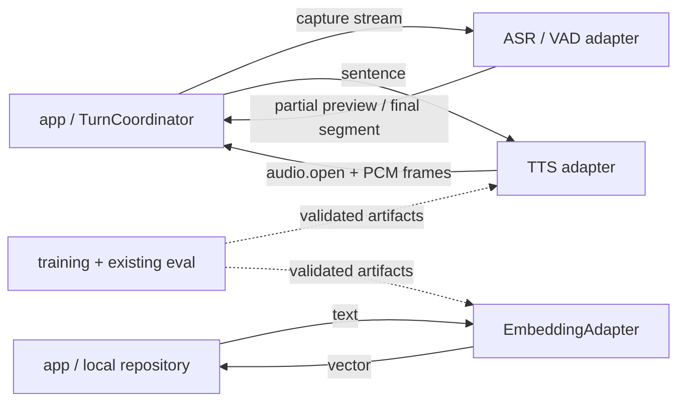

# `models/`：Python inference adapters 与训练实体

> 模型层提供语音识别、语音合成与文本向量能力，通过适配器复用成熟推理库，并与桌面业务和回合状态解耦。

## 边界

- ASR partial 不能触发 reply，final 才能。
- TTS stream 绑定 turn/sentence/stream；取消后停止产出，迟到帧仍由 app 丢弃。
- `EmbeddingAdapter` 只把文本转换为向量；不持有 proposal、memory 正文/index、persona 或检索决策。
- provider 先 warmup/readiness；activate 由 app/infra 原子完成。
- 模型、Runtime、sample 各自服从上游许可；应用许可证不覆盖它们。

## provider 与产物

适配器抽象：`AsrAdapter`、`TtsAdapter`、`EmbeddingAdapter`。manifest 固定 revision/checksum；推理服务只读已校验本地产物，不在活动 turn 中在线下载。

provider 同级可切换：每种能力经 registry 按 env 选实现——TTS `MOMO_TTS_PROVIDER`、ASR `MOMO_ASR_PROVIDER`、VAD `MOMO_VAD_PROVIDER`（本地 sherpa 与云端实现同级注册）。同一约定推广到 app 侧：LLM 经 `MOMO_LLM_ENDPOINT` 指向任意 OpenAI 兼容上游（本地 llama-server 或云端 API 等价），Live2D 模型/声线由 app 侧资源选择承担。用户可在设置项里于 momo 支持的 provider 列表中切换；自定义 provider 接入属长期方向，注册入口已预留。

模型选型、官方标称与带日期的实测记录集中在 [research.md](../00-context/research.md) 与 [decisions.md](../00-context/decisions.md)，作为复现与比较基线。

## 训练边界

- 声线与 persona 训练实体、checkpoint、评估脚本在 `models/`。
- job 生命周期、本地/SSH 执行、恢复与 promotion 编排在 `infra/`。
- 声线复用 [voice-clone.md](../04-tracks/voice-clone.md) 的 frozen gate；persona 复用 [persona.md](../04-tracks/persona.md) 的历史实验规格。

## 验收指针

- handshake/frame/schema 与 [通信协议](../01-architecture/protocol.md) 一致。
- cancel、seq gap、duplicate、wrong direction、unknown stream 与 stale turn 有确定行为。
- ASR/TTS 失败遵循 [runtime.md](../01-architecture/runtime.md) 的用户可见降级。
- manifest checksum 失败不 ready、不 activate。
