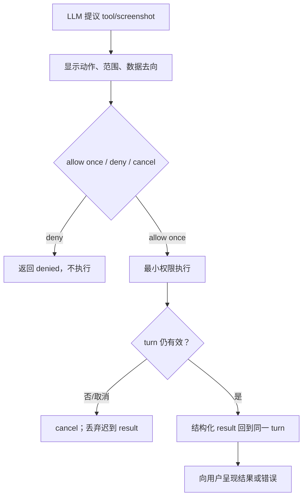
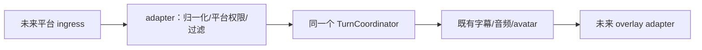

# 受控扩展

## 工具权限路径

## future streaming adapter

adapter 不拥有 turn、persona、memory、推理或 runtime 业务。

## 验收

- [ ] deny 不产生外部副作用；执行中 cancel 会丢弃迟到结果。
- [ ] screenshot 每次说明采集范围，不因曾允许一次而永久授权。
- [ ] streaming adapter 保持独立，只负责平台接入与输出 overlay。
