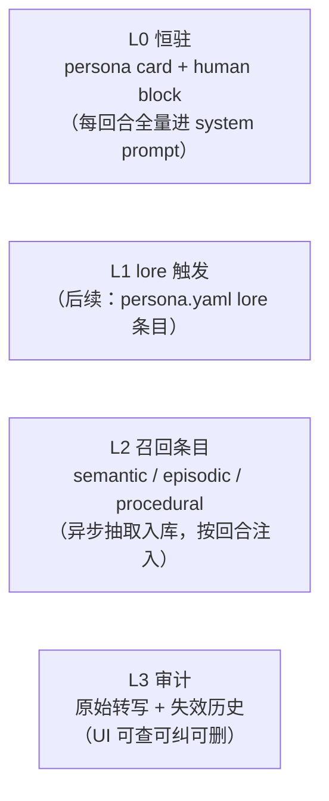

# 长期记忆（ADR-014 实装）

> momo 自主归纳、引用、遗忘；用户可审计、可纠正、可删除。

本页描述 ADR-014 的第一版实装：`app/` 侧本地长期记忆（L0 human block +
L2 召回条目 + 审计面）。分层全景与对标依据见
[00-context/soul-memory-notes.md](../00-context/soul-memory-notes.md)；
功能叙事见 [soul.md](./soul.md) / [stage.md](./stage.md)。

## 分层口径（本版落位）



本版实装 L0 的 human block 与 L2 记忆条目；L1 lore 与向量召回列为后续升级。

## 存储选型：sqlite（rusqlite bundled）

- **选 sqlite 而非 JSONL+内存索引**：失效语义（`superseded_by` / `deleted_at`）
  本质是关系查询——「全部 valid 条目」「kind 过滤分页」「supersede 链追溯」
  用 SQL 表达直接且正确性靠 schema 约束兜底；JSONL 每次启动全量回放、
  失效/软删要自己维护索引一致性，复杂度更高。
- **bundled feature**：编译期内置 sqlite amalgamation，无系统依赖、无
  openssl，跨 macOS/Linux/Windows 一致；部署仍为单二进制。
- **升级路径**：ADR-014 预留 sqlite-vec + BGE-M3；向量列可后续并入同一
  sqlite（schema 迁移 `memories` 加 embedding 或旁路 vec 表），不用换库。
- 路径固定 `{config_dir}/momo/memory.db`（与 `settings.json` 同目录先例），
  不新增 `MOMO_` env 键。

### Schema

```sql
memories(
  id TEXT PRIMARY KEY,              -- mem_<ulid>
  kind TEXT CHECK(kind IN ('semantic','episodic','procedural')),
  content TEXT NOT NULL,
  created_at TEXT NOT NULL,         -- UTC ISO8601
  updated_at TEXT NOT NULL,
  provenance_turn_id TEXT,          -- 来源回合 t_*；人工编辑 = 'manual'
  confidence REAL DEFAULT 1.0,
  superseded_by TEXT,               -- NULL = valid；替代条目 id 或 'void:<source>'
  deleted_at TEXT                   -- 用户删除（软删，审计面仍可见）
);
human_block(id INTEGER PRIMARY KEY CHECK(id = 1), content TEXT, updated_at TEXT);
```

失效语义（Zep 式）：`superseded_by`/`deleted_at` 任一非空即 invalid——
标失效不物理删，审计面保留「曾经记过什么」；召回与抽取上下文只见 valid
条目。用户删除（DELETE API）置 `deleted_at`，与 correction 的语义失效分开。

## 写路径：turn 后异步抽取（mem0 式，ADD-only + invalidate）

`turn.finished` 后不阻塞回合：`tokio::spawn` 跑抽取，失败只记 warn。

1. 组装本轮 transcript 片段（user_text + 已记账 assistant 文本）。
2. 用生效 `OpenAiCompatLlm`（设置面热改自动生效）发抽取请求：
   system 给出 JSON ops 契约 + 现有 valid 记忆摘要（供 invalidate 引 id），
   user 给本轮 transcript。要求只输出 JSON 数组：
   `[{op:add|invalidate, kind, content?, reason?, target_id?}]`。
3. 解析容错：截取首个 `[` 到末个 `]`，逐条 serde 解析，坏项跳过。
4. 应用：
   - `add` → 归一化内容哈希去重 + 字符 bigram Jaccard > 0.85 粗查跳过，
     再入库（provenance = 本回合 turn_id）。
   - `invalidate` → `target_id` 条目 `superseded_by = void:extract`；
     op 同时带 `content` 时先 add 新条再让旧条 `superseded_by` 指向新 id
     （纠正闭环：旧结论失效、新结论入库、链可追溯）。
5. 用户消息含纠正语义（不对/记错/忘掉/wrong/forget 等标记）时 prompt
   强调产出 invalidate——「纠正即失效」而非覆盖旧条。

## 读路径：关键词召回注入 system prompt

每回合 `llm_prompt` 在 persona 渲染结果后追加 `[长期记忆]` 段：

- human block 全文（用户画像，Letta core-block 式）；
- 近 N 条 valid semantic + procedural；
- 与本轮输入有 token 重叠的 valid episodic top-K（score=共享 token 数，
  同分取新）。

注入段有字符上限（`MEMORY_BLOCK_CHARS`），超出时先丢 episodic 再丢最旧
条目。store 不可用时返回空串，退化为纯 persona（L0-only，不崩）。

召回本期是关键词重叠；embedding 召回（sqlite-vec + `MOMO_EMBED_ENDPOINT`
链路）为后续升级——届时 `prompt_block` 换成向量 top-K，schema 与 API 不变。

## API（沿用 `/api/settings` 的 Bearer 鉴权与 `err_body` 风格）

| 路由 | 语义 |
|---|---|
| `GET /api/memories?kind=&limit=&offset=&all=` | 分页列表；`all=1` 含失效/已删（审计视图） |
| `PUT /api/memories/{id}` `{content}` | 编辑 = 旧条 `superseded_by` 指向新条，新条 `provenance_turn_id='manual'` |
| `DELETE /api/memories/{id}` | 软删（`deleted_at`） |
| `GET /api/memory/human-block` | `{content, updated_at}` |
| `PUT /api/memory/human-block` `{content}` | 全量改写，≤2000 字符（core block 上限） |

## UI：菜单「记忆」视图

同款面板语言（半透明圆角面板 + 粉色主按钮）：

- human block 编辑区（用户画像全文，保存即生效）；
- kind 过滤 + 记忆列表（kind 徽章、正文、来源 turn / manual、时间）；
- 每条「编辑」「删除」；编辑走 supersede，删除走软删——审计口径与
  「记忆提议、correction 与 CRUD」（workflows.md）一致。

## 验收

- [ ] 对话回合结束后记忆条目自动入库（不阻塞回复延迟）。
- [ ] 每条 memory 可见来源（turn_id / manual）；失效与删除历史可查。
- [ ] 用户纠正后相关记忆标 invalid，后续召回不再出现；新归纳不依赖旧结论。
- [ ] 编辑后召回用新正文；删除后召回不可见。
- [ ] human block 每回合进 system prompt，编辑后下一回合生效。
